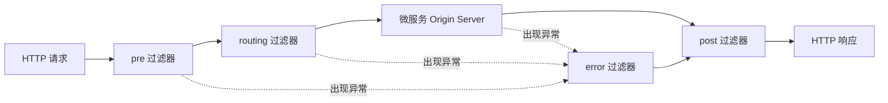

# 在网关层拦下每一个请求：Zuul 过滤器的四个方法与生命周期

路由配置好之后，请求已经能按服务名流进各个微服务了。但一个新的问题摆在面前：权限校验现在散落在每个微服务里，每个服务都要写一遍，啰嗦且难维护。既然所有请求都得先过网关，那就在网关这一层统一拦截、统一校验。承担这件事的正是 Zuul 的第二大核心功能：过滤器。

## 先给结论

- Zuul 有两大核心：路由转发与过滤器。路由负责把请求送到具体微服务，过滤器负责在网关层对请求拦截、校验、干预。
- 自定义过滤器四步走：写一个类继承 `ZuulFilter`，实现 `filterType`、`filterOrder`、`shouldFilter`、`run` 四个方法，再加 `@Component` 交给 Spring 容器。
- `filterType` 决定过滤器在哪一环执行，取值四种：`pre`、`routing`、`post`、`error`；做权限校验用 `pre`。
- `filterOrder` 决定同类过滤器的先后，数字越小优先级越高；`shouldFilter` 决定要不要执行；`run` 写核心业务逻辑。
- 生命周期主线：请求进来先走 pre，routing 负责转发到微服务，微服务返回后走 post；任何环节抛异常都会进入 error，error 处理完仍会走 post 收尾。
- 过滤器三大典型用途：统一异常处理、请求耗时统计、统一鉴权。

## 一、路由管去哪，过滤器管让不让去

把网关的职责拆开看会更清楚。路由转发回答的是「这个请求该去哪个服务」，属于纯搬运转发；过滤器回答的是「这个请求能不能去、路上要不要做点处理」，属于主动干预。

在这个系统里，权限校验原来是每个微服务各管一段：系统微服务写一遍，企业微服务再写一遍，逻辑雷同却各自维护。请求既然必须经过网关，把校验逻辑收敛到网关的过滤器里，微服务就只需要专心做业务。Zuul 内置了一组过滤器（如 `PreDecorationFilter`、`RibbonRoutingFilter`、`SendResponseFilter`、`SendErrorFilter`），分别负责路径装饰、负载路由、响应回写、错误回写；自定义过滤器要做的，就是往这条流水线上再插一个自己的环节。

## 二、自定义过滤器：四个方法各管一件事

在网关工程的 `filter` 包下新建一个类，继承 `ZuulFilter` 并实现四个抽象方法，课程现场写出的骨架如下（包名已改写为 `com.example`）：

```java
package com.example.gate.filter;

import com.netflix.zuul.ZuulFilter;
import com.netflix.zuul.exception.ZuulException;
import org.springframework.stereotype.Component;

/**
 * 自定义过滤器
 */
@Component
public class LoginFilter extends ZuulFilter {

    /**
     * String 类型的返回值, 定义过滤器类型
     *   pre     : 在执行路由请求之前执行
     *   routing : 在路由请求时调用
     *   post    : 在 routing 和 error 过滤器之后执行
     *   error   : 处理请求出现异常的时候执行
     */
    public String filterType() {
        return "pre";
    }

    /**
     * int 类型的返回值, 定义过滤器的优先级 : 数字越小, 优先级越高
     */
    public int filterOrder() {
        return 2;
    }

    /**
     * boolean 类型的返回值, 判断过滤器是否需要执行
     */
    public boolean shouldFilter() {
        //对某些请求过滤(不执行过滤器), 也可以按当前 URL 判断
        return true;
    }

    /**
     * run方法 : 过滤器中负责的具体业务逻辑
     */
    public Object run() throws ZuulException {
        System.out.println("执行了LoginFilter的run方法");
        return null;
    }
}
```

四个方法逐个拆开：

**第一，`filterType` 决定过滤器挂在流水线哪一环。** 返回 `pre` 表示请求在路由转发之前执行；`routing` 在路由请求真正发起时调用；`post` 在 routing 与 error 过滤器之后执行，也就是拿到微服务响应之后；`error` 在请求处理出现异常时执行。做权限校验的时机应当是请求进入业务之前，把不合法的请求挡在门外，所以这里返回 `pre`。

**第二，`filterOrder` 决定同类型过滤器谁先谁后。** pre 类型的过滤器可能不止一个，执行顺序由这个 int 值定：数字越小越先执行。两个 pre 过滤器想让 A 先跑，就给 A 返回 1、给 B 返回 2。

**第三，`shouldFilter` 是执行开关。** 返回 `true` 才会执行 `run`；返回 `false` 直接跳过。它最实际的用法是按请求 URL 判断：登录接口这类不需要鉴权的路径在这里返回 false，其余返回 true，过滤器就有了选择性。

**第四，`run` 是过滤器真正干活的地方。** 前三个方法都是「什么时候跑、要不要跑」的声明，业务逻辑全部写在 `run` 里。方法签名允许抛 `ZuulException`，返回值是 `Object`，通常返回 null 即可，返回 null 不代表中断请求。

写完启动网关，用 Postman 发一条请求，控制台应当打印出 run 方法里的那句话。课程现场第一次测试时控制台毫无动静，检查代码才想起来：类没交给 Spring 容器管理，`@Component` 忘了加。补上注解重启，每次请求网关都会执行一次 run。这是个很有代表性的坑：**过滤器类本身不进容器，Zuul 就根本不知道它存在。**

## 三、生命周期：pre、routing、post、error 怎么排

四个类型不是随意的标签，而是一条固定的流水线。Zuul 官网给出的请求生命周期图表达了完整次序：



正常流程里，请求依次穿过 pre、routing，到达微服务（Origin Server），微服务的响应再经 post 过滤器回写给调用方。异常流程是虚线：无论异常发生在 pre、routing 还是调用微服务的途中，都会立刻进入 error 过滤器，error 处理完成之后仍要走一遍 post，整个调用过程才算收尾。理解这条主线，就能回答「某个处理逻辑应该写在哪类过滤器里」的问题：进业务前的校验放 pre，对响应的加工放 post，兜底的异常封装放 error。

## 四、过滤器能干的三件典型事

**第一，统一异常处理。** 请求可能打到系统微服务、企业微服务或员工微服务，任何一个都可能抛异常。与其让每个服务各自封装错误响应，不如让异常统一流经网关的 error 过滤器，在这里做一致的错误包装，下游代码省掉大量重复的 try-catch 上报。

**第二，统计请求耗时。** pre 过滤器里记下请求开始的毫秒值，放进请求上下文；post 过滤器里取当前时间相减，一次调用经过网关的耗时就有数了。两个过滤器配合，即可得到每个微服务请求的真实耗时，实现简单且无侵入。

**第三，统一鉴权。** 这是使用最普遍的一件。权限校验从各微服务搬到网关的 pre 过滤器，请求还没进业务就完成身份判定。校验通过的继续往下路由，校验不过的直接在网关层回出错误状态码。下一课就是用它来落地 JWT 鉴权。

## 常见误区

- **写完类不加 `@Component`**：类编译不报错，启动也不报错，但 run 永远不执行。过滤器必须交给 Spring 容器，Zuul 才会把它纳入过滤链。
- **`shouldFilter` 返回 false 还纳闷逻辑不跑**：IDEA 生成的方法模板默认就是 `return false`，语义是「这个过滤器不执行」，照抄模板不修改，run 写得再对也白搭。
- **把校验逻辑写进 post 过滤器**：post 在微服务返回之后才执行，此时请求早已到达业务代码，校验形同虚设。鉴权属于「进门前拦截」，只能放 pre。
- **以为 `run` 返回 null 就是拦截**：返回 null 表示继续往后走；真正能中断路由的是对请求上下文设置 `setSendZuulResponse(false)`，这是下一课统一鉴权的核心动作。

## 面试可能被问到的问题

1. 面试官追问：「ZuulFilter 的四个方法各自承担什么职责？」
   答：`filterType` 声明过滤器类型（pre、routing、post、error），决定在生命周期哪一环执行；`filterOrder` 声明优先级，数字越小越先执行；`shouldFilter` 是开关，返回 false 则跳过；`run` 承载具体业务逻辑，前三个方法都是为它服务的。

2. 面试官追问：「请求在 Zuul 内部的完整流转顺序是什么？」
   答：请求先经过 pre 过滤器，routing 过滤器据此把请求转发到目标微服务，微服务响应后经 post 过滤器回写。处理过程中任何环节抛出异常都会进入 error 过滤器，error 执行完仍然会走 post，保证响应收尾。error 并不在主线的末尾，而是异常时的旁路。

3. 面试官追问：「两个 pre 过滤器都想先执行怎么办？」
   答：靠 `filterOrder` 控制，返回值小的先执行。例如登录校验过滤器设为 1，参数检查过滤器设为 2，则登录校验先跑。同类过滤器的排序完全由这个整数值决定，与类名、注册顺序无关。

4. 面试官追问：「过滤器在项目里能落地哪些功能？」
   答：典型的三类：error 过滤器统一封装异常响应；pre 与 post 配合记录起止时间完成耗时统计；pre 过滤器做统一鉴权，把原本散落在各微服务的权限校验收敛到网关层。此外限流、日志、灰度标记等横切能力也常在过滤器里实现。

5. 面试官追问：「自定义过滤器不生效，怎么排查？」
   答：按链路从注册到执行逐段查：类是否加了 `@Component` 进入容器；`shouldFilter` 是否返回 true；`filterType` 是否写对（鉴权写了 post 就永远拦不到）；`filterOrder` 是否被更早的过滤器短路；以及请求是否真的经过了网关而不是直连了微服务。

## 配套资料

- 网关过滤器成例（含 `filterType` 四类型注释与 JWT 校验的 `run` 实现，下一课详解）：
  `materials/code/02/day14 微服务网关与社保模块开发/day14/03-资料/网关相关资料/ihrm_gate/src/main/java/com/ihrm/gate/filter/LoginFilter.java`
  （文中骨架为课堂演示版，包名已改写为 `com.example`）
- 网关工程其余源码：`materials/code/02/day14 微服务网关与社保模块开发/day14/03-资料/网关相关资料/ihrm_gate/`
