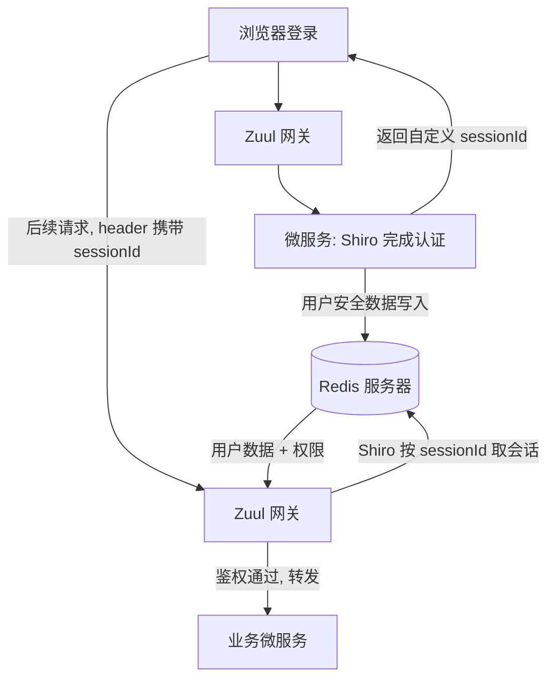

# 把 Shiro 会话鉴权搬进网关：会话统一存 Redis 的另一种解法

JWT 方案靠解析签名完成校验，无状态、不依赖存储；这个系统还落地过另一条路线：Shiro。它的思路完全不同，认证后的用户数据以会话形式统一放在 Redis 里，前端拿到的是自定义 sessionId。两种方案各有适用场景，这一课把 Shiro 鉴权从各个微服务收敛到网关，顺便把两条路线的取舍讲清楚。

## 先给结论

- Shiro 方案的会话模型：登录时由 Shiro 完成认证，用户安全数据（会话）统一存入 Redis，返回给前端的是自定义的 sessionId。
- sessionId 与 JWT 方案里的 token 地位相当：都放在请求头里携带，网关拿到后借助 Shiro 从 Redis 取回用户数据，完成认证与权限判断。
- 网关接入 Shiro 只做两件事：把 ShiroConfiguration 配置类放进网关工程；补齐依赖（common 模块与 shiro-redis 相关坐标）。
- 启动类要用 `scanBasePackages` 扫到 common 模块的包，Realm、自定义会话管理器这些组件才会被加载。
- 鉴权收敛到网关后，其他微服务可以不再各自做权限校验；JWT 与 Shiro 两套方案可以共存，注释掉其中一个过滤器就能切换。

## 一、与 JWT 方案的本质差异：无会话与有会话

两种方案处理的是同一个问题（请求进来判断你是谁、能干什么），但状态存放的位置不同。JWT 把用户信息编码进 token 本身，服务端不保存任何状态，网关用密钥验签即可；Shiro 把用户安全数据放在服务端的会话里，会话再统一托管到 Redis，前端只持有一个 sessionId 凭证。

整条链路可以这样走一遍：浏览器发起登录，请求经网关到微服务，Shiro 完成认证，登录成功立即把用户安全数据写入 Redis 服务器；微服务返回一个自定义的 sessionId 给前端。之后访问企业微服务等业务接口，浏览器在请求头里携带这个 sessionId（名字不同，位置与 JWT 方案的 token 一样），网关结合 Shiro 拿 sessionId 去 Redis 里取回用户数据，进而完成权限判断。



图里 Redis 居于正中：它把会话从单个服务的内存里解放出来，任何服务（包括网关）都能凭 sessionId 取到同一份用户数据，这正是分布式下会话共享的关键。

## 二、把 Shiro 配置装进网关

实现只涉及两个动作。**第一，配置迁移。** 之前微服务里写过的 ShiroConfiguration 整体拷进网关工程，内容不用重写。**第二，依赖补齐。** 网关的 pom 里补上 common 模块依赖（Realm、自定义会话管理器、工具类都在里面）与 shiro-redis 坐标，缺了哪个配置类里对应 import 就会飘红。

配置类的成例如下（包名已改写为 `com.example`）：

```java
@Configuration
public class ShiroConfiguration {

    //1.创建realm
    @Bean
    public IhrmRealm getRealm() {
        return new IhrmRealm();
    }

    //2.创建安全管理器
    @Bean
    public SecurityManager getSecurityManager(IhrmRealm realm) {
        DefaultWebSecurityManager securityManager = new DefaultWebSecurityManager();
        securityManager.setRealm(realm);
        //将自定义的会话管理器注册到安全管理器中
        securityManager.setSessionManager(sessionManager());
        //将自定义的redis缓存管理器注册到安全管理器中
        securityManager.setCacheManager(cacheManager());
        return securityManager;
    }

    //3.配置shiro的过滤器工厂
    @Bean
    public ShiroFilterFactoryBean shiroFilter(SecurityManager securityManager) {
        //1.创建过滤器工厂
        ShiroFilterFactoryBean filterFactory = new ShiroFilterFactoryBean();
        //2.设置安全管理器
        filterFactory.setSecurityManager(securityManager);
        //3.通用配置(跳转登录页面, 未授权跳转的页面)
        filterFactory.setLoginUrl("/autherror?code=1");//跳转url地址
        filterFactory.setUnauthorizedUrl("/autherror?code=2");//未授权的url
        //4.设置过滤器集合
        Map<String,String> filterMap = new LinkedHashMap<>();
        //anon -- 匿名访问
        filterMap.put("/sys/login","anon");
        filterMap.put("/autherror","anon");
        //authc -- 认证之后访问(登录)
        filterMap.put("/**","authc");
        //perms -- 具有某种权限(使用注解配置授权)
        filterFactory.setFilterChainDefinitionMap(filterMap);
        return filterFactory;
    }

    @Value("${spring.redis.host}")
    private String host;
    @Value("${spring.redis.port}")
    private int port;

    /**
     * 1.redis的控制器, 操作redis
     */
    public RedisManager redisManager() {
        RedisManager redisManager = new RedisManager();
        redisManager.setHost(host);
        redisManager.setPort(port);
        return redisManager;
    }

    /**
     * 2.sessionDao
     */
    public RedisSessionDAO redisSessionDAO() {
        RedisSessionDAO sessionDAO = new RedisSessionDAO();
        sessionDAO.setRedisManager(redisManager());
        return sessionDAO;
    }

    /**
     * 3.会话管理器
     */
    public DefaultWebSessionManager sessionManager() {
        CustomSessionManager sessionManager = new CustomSessionManager();
        sessionManager.setSessionIdUrlRewritingEnabled(false);
        sessionManager.setSessionDAO(redisSessionDAO());
        return sessionManager;
    }

    /**
     * 4.缓存管理器
     */
    public RedisCacheManager cacheManager() {
        RedisCacheManager redisCacheManager = new RedisCacheManager();
        redisCacheManager.setRedisManager(redisManager());
        return redisCacheManager;
    }
}
```

这份配置里最值得关注的是过滤器链与 Redis 三件套的配合：

**第一，过滤器链决定哪些路径放行。** `/sys/login` 与 `/autherror` 配 anon 匿名访问，登录接口必须敞开，否则用户无法认证；其余 `/**` 全部 authc，要求认证之后才能访问。网关层一旦生效，所有进入的请求都要先过这道链。

**第二，Redis 三件套让会话脱离本机。** `RedisManager` 负责 Redis 连接；`RedisSessionDAO` 把会话的存取落到 Redis；`CustomSessionManager` 作为自定义会话管理器接管会话生命周期并挂上 DAO。三者最终都注册进 `DefaultWebSecurityManager`，Shiro 每次查会话都是查 Redis，不再依赖网关自身内存。

配置类里引用的 `IhrmRealm`、`CustomSessionManager` 来自 common 模块，所以启动类要把扫描范围放宽到公共包（原成例是 `scanBasePackages="com.ihrm"`，改写后为 `com.example`）：

```java
@SpringBootApplication(scanBasePackages = "com.example")
@EnableZuulProxy          //开启zuul网关功能
@EnableDiscoveryClient    //开启服务发现功能
public class GateApplication {

    public static void main(String[] args) {
        SpringApplication.run(GateApplication.class);
    }
}
```

测试时还有一个细节：把上一课 JWT 方案的 LoginFilter 上的 `@Component` 注释掉，避免两套鉴权同时触发干扰判断。两套机制本身可以同时存在，这里注释只是为了演示路径更清晰。

## 三、实测：直连有数据，走网关提示未登录

启动网关后照例两步验证：

```bash
# 1. 直连企业微服务 9001, 服务内部没有鉴权拦截, 正常返回数据
curl http://127.0.0.1:9001/company

# 2. 走网关 9090, 请求头没带 sessionId, Shiro 的 authc 过滤器拦下, 提示您还未登录
curl http://127.0.0.1:9090/company
```

直连畅通、走网关被拦，说明权限校验已经在网关层由 Shiro 完成了。此时登录过的用户在请求头里带上 sessionId，Shiro 从 Redis 取回会话，请求即可继续转发。其他微服务从此不必再各自写权限校验，网关统一把关。

## 四、选型：什么时候用 JWT，什么时候用 Shiro

两条路线摆在一起比，差异一目了然：

| 维度 | JWT 方案 | Shiro 方案 |
|---|---|---|
| 状态 | 无状态，信息在 token 里 | 有状态，会话统一在 Redis |
| 网关校验 | 验签即可，不查存储 | 按 sessionId 取会话，依赖 Redis |
| 凭证 | token 字符串（Authorization 头） | 自定义 sessionId（同样放头里） |
| 权限模型 | 自行解析 claims 判断 | filterChain 与注解授权现成 |
| 吊销登录 | 天然困难，要额外黑名单 | 删 Redis 会话即失效 |

**第一，看重简单与横向扩展，选 JWT。** 无状态意味着服务端不存任何东西，微服务伸缩、多实例部署都不用考虑会话同步，网关一层验签就完成大头，代价是登出与强制下线需要额外设计。

**第二，看重成熟的权限体系，选 Shiro。** Shiro 提供完整的认证、授权、会话与缓存框架，注解授权、过滤器链开箱即用；配合 Redis 统一存会话，分布式下也能共享登录态，代价是多一个强依赖：Redis 不可用，整个鉴权链路瘫痪。

项目里两套都实现了，切换成本只是一行注解。理解「状态存在哪、由谁校验」这个分野，比记住结论更重要。

## 常见误区

- **两套鉴权同时开着不做隔离**：JWT 过滤器与 Shiro 过滤器都在 pre 层活动时，行为叠加难以排查。演示或切换方案时先注释其中一个，确认另一条链路的行为。
- **Redis 没通就认为 Shiro 配错了**：会话写入失败时，表现往往是每次请求都被要求重新登录。先确认 `spring.redis.host`、`port` 可达，再怀疑配置类。
- **三件套没有全部注册进安全管理器**：只配 `RedisSessionDAO` 而没把自定义会话管理器 `setSessionManager` 进 `DefaultWebSecurityManager`，会话仍走本地内存，Redis 里永远是空的。
- **启动类扫描范围不含 common 包**：`scanBasePackages` 漏掉公共模块的包，Realm、`CustomSessionManager` 这些 Bean 无法创建，启动直接报缺 Bean 的错。

## 面试可能被问到的问题

1. 面试官追问：「网关层接入 Shiro 需要做哪几件事？」
   答：配置与依赖两件。把微服务里已有的 ShiroConfiguration 拷进网关工程，包含 Realm、安全管理器、过滤器工厂与 Redis 会话三件套；pom 补上 common 模块和 shiro-redis 依赖；启动类用 scanBasePackages 扫到公共包让相关 Bean 生效。本质上就是把原本散在微服务的鉴权整体搬到网关。

2. 面试官追问：「Shiro 方案里前端携带的是什么，和 JWT 的 token 有什么区别？」
   答：携带的是自定义 sessionId，位置与 JWT 的 token 一样放在请求头。区别在于 sessionId 只是一个无意义的凭证，用户数据存在服务端 Redis 的会话里；JWT 的 token 本身编码了用户信息与签名，服务端不保存状态，验签即可信任内容。

3. 面试官追问：「会话统一到 Redis 靠哪几个组件协作？」
   答：RedisManager 负责与 Redis 的连接；RedisSessionDAO 实现会话的持久化存取，内部持有 RedisManager；自定义 SessionManager 挂上该 DAO 接管会话生命周期；最后这三者经安全管理器的 setSessionManager 与 setCacheManager 注册进 Shiro 体系，会话与权限缓存就都落在 Redis 了。

4. 面试官追问：「网关统一鉴权之后，微服务里还要不要写校验代码？」
   答：身份认证类的校验可以全部去掉，请求能到微服务就代表已经通过网关把关。但建议保留细粒度的授权判断（比如接口级别的权限注解），防止未来出现绕过网关的内网直连调用，也便于服务独立部署时仍然自治。

5. 面试官追问：「JWT 和 Shiro 两种网关鉴权方案怎么选？」
   答：看状态放在哪更划算。JWT 无状态，水平扩展与跨服务透传最省心，适合前后端分离且以认证为主的系统；Shiro 提供完整的认证授权与会话框架，权限体系复杂、需要强制下线与在线会话管理时更顺手，但要接受对 Redis 的强依赖。两者在网关层都以过滤器形式落地，切换成本不高。

## 配套资料

- 网关 Shiro 配置成例（文中 ShiroConfiguration 的完整出处，含过滤器链与 Redis 三件套）：
  `materials/code/02/day14 微服务网关与社保模块开发/day14/03-资料/网关相关资料/ihrm_gate/src/main/java/com/ihrm/gate/ShiroConfiguration.java`
- 网关启动类（`scanBasePackages` 扫描公共包的写法）：
  `materials/code/02/day14 微服务网关与社保模块开发/day14/03-资料/网关相关资料/ihrm_gate/src/main/java/com/ihrm/gate/GateApplication.java`
- 社保模块同款配置可对照阅读：
  `materials/code/02/day14 微服务网关与社保模块开发/day14/03-资料/社保模块相关资料/ihrm_social_securitys/src/main/java/com/ihrm/social/ShiroConfiguration.java`
  （文中包名已统一改写为 `com.example`）
