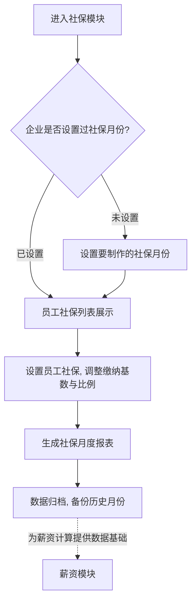
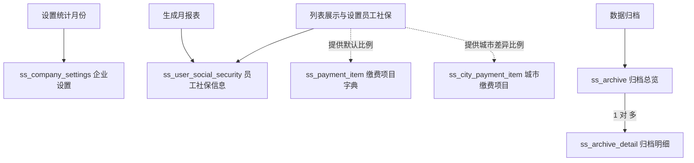

# 社保模块开篇：五险一金业务流程、六张表设计与社保微服务环境搭建

员工入职要办社保，离职要停保，每月企业还要按人按基数算钱、出报表。听起来只是「交钱」，真落到系统里，涉及参保城市、缴纳比例、统计周期、历史归档一整条链路。这一课把社保模块从需求讲到落库：业务流程拆成哪几步、六张 `ss_` 开头的表各管什么、一个新的微服务工程怎么搭起来并接到网关上。

## 先给结论

- 社保模块的业务主线只有四步：设置统计月份、展示员工参保列表、设置每个员工的社保、生成月度报表并归档。
- 表设计上，两张字典表（缴费项目、城市缴费项目）提供默认比例，一张企业设置表记录统计周期，一张员工社保表存最终参保数据，两张归档表按「总览加明细」组织历史数据。
- 新模块 `social-security-service` 的搭建与其他微服务同构：pom 依赖、启动类、`application.yml`、生成的 domain 与 dao 代码，重点是 `@EntityScan` 扫描公共模块里的实体包。
- 环境搭好后先写一个 `GET /social_securitys/settings` 验证链路：登录拿 token，直连 9004 端口测试，再在网关补上 `/social_securitys/**` 路由走 9090。

## 一、需求与业务流程：一条主线四个环节

社保俗称五险一金，这个模块要做的就是收集每个员工五险一金的缴纳情况，并做出相应的数据统计。它不是孤立的 CRUD，入口和出口都有讲究，整条流程如下：



图的入口和出口都有讲究。**入口是设置统计月份。** 进入社保模块做的第一件事是确定「这一期做哪个月」：设置成 9 月，后面展示的就是 9 月所有员工该缴纳的社保情况。这是 SaaS 多租户系统特有的设计，每家企业的统计周期各自独立，所以进模块先判断设置过没有。

**主体是列表展示与员工社保设置。** 列表页展示每个员工的缴纳比例与基数。比例会因城市而不同、因企业而不同：国家规定公积金在 5% 到 12% 区间内浮动，效益好的企业可以在上限基础上再提高；固定月份（如 4 月、7 月）社保基数调整后，比例也可能跟着变。所以这部分必须支持灵活设置，不能写死。

**出口是月报表与数据归档。** 列表核对无误后生成月度报表，详细记录每个员工的社保缴纳数额，并汇总企业当月的社保总支出。月份翻篇之后，上一个月的数据做归档备份，供日后校验与统计使用。归档产出的数据同时为员工薪资计算打下基础，这是社保模块与后续薪资模块的衔接点。

## 二、表结构：六张 ss_ 表各管一段

表设计直接对着上面的流程长出来，全部以 `ss_` 前缀命名。先看两张「字典性质」的表，它们负责提供默认值：

```sql
-- 缴费项目字典表: 六个项目各带一套默认比例
CREATE TABLE `ss_payment_item` (
  `id` varchar(40) NOT NULL COMMENT 'id',
  `name` varchar(255) NOT NULL COMMENT '缴费项目名称',
  `switch_company` tinyint(1) NOT NULL DEFAULT '0' COMMENT '企业是否缴纳开关, 0禁用1启用',
  `scale_company` decimal(6,2) NOT NULL DEFAULT '0.00' COMMENT '企业比例',
  `switch_personal` tinyint(1) NOT NULL DEFAULT '0' COMMENT '个人是否缴纳开关, 0禁用1启用',
  `scale_personal` decimal(6,2) NOT NULL DEFAULT '0.00' COMMENT '个人比例',
  PRIMARY KEY (`id`)
) COMMENT='社保-缴费项目';
-- 预置数据: 养老 19/8, 医疗 10/2, 失业 0.8/0.2, 工伤 0.2/-, 生育 0.8/-, 大病 0/0

-- 城市与缴费项目关联表: 同一项目在不同城市比例不同, 城市+项目组合唯一
CREATE TABLE `ss_city_payment_item` (
  `id` varchar(40) NOT NULL,
  `city_id` varchar(40) NOT NULL COMMENT '城市id',
  `payment_item_id` varchar(40) NOT NULL COMMENT '缴费项目id',
  `switch_company` tinyint(1) NOT NULL COMMENT '企业是否缴纳开关',
  `scale_company` decimal(6,2) DEFAULT NULL COMMENT '企业比例',
  `switch_personal` tinyint(1) NOT NULL COMMENT '个人是否缴纳开关',
  `scale_personal` decimal(6,2) DEFAULT NULL COMMENT '个人比例',
  `name` varchar(40) DEFAULT NULL COMMENT '缴费项目名称',
  PRIMARY KEY (`id`),
  UNIQUE KEY `UK_CID_PIID` (`city_id`,`payment_item_id`) COMMENT '城市id与缴费项目id组合唯一'
) COMMENT='社保-城市与缴费项目关联表';
```

字典表只是依据，不等于企业最终执行的比例。企业会参照默认值灵活调整，比如养老在字典里是 19%，有的城市登记为 16%，具体企业还可以再调。真正落到每个员工头上的参保数据在 `ss_user_social_security`：

```sql
CREATE TABLE `ss_user_social_security` (
  `user_id` varchar(40) NOT NULL COMMENT '用户id',
  `enterprises_pay_social_security_this_month` tinyint(1) NOT NULL DEFAULT '0'
    COMMENT '本月是否缴纳社保 0为不缴纳 1为缴纳',
  `participating_in_the_city_id` varchar(40) NOT NULL COMMENT '参保城市id',
  `social_security_type` tinyint(1) NOT NULL DEFAULT '2' COMMENT '参保类型 1首次开户 2非首次开户',
  `household_registration_type` tinyint(1) NOT NULL
    COMMENT '户籍类型 1本市城镇 2本市农村 3外埠城镇 4外埠农村',
  `social_security_base` int(8) NOT NULL COMMENT '社保基数',
  `provident_fund_city_id` varchar(40) NOT NULL COMMENT '公积金城市id',
  `provident_fund_base` int(8) NOT NULL COMMENT '公积金基数',
  `enterprise_proportion` decimal(6,2) NOT NULL COMMENT '公积金企业比例',
  `personal_proportion` decimal(6,2) NOT NULL COMMENT '公积金个人比例',
  `enterprise_provident_fund_payment` decimal(8,2) NOT NULL COMMENT '公积金企业缴纳数额',
  `personal_provident_fund_payment` decimal(8,2) NOT NULL COMMENT '公积金个人缴纳数额',
  PRIMARY KEY (`user_id`)
) COMMENT='社保-用户社保信息表';
```

注意几个设计细节：主键直接用 `user_id`，一人一条；参保城市与公积金城市分开存，两者可以不同；户籍类型影响参保政策；基数、比例、缴纳数额同表存放，数额由比例乘基数算出后落库。

剩下三张表管「设置」与「归档」。企业设置表极简，`company_id` 做主键，`is_settings` 标记是否设置过，`data_month` 记录当前统计月份。归档是两张表配合：`ss_archive` 存企业某月的总览（本月多少新增参保、多少退出、企业缴纳与个人缴纳合计），`ss_archive_detail` 存该月每个员工的明细，一张总览对多条明细，一对多关系。六张表与业务环节的对应关系如下：



读图的方法是从上往下对照四个业务环节：前两个环节各配一张主表，中间两张字典表在设置时提供默认值，归档环节由总览加明细两张表承接。

## 三、搭建社保微服务环境

业务和表都清楚了，开始搭新模块 `social-security-service`。搭法与之前的微服务完全同构，差别只在业务代码。

**第一，建模块引依赖。** 在父工程 `hrm-parent` 下新建 module，pom 里除了 Boot 基础依赖，重点是数据访问与微服务通信两组：

```xml
<dependencies>
    <dependency>
        <groupId>org.springframework.boot</groupId>
        <artifactId>spring-boot-starter-data-jpa</artifactId>
    </dependency>
    <dependency>
        <groupId>mysql</groupId>
        <artifactId>mysql-connector-java</artifactId>
    </dependency>
    <!-- 公共模块: 实体、Result/PageResult、IdWorker、JwtUtils 等都在里面 -->
    <dependency>
        <groupId>com.example</groupId>
        <artifactId>hrm_common</artifactId>
        <version>1.0-SNAPSHOT</version>
    </dependency>
    <dependency>
        <groupId>com.example</groupId>
        <artifactId>hrm_common_model</artifactId>
        <version>1.0-SNAPSHOT</version>
    </dependency>
    <!-- 注册中心客户端 + Feign 远程调用 -->
    <dependency>
        <groupId>org.springframework.cloud</groupId>
        <artifactId>spring-cloud-starter-netflix-eureka-client</artifactId>
    </dependency>
    <dependency>
        <groupId>org.springframework.cloud</groupId>
        <artifactId>spring-cloud-starter-openfeign</artifactId>
    </dependency>
</dependencies>
```

实体类不在本模块而在公共模块 `hrm_common_model` 里，这是后面启动类要特别处理的一点。

**第二，写启动类。** 相比普通 Boot 工程，多了实体扫描和两个服务注册相关的开关：

```java
package com.example.social;

@SpringBootApplication(scanBasePackages = "com.example")
//扫描公共模块中的实体类, 否则 JPA 找不到 domain
@EntityScan(value = "com.example.domain")
@EnableEurekaClient
@EnableDiscoveryClient
@EnableFeignClients
public class SocialSecuritysApplication {

    public static void main(String[] args) {
        SpringApplication.run(SocialSecuritysApplication.class, args);
    }

    @Bean
    public IdWorker idWorker() { return new IdWorker(); }

    //解决 JPA 查询后对象脱管、页面渲染时 no session 的问题
    @Bean
    public OpenEntityManagerInViewFilter openEntityManagerInViewFilter() {
        return new OpenEntityManagerInViewFilter();
    }
}
```

`@EntityScan` 是这个启动类最关键的一行：实体类按数据库表生成后统一放在公共模块的 `com.example.domain` 包下，不加这一行，JPA 只扫启动类所在包，所有实体注解都会被无视。

**第三，配置文件。** 端口 `9004`，服务名与数据库对应上：

```yaml
server:
  port: 9004
spring:
  application:
    name: social-security-service
  datasource:
    driver-class-name: com.mysql.jdbc.Driver
    url: jdbc:mysql://localhost:3306/ihrm?useUnicode=true&characterEncoding=utf8
    username: root
    password: 111111
  jpa:
    database: MySQL
    show-sql: true
    open-in-view: true
eureka:
  client:
    service-url:
      defaultZone: http://127.0.0.1:6868/eureka/
```

**第四，导入生成的代码。** 之前课程讲过代码生成器，六张表对应的实体、dao 接口、基础 service 都可以由工具生成后拷进工程。生成结果做一次裁剪：六个 dao 保留，service 只留 `CompanySettingsService`、`UserSocialService`、`PaymentItemService`、`ArchiveService` 四个够用的，把生成模板里多余的方法清空。Shiro 配置类也一并拷入，但本模块不做权限校验，权限已经收敛到网关统一处理。

## 四、首个接口与联调验证

环境齐了先写一个最小接口验证整条链路。业务选「查询企业是否设置过社保」，对应企业设置表的按主键查询：

```java
@RestController
@RequestMapping("/social_securitys")
public class SocialSecurityController extends BaseController {

    @Autowired
    private CompanySettingsService companySettingsService;

    /**
     * 查询企业是否设置过社保
     */
    @RequestMapping(value = "/settings", method = RequestMethod.GET)
    public Result settings() {
        CompanySettings cs = companySettingsService.findById(companyId);
        return new Result(ResultCode.SUCCESS, cs);
    }
}
```

这里的 `companyId` 来自父类 `BaseController`：它从请求头解析出当前登录用户所属的企业 id，子类直接取用，SaaS 多租户的数据隔离就靠它兜底。Service 层是标准的按 id 查询，借助 JPA 返回的 `Optional` 做一次判空：

```java
@Service
public class CompanySettingsService {
    @Autowired
    private CompanySettingsDao companySettingsDao;

    //根据企业id查询
    public CompanySettings findById(String companyId) {
        Optional<CompanySettings> optional = companySettingsDao.findById(companyId);
        return optional.isPresent() ? optional.get() : null;
    }
}
```

验证分两步走。先用 Postman 直连新服务：请求网关登录接口拿 token（POST `http://localhost:9090/sys/login`，body 传 `mobile` 与 `password`），再 GET `http://localhost:9004/social_securitys/settings`，请求头带上 `Authorization: Bearer <token>`，能返回企业设置数据说明模块本身通了。第二步把流量切到网关：网关配置里补上 `/social_securitys/**` 到 `social-security-service` 的路由（含敏感头放行两行配置），重启网关后同样的请求改走 9090 端口，返回结果与直连一致，新模块才算真正接入系统。

## 常见误区

- **漏写 `@EntityScan`**：实体类放在公共模块包下时，启动类不加这行扫描声明，JPA 启动即报「Not a managed type」，这是公共实体外加模块结构下最常见的启动失败。
- **字典表比例当成最终比例**：`ss_payment_item` 里的比例只是默认值，城市关联表和企业设置都会覆盖它，计算缴纳额必须以员工社保表里落定的基数与比例为准。
- **归档表和明细表混为一谈**：总览表按「企业加月份」一条记录，明细表按「人」一条记录，靠 `archive_id` 关联；把明细字段塞进总览表，月份一多查询和备份都会失衡。
- **直连测试通过就以为完事**：新模块必须再补网关路由并用 9090 端口复测一遍，敏感头放行配置少了任何一个，直连正常、走网关却 401 的问题会拖到联调后期才暴露。

## 面试可能被问到的问题

1. 面试官追问：「社保模块为什么要在入口做一次『设置统计月份』？」
   答：SaaS 系统里每家企业独立核算，各自的统计周期不同。企业设置表以企业 id 为主键记录当前统计月份与设置状态，进入模块先查这张表，设置过直接进列表，没设置先引导补设置，保证后续报表与归档都有明确的期间。

2. 面试官追问：「缴费项目的比例为什么要拆成字典表和城市关联表两张？」
   答：字典表提供国家或系统层面的默认比例，城市关联表处理地域差异，同一项目在北京和上海的缴纳比例不同，且城市加项目组合有唯一约束。两层结构让默认值与覆盖值分离，企业再在员工维度最终确定，逐层收窄。

3. 面试官追问：「员工社保表的主键为什么直接用 user_id 而不是单独的 id？」
   答：一个员工在同一时刻只有一条生效的参保记录，参保信息与用户是一对一关系，用 user_id 做主键天然防重，保存即更新，也方便与用户表直接关联查询。

4. 面试官追问：「归档为什么拆成总览加明细两张表？」
   答：归档数据要长期保留且按月追溯，总览表支持快速查询某企业某月的整体支出，明细表保留每个员工的计算依据供审计核对。一对多结构既避免总览表字段爆炸，也让明细可以独立分表或转存。

5. 面试官追问：「新微服务的启动类比普通 Boot 工程多了哪些注解，各起什么作用？」
   答：`@EntityScan` 指定实体类扫描路径，覆盖公共模块里的 domain 包；`@EnableEurekaClient` 与 `@EnableDiscoveryClient` 注册服务到注册中心，供网关按服务名路由；`@EnableFeignClients` 开启 Feign 客户端扫描，让本模块能声明式调用其他微服务。

6. 面试官追问：「`OpenEntityManagerInViewFilter` 解决什么问题？」
   答：JPA 的懒加载依赖事务内的 EntityManager，请求处理完毕后事务关闭，Controller 返回的对象再被序列化时会抛 no session 异常。这个过滤器把 EntityManager 的生命周期拉长到整个请求视图渲染结束，属于服务端展示层的常见补救手段。

## 配套资料

- 社保微服务完整工程：`materials/code/02/day14 微服务网关与社保模块开发/day14/03-资料/社保模块相关资料/ihrm_social_securitys/`（含 `pom.xml`、`SocialSecuritysApplication.java`、`SocialSecurityController.java`、`application.yml`，文中包名与服务名已改为中性命名）
- 代码生成器产出的基础代码：同目录 `社保资源/基本代码/`（`domain/CompanySettings.java`、`dao/CompanySettingsDao.java` 等）
- 六张社保表结构与预置数据：`materials/code/02/day14 微服务网关与社保模块开发/day14/ihrm.sql`（检索 `ss_` 前缀建表语句）
