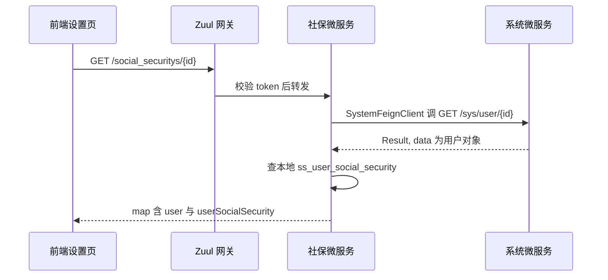

# 设置员工社保：参保信息录入、跨服务取数与缴纳金额的计算落地

列表页只能看，真正办社保要点进单个员工填写参保信息：在哪个城市参保、基数多少、公积金比例多少。这个详情页一次要动三份数据：用户基本信息在系统微服务里，参保项目的城市差异在关联表里，员工自己的参保记录在社保表里。这一课跟着页面把它需要的三个接口写完，顺便把「缴纳金额到底怎么算」落到表字段上。

## 先给结论

- 详情页数据分两块取：用户信息走 Feign 调系统微服务，参保信息查本地社保表，Controller 里用一个 Map 组装成 `{user, userSocialSecurity}` 返回。
- 切换参保城市时调 `GET /payment_item/{id}`，从城市缴费项目关联表查出该城市每个险种的企业与个人比例。
- 保存与更新共用 `PUT /social_securitys/{id}`，员工社保表以 `user_id` 做主键，JPA 的 `save` 天然是「不存在插入、存在更新」。
- 缴纳金额的计算规则：各项缴纳额等于基数乘以对应比例，企业部分与个人部分分开求和；公积金基数与比例独立于社保，单独一组字段存放。

## 一、详情页加载：两份数据拼一个响应

点击列表中的员工进入设置页，页面下半部分是参保表单，上半部分要回显员工的入职时间、身份证号、手机号这些用户属性。抓包能看到页面发出的请求是 `GET /social_securitys/{id}`，一个接口要同时喂饱两块区域：

```java
/**
 * 根据用户id查询用户的社保数据
 */
@RequestMapping(value = "/{id}", method = RequestMethod.GET)
public Result findById(@PathVariable String id) {
    Map map = new HashMap();
    //1.根据用户id查询用户数据, 用户在系统微服务里
    Object obj = systemFeignClient.findById(id).getData();
    map.put("user", obj);
    //2.根据用户id查询社保数据
    UserSocialSecurity uss = userSocialService.findById(id);
    map.put("userSocialSecurity", uss);
    return new Result(ResultCode.SUCCESS, map);
}
```

用户数据不在本模块，通过 Feign 声明式客户端向系统微服务发起调用：

```java
@FeignClient("system-service")
public interface SystemFeignClient {

    @RequestMapping(value = "/sys/user/{id}", method = RequestMethod.GET)
    Result findById(@PathVariable(value = "id") String id);
}
```

接口上 `@FeignClient` 标注目标服务名，方法签名对齐目标服务的 `GET /sys/user/{id}`。调用返回的是统一的 `Result` 包装，真正的用户对象在 `getData()` 里，Controller 里 `.getData()` 之后不再强转，放进 Map 交给 JSON 序列化。本地这半边按主键查询，同样要过一次判空：

```java
//根据id查询
public UserSocialSecurity findById(String id) {
    Optional<UserSocialSecurity> optional = userSocialSecurityDao.findById(id);
    return optional.isPresent() ? optional.get() : null;
}
```

员工从没办过社保时，`userSocialSecurity` 为 null，前端据此渲染空表单等待录入；办过则回显原值，页面走编辑模式。整条加载链路如下：



图里社保服务同时扮演两个角色：对网关是被调用方，对系统微服务是调用方，Feign 把后一层调用写成了本地方法的样子。

## 二、参保城市联动：一个城市一套险种比例

表单里选择参保城市后，险种列表要跟着变：有的城市四险一金，有的城市五险一金，同名险种的比例也各不相同。支撑它的是城市缴费项目关联表，接口按城市 id 查询：

```java
/**
 * 根据城市id查询参保城市的参保项目
 */
@RequestMapping(value = "/payment_item/{id}", method = RequestMethod.GET)
public Result findPaymentItem(@PathVariable String id) {
    List<CityPaymentItem> list = paymentItemService.findAllByCityId(id);
    return new Result(ResultCode.SUCCESS, list);
}
```

dao 层是一个标准的派生查询方法名，一个城市对应多条缴费项目记录，返回值自然是 List：

```java
public interface CityPaymentItemDao
        extends JpaRepository<CityPaymentItem, String>,
                JpaSpecificationExecutor<CityPaymentItem> {
    List<CityPaymentItem> findAllByCityId(String id);
}
```

查回的每条记录带四个关键字段：`switchCompany` 与 `scaleCompany` 决定企业缴不缴、缴多少，`switchPersonal` 与 `scalePersonal` 决定个人缴不缴、缴多少。工伤、生育这类险种个人比例在多数城市就是空或零，开关字段直接把「个人不缴」表达出来，前端渲染表单时按开关禁用输入框。

## 三、保存与更新：一条主键撑起的双语义

表单填完点保存，抓包发现请求还是 `{id}` 这个路径，只是方法换成了 PUT。Controller 与 service 的写法都极简：

```java
/**
 * 保存或更新用户社保
 */
@RequestMapping(value = "/{id}", method = RequestMethod.PUT)
public Result saveUserSocialSecurity(@RequestBody UserSocialSecurity uss) {
    userSocialService.save(uss);
    return new Result(ResultCode.SUCCESS);
}

//service
public void save(UserSocialSecurity uss) {
    userSocialSecurityDao.save(uss);
}
```

同一个方法覆盖两种场景的秘密在表设计上：`ss_user_social_security` 的主键就是 `user_id`，JPA 的 `save` 按主键判断，库里有这条记录就发 update，没有就发 insert。员工第一次参保是插入，调整基数或比例是更新，代码层面不需要写任何分支。用户表里已有企业归属，参保表不必冗余 `company_id`，按 `user_id` 关联即可追溯。

## 四、基数与比例：缴纳金额的计算规则

录入的核心数据是基数，计算的输入输出都在员工社保表里。规则可以概括成两条：

**社保部分按城市比例计算。** 基数 `social_security_base` 乘以参保城市各险种的比例，企业与个人分开累加。以预置数据里某城市的比例为例：养老企业 16%、个人 8%，医疗企业 10%、个人 5%，失业企业 0.8%、个人 0.2%，工伤企业 0.4%、个人不缴，生育企业 0.8%、个人不缴。假设员工社保基数 6000 元，企业月缴 `6000 × (16% + 10% + 0.8% + 0.4% + 0.8%) = 1680` 元，个人月缴 `6000 × (8% + 5% + 0.2%) = 792` 元。

**公积金独立成组。** 公积金城市、基数 `provident_fund_base` 与比例 `enterpriseProportion`、`personalProportion` 都单独存列，因为公积金比例是企业与员工在政策区间内协商确定的，不走城市默认值。基数 6000、企业个人各 12% 时，两侧各缴 720 元，缴纳数额分别落在 `enterpriseProvidentFundPayment` 与 `personalProvidentFundPayment` 两个列上，计算结果落库而不是每次现算。

到月底生成月报表时，归档明细会把企业部分与个人部分分别汇总，归档总览再累加全企业：

```java
public void setUserSocialSecurity(UserSocialSecurity userSocialSecurity) {
    // ...字段逐一拷贝
    this.providentFundEnterprises = userSocialSecurity.getEnterpriseProvidentFundPayment();
    this.providentFundIndividual = userSocialSecurity.getPersonalProvidentFundPayment();
    this.totalProvidentFund = this.providentFundEnterprises.add(this.providentFundIndividual);
}
```

明细行内先算个人合计，归档总览表的 `enterprise_payment`、`personal_payment`、`total` 三个字段再把全公司当月支出统计出来。金额字段全部用 `decimal` 存储且计算走 `BigDecimal.add`，避免浮点误差在逐月累加里放大。

## 常见误区

- **拿到 Feign 返回值直接当用户对象用**：远程调用返回的是 `Result` 包装，用户数据在 `data` 里，不 `getData()` 就塞给前端，页面拿到的永远是带 code 与 message 的壳。
- **把公积金比例也做成城市默认值**：城市关联表里没有公积金，公积金的比例按企业协商确定、存在员工社保表里。把公积金比例塞进城市字典，会让所有企业被同一比例绑架。
- **为新老员工写两条保存逻辑**：主键即 `user_id` 的前提下 `save` 自动区分插入与更新，自己写「先查再插或改」的分支不仅多余，还容易在并发下产生重复主键报错。
- **金额用 float 或 double 计算**：比例乘基数的中间结果带小数，浮点累加几个月就会与财务对不上账，一律 `decimal` 存储、`BigDecimal` 运算。

## 面试可能被问到的问题

1. 面试官追问：「详情页的用户数据为什么要走 Feign，而不是直接查库？」
   答：用户数据属于系统微服务的职责范围，社保模块只持有 user_id 引用。走 Feign 保持服务边界，用户表的字段调整不影响社保模块；代价是一次额外远程调用，对单条详情查询完全可接受。列表这种批量场景才需要另想办法。

2. 面试官追问：「Feign 接口是怎么工作的？」
   答：接口上加 `@FeignClient` 声明目标服务名，方法用 Spring MVC 注解描述路径与参数。启用 `@EnableFeignClients` 后框架生成动态代理，调用方法时从注册中心按服务名取实例、负载均衡后发起 HTTP 请求，返回值反序列化成声明的类型。

3. 面试官追问：「员工社保表为什么用 user_id 做主键？」
   答：参保记录与员工是一对一关系，用业务主键天然防重。同一员工重复录入会直接主键冲突，`save` 也因此获得插入与更新的双语义，无需维护额外的唯一索引。

4. 面试官追问：「缴纳金额为什么落库而不实时计算？」
   答：参保比例与基数会随政策和企业调整而变化，月度报表必须以「当期执行值」为准。录入时算好落库，后续月份改比例也不影响历史数据口径，归档与审计才有稳定依据。

5. 面试官追问：「切换参保城市时前端怎么拿到该城市的险种与比例？」
   答：城市与缴费项目在关联表里按「城市 id 加项目 id」组合唯一维护，前端切换城市时请求按城市 id 的查询接口，返回该城市每个险种的缴纳开关与企业、个人比例，表单按开关渲染输入项。

## 配套资料

- 三个接口的完整实现：`materials/code/02/day14 微服务网关与社保模块开发/day14/03-资料/社保模块相关资料/ihrm_social_securitys/src/main/java/com/ihrm/social/controller/SocialSecurityController.java`（`findById`、`saveUserSocialSecurity`、`findPaymentItem`，包名已改为中性命名）
- Feign 客户端与城市缴费查询：同工程 `client/SystemFeignClient.java`、`dao/CityPaymentItemDao.java`、`service/PaymentItemService.java`
- 表结构与预置比例数据：`materials/code/02/day14 微服务网关与社保模块开发/day14/ihrm.sql`（`ss_user_social_security`、`ss_city_payment_item`、`ss_payment_item` 建表与 insert 语句）
- 归档明细的金额汇总逻辑：同目录 `社保资源/基本代码/domain/ArchiveDetail.java`
