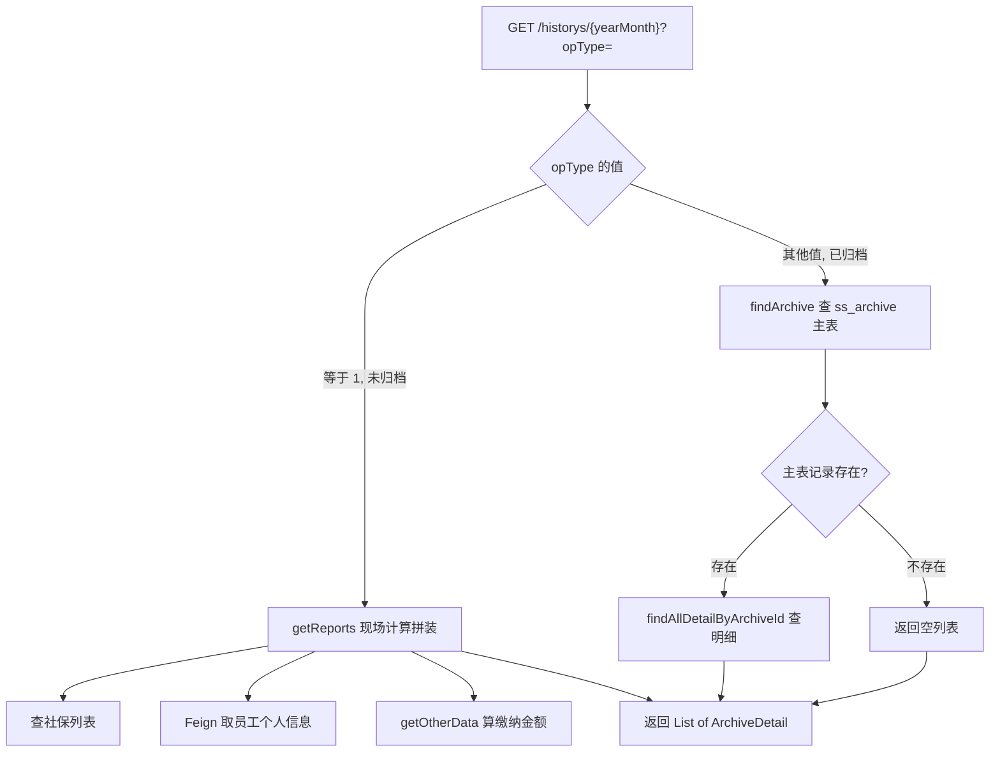

# 月度社保统计报表：一个接口的归档与未归档两条查询线

员工参保信息都设置完，月底要交的就是一张全公司的月度报表：每个员工的姓名、入职时间、社保基数、公积金基数、企业缴纳、个人缴纳、备注，一列列铺开。抓包看这个报表页面，请求只有一个 `GET /historys/201907?yearMonth=201907&opType=1`，但后端却要分成完全不同的两条路去查：当月数据还没归档，得现场把散在几张表里的数据拼出来；历史月份的数据已经归档，直接读两张归档表就行。这一课把这两条线都打通。

## 先给结论

- 报表查询只有一个入口 `GET /historys/{yearMonth}`，参数 `opType` 决定走哪条线：等于 1 查询当月未归档数据，其他值查询历史归档明细。
- 已归档的数据在 `ss_archive`（归档主表）与 `ss_archive_detail`（归档明细表）里，主表与明细是一对多，按企业 id 加年月先查主表，再按主表 id 查明细。
- 未归档的数据没有现成表，`getReports` 方法现场拼装：社保列表 + Feign 远程取员工个人信息 + `getOtherData` 逐项计算社保与公积金金额。
- 金额计算规则：缴纳额等于比例乘以基数再除以 100，企业与个人分开累加，全部用 `BigDecimal`，工伤比例是唯一存在员工表里的特例。
- Spring Data JPA 的派生查询方法名必须与实体属性名逐字一致，实体字段是 `yearsMonth`，方法名写成 `YearMonth` 会在启动时就抛 `PropertyReferenceException`。

## 一、一个接口，两条查询线

报表页顶部的月份就是查询条件，页面上还提供了归档按钮：报表核对无误后归档，做一次历史备份，之后的报表就是下一个月份的了。归档与否决定了数据在哪，所以同一个接口内部必须分叉：

```java
/**
 * 查询月份数据报表
 *  /historys/201907?yearMonth=201907&opType=1
 *      opType : 1 (当月数据, 未归档)
 *             : 其他(历史归档的详细记录)
 */
@RequestMapping(value = "/historys/{yearMonth}", method = RequestMethod.GET)
public Result historysDetail(@PathVariable String yearMonth, int opType) throws Exception {
    List<ArchiveDetail> list = new ArrayList<>();
    if(opType == 1) {
        //未归档, 查询当月的详细数据
        list = archiveService.getReports(yearMonth, companyId);
    }else{
        //已归档的数据
        //1.根据月和企业id查询归档历史
        Archive archive = archiveService.findArchive(companyId, yearMonth);
        //2.如果归档历史存在, 查询归档明细
        if(archive != null) {
            list = archiveService.findAllDetailByArchiveId(archive.getId());
        }
    }
    return new Result(ResultCode.SUCCESS, list);
}
```

`companyId` 来自父类 `BaseController`，由网关层解析 token 后注入，Controller 里不用再管。两条线的分叉关系是这样的：



图里最值得注意的一条边是「主表记录不存在返回空列表」：归档历史查不到时不报错，前端拿到空数据自行渲染，这比抛异常对页面更友好。

## 二、已归档：主表加明细的两次查询

已归档这条线相对简单，`ArchiveService` 里两个方法就够：

```java
//查询归档历史
public Archive findArchive(String companyId, String yearMonth) {
    return archiveDao.findByCompanyIdAndYearsMonth(companyId, yearMonth);
}

//根据归档历史id, 查询归档明细
public List<ArchiveDetail> findAllDetailByArchiveId(String id) {
    return archiveDetailDao.findByArchiveId(id);
}
```

两个方法背后都是 Spring Data JPA 的方法名派生查询，dao 里不需要写任何 SQL：

```java
public interface ArchiveDao extends JpaRepository<Archive, String>,
        JpaSpecificationExecutor<Archive> {
    Archive findByCompanyIdAndYearsMonth(String companyId, String yearMonth);
}

public interface ArchiveDetailDao extends JpaRepository<ArchiveDetail, String>,
        JpaSpecificationExecutor<ArchiveDetail> {
    void deleteByArchiveId(String archiveId);
    List<ArchiveDetail> findByArchiveId(String archiveId);
}
```

派生查询的解析规则是把 `findBy` 后面的部分按属性名切开：`CompanyIdAndYearsMonth` 对应实体 `Archive` 的 `companyId` 与 `yearsMonth` 两个属性，`And` 拼接多个条件。框架按方法名自动生成 `where company_id = ? and years_month = ?`，主键与字段映射由 `@Table(name = "ss_archive")` 与命名策略完成。

## 三、未归档：getReports 的三段拼装

未归档的报表没有现成的表可查，页面要的几十个字段散落在社保表、用户表、员工档案表三个地方，只能手工拼。`getReports` 的逻辑分三段：

```java
public List<ArchiveDetail> getReports(String yearMonth, String companyId) throws Exception {
    //1.查询用户的社保列表 (用户和基本社保数据), 分页参数为 null 代表查全部
    Page<Map> userSocialSecurityItemPage = userSocialSecurityDao.findPage(companyId, null);
    List<ArchiveDetail> list = new ArrayList<>();
    for (Map map : userSocialSecurityItemPage) {
        //2.用关联查询结果构造明细对象
        String userId = (String) map.get("userId");
        String mobile = (String) map.get("mobile");
        String username = (String) map.get("username");
        String departmentName = (String) map.get("departmentName");
        ArchiveDetail vo = new ArchiveDetail(userId, mobile, username, departmentName);
        vo.setTimeOfEntry((Date) map.get("timeOfEntry"));
        //3.远程获取员工个人信息(学历、开户行、银行卡号等只在员工微服务里)
        Result personalResult = employeeFeignClient.findPersonalInfo(vo.getUserId());
        if (personalResult.isSuccess()) {
            UserCompanyPersonal userCompanyPersonal = JSON.parseObject(
                    JSON.toJSONString(personalResult.getData()), UserCompanyPersonal.class);
            vo.setUserCompanyPersonal(userCompanyPersonal);
        }
        //4.计算社保与公积金金额
        getOtherData(vo, yearMonth);
        list.add(vo);
    }
    return list;
}
```

**第一段是查社保列表。** `findPage` 是一个 `@Query` 原生 SQL 的联表查询，用户表左连员工社保表，一次带出用户 id、手机号、部门名、入职时间与社保基数。分页参数传 `null` 代表不分页，报表要的就是全公司。返回的每行是一个 `Map`，取值全靠 SQL 里起的列别名，别名与 `Map` 的 key 必须一字不差。

**第二段是补个人信息。** 学历、开户行、银行卡号、社保电脑号这些字段只有员工微服务才有，社保模块通过 `EmployeeFeignClient` 发起远程调用。返回的 `data` 是一个结构未知的对象，先 `JSON.toJSONString` 转成字符串再 `parseObject` 成 `UserCompanyPersonal`，等于借 JSON 做了一次类型转换，随后 `setUserCompanyPersonal` 把身份证号、学历等字段逐一填进明细。

**第三段是算钱。** 这一段单独抽成了 `getOtherData` 方法。

## 四、金额计算链路：比例乘基数，BigDecimal 累加

`getOtherData` 按员工参保城市的缴费项目逐项计算：

```java
public void getOtherData(ArchiveDetail vo, String yearMonth) {
    UserSocialSecurity userSocialSecurity = userSocialService.findById(vo.getUserId());
    if(userSocialSecurity == null) {
        return; //员工没设置过社保, 明细留空
    }
    BigDecimal socialSecurityCompanyPay = new BigDecimal(0);
    BigDecimal socialSecurityPersonalPay = new BigDecimal(0);
    List<CityPaymentItem> cityPaymentItemList =
            paymentItemService.findAllByCityId(userSocialSecurity.getProvidentFundCityId());
    for (CityPaymentItem cityPaymentItem : cityPaymentItemList) {
        //企业部分: 开关打开才缴, 缴纳额 = 企业比例 × 基数 ÷ 100
        if (cityPaymentItem.getSwitchCompany()) {
            BigDecimal augend;
            if (cityPaymentItem.getPaymentItemId().equals("4")
                    && userSocialSecurity.getIndustrialInjuryRatio() != null) {
                //工伤的企业的比例特殊, 存在员工社保表里
                augend = userSocialSecurity.getIndustrialInjuryRatio()
                        .multiply(userSocialSecurity.getSocialSecurityBase());
            } else {
                augend = cityPaymentItem.getScaleCompany()
                        .multiply(userSocialSecurity.getSocialSecurityBase());
            }
            BigDecimal divideAugend = augend.divide(new BigDecimal(100));
            socialSecurityCompanyPay = socialSecurityCompanyPay.add(divideAugend);
        }
        //个人部分: 同样按开关与比例计算
        if (cityPaymentItem.getSwitchPersonal()) {
            BigDecimal augend = cityPaymentItem.getScalePersonal()
                    .multiply(userSocialSecurity.getSocialSecurityBase());
            BigDecimal divideAugend = augend.divide(new BigDecimal(100));
            socialSecurityPersonalPay = socialSecurityPersonalPay.add(divideAugend);
        }
    }
    vo.setSocialSecurity(socialSecurityCompanyPay.add(socialSecurityPersonalPay));
    vo.setSocialSecurityEnterprise(socialSecurityCompanyPay);
    vo.setSocialSecurityIndividual(socialSecurityPersonalPay);
    vo.setUserSocialSecurity(userSocialSecurity);
    vo.setSocialSecurityMonth(yearMonth);
    vo.setProvidentFundMonth(yearMonth);
}
```

计算链路可以归纳成一句话：缴费项目表给出每个险种的比例与开关，员工社保表给出基数，两者相乘除以 100 得到单项缴纳额，企业与个人分别累加，最后 `socialSecurityEnterprise`、`socialSecurityIndividual` 落到明细行，两者相加得到 `socialSecurity` 合计。工伤是唯一的例外，它的企业比例随员工而变，所以存在员工社保表的 `industrialInjuryRatio` 字段里，计算时优先取员工自己的值。

金额类型从头到尾都是 `BigDecimal`：比例乘基数的中间结果带小数，几十个险种累加后浮点误差会被放大到对不上账，商业计算一律用 `BigDecimal` 的 `add`、`multiply` 方法，宁可啰嗦不能出错。

## 常见误区

- **派生查询方法名与实体属性对不上**：实体里字段是 `yearsMonth`，dao 方法写成 `findByCompanyIdAndYearMonth`，启动直接抛 `PropertyReferenceException`，提示找不到 `yearMonth` 属性。方法名不是随便起的英文，是框架解析查询的依据，必须逐字对齐实体属性。
- **把 `opType` 当成可有可无的参数**：它决定查实时数据还是归档数据。漏传或者当月已归档还传 1，查到的就是拼装出来的「现在」，而不是归档时刻的「当时」，报表数据会与财务记录对不上。
- **联表查询的列别名与 `Map` 取值 key 不一致**：SQL 里写 `work_number workNumber`，Java 里却 `map.get("workNumber ")` 或大小写不符，取出来全是 null，页面上大片空白却没有任何报错。
- **首次请求报 504 就以为服务挂了**：请求经过 Zuul 网关转发，网关首次路由到某个服务时需要拉取实例并建立连接，第一次请求容易超时。看到 504 先重试一次，再看社保服务本身的启动日志。

## 面试可能被问到的问题

1. 面试官追问：「同一个报表接口为什么用 opType 区分两条查询路径？」
   答：归档前后数据的存在形态完全不同。已归档数据在归档表里是快照，读两张表即可；未归档数据分散在用户表、社保表和员工微服务里，要现场联表、远程调用并计算金额。用一个入口加类型参数，前端调用方式统一，后端按数据形态分流。

2. 面试官追问：「Spring Data JPA 的方法名派生查询是怎么工作的？」
   答：框架解析 `findBy` 之后的字符串，按属性名切分出条件字段与连接词（`And`、`Or`），自动生成对应 JPQL 或 SQL。方法名必须与实体属性名一致，写错会在启动阶段抛 `PropertyReferenceException`，这反而比运行期才发现要好。

3. 面试官追问：「为什么金额计算必须用 BigDecimal 而不是 double？」
   答：double 是二进制浮点，无法精确表示 0.1 这类十进制小数，比例乘基数再逐项累加，误差会随累加次数放大，最终与财务对不上账。`BigDecimal` 用十进制表示并提供 `add`、`multiply` 等方法，商业金额计算的标准选择，落库时对应 MySQL 的 `decimal` 类型。

4. 面试官追问：「getReports 为什么要通过 Feign 去拿员工的个人信息？」
   答：学历、开户行这些数据属于员工微服务的库表，社保模块只持有 user_id。跨服务取数走 Feign 保持服务边界，避免跨库直连造成的耦合；报表里用 `JSON.toJSONString` 加 `parseObject` 把 Result 里的 data 转成实体，不需要目标服务提供额外的 DTO 接口。

5. 面试官追问：「工伤比例为什么存在员工表里而其他险种比例在城市表里？」
   答：多数险种的比例由城市政策统一定义，全城一致；工伤比例按行业与单位费率浮动，每个员工可能不同，所以随参保信息存在员工社保表里，计算时优先取员工自己的值，取不到再退回城市默认值。

## 配套资料

- 报表接口与归档查询：`materials/code/02/day14 微服务网关与社保模块开发/day14/03-资料/社保模块相关资料/ihrm_social_securitys/src/main/java/com/ihrm/social/controller/SocialSecurityController.java`（`historysDetail` 方法，包名已改为中性命名）
- 报表拼装与金额计算：同目录 `社保资源/基本代码/service/ArchiveService.java`（`findArchive`、`findAllDetailByArchiveId`、`getReports`、`getOtherData`）
- 归档表 dao 与实体：同目录 `社保资源/基本代码/dao/ArchiveDao.java`、`ArchiveDetailDao.java`、`domain/Archive.java`
- 联表查询 SQL：同目录 `社保资源/基本代码/dao/UserSocialSecurityDao.java` 的 `findPage` 方法（`@Query` 原生 SQL，列别名即 `Map` 的 key）
- 表结构：`materials/code/02/day14 微服务网关与社保模块开发/day14/ihrm.sql`（`ss_archive`、`ss_archive_detail` 建表语句）
