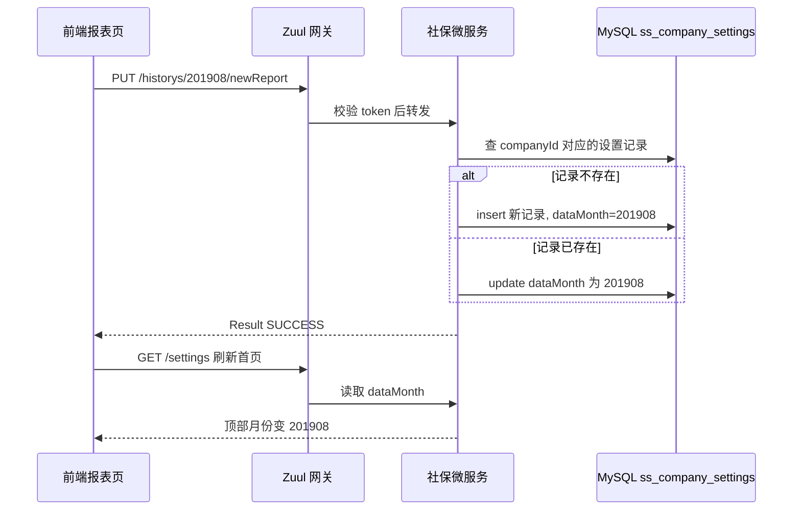

# 切换社保统计周期：一个字段撑起的新建报表

7 月归档完，页面上点「新建报表」，确认「是否新建 8 月份报表」，回到社保首页，顶部月份已经变成 8 月，列表回到待设置的空状态。听起来像是生成了一批新数据，抓包看到的却只有一条 `PUT /historys/201908/newReport`，落库的改动更是小得惊人：企业设置表里的一个字段。报表月份从哪来、为什么改一个字段就能全站切换、切换前漏归档会怎样，这一课把这条最短的链路讲透。

## 先给结论

- 新建报表不创建任何报表数据，本质是把 `ss_company_settings` 表的 `dataMonth` 字段从 07 改成 08。
- 接口为 `PUT /historys/{yearMonth}/newReport`，路径变量就是新周期，请求方式是 PUT，写成其他方法直接 404。
- `CompanySettings` 实体以 `companyId` 做主键，`save` 天然是「不存在插入、存在更新」，服务层顺带把 `isSettings` 置 1 表示当月已设置。
- 首页与报表页的月份都读 `dataMonth`，一个字段就是全模块的统计周期开关。
- 两个边界要守住：切换前先归档，否则上月报表再也回不去；接口没有幂等保护，重复点击会把周期继续往后推。

## 一、统计周期存在哪：一张设置表说了算

社保模块进来第一件事是读企业设置：`GET /settings` 返回 `CompanySettings`，前端拿 `dataMonth` 决定顶部显示几月、报表查几月。这张表只有三个业务字段：

```java
@Entity
@Table(name = "ss_company_settings")
@Data
public class CompanySettings implements Serializable {

    @Id
    private String companyId;      //企业id, 同时是主键
    /**
     * 是否设置 0为未设置，1为已设置
     */
    private Integer isSettings;
    /**
     * 当前显示报表月份
     */
    private String dataMonth;
}
```

所谓「统计周期」不是什么定时任务，就是这一行记录里的 `dataMonth`。新建报表按钮做的全部事情，是把 `07` 改成 `08`，之后所有页面按新月份取数。整条链路如下：



图里 insert 与 update 两条分支都汇到同一个 `save` 调用上，这正是用主键做企业 id 带来的便利：新建报表第一次与第 N 次走的是同一段代码。

## 二、接口实现：查出来，补上字段，直接保存

Controller 里的方法短到只有几行：

```java
///historys/201908/newReport
/**
 * 制作新报表
 *     切换统计周期
 */
@RequestMapping(value = "/historys/{yearMonth}/newReport", method = RequestMethod.PUT)
public Result saveSettings(@PathVariable String yearMonth) {
    //修改企业设置
    CompanySettings cs = companySettingsService.findById(companyId);
    if(cs == null) {
        cs = new CompanySettings();  //企业从没设置过社保时兜底
    }
    cs.setCompanyId(companyId);
    cs.setDataMonth(yearMonth);
    companySettingsService.save(cs);
    return new Result(ResultCode.SUCCESS);
}
```

service 层的 `save` 多做了一件事：

```java
//保存企业设置
public void save(CompanySettings companySettings) {
    companySettings.setIsSettings(1); //已经完成当月设置
    companySettingsDao.save(companySettings);
}
```

`isSettings` 置 1 的含义是企业已完成过社保配置，首页据此区分「从未设置过」与「已设置，当前周期 8 月」两种状态。查出来判空再 new 的写法，保证首次使用社保功能的企业不会因为设置表里没有记录而空指针，这一行兜底与归档主表的处理方式完全同构。

## 三、两个边界：漏归档与重复点击

**切换前不归档，上月报表就回不去了。** 未归档的报表没有实体表，每次都是 `getReports` 按员工社保表的当前值现场计算。员工下个月调了基数，7 月的「未归档报表」就会按新基数算出 8 月口径的数据，`opType=1` 再也拼不回 7 月当时的样子。归档表存在的意义正是把「当时」冻结下来，所以正确的操作顺序永远是：核对当月报表、归档、再切换周期。切换本身只是一个 update，代价趋近于零，不可逆的是跳过归档损失掉的快照能力。

**重复点击会继续推月。** 演示时连点了两次新建报表，月份直接从 8 月跳到了 9 月：路径里的年月是前端按「当前周期加一个月」算出来传的，后端照单全收，没有任何「只能前进一格」或「重复请求返回同一结果」的校验。生产化改造至少要加一层比较：传入的 `yearMonth` 必须晚于当前 `dataMonth` 且间隔一个月，否则拒绝执行。

**请求方式写错就是 404。** 联调时第一次点击没有生效，回看抓包才发现这个接口是 PUT，开发时按惯性写成了 POST，路径相同方法不同，Spring MVC 匹配不上直接 404。REST 风格下「改状态」的语义落在 PUT 上，前后端约定接口时要连方法一起核对。

## 四、为什么用改字段而不是建表

一种更「重」的设计是每个月建一张报表表或给报表数据加月份维度。这套代码选择只维护一个当前周期字段，理由在于职责划分：员工社保表存的是参保现状（基数、比例、城市），报表是现状在某个口径下的投影，归档表负责历史。现状只有一份，周期只是「指针」，指向现状当前的统计月份。指针一改，列表页、报表页、归档入口全部跟着走，不需要任何数据搬迁。这个设计的代价就是上一节说的边界：指针挪走之前必须归档，否则上一个口径的数据无处可查。

## 常见误区

- **以为新建报表会生成数据**：它只更新设置表的 `dataMonth`，报表数据要等员工参保信息录入后由查询接口现算。切换完发现列表为空属于正常，不是故障。
- **用 POST 或 GET 调 newReport**：路径一样方法不对，得到 404。Spring MVC 按路径与方法共同匹配，`RequestMethod.PUT` 少一个字都映射不上。
- **跳过归档直接切周期**：未归档报表是实时计算的投影，周期一挪，上月口径永远丢失。先归档再切换是顺序硬约束。
- **把重复点击当成无害操作**：每次调用都会把周期推到传入月份，连点两次就跳两个月。补上「新周期等于当前周期加一月」的校验才敢上生产。

## 面试可能被问到的问题

1. 面试官追问：「新建报表为什么只改一个字段就能切换月份？」
   答：模块把「统计周期」建模成企业设置表里的当前月份指针，员工社保表存参保现状，报表是现状按指针口径的实时投影，历史月份另有归档表。指针移动不需要搬运数据，读数的地方全部以指针为准。

2. 面试官追问：「CompanySettings 用 companyId 做主键有什么好处？」
   答：企业与设置是一对一关系，业务主键天然防重，避免一个企业出现两条设置记录导致周期二义。同时 JPA 的 `save` 按主键区分插入与更新，首次设置与日常切换共用同一段代码，不需要写分支。

3. 面试官追问：「这个接口有什么幂等问题，怎么改？」
   答：重复调用会把周期继续后移，因为后端不做任何状态比较，照单全收路径里的年月。幂等化可以在执行前校验传入年月必须等于当前周期加一个月，重复提交相同月份直接返回成功，回退月份则拒绝。

4. 面试官追问：「切换周期和归档的先后顺序为什么不能反？」
   答：未归档报表按员工社保表当前值实时计算，没有历史快照。先切换再想补上月报表，`opType=1` 算出的已是新周期口径，上月数据不可复原。归档把当月明细固化进归档表之后，周期才允许挪走。

5. 面试官追问：「首次给企业切换报表周期，设置表里还没有记录，会发生什么？」
   答：`findById` 返回 null，代码里判空后 new 一个空对象，补上 `companyId` 与 `dataMonth` 再保存，`save` 走 insert 并把 `isSettings` 置 1。判空兜底让首次配置与日常切换收敛到同一入口。

## 配套资料

- 切换周期接口：`materials/code/02/day14 微服务网关与社保模块开发/day14/03-资料/社保模块相关资料/ihrm_social_securitys/src/main/java/com/ihrm/social/controller/SocialSecurityController.java`（`/historys/{yearMonth}/newReport` 方法，包名已改为中性命名）
- 企业设置实体与服务：同目录 `社保资源/基本代码/domain/CompanySettings.java`、`service/CompanySettingsService.java`、`dao/CompanySettingsDao.java`
- 设置表结构：`materials/code/02/day14 微服务网关与社保模块开发/day14/ihrm.sql`（`ss_company_settings` 建表与预置数据）
