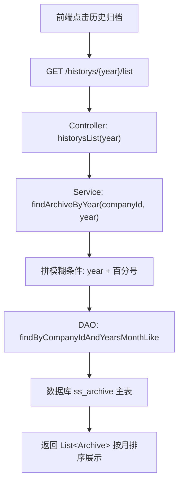

# 查社保历史归档列表：一个 Like 方法名背后的年月模糊查询

社保模块的归档动作上一课已经完成，月报表可以固化进 `ss_archive` 主表。但点开页面右上角的「历史归档」，前端发出 `GET /social_security/historys/2019/list`，后端没有任何接口接住，浏览器控制台直接 404。这一课就补这一个查询接口，让它按年份查出该企业全年已归档的月份列表，顺带解决一个经典问题：Spring Data JPA 的方法名派生查询，写错一个单词不是运行时报错，而是整个微服务启动失败。

## 先给结论

- 历史归档列表查的是归档主表 `ss_archive`，按企业 id 加年份过滤，一年最多十几条记录，直接返回 `List<Archive>`，不必分页。
- 数据库里年月字段 `years_month` 存的是 `201906` 这种六位字符串，传进来的参数却是 `2019` 四位年份，两者对不上精确匹配，必须用 Like 模糊查询，service 层拼上 `%`。
- 方法名派生查询的完整写法是 `findByCompanyIdAndYearsMonthLike`，属性名取自实体类，与 controller 方法参数叫什么都无关。
- 方法名写错不会等到查询时才报错，Spring Data 在启动阶段解析方法名并生成实现，解析失败直接抛异常终止启动。
- 列表展示要按月份排序，最新月份排在最前面更符合查看习惯，排序同样可以用方法名表达。

## 一、先看页面约定什么接口

功能入口是社保页面右上角的「历史归档」按钮，点击后按当前年份发请求。用浏览器开发者工具观察，请求是 GET 方式，路径形如 `/social_security/historys/2019/list`，`2019` 是路径变量，代表要查询的年份。切换到 2018 年，同一个接口换个年份再发一次。

接口风格与社保模块已有的接口保持一致：路径以 `historys` 开头区分历史归档一族，用 GET 表达查询语义。Controller 不需要新开一个类，社保模块现有的 Controller 里就能放下这个方法，因为历史归档与社保列表、月报表同属一个业务边界。

## 二、三层实现：Controller 到 DAO

整体调用链如下：



Controller 层只有一个动作，调 service 拿列表再包进统一响应：

```java
//查询历史归档列表
@RequestMapping(value = "/historys/{year}/list", method = RequestMethod.GET)
public Result historysList(@PathVariable String year) throws Exception {
    List<Archive> archiveList = archiveService.findArchiveByYear(companyId, year);
    return new Result(ResultCode.SUCCESS, archiveList);
}
```

`companyId` 来自 `BaseController` 中从登录态解析出的企业 id，与上一课查询员工社保列表的做法一致。多租户系统的查询永远要带企业维度，历史归档也不例外。

Service 层负责把「年份」翻译成数据库能用的「年月模糊条件」：

```java
//根据企业ID和年份查询归档数据(模糊查询)
public List<Archive> findArchiveByYear(String companyId, String year) {
    // years_month 存的是 201906 这样的年月, 按年份查询要补上通配符
    return archiveDao.findByCompanyIdAndYearsMonthLike(companyId, year + "%");
}
```

DAO 层是这次新增的全部数据库代码：

```java
public interface ArchiveDao extends JpaRepository<Archive, String>,
        JpaSpecificationExecutor<Archive> {
    List<Archive> findByCompanyIdAndYearsMonthLike(String companyId, String yearMonth);
}
```

没有 SQL，没有 `@Query`，一个方法声明就是全部。Spring Data JPA 在启动时解析 `findByCompanyIdAndYearsMonthLike`：`And` 切成两个条件，`CompanyId`、`YearsMonth` 对应 `Archive` 实体的两个属性，`Like` 声明匹配方式，随后生成实现类注入容器。

## 三、为什么必须用 Like，以及字段名从哪来

两个细节决定这个方法能不能查出数据。

**第一，参数名叫 year，字段却叫 yearsMonth。** 实体类里的年月属性定义如下：

```java
@Entity
@Table(name = "ss_archive")
@Data
public class Archive implements Serializable {

    @Id
    private String id;
    /** 企业id */
    private String companyId;
    /** 年月 */
    private String yearsMonth;
    /** 创建时间 */
    private Date creationTime;
    /** 企业缴费 */
    private BigDecimal enterprisePayment;
    /** 个人缴费 */
    private BigDecimal personalPayment;
    /** 合计 */
    private BigDecimal total;
}
```

方法名里的 `YearsMonth` 必须严格照抄实体属性名，`year`、`yearMonth` 都会解析失败。派生查询的属性名来源是实体类，不是 controller 传参的名字，两套命名各管各的。

**第二，四位年份匹配六位年月，只有模糊查询能接住。** `years_month` 里的数据是 `201901` 到 `201912`，查询条件是 `2019`，等值匹配一个都查不出来。传参时在年份后面拼一个 `%`，生成的 SQL 相当于：

```sql
SELECT * FROM ss_archive
WHERE company_id = ? AND years_month LIKE '2019%';
```

前四位命中年份，后两位是任意的月份，全年归档记录一次查齐。

## 四、启动就报错：List 与 Like 一字之差

这个方法在联调时踩过一个很典型的坑：方法名末尾写成了 `findByCompanyIdAndYearsMonthList`，把 Like 手误打成了 List。微服务还没等测试就启动失败，抛出属性引用异常，提示在 `Archive` 里找不到 `yearsMonthList` 这个属性。

原因在于派生查询的解析时机。Spring Data 在容器启动、创建 dao 的 bean 时就要遍历方法名、切分关键字、核对实体属性，任何一段对不上都会在此时抛异常，而不是等到第一次调用才失败。这个设计其实是好事：写错的方法名活不过启动，问题在开发期暴露。排查思路也固定，报错信息会明确指出无法解析的属性路径，对着实体类把属性名抄对、把关键字拼对即可。

顺带一提，`And` 两边的关键字与数据库列名无关，全看 Java 属性；如果实体属性上用了 `@Column(name = "years_month")` 改列名，方法名里依然写驼峰属性名。

## 五、展示优化：让最新月份排前面

接口写完一测，2019 年的归档记录已经能查出来，但展示顺序不太理想。归档通常按月份递增产生，直接展示就是从一月排到十二月，而使用者最关心的往往是刚归档的那几个月。给查询补上排序即可，方法名派生查询连这件事都能表达：

```java
// 按年月倒序排列, 最新归档在最前(示例: 在原方法名上追加 OrderBy 子句)
List<Archive> findByCompanyIdAndYearsMonthLikeOrderByYearsMonthDesc(
        String companyId, String yearMonth);
```

`OrderByYearsMonthDesc` 追加在条件之后，`Desc` 表示倒序。若业务上更习惯从一月起逐月查看，把 `Desc` 换成 `Asc` 就是升序。排序放数据库还是放前端是个取舍点：记录条数少、接口只服务这一个页面时，方法名排序最省事；同一份列表要供多个前端复用且排序诉求不同时，把排序权交给前端更灵活。

## 常见误区

- **方法名里的属性名照着参数名写**：参数叫 `year`，方法名就写 `findByCompanyIdAndYearLike`，实体里没有 `year` 属性，启动即报属性引用异常。属性名以实体类为准，本例是 `yearsMonth`。
- **模糊查询忘拼 `%`**：DAO 声明了 Like，service 却原样传 `2019`，生成的 SQL 变成 `years_month = '2019'`，一条都查不到。通配符由调用方拼接，声明 Like 不等于自动加 `%`。
- **误以为该用分页**：归档主表一年最多十几条，返回 `List` 完全够用；真正需要分页的是明细表几十列、多员工的报表场景。给这种小结果集套 Pageable 只会增加复杂度。
- **把历史归档当成新功能新建 Controller**：它和月报表共用同一批实体与 dao，塞进现有 Controller 复用企业 id 与返回封装即可，类的数量不是越多越好。

## 面试可能被问到的问题

1. 面试官追问：「Spring Data JPA 的方法名派生查询是什么原理？」
   答：框架在启动创建 Repository bean 时解析方法名，按 `findBy`、`And`、`Or`、`Like`、`OrderBy` 等关键字切分，余下片段与实体属性名比对，全部合法则生成查询实现并注入容器；任何属性对不上都会在启动期抛 `PropertyReferenceException`，查询不会等到运行时才失败。

2. 面试官追问：「Like 查询的通配符应该写在哪一侧？」
   答：写在调用方传入的参数值里，例如 `year + "%"`。方法名只声明匹配方式是 Like，框架不会自动补通配符；`%` 放前面是前缀匹配会放弃索引，放后面是后缀匹配可以走索引，能只用后缀匹配就不要前后都加。

3. 面试官追问：「`years_month` 存成字符串会不会影响查询和排序？」
   答：固定格式 `yyyyMM` 的字符串天然满足字典序与时间序一致，Like 前缀匹配和 OrderBy 都能得到正确结果。风险在于格式不统一，比如混入 `2019-06`，排序与比较就会错乱，所以入库前必须统一格式校验。

4. 面试官追问：「多租户系统里这类查询为什么要强制带企业 id？」
   答：所有租户的数据共存在同一张表里，不带企业 id 的查询会跨租户泄露数据。企业 id 从登录态解析后逐层传到 dao，让每个查询天然带上租户过滤，这是数据隔离最基本的一道防线。

5. 面试官追问：「派生查询和 `@Query` 各适合什么场景？」
   答：条件简单、字段固定时派生查询可读性好，IDE 能校验属性名；条件复杂、涉及多表连接、聚合函数或动态条件时，派生方法名会冗长到不可维护，改用 `@Query` 写 JPQL 或原生 SQL，更复杂的需求再上 `JpaSpecificationExecutor` 动态拼接。

## 配套资料

- 归档主表实体 `Archive`：`materials/code/02/day15 考勤模块开发/day15/工具代码/实体类/social_security/Archive.java`（含 `yearsMonth`、三个金额字段，包名已改为 `com.example`）
- 归档 dao 基础版（精确查询）与社保模块工程：`materials/code/02/day14 微服务网关与社保模块开发/day14/03-资料/社保模块相关资料/ihrm_social_securitys/src/main/java/com/ihrm/social/dao/ArchiveDao.java`（`findByCompanyIdAndYearsMonthLike` 与排序方法为本课在视频里新增的写法，按本课写法补全）
- 归档明细实体 `ArchiveDetail`（下一课的查询对象）：`materials/code/02/day15 考勤模块开发/day15/工具代码/实体类/social_security/ArchiveDetail.java`
- 文中包名均已由课程原始包名改为 `com.example` 中性包名
