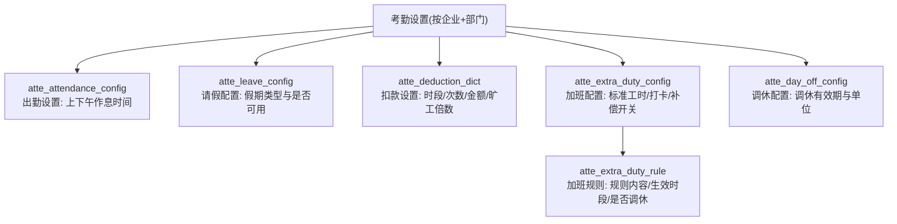
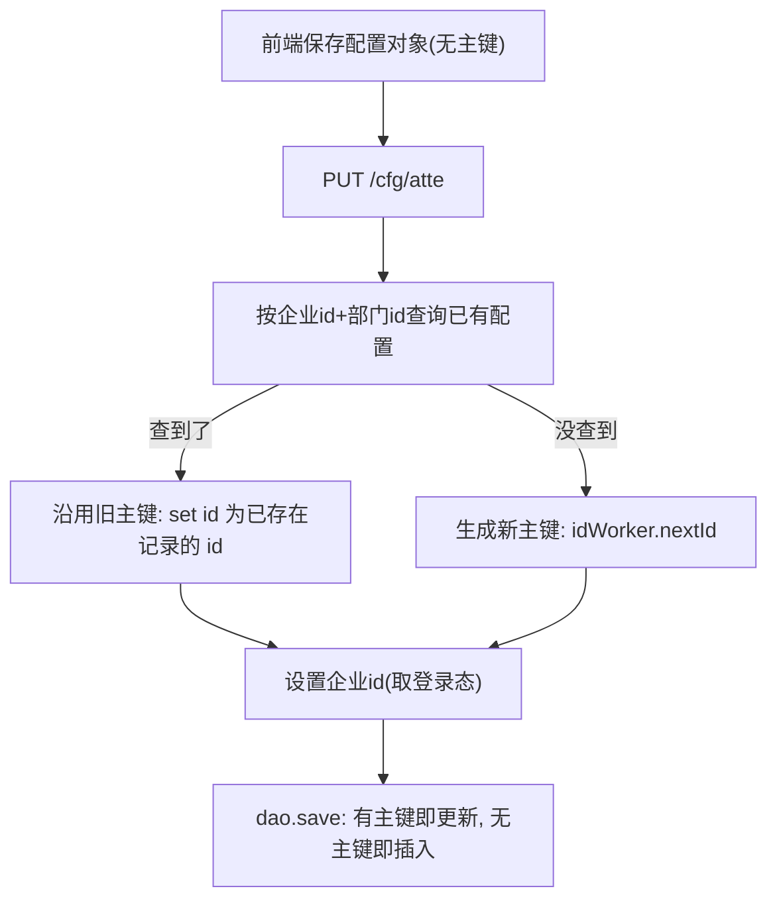

# 考勤设置：六张配置表撑起一家公司的出勤制度

社保收尾之后，人力资源系统进入考勤。做考勤的第一件事不是记打卡，而是把「什么算迟到、什么算旷工、哪些假期可用、能不能加班」这些制度配置进系统：研发部早晨九点打卡，销售部可能七点半就要到岗；职能部门请假按制度走，外勤岗位宽松得多。这一课先拆解考勤设置的需求与六张配置表的分工，然后新建考勤微服务，把第一个功能「出勤设置」的查询与保存完整实现出来。这套配置看似只是增删改查，却是后面考勤管理、薪资计算的判定基准。

## 先给结论

- 考勤设置分四类：出勤时间、请假类型、扣款规则、加班规则，全部按「企业 id 加部门 id」两级配置，同一企业不同部门可以制度不同。
- 配置数据落在六张 `atte_` 前缀的表里：`atte_attendance_config` 出勤、`atte_leave_config` 请假、`atte_deduction_dict` 扣款、`atte_extra_duty_config` 加班总开关、`atte_extra_duty_rule` 加班规则、`atte_day_off_config` 调休。
- 考勤是新微服务，端口 9005，实体与 dao 由课程资料以工具代码提供，四类设置的查询保存合并进一个 `ConfigurationService`，因为每类设置方法极少，没必要一对一拆分。
- 查询接口 `POST /cfg/atte/item` 传部门 id，按企业 id 加部门 id 用派生查询 `findByCompanyIdAndDepartmentId` 取出勤配置。
- 保存接口用 PUT 接收整个配置对象，先查该部门是否已有配置：存在就沿用旧主键走更新，不存在就生成新主键走插入，企业 id 以登录态为准而不是信任前端。

## 一、需求分析：四类规则，因企业因部门而异

考勤的本质是「用既定规则约束出勤」，而规则因企业、因部门、因岗位而异。页面上点开设置弹窗，一共四个标签页，对应四类配置。

**第一类，出勤设置。** 每个部门各自的上下午作息：研发部早晨九点开始打卡、中午十二点休息、下午一点继续上班、晚上六点下班。这些时间直接决定后面每一条打卡记录被判定为正常、迟到还是早退。

**第二类，请假设置。** 年假、事假、病假、婚假、丧假、产假、陪产假、探亲假、工伤假等假期类型逐一列出，每个类型一个「是否可用」开关，且按部门配置。职能部门严格按制度执行；销售一类常年在外应酬的岗位，假期规则就要放宽。开关做到部门粒度，同一套代码才能服务公司内部的多样制度。

**第三类，扣款设置。** 这是给薪资计算准备的判定依据。可以配置迟到是否扣款、迟到多少分钟开始扣、迟到多久算旷工、早退一次扣多少、旷工按当月日薪的几倍罚款。人性化的公司允许每月免费迟到两三次，严格的公司早退五分钟就扣钱，这些差异全部进配置表，不写死在代码里。

**第四类，加班设置。** 工作日能否申请加班、休息日能否申请、法定节假日加班如何补偿，另外还有打卡验证与加班补偿开关、调休有效期。这一项还与工作流联动：企业设置为不允许加班时，员工发起的加班审批流可以直接不通过。

四类设置各自的查询保存逻辑高度相似，把第一个「出勤设置」做通，其余三类照模板复制即可。

## 二、表结构：六张配置表怎么分工

考勤模块的表统一以 `atte_` 前缀命名，与社保的 `ss_`、组织的 `bs_` 划清边界。四类设置与六张表的对应关系如下：



出勤、请假、扣款各一张表；加班比它们复杂，拆成「配置加规则」两张：`atte_extra_duty_config` 存部门级总开关，`atte_extra_duty_rule` 存具体规则条目，一张配置挂多条规则才能覆盖「工作日加班转调休、节假日加班发补偿」这类多场景。调休单独一张表，记录调休最后有效日期与计量单位，防止调休无限期累积。

看一张真实的建表语句，体会配置表的设计味道：

```sql
CREATE TABLE `atte_extra_duty_rule` (
  `id` varchar(40) NOT NULL COMMENT '主键',
  `company_id` varchar(60) DEFAULT NULL COMMENT '公司ID',
  `department_id` varchar(60) DEFAULT NULL COMMENT '部门ID',
  `rule_name` varchar(60) DEFAULT NULL COMMENT '规则名称',
  `rule_content` varchar(100) DEFAULT NULL COMMENT '规则内容',
  `rule_start_time` time DEFAULT NULL COMMENT '规则生效开始时间',
  `rule_end_time` time DEFAULT NULL COMMENT '规则生效结束时间',
  `is_enable` int(10) DEFAULT NULL COMMENT '是否开启 0开启 1关闭',
  `create_by` varchar(60) DEFAULT NULL COMMENT '创建人',
  `update_by` varchar(60) DEFAULT NULL COMMENT '更新人',
  `create_date` datetime DEFAULT NULL COMMENT '创建时间',
  `update_date` datetime DEFAULT NULL COMMENT '更新时间',
  PRIMARY KEY (`id`) USING BTREE
) ENGINE=InnoDB DEFAULT CHARSET=utf8mb4 COMMENT='加班规则';
```

几乎每张配置表都有四个公共列：创建人、创建时间、更新人、更新时间。这些审计字段不适合在每个实体里重复声明，代码里用父类统一收编，后面实体部分会看到。

## 三、环境搭建：新建考勤微服务

考勤代码不能塞进社保服务里，独立成模块才能独立部署与扩展。按课程惯例新建考勤模块，包名定为 `com.example.atte`，启动类与其他微服务同款：

```java
@SpringBootApplication(scanBasePackages = "com.example")
@EntityScan(value = "com.example.domain.atte")   // JPA 实体所在包
@EnableDiscoveryClient                            // 注册到注册中心
@EnableFeignClients                               // 开启服务间调用
public class AttendanceApplication {

    public static void main(String[] args) {
        SpringApplication.run(AttendanceApplication.class, args);
    }

    @Bean
    public IdWorker idWorker() {
        return new IdWorker();   // 分布式主键生成器
    }
}
```

配置文件指定 9005 端口、独立数据库与注册中心地址：

```yaml
server:
  port: 9005
spring:
  application:
    name: example-attendance          # 服务名
  datasource:
    driver-class-name: com.mysql.jdbc.Driver
    url: jdbc:mysql://localhost:3306/attendance?useUnicode=true&characterEncoding=utf8
    username: root
    password: 111111
eureka:
  client:
    service-url:
      defaultZone: http://127.0.0.1:8008/eureka/
  instance:
    preferIpAddress: true
    instance-id: ${spring.cloud.client.ip-address}:${spring.application.name}:${server.port}
```

实体类与 dao 不需要手写。考勤模块涉及十几张表，六张配置表之外还有考勤记录、月度报表等管理类实体，课程资料把全部实体、dao 与空的 service 骨架以工具代码形式提供，按包整体拷入工程即可。dao 层全是继承 `JpaRepository` 与 `JpaSpecificationExecutor` 的接口声明，真正需要关注的是 service 怎么组织。

一个值得留意的取舍：资料把四类设置的所有 dao 都注入进同一个 `ConfigurationService`，而不是每个 dao 配一个 service。原因在于每个设置的服务方法极少，出勤设置可能只有一个查询加一个保存，拆成一堆一方法的小 service 徒增类数量。方法少就合并，方法多才拆分，服务的粒度跟着方法数量走，不必死守「一个 dao 一个 service」的教条。资料里的骨架如下：

```java
@Service
public class ConfigurationService {

    @Autowired
    private AttendanceConfigDao attendanceConfigDao;
    @Autowired
    private LeaveConfigDao leaveConfigDao;
    @Autowired
    private DeductionDictDao deductionDictDao;
    @Autowired
    private ExtraDutyConfigDao extraDutyConfigDao;
    @Autowired
    private ExtraDutyRuleDao extraDutyRuleDao;
    @Autowired
    private DayOffConfigDao dayOffConfigDao;
    @Autowired
    private IdWorker idWorker;
}
```

## 四、查询考勤设置：实体、dao 与第一个接口

出勤设置的实体对应 `atte_attendance_config` 表，除了作息时间四个字段，还有企业与部门两个定位字段，公共审计字段来自父类：

```java
@Entity
@Table(name = "atte_attendance_config")
@Data
@NoArgsConstructor
@AllArgsConstructor
@EqualsAndHashCode(callSuper = true)
public class AttendanceConfig extends BaseEntity implements Serializable {

    @Id
    private String id;

    private String companyId;

    @NotBlank(message = "部门ID不能为空")
    private String departmentId;

    @NotNull(message = "上午上班时间不能为空")
    private String morningStartTime;
    @NotNull(message = "上午下班时间不能为空")
    private String morningEndTime;
    @NotNull(message = "下午上班时间不能为空")
    private String afternoonStartTime;
    @NotNull(message = "下午下班时间不能为空")
    private String afternoonEndTime;
}
```

`BaseEntity` 父类用 `@MappedSuperclass` 声明，本身不映射表，只把公共字段下沉：

```java
@Getter
@Setter
@MappedSuperclass
public class BaseEntity implements Serializable {
    /** 创建者 */
    private String createBy;
    /** 创建日期 */
    private Date createDate;
    /** 更新者 */
    private String updateBy;
    /** 更新日期 */
    private Date updateDate;
    /** 备注 */
    private String remarks;
}
```

页面上的交互是：打开设置弹窗，切换部门时请求该部门的当前配置回显表单。用开发者工具观察，请求路径 `cfg/atte/item`，POST 方式，参数是部门 id（路径里的 `api` 前缀是前端代理加的，后端没有）。所有设置类接口都以 `cfg` 开头，因此单独做一个 `ConfigController`：

```java
/**
 * 配置考勤设置的controller
 */
@RestController
@RequestMapping("/cfg")
public class ConfigController extends BaseController {

    @Autowired
    private ConfigurationService configurationService;

    /**
     * 获取考勤设置
     * 请求: POST /cfg/atte/item  参数: departmentId
     */
    @RequestMapping(value = "/atte/item", method = RequestMethod.POST)
    public Result atteConfig(String departmentId) {
        AttendanceConfig ac = configurationService.getAtteConfig(companyId, departmentId);
        return new Result(ResultCode.SUCCESS, ac);
    }
}
```

`companyId` 继承自 `BaseController`，从登录态解析而来。查询条件是两个 id 的组合，dao 用一个派生查询方法完成：

```java
@Repository
public interface AttendanceConfigDao
        extends JpaRepository<AttendanceConfig, String>,
                JpaSpecificationExecutor<AttendanceConfig> {

    /**
     * 根据公司和部门查询考勤配置信息
     */
    AttendanceConfig findByCompanyIdAndDepartmentId(String companyId, String departmentId);
}
```

Service 层只是转发：

```java
//查询考勤设置
public AttendanceConfig getAtteConfig(String companyId, String departmentId) {
    return attendanceConfigDao.findByCompanyIdAndDepartmentId(companyId, departmentId);
}
```

该部门从未配置过时返回 null，前端拿到空数据就渲染空白表单等待填写，首次配置与再次查看共用同一个接口。

## 五、保存与更新：先查后存的一次决定

表单填写完点保存，前端把整个配置对象发到 `cfg/atte`，PUT 方式。此时有个绕不开的问题：这次请求到底是新增还是修改？页面上并没有告诉后端，表单对象里也没有主键 id。靠前端传参判断不可靠，正确姿势是后端自己查一次再决定：



对应到代码，Controller 接收 JSON 对象：

```java
/**
 * 保存或更新考勤设置
 * 请求: PUT /cfg/atte  参数: 考勤配置对象
 */
@RequestMapping(value = "/atte", method = RequestMethod.PUT)
public Result saveAtteConfig(@RequestBody AttendanceConfig attendanceConfig) {
    configurationService.saveAtteConfig(attendanceConfig);
    return new Result(ResultCode.SUCCESS);
}
```

Service 层承载全部判断逻辑：

```java
//保存或更新考勤设置
public void saveAtteConfig(AttendanceConfig attendanceConfig) {
    //1.按企业id与部门id查询, 判断该部门是否已有配置
    AttendanceConfig vo = getAtteConfig(companyId, attendanceConfig.getDepartmentId());
    if (vo != null) {
        //2.已存在: 沿用旧主键, JPA save 自动转为 update
        attendanceConfig.setId(vo.getId());
    } else {
        //3.不存在: 生成新主键, JPA save 走 insert
        attendanceConfig.setId(idWorker.nextId() + "");
    }
    //4.企业id以登录态为准, 不信任前端传值
    attendanceConfig.setCompanyId(companyId);
    //5.保存与更新统一收口到 save
    attendanceConfigDao.save(attendanceConfig);
}
```

这段代码有两个要点值得咀嚼。

**第一，JPA 的 `save` 本身就是「保存或更新」。** 主键在表里已存在就发 update，不存在就发 insert。所以所谓「保存或更新」的实现，只是决定这个对象带不带一个已存在的主键，真正的分支逻辑收敛在 `setId` 那几行。与社保归档里覆盖旧记录的写法一脉相承。

**第二，企业 id 必须在服务端补写。** 前端提交的对象里可能带着企业 id，但那是可以篡改的输入；`companyId` 一律取登录态里解析出的值，防止 A 企业用户把配置写到 B 企业名下。多租户系统的铁律：定位数据归属的字段永远以服务端为准。

## 六、接入网关并验证

新服务要暴露给前端，还差网关转发这一环。所有请求统一从网关进出，在网关的配置文件里追加一条路由，把 `cfg` 前缀的请求转发到考勤服务：

```yaml
zuul:
  routes:
    attendance:
      path: /cfg/**
      serviceId: example-attendance   # 转发到考勤微服务
```

（路由结构按本课程网关的既有写法补全，服务名与包名同为中性命名。）重启网关后整条链路贯通：前端发 `api/cfg/atte/item`，代理剥掉 `api`，网关按 `cfg` 前缀路由到 9005 的考勤服务。

页面验证的现象很直观：打开设置弹窗，研发部默认已经回显出配置的作息时间，测试部、财务部各显示各的时间，互不干扰；把研发部上班时间改成八点零五保存，刷新后回显即为新值，数据库里是同一行记录被更新而非插入新行。到此出勤设置完整落地，请假、扣款、加班三类设置的查询与保存照同一套模板实现即可。回头看，考勤设置的代码量不大，但它是考勤管理与薪资计算的地基：打卡记录要按这里的作息时间判定迟到早退，扣款金额要按这里的规则计算，配置一旦改动，判定口径随之改变。

## 常见误区

- **靠前端传参判断新增还是修改**：表单对象没有主键，前端说新增未必是新增。后端按企业 id 加部门 id 先查一次，存在沿用旧主键、不存在生成新主键，把决定权收回到服务端。
- **企业 id 从请求体里取**：请求体里的 `companyId` 可以被随意篡改，用它写入会造成跨企业写数据。归属字段一律取登录态，请求体里就算带了也要覆盖。
- **一个 dao 机械地配一个 service**：四类设置每类只有寥寥数个方法，拆出四个 service 只是增加类数量。方法少就合并进 `ConfigurationService`，服务粒度跟着方法数量走。
- **把作息时间存成 Date 或 Timestamp**：`morningStartTime` 这类字段只需要「九点整」的时刻，存字符串 `HH:mm` 最直观，存完整日期反而要处理无意义的日期部分与解析格式问题。

## 面试可能被问到的问题

1. 面试官追问：「多租户 SaaS 里，考勤制度这类规则数据应该怎么建模？」
   答：规则落库而不是硬编码，配置表同时携带企业 id 与部门 id 两级定位，查询时先按企业再按部门取到生效规则。换租户、换部门都只是换一行配置，代码零改动，这是 SaaS 一套代码服务多家客户的前提。

2. 面试官追问：「JPA 的 save 方法是怎么同时支持新增和更新的？」
   答：save 按主键判断：实体主键为空或库中不存在对应行就发 insert，主键在库中存在就发 update。「保存或更新」的业务语义由调用方决定对象携带什么主键来实现，持久层本身只有一种保存动作。

3. 面试官追问：「`@MappedSuperclass` 和普通父类继承在 JPA 里有什么区别？」
   答：普通实体类继承会被映射成继承关系表策略，父类字段进独立表或按策略分布；`@MappedSuperclass` 标注的类不映射表，其字段直接「摊平」进每个子类实体对应的表。审计字段、备注这类公共列用它下沉最合适。

4. 面试官追问：「为什么加班要拆成配置表和规则表两张？」
   答：配置表存部门级开关与标准工时，规则表存具体条目并外键关联配置，一对多。如果压成一张宽表，每加一条规则就要加一列或加一行重复的开关字段，查询与维护都别扭；拆开后规则可以任意增删，还能带生效时段与是否调休等独立属性。

5. 面试官追问：「配置修改后，已生成的考勤判定结果会跟着变吗？」
   答：不会。考勤记录在打卡时按当时生效的规则判定并落库，规则修改只影响之后的判定；已归档的数据更不可变。要让历史数据按新规则重算，需要显式发起重算流程，不能依赖配置热更新悄悄生效，否则报表口径无法追溯。

6. 面试官追问：「新微服务接入网关时容易漏什么？」
   答：漏配路由导致网关 404，服务本身却是正常的，先直连服务端口验证业务再查路由可以快速定位；另外路径前缀要与前端代理约定一致，服务名必须与注册中心注册名一致，负载均衡才能找到实例。

## 配套资料

- 出勤配置实体与 dao：`materials/code/02/day15 考勤模块开发/day15/工具代码/实体类/atte/entity/AttendanceConfig.java`、`materials/code/02/day15 考勤模块开发/day15/工具代码/工具类/考勤模块/dao/AttendanceConfigDao.java`（含 `findByCompanyIdAndDepartmentId`，包名已改为 `com.example`）
- 四类设置的其余实体：同目录 `atte/entity/` 下 `LeaveConfig.java`（请假）、`DeductionDict.java`（扣款）、`ExtraDutyConfig.java` 与 `ExtraDutyRule.java`（加班）、`DayOffConfig.java`（调休）
- 公共审计字段父类：`materials/code/02/day15 考勤模块开发/day15/工具代码/实体类/atte/base/BaseEntity.java`
- 设置服务骨架（全部配置 dao 的注入处）：`materials/code/02/day15 考勤模块开发/day15/工具代码/工具类/考勤模块/service/ConfigurationService.java`（`getAtteConfig`、`saveAtteConfig` 方法体按本课视频写法补全）
- 主键生成工具：`materials/code/02/day15 考勤模块开发/day15/工具代码/工具类/utils/IdWorker.java`
- 加班规则表建表语句见本课讲义附表（`atte_extra_duty_rule`，文中已收录）；启动类与网关路由为按本课程微服务既有写法补全的中性命名示例
