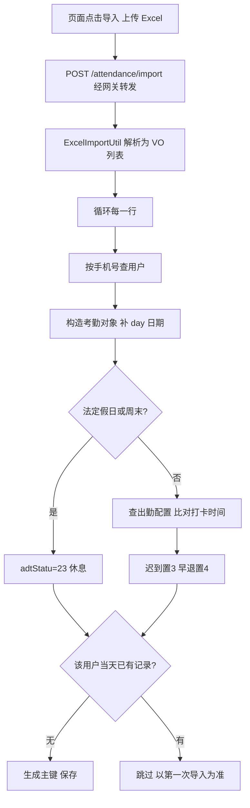

# 考勤数据导入落地：页面上传、解析 VO、组装入库的五步实现

工具类用 `AtteUploadVo` 实测通过之后，导入只剩把链路接起来这件事：页面点上传，请求进 Controller，Service 里完成「解析、查用户、造对象、判状态、防重入库」。这五步每一步都藏着取舍，最典型的是查用户走不走远程调用、迟到早退的时间比较怎么做才不出错。这一课把三个环节拆开讲透，写完这一篇，考勤数据就能真正落进 `atte_attendance` 表。

## 先给结论

- 接口是 `POST /attendance/import`，用 `@RequestPart("file") MultipartFile` 接收文件；Excel 里没有企业归属，`companyId` 必须由 Controller 从登录态取出传下去。
- Service 五步走：解析 Excel 成 VO 列表、循环逐行按手机号查用户、构造考勤对象、判定休假与迟到早退状态、查重后保存，重复导入以第一次为准。
- 查用户不走微服务远程调用：一次导入上万行，每行一次 HTTP 太慢，所有表同库，直接注入 `UserDao.findByMobile` 是有意识的折中。
- 休假判定靠配置：法定假日与调休上班日写在 yml 里注入字符串，命中假日、或周末且非调休上班日，状态置 23 休息。
- 迟到早退靠 `DateUtil.comparingDate` 把规定时间与打卡时间都归一成 `HH:mm:ss` 再比较，返回「第一个参数是否在第二个之后」，迟到取非、早退不取非，两个条件方向相反。

## 一、步骤拆解：接口、网关与五步任务

页面上有「导入」按钮，点击选择文件后上传。打开浏览器开发者工具的 Network 面板观察这次请求：路径是 `attendance/import`，方式 POST，请求体是名为 `file` 的文件。考勤设置与考勤管理同属一个微服务，但挂在不同的请求前缀下，网关要为 `attendance` 前缀补一条路由：

```yaml
zuul:
  routes:
    cfg:
      path: /cfg/**                  # 考勤设置, 之前已配置
      serviceId: example-attendance
      stripPrefix: false
    attendance:
      path: /attendance/**           # 考勤管理, 本次新增
      serviceId: example-attendance  # 同一个考勤微服务
      stripPrefix: false
```

Controller 是常规骨架，重点是参数怎么接、企业 id 从哪来：

```java
@RestController
@RequestMapping("/attendance")
public class AttendanceController extends BaseController {

    @Autowired
    private ExcelImportService excelImportService;

    /**
     * 上传考勤数据 Excel
     * 请求: POST /attendance/import  参数: file
     */
    @RequestMapping(value = "/import", method = RequestMethod.POST)
    public Result importExcel(@RequestPart("file") MultipartFile file) throws Exception {
        // 上传的文件里没有企业归属, 企业id 必须从登录态取
        excelImportService.importAttendanceExcel(file, companyId);
        return new Result(ResultCode.SUCCESS);
    }
}
```

Spring Boot 把上传文件封装成 `MultipartFile` 文件对象，`@RequestPart` 的名字与前端表单字段 `file` 对应。文件上传成功与否接口层其实不用关心细节，它只负责把文件与 `companyId` 转交 Service，解析失败与入库细节都收在 Service 里。导入逻辑与其他考勤代码分开，单独建一个专管 Excel 的 `ExcelImportService`，注入它需要的四个依赖与两份假期配置：

```java
@Log4j2
@Service
public class ExcelImportService {

    @Autowired
    private UserDao userDao;
    @Autowired
    private AttendanceDao attendanceDao;
    @Autowired
    private AttendanceConfigDao attendanceConfigDao;
    @Autowired
    private IdWorker idWorker;

    @Value("${atte.holidays}")      // 法定假日, 如 0101,1001,1002,1003
    private String holidays;
    @Value("${atte.workingDays}")   // 调休上班日, 如 0927,0929
    private String workingDays;
}
```

方法骨架把任务注释先立好，实现逐段填充：

```java
/**
 * 处理考勤数据的文件上传
 * 参数: excel 文件, 企业id
 */
public void importAttendanceExcel(MultipartFile file, String companyId) throws Exception {
    // 1.将导入的 excel 文件解析为 VO 的 list 集合
    // 2.循环 list 集合
    // 2.1 根据上传的手机号查询用户
    // 2.2 构造考勤对象
    // 2.3 判断是否休假
    // 2.4 判断迟到早退状态
    // 2.5 查询用户是否已有考勤记录, 不存在才保存
}
```

整条链路画成图，后面的章节就是把图中每个框换成代码：



## 二、解析成 VO：接上工具类，模板补一列

第一步调上一课测好的工具类，输入流直接取自上传文件：

```java
// 1.将导入的 excel 文件解析为 VO 的 list 集合
List<AtteUploadVo> list = new ExcelImportUtil<>(AtteUploadVo.class)
        .readExcel(file.getInputStream(), 1, 0);
// 2.循环 list 集合
for (AtteUploadVo atteUploadVo : list) {
}
```

起始行 1 跳过表头，起始列 0 从姓名列读起，得到的每个 `AtteUploadVo` 就对应 Excel 里一名员工一天的打卡。

实现往下走之前，模板要先补一列。判休假、判重、按月统计都需要一个纯日期的键，从「2019-7-1 8:30」这种日期时间里反复截取很别扭，直接在 Excel 末尾加一列「考勤日期」，VO 加一个字段承接：

```java
@Data
@ToString
public class AtteUploadVo {

    // 员工姓名 手机号 工号 上班时间 下班时间 考勤日期
    @ExcelAttribute(sort = 0, format = "String")
    private String username;
    @ExcelAttribute(sort = 1, format = "String")
    private String mobile;
    @ExcelAttribute(sort = 2, format = "String")
    private String workNumber;
    @ExcelAttribute(sort = 3, format = "Date")
    private Date inTime;
    @ExcelAttribute(sort = 4, format = "Date")
    private Date outTime;
    // 考勤日期, 紧凑格式如 20190701
    @ExcelAttribute(sort = 5, format = "String")
    private String atteDate;
}
```

考勤实体 `Attendance` 本来就带 `String day` 字段，直接从 VO 拿值填进去。这一列的格式必须是 `20190701` 这种紧凑形式：后面的法定假日匹配与周末判断都按 `yyyyMMdd` 解析，写成 `2019-07-01` 会让这两个判断全部落空。不想加列的话，也可以在代码里用 `DateUtil.parseDate2String(vo.getInTime(), "yyyyMMdd")` 从上班时间格式化生成，两种做法二选一，课程最终采用加列方案，格式责任交给人事整理时一次性保证。

## 三、组装实体入库：查用户、判状态、防重

### 3.1 按手机号查用户，以及不走远程调用的取舍

Excel 里的姓名手机号工号，要落成考勤记录必须先变成系统里的 `User`。正规的微服务姿势是考勤服务发 HTTP 请求调系统微服务取用户。但算一笔账就知道问题：一个公司几百上千名员工，每天都有考勤记录，一次导入几万行，每行一次远程调用，光网络往返就拖垮整个导入。课程采用的折中方案是，考勤与系统的表本来就在同一个数据库，直接把 `UserDao` 注入进来同库查询：

```java
public interface UserDao extends JpaRepository<User, String>,
        JpaSpecificationExecutor<User> {

    public User findByMobile(String mobile);

    List<User> findByCompanyId(String companyId);
}
```

SaaS 系统注册时手机号全局唯一，按手机号查用户最稳。这个取舍要辩证看：它牺牲了服务间的边界隔离，换来导入性能；如果哪天两个模块拆库拆服务，这里必须改成批量接口（一次请求带走整批用户的映射），而不是逐行远程调用。

### 3.2 构造考勤对象

查到用户之后，把 VO 与 User 的信息组装成 `Attendance`。字段一个个 `set` 太啰嗦，实体上专门备了一个构造方法：

```java
public Attendance(AtteUploadVo vo, User user) {
    this.adtInTime = vo.getInTime();
    this.adtOutTime = vo.getOutTime();
    this.userId = user.getId();
    this.companyId = user.getCompanyId();
    this.departmentId = user.getDepartmentId();
    this.jobStatu = user.getInServiceStatus();
}
```

企业、部门、在职状态都从用户对象取，Excel 与登录态只提供原料，数据归属在组装时天然对齐。补上考勤日期：

```java
// 2.1 根据上传的手机号查询用户
User user = userDao.findByMobile(atteUploadVo.getMobile());
// 2.2 构造考勤对象, 补考勤日期
Attendance attendance = new Attendance(atteUploadVo, user);
attendance.setDay(atteUploadVo.getAtteDate());
```

### 3.3 判断是否休假

考勤机导出的数据有一种坑：某天只有一条零散记录，其实那天是周末或法定假日，人根本没来。不做处理，这条记录会被当成旷工。判定思路是把假日「声明」出来，而不是让程序猜。法定假日与调休上班日都放进配置文件：

```yaml
atte:
  holidays: 0101,1001,1002,1003   # 元旦与国庆假期
  workingDays: 0927,0929          # 调休: 周末上班补长假
```

假日写配置文件还是写数据库，取决于变更频率：假日一年一改，配置文件够用，改完重启生效；要运营随时维护就上字典表。判定代码两段：

```java
// 2.3 判断是否休假
if (holidays.contains(attendance.getDay())) {
    attendance.setAdtStatu(23);                                  // 法定假日休息
} else if (DateUtil.isWeekend(attendance.getDay())
        && !workingDays.contains(attendance.getDay())) {
    attendance.setAdtStatu(23);                                  // 周末且非调休上班日
}
```

第一段看日期字符串是否命中假日列表；第二段判断周末，还要排除「调休上班」的周末：国庆凑七天长假，前后某个周六周日是要上班的，这样的周末不能放。工具方法 `DateUtil.isWeekend` 内部把 `yyyyMMdd` 字符串解析成日历，取 `DAY_OF_WEEK` 判断。

### 3.4 判断迟到早退

非假日的记录要与该部门的出勤配置比对。配置表按企业加部门定位，上一课的派生查询直接复用：

```java
// 2.4 查询当前员工部门的出勤配置
AttendanceConfig ac = attendanceConfigDao
        .findByCompanyIdAndDepartmentId(companyId, user.getDepartmentId());
```

`AttendanceConfig` 里四个时间字段都是 `HH:mm` 形式的字符串：`morningStartTime` 上午上班、`morningEndTime` 上午下班、`afternoonStartTime` 下午上班、`afternoonEndTime` 下午下班。比较工具方法长这样：

```java
public static boolean comparingDate(String target, Date sourceDate) throws Exception {
    Date date1 = new SimpleDateFormat("HH:mm:ss").parse(target);
    String t = new SimpleDateFormat("HH:mm:ss").format(sourceDate);
    Date date2 = new SimpleDateFormat("HH:mm:ss").parse(t);
    return date1.after(date2);
}
```

这个方法是整个判定的题眼。规定时间直接按 `HH:mm:ss` 解析；打卡时间是完整 `Date`，先 `format` 成 `HH:mm:ss` 再解析回来，两边都被剥掉了年月日，落在「同一天的几点几秒」这一个水平线上比较，返回值回答「规定时间是否在打卡时间之后」。两个方向的判断由此得来：

```java
// 迟到: 打卡晚于规定上班时间, 即规定时间不在打卡时间之后
if (!DateUtil.comparingDate(ac.getMorningStartTime(), atteUploadVo.getInTime())) {
    attendance.setAdtStatu(3);                       // 迟到
}
// 早退: 打卡早于规定下班时间, 即规定时间在打卡时间之后
if (DateUtil.comparingDate(ac.getAfternoonEndTime(), atteUploadVo.getOutTime())) {
    attendance.setAdtStatu(4);                       // 早退
}
```

规定上班 8:30、打卡 10:00，`8:30.after(10:00)` 为假，取非命中迟到；规定下班 18:00、打卡 17:00，`18:00.after(17:00)` 为真，直接命中早退。两个 if 一个取非一个不取非，因为 `comparingDate` 只回答一个方向的问题，迟到与早退恰好站在它的两侧。照抄同款条件把早退也取非，判出来的会是加班。两个判断都不命中，就是正常出勤，状态保持默认。

### 3.5 防重与保存

最后一步守门：同一用户同一天只能有一条记录，以第一次导入为准，防止反复导入覆盖出「完美考勤」：

```java
// 2.5 查询该用户当天是否已有考勤记录
Attendance exist = attendanceDao
        .findByUserIdAndDay(user.getId(), attendance.getDay());
if (exist == null) {
    attendance.setId(idWorker.nextId() + "");        // 不存在才生成主键保存
    attendanceDao.save(attendance);
}
```

`findByUserIdAndDay` 是按视频写法在 dao 里补的派生查询，考勤 dao 的真实声明如下：

```java
@Repository
public interface AttendanceDao extends JpaRepository<Attendance, String>,
        JpaSpecificationExecutor<Attendance> {

    Attendance findByUserIdAndDay(String userId, String day);
}
```

到这里五步全部落地，完整方法体就是前面各段按 1、2.1 到 2.5 的顺序拼装。跑一次真实导入验证：上传模板，考勤列表里出现张三当天的记录，状态按打卡时间正确显示正常或迟到；再传一次同样的文件，列表不变，防重生效。

## 常见误区

- **企业 id 试图从文件里拿**：Excel 模板里没有也不该有企业信息，`companyId` 只能由 Controller 从登录态解析后传入 Service。文件里出现企业字段也一律忽略，否则等于把跨租户写数据的口子开给了文件制作者。
- **`comparingDate` 的参数顺序与返回方向搞混**：第一个参数是规定时间的字符串，第二个是打卡的 `Date`，返回「规定时间是否在打卡时间之后」。迟到要取非，早退不取非，把两个条件写成同款，早退会判成加班。
- **考勤日期格式不统一**：假日匹配 `holidays.contains` 与周末判断 `isWeekend` 都按 `yyyyMMdd` 紧凑格式工作，单元格里写 `2019-07-01` 会让休假判定全部落空，记录被误判成旷工。模板列格式与代码解析格式必须逐字对上。
- **直接照抄周末判断工具**：`Calendar.DAY_OF_WEEK` 的编号是周日为 1、周六为 7，资料里的 `isWeekend` 做了减 1 后判断 0 与 5，按标准编号 5 对应的是周五而不是周六。抄任何日期工具前先写两三个用例验证，周末判定错了，全年考勤跟着错。
- **重复导入直接 `save`**：JPA 按主键决定插入或更新，逐次生成新主键的 `save` 只会不断堆重复记录。入库前按「用户加日期」查一次，存在即跳过；更硬的保障是在表上加唯一索引兜底。

## 面试可能被问到的问题

1. 面试官追问：「导入时查用户为什么不用 Feign 调系统微服务，而是直接注入别家的 UserDao？」
   答：一次导入动辄上万行，逐行远程调用的网络开销不可接受。考勤与系统的表同库，直接查库是性能优先的折中。这个方案的代价是耦合了表结构与模块边界，一旦拆库就必须改造成批量查询接口，一次请求换回整批用户的映射，而不是简单回到逐行调用。

2. 面试官追问：「迟到早退的判定为什么要先把时间归一成 HH:mm:ss？」
   答：规定时间在配置里只是「几点几分」，打卡时间却带着完整日期。把两边都格式化成 `HH:mm:ss` 再解析，年月日被剥掉，比较就变成同一天的时刻比较，天然规避跨天、时区、日期部分不一致的干扰。归一化之后比较语义只剩一个方向问题，条件才写得简洁。

3. 面试官追问：「法定节假日和调休怎么维护比较好？」
   答：低频变更放配置文件，一年改一次，改完重启生效；需要运营人员随时维护就用字典表加管理界面，读取时可以加缓存。无论哪种载体，关键是数据格式与判定代码约定一致，并且要同时覆盖「假日休息」与「周末调休上班」两个方向。

4. 面试官追问：「批量导入怎么保证幂等？」
   答：定义业务唯一键，这里是用户 id 加考勤日期，入库前先查存在即跳过，实现「以第一次为准」；数据库层面对业务键建唯一索引做最后兜底，并发或重复提交时靠约束拒绝。两者结合，导入跑多少遍结果都一致。

5. 面试官追问：「考勤状态用 3、4、23 这种数字魔法值有什么问题？」
   答：可读性差、含义散落在注释里，新增状态要全代码搜索。应收敛成常量类或枚举，比如 `ATT_STATUS_LATE`，判定与展示共用同一份定义；落库仍是数字，代码里不再出现裸数字。

6. 面试官追问：「如果导入文件有十万行，这套实现要怎么优化？」
   答：逐行 `save` 会放大事务与网络开销，改成攒批后批量插入；逐行查用户改成按手机号集合一次查出建映射；解析换事件模型按流读取避免整簿进内存；校验前置，格式不合格的行先收集统一报告，不要解析一半入库一半。

## 配套资料

- 导入服务骨架：`materials/code/02/day15 考勤模块开发/day15/工具代码/工具类/考勤模块/service/ExcelImportService.java`（dao 注入与假期配置占位为真实骨架，方法体按本课视频实现补全，包名已改为 `com.example`）
- 考勤实体与组装构造器：`materials/code/02/day15 考勤模块开发/day15/工具代码/实体类/atte/entity/Attendance.java`（含 `Attendance(AtteUploadVo, User)`）
- 用户 dao（`findByMobile`）：`materials/code/02/day15 考勤模块开发/day15/工具代码/工具类/考勤模块/dao/UserDao.java`
- 考勤 dao 与出勤配置：同目录 `AttendanceDao.java`（`findByUserIdAndDay` 按视频写法补全）、`AttendanceConfigDao.java`（`findByCompanyIdAndDepartmentId`）；配置实体见 `materials/code/02/day15 考勤模块开发/day15/工具代码/实体类/atte/entity/AttendanceConfig.java`
- 日期工具：`materials/code/02/day15 考勤模块开发/day15/工具代码/工具类/utils/DateUtil.java`（`comparingDate`、`isWeekend`、`parseDate2String`，文中已提示其周末判断的编号问题）
- 解析工具与注解：`materials/code/02/day08 POI高级/POI高级/资源/代码/工具类/ExcelImportUtil.java`、同目录 `ExcelAttribute.java`；导入 VO：`materials/code/02/day15 考勤模块开发/day15/工具代码/实体类/atte/vo/AtteUploadVo.java`（`atteDate` 字段与网关路由、yml 假日配置为按视频写法补全的示例）
