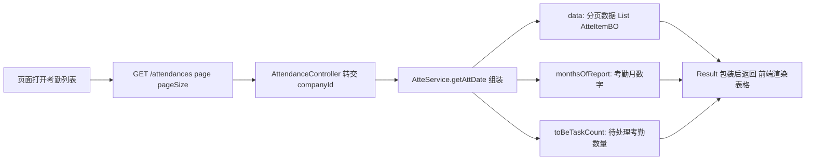

# 考勤列表需求分析：一份 Map 契约，按月分页看全员考勤明细

考勤数据落进 `atte_attendance` 表只是第一步，人事每天盯着的是列表页：打开当月考勤，全公司每个人、每一天的状态平铺在一屏里，谁缺卡、谁旷工一目了然。点开页面，Network 面板里躺着一个 404，`/attendances` 这个请求后端还没有实现。先把接口契约拆清楚再动笔：请求带什么，返回的 Map 里装哪三块内容，写代码之前必须回答哪三个问题。

## 先给结论

- 列表接口是 `GET /attendances`，携带 `page` 与 `pageSize` 两个分页参数，企业 id 由 `BaseController` 从登录态解析，前端不参与传值。
- 返回值主体是一个 Map，约定三个键：`data` 装分页数据，`monthsOfReport` 装考勤月，`toBeTaskCount` 装待处理考勤数量。
- `data` 的每一行是一个 `AtteItemBO`：员工基本信息加上当月每天一条考勤记录，31 天的月份就是 31 条，缺的日子由后端补旷工。
- 考勤月不允许前端随便指定，统一取企业设置表 `sa_company_settings` 的 `dataMonth` 字段。
- 动笔前的收尾：导入的状态判定链路还缺一个 else 分支，非假日、不迟到不早退的记录要置 1 正常。

## 一、导入收尾：把「正常」状态补上

导入的判定只覆盖了「有问题」的记录：假日休息、迟到、早退各有归属，全都命不中的记录还没有出口。把迟到早退的判定收拢成一条链，最后补上 else：

```java
// 2.4 判定状态: 迟到早退都未命中, 即正常出勤
if (!DateUtil.comparingDate(ac.getMorningStartTime(), atteUploadVo.getInTime())) {
    attendance.setAdtStatu(3);                        // 打卡晚于规定上班时间, 迟到
} else if (DateUtil.comparingDate(ac.getAfternoonEndTime(), atteUploadVo.getOutTime())) {
    attendance.setAdtStatu(4);                        // 打卡早于规定下班时间, 早退
} else {
    attendance.setAdtStatu(1);                        // 正常出勤
}
```

状态字段 `adt_statu` 的取值在数据库里有一份字典说明，后面所有功能都围绕它展开：

| 状态值 | 含义 |
|---|---|
| 1 | 正常 |
| 2 | 旷工 |
| 3 | 迟到 |
| 4 | 早退 |
| 8 | 请假 |
| 17 | 调休 |
| 23 | 休息（假日或周末） |

重启微服务验证一次：先把表里的旧记录清空，再上传一份测试 Excel。库里落了三条记录，两条状态 1，一条下午 12:30 打下班卡的记录状态 4 早退，判定与字典一致，导入链路正式收官。

## 二、列表请求长什么样

打开考勤页面，Network 面板立刻能看到一个失败的请求：`GET /attendances`，携带 `page` 与 `pageSize`。页面一进来就发它，说明「查当月考勤列表」是考勤模块的主接口；404 只是因为后端还没写。考勤相关的请求都打在 `/attendances` 前缀下，Controller 骨架如下：

```java
@RestController
@RequestMapping("/attendances")
public class AttendanceController extends BaseController {

    @Autowired
    private AtteService atteService;

    /**
     * 查询考勤数据列表
     * 请求: GET /attendances  参数: page, pageSize
     */
    @RequestMapping(value = "", method = RequestMethod.GET)
    public Result getAttDate(int page, int pageSize) throws Exception {
        // 企业id 由 BaseController 提供, 前端不传
        Map map = atteService.getAttDate(companyId, page, pageSize);
        return new Result(ResultCode.SUCCESS, map);
    }
}
```

两个分页参数用基本类型 `int` 直接接收，参数名必须与前端完全一致，写错就拿不到值。方法真正的复杂度全部压进 `getAttDate`，Controller 只做转交与包装。

## 三、返回值契约：Map 里的三块内容

返回的 `Result` 外壳不变，数据部分是一个 Map，键有三个。整条链路画出来是这样：



`data` 是大头，它的每个元素对应列表的一行，结构由 `AtteItemBO` 定义，资料包里的真实字段如下：

```java
@Data
public class AtteItemBO {

    //编号
    private String id;
    //名称
    private String username;
    //工号
    private String workNumber;
    //部门
    private String departmentName;
    //手机
    private String mobile;
    //考勤记录: 当月每天一条
    private List<Attendance> attendanceRecord;
    //部门ID
    private String departmentId;
}
```

前六个字段是员工属性，值来自用户表；`attendanceRecord` 是历史集合，存当前月份每天的考勤，一个月 30 天就是 30 个 `Attendance`。前端拿到一行，横向铺开就是这个人整月的出勤日历。另外两个键是页面顶部区域需要的：`monthsOfReport` 告诉页面当前展示的是几月，`toBeTaskCount` 给出待处理的考勤数量，本期先占位为 0。

## 四、写代码前必须回答的三个问题

**第一，考勤月是什么时候。** 列表展示哪个月不能由前端随口指定，一月份二月份乱传，同一份数据会被渲染成不同口径。这个月份是企业级配置，放在企业设置表里，`sa_company_settings` 的 `dataMonth` 字段记录当前要处理的年月（如 `201908`），一企一行，全公司共享一份。

**第二，分页怎么分。** 一家公司几百人，一个月几千条记录，一次全查前端也渲染不动。分页的对象是用户而不是考勤记录：一页取 10 个用户，每个用户再展开当月每天的记录。分错维度，一页 10 条记录可能全属于同一个人，其他人的行就凑不齐。

**第三，怎么查。** 每一行除了考勤记录还要员工的基本信息，两部分数据来自两张表；更要紧的是，员工某一天可能根本没有打卡记录，查不到的日子要补一条旷工状态的记录返回，否则前端的日历格子会错位，人事也看不出这天到底是没数据还是旷工。

三个问题分别对应 `getAttDate` 方法的三段实现，下一篇逐段写完。

## 常见误区

- **分页分在考勤记录上**：按 `Page<Attendance>` 一页取 10 条，同一个人的记录被切开，列表行的语义完全乱掉。分页对象是用户，记录按人补齐。
- **`monthsOfReport` 原样返回 `201908`**：前端要的是月份数字 8。`substring(4)` 转 `int` 的收尾工作在后端做完，别把格式化的负担甩给页面。
- **考勤月由前端参数传入**：展示口径属于企业配置，从前端接收等于任何人都能改口径，统计与归档就对不上账。
- **缺记录的日子直接跳过**：少一天前端就少一格，看板错位。查不到必须补一条旷工记录占住格子，也给人事留一个可修改的入口。

## 面试可能被问到的问题

1. 面试官追问：「列表接口为什么返回 Map 而不定义一个 VO？」
   答：快速迭代阶段返回结构还在变，Map 加约定键最省事；代价是失去编译期检查，键名写错要到联调才暴露。结构稳定后应当沉淀成 VO，把契约固化成类型。

2. 面试官追问：「为什么按用户分页，而不是按考勤记录分页？」
   答：页面的展示维度是人，一行是一个人整月的日历。先分页锁定本页用户，再为每人补全当月记录，行数由分页参数控制，每行格子数恒等于当月天数，两层结构互不干扰。

3. 面试官追问：「某天没有考勤记录怎么处理？」
   答：后端补一条旷工状态的记录返回，保证日历每天一格。没有记录只有两种可能：真旷工，或者数据没导入，无论哪种都该被人看见。人事发现误判可以在页面修改，编辑接口在后面的课程实现。

4. 面试官追问：「考勤月为什么存在企业设置表里？」
   答：它是全公司共享的展示口径，存 `sa_company_settings` 的 `dataMonth`，一次设置全体生效。散落在请求参数里，同一份数据会被不同口径渲染，月度报表与薪酬核算都无法对齐。

5. 面试官追问：「分页参数为什么要用 int 而不是 Integer？」
   答：分页参数是必填项，用基本类型配合前端约定，缺参时参数绑定直接失败，问题在入口暴露；用 Integer 会拿到 null，错误被推迟到分页计算时才以更隐晦的方式出现。

## 配套资料

- 列表行 BO：`materials/code/02/day15 考勤模块开发/day15/工具代码/工具类/考勤模块/domain/bo/AtteItemBO.java`
- 考勤实体（`adtStatu`、`day` 字段）：`materials/code/02/day15 考勤模块开发/day15/工具代码/实体类/atte/entity/Attendance.java`
- 企业设置实体（`dataMonth` 字段）：`materials/code/02/day15 考勤模块开发/day15/工具代码/实体类/salarys/CompanySettings.java`
- 用户 dao：`materials/code/02/day15 考勤模块开发/day15/工具代码/工具类/考勤模块/dao/UserDao.java`
- 考勤服务：`materials/code/02/day15 考勤模块开发/day15/工具代码/工具类/考勤模块/service/AtteService.java`（资料包内仅有依赖注入骨架，`getAttDate` 与 Controller 方法体按本课视频实现补全，包名已改为 `com.example`）
