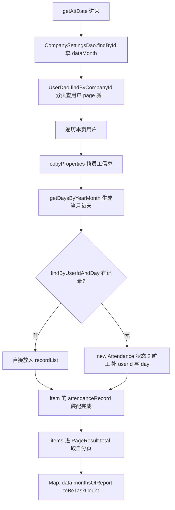

# 考勤列表代码实现：分页查用户，按天补齐考勤，组装 Map 返回

契约定好之后，剩下的就是把 `getAttDate` 这一个方法从上到下写完。它一次要干四件事：查企业设置拿考勤月、分页查用户、逐用户逐天补齐当月考勤、组装 Map 返回。每一步都不难，但每一步都有一个能把整页列表带歪的小坑：页码减不减一、原生 SQL 要不要声明、工具方法吃不吃完整日期、`copyProperties` 的参数方向。

## 先给结论

- `getAttDate` 四步走：查企业设置拿考勤月，分页查用户，逐用户逐天查考勤缺则补旷工，组装 Map 返回。
- 考勤月来自 `companySettingsDao.findById(companyId).get().getDataMonth()`，形如 `201908`。
- 分页查用户在 `UserDao` 里用 `@Query` 原生 SQL 配 `Pageable`，Spring Data 页码从 0 起，所以要传 `page - 1`。
- 当月天数由 `DateUtil.getDaysByYearMonth(dataMonth)` 生成 `20190801` 式的日期数组，逐天 `findByUserIdAndDay` 查询，查不到就 new 一条旷工记录（状态 2）占位。
- 返回 Map：`data` 用公共 `PageResult(total, rows)` 包装，`toBeTaskCount` 占位 0，`monthsOfReport` 是 `Integer.parseInt(dataMonth.substring(4))`。

## 一、第一步：考勤月从企业设置表来

`sa_company_settings` 一企一行，主键就是企业 id，`dataMonth` 记录当前要处理的年月：

```java
@Entity
@Table(name = "sa_company_settings")
@Data
public class CompanySettings implements Serializable {

    @Id
    private String companyId;      // 企业id, 一企一行
    private Integer isSettings;    // 是否设置: 0 未设置 1 已设置
    private String dataMonth;      // 当前显示报表月份, 如 201908
}
```

dao 用主键查即可，拿到实体后取字段：

```java
// 1.查询企业设置, 得到当前考勤月
CompanySettings settings = companySettingsDao.findById(companyId).get();
String dataMonth = settings.getDataMonth();          // 如 201908
```

考勤月是后面所有查询的时间锚点，只在方法开头取一次，整月的天数、模糊匹配的月份前缀都由它派生。

## 二、第二步：分页查用户

列表的分页维度是用户。`UserDao` 补一个分页方法，课程采用原生 SQL 写法：

```java
@Query(value = "select * from bs_user where company_id = ?1", nativeQuery = true)
Page<User> findByCompanyId(String companyId, Pageable pageable);
```

单表等值查询也可以用派生查询 `Page<User> findByCompanyId(String companyId, Pageable pageable);`，两种等价，原生 SQL 胜在直白，表名 `bs_user` 一眼可见。Service 里组装分页请求：

```java
// 2.分页查询当前企业的用户, 页码从 0 起
Page<User> userPage = userDao.findByCompanyId(companyId, PageRequest.of(page - 1, size));
```

用 `Page` 而不是 `List` 接收，是要顺带拿到 `getTotalElements()` 的总记录数，等会组装 `PageResult` 要用；本页内容从 `getContent()` 取。

## 三、第三步：逐用户逐天补齐当月考勤

每个用户构造一个 `AtteItemBO`。BO 里的员工字段（`id`、`username`、`workNumber`、`departmentName`、`mobile`、`departmentId`）与 `User` 实体一一同名，借 `BeanUtils.copyProperties` 一次性拷贝，不用手写六个 `set`：

```java
// 3.循环用户, 每人构造一个 AtteItemBO
List<AtteItemBO> items = new ArrayList<>();
for (User user : userPage.getContent()) {
    AtteItemBO item = new AtteItemBO();
    // 同名属性一次性拷贝: 第一个参数是源对象 user, 拷到 item
    BeanUtils.copyProperties(user, item);

    List<Attendance> recordList = new ArrayList<>();
    // 3.1 获取考勤月的所有天: 20190801 20190802 ...
    String[] days = DateUtil.getDaysByYearMonth(dataMonth);
    for (String day : days) {
        // 3.2 查该用户当天是否已有考勤记录
        Attendance attendance = attendanceDao.findByUserIdAndDay(user.getId(), day);
        if (attendance == null) {
            // 没有记录: 构造一条旷工占位, 页面上可以再修改
            attendance = new Attendance();
            attendance.setAdtStatu(2);                 // 旷工
            attendance.setUserId(user.getId());
            attendance.setDay(day);
        }
        recordList.add(attendance);
    }
    item.setAttendanceRecord(recordList);
    items.add(item);
}
```

`getDaysByYearMonth` 是资料包里的真实工具方法：传入 `yyyyMM` 六位年月，返回该月每一天的 `yyyyMMdd` 字符串数组，8 月就是 31 个元素。循环体里那句「查不到就补旷工」是列表逻辑的灵魂：没有记录不等于可以空着，补上状态 2 的占位记录，前端每天一格，人事也拿到了一个待修正的入口。

## 四、第四步：组装 Map 返回

三个键按契约装好：

```java
// 4.组装返回的 Map
PageResult<AtteItemBO> pageResult =
        new PageResult<>(userPage.getTotalElements(), items);
Map<String, Object> map = new HashMap<>();
map.put("data", pageResult);                                // 分页数据
map.put("toBeTaskCount", 0);                                // 待处理考勤数量, 占位
map.put("monthsOfReport", Integer.parseInt(dataMonth.substring(4)));  // 只给月份数字
return map;
```

`PageResult` 是公共模块的分页对象，构造参数就是总记录数加当前页数据，`total` 直接取自刚才的分页查询。`"201908".substring(4)` 得到 `"08"`，转成 int 就是 8，前端要的月份到此已经在后端处理完。



图里两条分支最后汇进同一个格子集合，`PageResult` 的 total 却来自用户分页，这就是「分用户、补记录」两层结构在代码里的样子。

## 五、启动验证

重启微服务，页面刷新：列表按 10 人一页铺开，每人当月每天一格。测试库的考勤月指向 8 月，而表里只有 7 月的导入数据，所以整屏都是旷工，这恰好证明补旷工逻辑在正常工作；这些误判正是下两课「修改考勤记录」要处理的对象。

## 常见误区

- **页码忘了减一**：`PageRequest.of(page, size)` 会把第一页跳过去，前端传 1 查到的其实是第二页。Spring Data 的页码从 0 开始，接收后先减一。
- **`@Query` 忘写 `nativeQuery = true`**：默认按 JPQL 解析，`select * from bs_user` 里的表名在实体世界里不存在，应用启动时就抛异常。
- **`getDaysByYearMonth` 传了完整日期**：它只认 `yyyyMM` 六位，把 `20190801` 传进去日历直接错乱，当月天数全不对。
- **`copyProperties` 参数写反**：Spring 版签名是「源对象在前、目标对象在后」，写反了 BO 全空还不报错，页面上整列空白，很难一眼定位。
- **缺记录不补旷工直接跳过**：前端格子错位只是表象，更麻烦的是这条数据从此没有修正入口。

## 面试可能被问到的问题

1. 面试官追问：「Page 和 List 接收分页结果差在哪？」
   答：`Page` 除内容外还带总记录数、总页数等元信息，组装 `PageResult` 时 `total` 直接取 `getTotalElements()`；用 `List` 接收就拿不到总数，分页条无法渲染，只能再发一次 count 查询。

2. 面试官追问：「原生 SQL 和 JPQL 这里怎么选？」
   答：单表等值查询两者等价。JPQL 面向实体，改表名不用动 SQL；原生 SQL 直白，便于直接复用 DBA 给出的语句。团队内统一一种即可，混用会让同类查询出现两种心智模型。

3. 面试官追问：「逐用户逐天查询有什么隐患？」
   答：一页 10 人乘 31 天就是三百多次 `findByUserIdAndDay`，是典型的查询次数放大。人数上来后应改成一条 SQL 查出本页用户当月全部记录，按 `userId + day` 分组到内存再补旷工，查询次数降到常数级。

4. 面试官追问：「旷工为什么查询时补，而不是落库固化？」
   答：没有记录不等于旷工，可能只是数据没导入。读时补齐是展示层的兜底，不污染原始数据；一旦落库，误判就变成脏数据，修正还得走编辑接口清理。展示口径与事实数据分离，是报表类功能的基本功。

5. 面试官追问：「HashMap 返回给前端，键的顺序有问题吗？」
   答：没有。前端按键名取值，与顺序无关。真正要守的是键名契约：`data`、`monthsOfReport`、`toBeTaskCount` 任何一个拼错，页面对应区域就空白，而且不报错。

## 配套资料

- 考勤服务骨架（dao 注入齐全，`getAttDate` 方法体按本课视频实现补全）：`materials/code/02/day15 考勤模块开发/day15/工具代码/工具类/考勤模块/service/AtteService.java`
- 用户 dao（`findByCompanyId` 真实存在，分页重载按视频写法补全）：`materials/code/02/day15 考勤模块开发/day15/工具代码/工具类/考勤模块/dao/UserDao.java`
- 考勤 dao（`findByUserIdAndDay` 按视频写法补全）：`materials/code/02/day15 考勤模块开发/day15/工具代码/工具类/考勤模块/dao/AttendanceDao.java`
- 日期工具（`getDaysByYearMonth` 真实实现）：`materials/code/02/day15 考勤模块开发/day15/工具代码/工具类/utils/DateUtil.java`
- 企业设置实体：`materials/code/02/day15 考勤模块开发/day15/工具代码/实体类/salarys/CompanySettings.java`
- 公共分页对象（`total` 加 `rows` 构造）：`materials/code/02/day01 SAAS-HRM系统概述与搭建环境/SAAS-HRM系统概述与搭建环境/资源/通用代码/common/PageResult.java`
