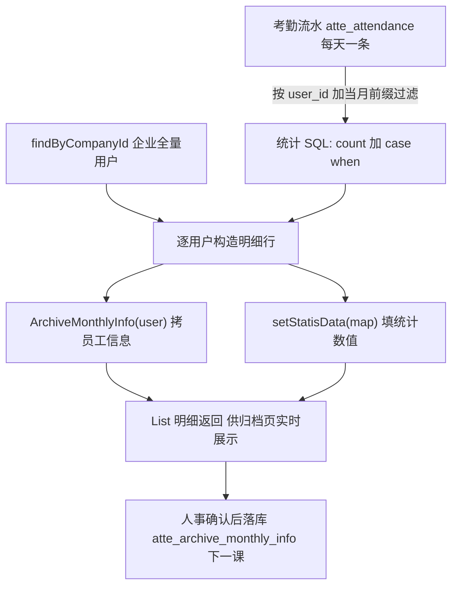

# 考勤归档第一步：用一条统计 SQL 查出月报表数据

月底人事要把当月考勤封存成报表：每人正常几天、迟到几次、早退几次、旷工几天，确认无误后定稿归档，作为薪酬核算的依据。归档分两步走，先把报表数据实时统计出来给人看，确认口径没问题再落库。这一课做前一半：查看未归档的月报表数据。

## 先给结论

- 归档涉及两张表：`atte_archive_monthly` 存整月汇总（归档年月、总人数、全勤人数、是否归档），`atte_archive_monthly_info` 存每名员工的明细行。
- 查看接口 `GET /attendances/reports?atteDate=201907`，返回的是未归档状态的实时统计：每个用户一行明细，现场从考勤流水里算出来。
- 统计靠一条原生 SQL：`count(*)` 配 `case when adt_statu = 1 then 1 end` 按状态分别计数，结果以 Map 返回，别名 `at0`、`at1`、`at2` 与状态码一一对应。
- 明细对象 `ArchiveMonthlyInfo` 先用 `new ArchiveMonthlyInfo(user)` 拷入员工信息，再 `setStatisData(map)` 把统计值填进各字段。
- `day` 条件用 `like '201907%'` 模糊匹配当月，百分号在 dao 调用处拼上，不写死在 SQL 里。

## 一、归档要解决什么问题

列表页看的是单月明细，归档报表是汇总口径。汇总一旦定稿就要可追溯：薪酬按它算，争议按它查，所以先看后存。两张表分工明确：

```java
@Entity
@Table(name = "atte_archive_monthly")
@Data
public class ArchiveMonthly extends BaseEntity implements Serializable {

    @Id
    private String id;
    private String companyId;
    private String departmentId;

    private String archiveYear;          // 归档年份
    private String archiveMonth;         // 归档月份
    private Integer totalPeopleNum;      // 总人数
    private Integer fullAttePeopleNum;   // 全勤人数
    private Integer isArchived;          // 是否已归档
}
```

`ArchiveMonthly` 一月一行，服务归档列表页；`ArchiveMonthlyInfo` 一人一行，字段多达几十个，正常天数、各类假期天数、迟到早退次数、计薪天数都在里面，服务报表展示与后续薪酬核算。数据流向是：



本课只走到 G 这一步：请求过来时数据还未归档，明细必须现场统计；已归档的月份才从归档表里读，两条路径分开。

## 二、接口与明细实体

页面在归档区选好月份点查询，请求 `GET /attendances/reports`，参数 `atteDate` 是 `201907` 这样的六位年月：

```java
/**
 * 获取月报表数据(未归档的实时统计)
 * 请求: GET /attendances/reports  参数: atteDate 如 201907
 */
@RequestMapping(value = "/reports", method = RequestMethod.GET)
public Result getReports(String atteDate) throws Exception {
    return new Result(ResultCode.SUCCESS, atteService.getReports(atteDate, companyId));
}
```

明细实体的骨架与两个关键方法如下，员工信息的拷贝由构造器完成，统计值的填充由 `setStatisData` 完成：

```java
@Entity
@EqualsAndHashCode(callSuper = true)
@Table(name = "atte_archive_monthly_info")
@Data
public class ArchiveMonthlyInfo extends BaseEntity implements Serializable {

    @Id
    private String id;
    private String userId;
    private String atteArchiveMonthlyId;   // 所属的月归档id
    private String name;
    private String workNumber;
    private String mobile;
    private String department;
    // 以下省略各类假期与计薪天数字段
    private String normalDays;             // 正常天数
    private String absenceDays;            // 旷工天数
    private String laterTimes;             // 迟到次数
    private String earlyTimes;             // 早退次数
    private String leaveDays;              // 请假天数
    private String dayOffLeaveDays;        // 调休天数

    // 用用户信息初始化明细行
    public ArchiveMonthlyInfo(User user) {
        this.userId = user.getId();
        this.name = user.getUsername();
        this.workNumber = user.getWorkNumber();
        this.department = user.getDepartmentName();
        this.mobile = user.getMobile();
    }

    // 从统计结果 Map 里取值填充
    public void setStatisData(Map map) {
        this.normalDays = map.get("at1").toString();
        this.absenceDays = map.get("at2").toString();
        this.laterTimes = map.get("at3").toString();
        this.earlyTimes = map.get("at4").toString();
        this.leaveDays = map.get("at8").toString();
        this.dayOffLeaveDays = map.get("at17").toString();
    }
}
```

`setStatisData` 里的键名 `at1` 到 `at17` 就是下一节 SQL 里各个计数的别名，两边是对得上号的契约。

## 三、统计 SQL：count 加 case when

统计一个用户当月考勤，第一反应是查流水回 Java 里数。但每行都要十几个统计值，逐个遍历太啰嗦，直接让数据库用一条 SQL 数完。先从最朴素的版本推起：

```sql
-- 第一步: 数出某人当月有几条考勤流水
SELECT COUNT(*) FROM atte_attendance
WHERE user_id = '1' AND day LIKE '201907%';

-- 第二步: 在 count 里嵌 case when, 按状态分别计数
SELECT COUNT(*)                                            AS at0,
       COUNT(CASE WHEN adt_statu = 1  THEN 1 END)          AS at1,
       COUNT(CASE WHEN adt_statu = 2  THEN 1 END)          AS at2,
       COUNT(CASE WHEN adt_statu = 3  THEN 1 END)          AS at3,
       COUNT(CASE WHEN adt_statu = 4  THEN 1 END)          AS at4,
       COUNT(CASE WHEN adt_statu = 8  THEN 1 END)          AS at8,
       COUNT(CASE WHEN adt_statu = 17 THEN 1 END)          AS at17
FROM atte_attendance
WHERE user_id = ?1 AND day LIKE ?2;
```

原理在 `COUNT` 对 null 不计数：状态命中时 `case when` 返回 1，不命中返回 null，`COUNT` 只数命中的行，每列自然就是该状态的天数。写法上有个著名的陷阱：给 `case when` 补上 `else 0`，所有列都会等于总条数，因为 0 也被数进去了；要的是「命中才计数」，所以只写 `then 1 end`。

落到 dao 上就是原生查询，多列结果按别名装进 Map：

```java
@Query(value = "select count(*) as at0, " +
        "count(case when adt_statu = 1 then 1 end) as at1, " +
        "count(case when adt_statu = 2 then 1 end) as at2, " +
        "count(case when adt_statu = 3 then 1 end) as at3, " +
        "count(case when adt_statu = 4 then 1 end) as at4, " +
        "count(case when adt_statu = 8 then 1 end) as at8, " +
        "count(case when adt_statu = 17 then 1 end) as at17 " +
        "from atte_attendance where user_id = ?1 and day like ?2",
        nativeQuery = true)
Map statisByUser(String userId, String day);
```

字典里定义了哪些状态码，就照着多列几行 `case when`，写法完全重复。调用时第二个参数要自己拼上模糊匹配的百分号：`atteDate + "%"`，让 `like` 命中当月所有 `yyyyMMdd` 形式的日期。

## 四、组装明细列表

Service 的职责就是把「每个用户一行明细」拼出来：

```java
// 查询未归档的月报表数据
public List<ArchiveMonthlyInfo> getReports(String atteDate, String companyId) throws Exception {
    // 1.查询企业全部用户
    List<User> users = userDao.findByCompanyId(companyId);
    List<ArchiveMonthlyInfo> list = new ArrayList<>();
    for (User user : users) {
        // 2.每个用户构造一行明细, 员工信息由构造器拷入
        ArchiveMonthlyInfo info = new ArchiveMonthlyInfo(user);
        // 3.统计该用户当月考勤, like 的百分号在调用处拼上
        Map map = attendanceDao.statisByUser(user.getId(), atteDate + "%");
        // 4.把统计结果填进明细字段
        info.setStatisData(map);
        list.add(info);
    }
    return list;
}
```

重启微服务验证：归档页切到 7 月，测试数据里员工 A01 有三条流水，两条正常一条早退，报表上他的正常天数是 2、早退次数是 1，口径与流水一致。确认过的报表数据才进入下一课的落库归档。

## 常见误区

- **`case when` 里补了 `else 0`**：`COUNT` 连 0 一起数，每一列都等于总条数，所有状态的统计值全部失真。命中才计数，只写 `then 1 end`。
- **百分号写死在 SQL 里**：`like '201907%'` 把月份焊死了，换月统计就得改 SQL。月份作为参数传入，百分号在调用处拼。
- **`setStatisData` 的键与 SQL 别名对不上**：`at1` 是正常、`at2` 是旷工，取错列报表数字不对还看不出错；SQL 里没有的别名直接 `null.toString()` 抛空指针。两边必须当成一份契约维护。
- **`@Query` 忘写 `nativeQuery = true`**：默认按 JPQL 解析，原生 SQL 里的表名与函数直接让启动失败。
- **已归档月份也实时重算**：归档的意义在于冻结口径，已归档的月份数据要读 `atte_archive_monthly_info`，实时统计只服务未归档月份。

## 面试可能被问到的问题

1. 面试官追问：「为什么用一条 SQL 聚合，而不是查出流水在 Java 里分组统计？」
   答：聚合在数据库完成，一次往返只传回一行统计值，省掉流水传输与内存分组。代价是状态码散在 SQL 里，维护靠注释与别名约定；统计维度稳定时这是更划算的取舍。

2. 面试官追问：「count 加 case when 统计各状态数量的原理是什么？」
   答：`case when` 命中返回 1、不命中返回 null，而 `COUNT(表达式)` 只统计非 null 的行，所以每个别名列就是对应状态的数量。补 `else 0` 反而失效，因为 0 会被一起数进去。

3. 面试官追问：「like '201907%' 这种前缀模糊匹配走得了索引吗？」
   答：前缀匹配可以走索引，通配符在后面的 `like` 与索引是兼容的；通配符打头才失效。按月统计频繁时，建 `(user_id, day)` 联合索引能把扫描范围压到单人单月。

4. 面试官追问：「归档为什么拆成汇总表和明细表两张？」
   答：粒度和消费者不同。汇总表一月一行，服务归档列表与是否归档的判断；明细表一人一行，服务报表展示与薪酬核算。合并成一张会让列表页背着几十个无关字段查库，明细也没法单独补录。

5. 面试官追问：「每个用户一条统计 SQL，人数多了怎么优化？」
   答：把 `user_id` 从 where 条件挪到 `group by`，一条 SQL 全公司一次算完，Java 只做行到对象的组装；再往上可以按月做定时预统计或加缓存，归档页读现成结果。

## 配套资料

- 月归档汇总实体：`materials/code/02/day15 考勤模块开发/day15/工具代码/工具类/考勤模块/domain/entity/ArchiveMonthly.java`
- 月归档明细实体（含 `ArchiveMonthlyInfo(User)` 构造器与 `setStatisData`）：`materials/code/02/day15 考勤模块开发/day15/工具代码/工具类/考勤模块/domain/entity/ArchiveMonthlyInfo.java`
- 归档 dao（`findByCompanyIdAndArchiveYear`、`findByAtteArchiveMonthlyId` 真实存在）：`materials/code/02/day15 考勤模块开发/day15/工具代码/工具类/考勤模块/dao/ArchiveMonthlyDao.java`、同目录 `ArchiveMonthlyInfoDao.java`
- 用户 dao（`findByCompanyId`）：`materials/code/02/day15 考勤模块开发/day15/工具代码/工具类/考勤模块/dao/UserDao.java`
- 考勤服务（资料包内为依赖注入骨架，`getReports` 按本课视频实现补全）：`materials/code/02/day15 考勤模块开发/day15/工具代码/工具类/考勤模块/service/AtteService.java`
- 归档服务骨架（`ArchiveService`，注入归档相关 dao，归档落库在下一课实现）：`materials/code/02/day15 考勤模块开发/day15/工具代码/工具类/考勤模块/service/ArchiveService.java`
