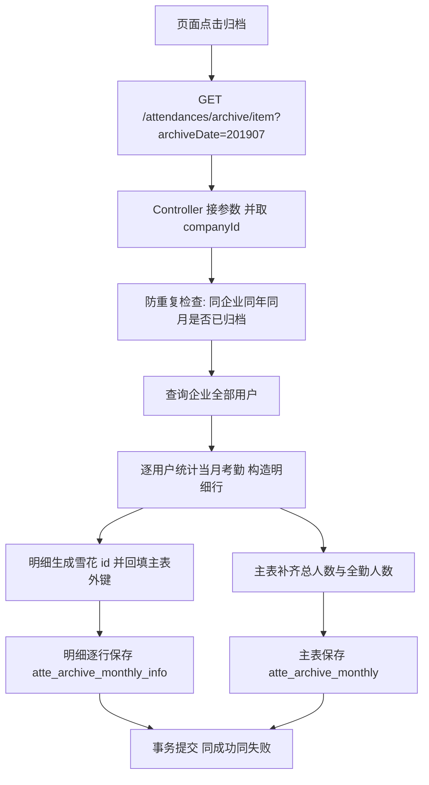

# 考勤月报定稿落库：把实时统计写进两张归档表

月报表的数据是请求过来时现场算的，关掉页面它就不存在了。人事核对完口径，点下「归档」按钮，这份数据要冻结下来：一个月一行汇总，一个员工一行明细，以后薪酬核算、劳动争议取证都查这份定稿。归档按钮背后是 `GET /attendances/archive/item?archiveDate=201907`，意思很直白：把 2019 年 7 月的考勤真正归档。

能查出来的数据就能存起来，所以这一步的难度不在查询，而在落库的秩序：主表和明细表两次 `save`，谁先谁后、id 谁来生成、外键怎么回填、重复点击归档怎么办，这些问题不处理好，归档表里就会留下对不上号的脏数据。

## 先给结论

- 归档做两件事：保存归档主表 `ArchiveMonthly` 一月一行，保存归档明细表 `ArchiveMonthlyInfo` 一人一行。
- 主表数据来自日期参数与企业查询：`substring(0, 4)` 切出年份，`substring(5)` 切出月份，总人数取 `users.size()`。
- 明细行主键与外键都要自己填：`IdWorker` 生成雪花 id，`atteArchiveMonthlyId` 回填主表 id，缺了任何一个明细就是孤儿数据。
- 两次落库必须包在同一个 `@Transactional` 事务里，主表成功明细失败要能整体回滚。
- 防重复归档靠「企业 id + 归档年份 + 归档月份」的组合查询，`ArchiveMonthlyDao` 里现成的 `findByCompanyIdAndArchiveYear` 就是干这个的。

## 一、归档接口：从页面按钮到 Controller

页面部分原本请求的路径有点问题，进入不了系统的统一请求前缀，在前端补上一个请求前缀后，F12 里看到的请求是 `GET /attendances/archive/item?archiveDate=201907`。Controller 里补一个方法承接它：

```java
/**
 * 数据归档
 * 请求: GET /attendances/archive/item?archiveDate=201907
 */
@RequestMapping(value = "/archive/item", method = RequestMethod.GET)
public Result archive(String archiveDate) throws Exception {
    // companyId 在统一鉴权后从登录信息中取得, 归档范围就是本企业
    archiveService.saveArchive(archiveDate, companyId);
    return new Result(ResultCode.SUCCESS);
}
```

Controller 只做三件事：声明请求方式与路径、接住 `archiveDate` 参数、把参数连同 `companyId` 交给 Service。归档成功与否的细节全部下沉到 Service 层，操作成功直接向前端返回成功，页面随后刷新归档列表。

## 二、Service 落库：主表一行，明细 N 行

上一课的报表查询只统计了明细部分，真正归档时上面的主表也要有数据。整段归档逻辑拆成两件事：构造主表数据，循环构造明细数据。

```java
// 数据归档: 主表一行 + 每个员工一行明细
@Transactional
public void saveArchive(String archiveDate, String companyId) {
    // 0.防重复: 同企业同年同月只允许归档一次
    String year = archiveDate.substring(0, 4);
    String month = archiveDate.substring(5);
    List<ArchiveMonthly> archived = atteArchiveMonthlyDao.findByCompanyIdAndArchiveYear(companyId, year);
    boolean duplicated = archived.stream()
            .anyMatch(a -> month.equals(a.getArchiveMonth()));
    if (duplicated) {
        throw new CommonException("该月考勤已归档, 请勿重复操作");
    }

    // 1.查询企业全部用户
    List<User> users = userDao.findByCompanyId(companyId);

    // 2.构造归档主表数据
    ArchiveMonthly archiveMonthly = new ArchiveMonthly();
    archiveMonthly.setId(idWorker.nextId() + "");
    archiveMonthly.setCompanyId(companyId);
    archiveMonthly.setArchiveYear(year);      // 201907 -> 2019
    archiveMonthly.setArchiveMonth(month);    // 201907 -> 07

    // 3.循环构造明细表数据
    for (User user : users) {
        ArchiveMonthlyInfo info = new ArchiveMonthlyInfo(user);
        // 明细主键由雪花算法生成
        info.setId(idWorker.nextId() + "");
        // 明细回填主表外键, 这是主从关系的纽带
        info.setAtteArchiveMonthlyId(archiveMonthly.getId());
        // 统计该用户当月考勤, like 的百分号在调用处拼上
        Map map = attendanceDao.statisByUser(user.getId(), archiveDate + "%");
        info.setStatisData(map);
        archiveMonthlyInfoDao.save(info);
    }

    // 4.补全主表统计项后保存
    archiveMonthly.setTotalPeopleNum(users.size());
    // 课上演示默认全员全勤, 严谨做法应按明细中的全勤标记统计
    archiveMonthly.setFullAttePeopleNum(users.size());
    archiveMonthly.setIsArchived(0);
    atteArchiveMonthlyDao.save(archiveMonthly);
}
```

几个容易含糊的点展开说一下。

**第一，年份和月份从参数里切出来。** 传进来的是 `201907` 这样的六位字符串，`substring(0, 4)` 从下标 0 拿前四位是 `2019`，月份从下标 5 拿到结尾是 `07`。下标差一位，年月就整体错位，这是字符串切日期最常见的翻车点。

**第二，主从两条纽带都要手工建立。** JPA 的 `@Id` 是字符串类型，数据库不会替你生成，主表和每行明细的 id 都由 `IdWorker`（雪花算法）产生。明细表通过 `atteArchiveMonthlyId` 字段指向主表，这个外键值就是主表刚生成的 id，有了它，按归档记录查明细的 `findByAtteArchiveMonthlyId` 才能查到东西。

**第三，主表的统计项在明细循环之后补齐。** 总人数就是用户列表长度；全勤人数课上演示直接取总人数，默认全员全勤，严谨的实现应该按明细行里的全勤标记二次统计；`isArchived` 归档时写入固定初始值 0，历史归档的查询按「企业 id + 年份」走，不依赖这个标志位。

整条归档链路串起来是这样：



关键路径在 D 和 K：D 挡住重复归档，K 保证主表与明细要么都落库要么都不落。这两关丢了，归档表迟早出脏数据。

## 三、防重复归档与事务边界

**归档是幂等性敏感的操作。** 页面上按钮连点两次，或者两人同时点归档，没有防重逻辑就会写出两套一模一样的月报，后续按归档记录查列表会出现两个 201907，薪酬口径直接乱掉。dao 里现成的 `findByCompanyIdAndArchiveYear(companyId, archiveYear)` 一次查出该企业该年的全部归档，再比对月份即可判断是否已归档，命中就抛业务异常终止。

**事务把两次 `save` 绑成原子操作。** 方法标上 `@Transactional` 后，明细保存到一半抛异常，已写入的明细和主表会一起回滚，不会出现「主表有了、明细缺了半个公司」的中间态。课上演示前先手工删光主表和从表的旧数据再归档，验证的就是这套「删干净、归完整」的闭环：归档完成后主表多出一行，明细表按员工人数多出对应行数，与月报表上的数字一一对应。

## 常见误区

- **`substring` 下标切错位**：想拿月份写成了 `substring(4, 6)` 固然也对，但配合 `substring(0, 4)` 的写法时，`substring(5)` 与 `substring(4)` 差一个字符，切出来的月份会带上多余的 0 或丢掉 0，归档年月对不上查询条件。
- **明细不生成 id 或不回填外键**：主键为空明细存不进去；外键为空明细存进去了却永远查不出来，属于最隐蔽的脏数据。
- **主表和明细不在同一个事务里**：中途失败留下半套归档数据，报表与归档对不上账。`@Transactional` 加在 Service 方法上，两个 dao 操作共用一个事务边界。
- **归档按钮可重复点击**：没有防重判断时，同月归档出多行记录。用「企业 id + 年份 + 月份」组合查询挡在落库之前，或给这三列建唯一索引兜底。
- **全勤人数直接抄总人数**：演示可以，生产上要把全勤判定落进统计口径，比如按明细行里 `isFullAttendanceint` 标记汇总，否则全勤报表永远 100%。

## 面试可能被问到的问题

1. 面试官追问：「主子表两次落库，怎么保证数据一致？」
   答：把两步操作放进同一个 Service 方法并标注 `@Transactional`，Spring 事务保证它们在同一连接同一事务内执行，任一步抛异常整体回滚。更极端的场景（跨服务）才需要引入消息表或分布式事务，单库内一个事务就够了。

2. 面试官追问：「主键为什么用雪花 id 而不是数据库自增？」
   答：id 在应用层生成，落库前就能拿到，明细回填主表外键不需要多一次查询；分库分表或多个服务实例并发生成时也不会冲突，雪花算法用机器标识加时间戳加序列保证全局唯一。自增 id 在分布式插入场景下要么冲突要么依赖数据库集中分配。

3. 面试官追问：「怎么防止同一个月被重复归档？」
   答：应用层先按「企业 id + 归档年份」查出已有归档，比对月份存在即拒绝；数据库层给「企业 id + 年 + 月」加唯一索引作为最后防线。两层配合，并发下也不会出现重复归档行。

4. 面试官追问：「归档时 `isArchived` 写 0，这个字段还有什么用？」
   答：它是归档记录的状态位，本课写入固定初始值 0，后续业务可以用它表达撤销、封存等状态流转。防重复与历史查询不依赖它，而是用「企业 id + 年 + 月」的组合条件，避免状态位和业务判定耦合。

5. 面试官追问：「从 `201907` 切年月，有没有比 `substring` 更稳的写法？」
   答：可以用 `java.time.YearMonth.parse(archiveDate, DateTimeFormatter.ofPattern("yyyyMM"))` 解析成对象后再取年取月，格式非法会直接抛异常，比手工切字符串多了格式校验。参数格式可控时 `substring` 更轻量，面向外部输入时解析类写法更稳。

## 配套资料

- 归档服务骨架（`ArchiveService`，资料包内为依赖注入骨架，`saveArchive` 按本课视频实现补全）：`materials/code/02/day15 考勤模块开发/day15/工具代码/工具类/考勤模块/service/ArchiveService.java`
- 归档主表实体 `ArchiveMonthly`（表 `atte_archive_monthly`）：`materials/code/02/day15 考勤模块开发/day15/工具代码/工具类/考勤模块/domain/entity/ArchiveMonthly.java`
- 归档明细实体 `ArchiveMonthlyInfo`（含 `ArchiveMonthlyInfo(User)` 构造器、`setStatisData` 与全勤标记字段）：`materials/code/02/day15 考勤模块开发/day15/工具代码/工具类/考勤模块/domain/entity/ArchiveMonthlyInfo.java`
- 归档 dao（`findByCompanyIdAndArchiveYear`、`findByAtteArchiveMonthlyId` 真实存在）：`materials/code/02/day15 考勤模块开发/day15/工具代码/工具类/考勤模块/dao/ArchiveMonthlyDao.java`、同目录 `ArchiveMonthlyInfoDao.java`
- 用户 dao（`findByCompanyId`）：`materials/code/02/day15 考勤模块开发/day15/工具代码/工具类/考勤模块/dao/UserDao.java`
- 雪花算法工具 `IdWorker`：`materials/code/02/day15 考勤模块开发/day15/工具代码/工具类/utils/IdWorker.java`
