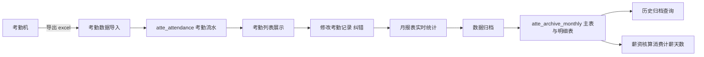

# 考勤模块收官：从考勤机到归档表的完整数据链

社保模块走完，考勤模块的主链路也走完了。回头看这一天，代码是一段一段写的，但串起来其实是一条完整的数据链：考勤机吐数据，系统导入、纠错、汇总、封存。梳理这条链，比记住某个方法怎么写重要得多，面试里讲考勤项目，讲的也是这条链。

主链路之外还有两块没做完的收尾：历史归档的查询页面，以及薪资模块的环境。前者与社保模块同构，代码几乎可以照搬；后者是下一天的主角，先把环境搭起来、把薪资列表跑出来，就能无缝接上。

## 先给结论

- 考勤模块的数据链：考勤机导出 excel，excel 导入系统成为考勤流水，列表展示、修改纠错、月报表统计、数据归档，一环扣一环。
- 数据来源的关键动作是「两个系统连通」：考勤机数据生成为 excel，excel 导入到人力资源系统中。
- 修改考勤记录是唯一的纠错入口，必须在归档之前完成，归档之后的口径是冻结的。
- 历史归档列表与详情和社保模块的实现同构，按「企业 id + 年份」查归档主表、按主表 id 查明细即可复用。
- 薪资模块起步练习：搭建薪资服务环境，跑通薪资列表页面，为工资表制作做准备。

## 一、这条数据链的全貌

把这一模块做过的功能按数据流向排开，就是下面这张图：



**第一环是数据来源。** 考勤机自己是一套系统，它不直接连人力资源系统的数据库，连通方式是把考勤机数据生成为 excel，再把 excel 导入人力资源系统。导入工具类在前面的课程里已经测试过，一批员工一段日期的打卡数据，解析成一条条考勤流水写进 `atte_attendance` 表。

**第二环是数据修正。** 导入的数据难免有异常：忘打卡、机器故障、临时外出。考勤列表页支持按部门、按考勤状态筛选，找到问题记录直接修改考勤状态。这一步必须在归档前做，归档相当于把当月数字签字画押，之后再改流水，报表和归档就对不上了。

**第三环是汇总与封存。** 月报表把流水按人聚合成正常天数、迟到次数、早退次数等统计值；确认无误后归档落库，主表一行存整月汇总，明细表一人一行存完整口径。归档后的月份从「实时计算」切换到「读定稿数据」，历史归档查询的就是这份数据。

## 二、数据走向背后的设计逻辑

为什么中间要兜这么大一圈，而不是考勤机直连系统？拆开看有三个理由。

**第一，解耦。** 考勤机型号各异，数据格式不一，用 excel 做交换介质，系统只需要面对一种格式。导入逻辑集中在一个工具类里，换考勤机只影响导出环节。

**第二，留出人工校验窗口。** 从导入到归档之间隔着列表和报表两道人工环节，数据有修正机会。如果打卡直接进库，错误数据会直接污染薪资核算。

**第三，归档形成审计边界。** 每个月的口径有据可查：流水是原始凭证，报表是过程稿，归档表是定稿。争议回溯时按时间线取对应层的数据即可。

## 三、收尾一：历史归档查询，照社保的样子搬

历史归档的交互与社保模块完全一样：按年列归档列表，点进某个月看详情。社保模块当时的实现是按「企业 id + 年份」查归档表：

```java
// 查询某年内的归档列表
@RequestMapping(value = "/histories/{year}/list", method = RequestMethod.GET)
public Result historiesList(@PathVariable(value = "year") String year) {
    List<ArchiveMonthly> archiveVoList = archiveService.findArchiveByYear(companyId, year);
    return new Result(ResultCode.SUCCESS, archiveVoList);
}
```

```java
// 按企业 id 与年份查归档
public List<ArchiveMonthly> findArchiveByYear(String companyId, String year) {
    return archiveMonthlyDao.findByCompanyIdAndArchiveYear(companyId, year);
}
```

考勤模块的 dao 里 `findByCompanyIdAndArchiveYear(companyId, archiveYear)` 真实存在，明细侧还有 `findByAtteArchiveMonthlyId` 按主表 id 查详情，两个方法一拼，历史归档列表和详情的接口就齐了。这就是同构模块的迁移套路：实体换一个，dao 方法名不变，Controller 照抄改路径。

## 四、收尾二：薪资模块环境，为下一天铺路

考勤归档明细里躺着一组关键字段：应出勤工作日、计薪天数（正式）、计薪天数（非正式），这些正是工资核算的输入。薪资模块要消费考勤数据，两个服务之间走 Feign 调用，薪资服务侧声明的客户端长这样：

```java
// 声明调用的微服务名称
@FeignClient("attendance-service")
public interface AttendanceFeignClient {
    /**
     * 调用考勤服务的接口: 查询某用户某月的考勤统计
     */
    @RequestMapping(value = "/attendances/archive/{userId}/{yearMonth}", method = RequestMethod.GET)
    Result atteStatisMonthly(@PathVariable("userId") String userId, @PathVariable("yearMonth") String yearMonth);
}
```

起步练习就两件事：把薪资服务工程跑起来，把薪资列表页面调通。环境立起来之后，下一天从工资表制作开始，考勤、社保、薪资三块数据才算真正合流。

## 常见误区

- **以为归档就是数据搬家查不到了**：归档冻结的是口径，不是封存。历史归档列表、详情页读的都是归档表，查询反而比实时统计更快更稳。
- **归档之后还去改考勤流水**：改了流水，月报表重算的结果与归档定稿不一致，薪资以哪份数据为准就成了悬案。纠错必须在归档前完成，归档后发现错误要走冲正流程。
- **跳过导入环节直接在库里造数据做演示**：造出来的流水缺字段（部门、在职状态），到报表和归档环节各种空指针。演示数据也走一遍 excel 导入，链路才是完整的。
- **练习搭建薪资环境时只启动服务不看表结构**：薪资列表的列名对应 `sa_user_salary`、`sa_settings` 等表字段，不先看表，下一天写工资表制作时对不上号。

## 面试可能被问到的问题

1. 面试官追问：「考勤模块的数据从哪来，到哪去？」
   答：来源是考勤机，通过 excel 导入变成考勤流水；去向有两个，一个是页面的列表与月报表展示，一个是归档落库形成定稿，归档明细里的计薪天数再供薪资模块核算工资使用。

2. 面试官追问：「为什么考勤机数据要用 excel 中转，而不是直接对接数据库或调接口？」
   答：excel 中转让两边解耦，系统只面对一种统一格式，兼容不同型号的考勤机；同时给人工留出校验窗口，导入后、归档前都能纠错。直连数据库耦合太深，直接调接口则要求考勤机厂商配合，落地成本高。

3. 面试官追问：「归档和报表是什么关系，为什么不直接报表定稿？」
   答：报表是实时统计的过程数据，随时随查询重算；归档是把确认过的口径固化到归档表，作为后续核算与审计的依据。报表给人看，归档给系统与流程用，职责不同。

4. 面试官追问：「新模块要做一个和已有模块相似的功能，你怎么复用？」
   答：先识别同构点，这里的模式是「企业设置表 + 按企业与年月查主表 + 按主表 id 查明细」。复用的是接口形态与 dao 查询模式，替换的是实体与表名，Controller 与 Service 结构照搬。历史归档查询就是把社保的实现平移到考勤。

5. 面试官追问：「薪资模块为什么要通过 Feign 拿考勤数据，而不是直接查考勤的表？」
   答：微服务下每个服务独享自己的数据库，跨服务直连库会破坏数据所有权与自治性，表结构变更会波及多个服务。Feign 走 HTTP 接口，服务边界清晰，考勤侧内部实现怎么改，只要接口契约不变，薪资侧无感。

## 配套资料

- 归档主表与明细实体（明细含应出勤工作日、计薪天数等薪资核算字段）：`materials/code/02/day15 考勤模块开发/day15/工具代码/工具类/考勤模块/domain/entity/ArchiveMonthly.java`、同目录 `ArchiveMonthlyInfo.java`
- 归档 dao（`findByCompanyIdAndArchiveYear`、`findByAtteArchiveMonthlyId` 真实存在，历史归档查询直接可用）：`materials/code/02/day15 考勤模块开发/day15/工具代码/工具类/考勤模块/dao/ArchiveMonthlyDao.java`、同目录 `ArchiveMonthlyInfoDao.java`
- 薪资服务侧的考勤 Feign 客户端（文中服务名按业务语义调整为 `attendance-service`）：`materials/code/02/day16 薪资管理与工作流概述/day16/03-资料/03薪资代码/基本操作代码/feign/AttendanceFeignClient.java`
- 同目录另有 `SocialSecurityFeignClient.java`、`FeignClientService.java`，可看薪资服务聚合社保数据的另一半
- 薪资服务起步工程（启动类与配置，练习环境搭建用）：`materials/code/02/day16 薪资管理与工作流概述/day16/03-资料/03薪资代码/SalarysApplication.java`、同目录 `application.yml`
