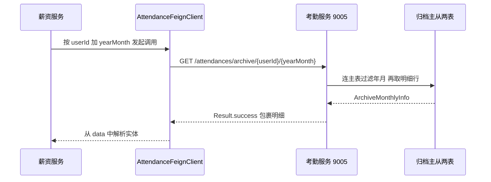

# 按员工查归档明细：薪资模块要来调用的考勤内部接口

考勤归档还剩最后一个口子没开。算工资的时候，光有基本工资不够，还要扣考勤：迟到几次、早退几次、请了几天假，这些都藏在考勤模块的归档明细表里。薪资模块自己不存考勤数据，只能跨服务来要，要的粒度精确到「某个员工、某个月」。这一课就是把 `GET /attendances/archive/{userId}/{yearMonth}` 这个接口补出来，用 Postman 直连微服务验证，为下一阶段的薪资计算铺路。

页面功能到这里已经全部收尾，这个接口在系统界面上没有任何入口，它是纯给微服务之间调用准备的。

## 先给结论

- 接口按「用户 id + 年月」查一条归档明细，一个人一个月只有一行归档数据，返回单个 `ArchiveMonthlyInfo`，外面照常包 `Result`。
- 明细表只挂主表外键，年月信息存在主表上，查询需要连主表过滤，这一点与社保模块靠冗余字段直接派生查询的做法形成对照。
- 路径与返回结构从这一课起就固定下来，薪资模块的 Feign 客户端会按同样的路径声明调用，单方面改动会连带破坏消费方。
- Postman 直连 9005 端口测试，不走网关，但要带 `Authorization` 请求头，因为服务自己的过滤器链仍要校验令牌。

## 一、谁在消费这个接口

薪资服务那边其实已经把调用端写好了，声明式客户端长这样：

```java
// 声明调用的微服务名称
@FeignClient("example-attendance")
public interface AttendanceFeignClient {

    /**
     * 调用微服务的接口
     */
    @RequestMapping(value = "/attendances/archive/{userId}/{yearMonth}", method = RequestMethod.GET)
    Result atteStatisMonthly(@PathVariable("userId") String userId,
                             @PathVariable("yearMonth") String yearMonth);
}
```

`@FeignClient` 里写的是注册中心里的服务名，方法上的路径就是本课要实现的接口路径，两边必须严丝合缝。整条调用链是这样的：



图的看点在最后一环：Feign 拿到的是统一响应体，消费方从 `data` 里二次解析实体，这决定了提供方必须用 `Result` 包装返回，而不是像社保模块那个内部接口一样裸返实体。

## 二、三层实现：接口、服务与连表查询

Controller 层两个路径变量，一个都少不了 `@PathVariable`：

```java
// 根据用户id和年月查询已归档的考勤明细
@RequestMapping(value = "/archive/{userId}/{yearMonth}", method = RequestMethod.GET)
public Result historysData(@PathVariable(value = "userId") String userId,
                           @PathVariable(value = "yearMonth") String yearMonth) throws Exception {
    ArchiveMonthlyInfo info = archiveService.findUserArchiveDetail(userId, yearMonth);
    return new Result(ResultCode.SUCCESS, info);
}
```

Service 层照例透传：

```java
// 根据用户id和年月查询归档明细
public ArchiveMonthlyInfo findUserArchiveDetail(String userId, String yearMonth) {
    return archiveMonthlyInfoDao.findUserArchiveDetail(userId, yearMonth);
}
```

麻烦都在 dao。考勤明细实体里只有 `userId` 和指向主表的 `atteArchiveMonthlyId`，归档年份与月份全在主表 `ArchiveMonthly` 的 `archiveYear`、`archiveMonth` 字段上，所以查询要跨两张表。方法签名来自课程实现，查询体按两个实体的真实字段补全为示例：

```java
public interface ArchiveMonthlyInfoDao extends JpaRepository<ArchiveMonthlyInfo, String>,
        JpaSpecificationExecutor<ArchiveMonthlyInfo> {

    // 根据用户id与归档年月查明细: 年月在主表上, 需连主表过滤
    @Query("select i from ArchiveMonthlyInfo i, ArchiveMonthly m " +
            "where i.atteArchiveMonthlyId = m.id " +
            "and i.userId = ?1 and concat(m.archiveYear, m.archiveMonth) = ?2")
    ArchiveMonthlyInfo findUserArchiveDetail(String userId, String yearMonth);
}
```

对照着看更容易记住设计差异：社保归档明细表冗余了一个 `yearsMonth` 字段，派生查询 `findByUserIdAndYearsMonth` 一行搞定；考勤明细表没有做这份冗余，就要用 `@Query` 连主表拼条件。两种方案都成立，前者查询快但要维护冗余一致，后者结构干净但多一次连接，归档型数据写入后不再变化，冗余的维护成本几乎为零，社保那种选法更划算。

`concat(m.archiveYear, m.archiveMonth)` 之所以能对上 `201907`，依赖的是归档时的切法：年份取 `substring(0, 4)` 得 `2019`，月份从下标 5 取到尾得 `07`，拼起来正好六位。口径任何一头变了，这个等值条件就静默失效。

## 三、Postman 直连验证

测试时不经过网关，直接打考勤服务的 9005 端口，模拟未来薪资模块的真实调用方式：

```bash
curl http://127.0.0.1:9005/attendances/archive/1063705899262277968/201907 \
  -H "Authorization: Bearer <从浏览器 F12 复制的令牌>"
```

有个反直觉的细节：不走网关不是就不需要认证了。考勤服务自己的 Shiro 过滤器链照样校验令牌，不带 `Authorization` 头直接 401。课上的做法是从浏览器已登录会话的请求里把认证头原样拷进 Postman。带头发出去，返回结构如下：

```json
{
  "success": true,
  "code": 10000,
  "message": "操作成功！",
  "data": {
    "userId": "1063705899262277968",
    "name": "A02",
    "normalDays": "11",
    "laterTimes": "1",
    "earlyTimes": "1",
    "leaveDays": "0"
  }
}
```

字段做了删减，真实明细有几十个统计项。到这里考勤模块对薪资模块承诺的数据口子全部就位，下周期的工资核算可以直接取数。

## 常见误区

- **只用 userId 查明细表**：能查出该员工全部月份的归档，月度口径直接错乱。必须叠加年月条件，而年月在主表上，单表派生查询写不出来。
- **年月格式对不上**：传 `2019-07` 或 `20197` 都匹配不到 `201907`，接口约定六位 `yyyyMM`，消费方拼参时要用同一格式。
- **返回值设计成裸实体**：页面接口可以裸返，这个接口的消费方是 Feign 客户端，封装成 `Result` 后消费方才能用 `success` 字段统一判断成败。
- **单方面修改接口路径**：Feign 客户端按路径字符串匹配，提供方改了 `/archive/{userId}/{yearMonth}` 而不同步消费方，运行期才报 404，编译期毫无感知。

## 面试可能被问到的问题

1. 面试官追问：「薪资模块为什么不直接连考勤的数据库表，而要走接口？」
   答：微服务架构下每个服务独占自己的表，跨库连表会耦合两边的表结构，任何一方改字段都会波及对方。走接口只暴露契约，表结构可以独立演进，也便于各自的缓存、权限与限流策略生效。

2. 面试官追问：「为什么查归档数据而不是让薪资模块调用实时统计？」
   答：算钱要求数据口径稳定，实时统计依赖的配置随时可能被修改，算到一半口径变了结果无法复现。归档数据是定格快照，任何时候查都一致，也方便对账与审计。

3. 面试官追问：「明细表不冗余年月、连主表查询，和冗余字段直查，怎么选？」
   答：数据写入后不再变更时，冗余维护成本低，直查性能好，适合报表归档类场景；数据会被更新时冗余要同步维护，连表更安全。社保明细冗余了年月，考勤明细连主表，本质是同一权衡的两种取舍。

4. 面试官追问：「Feign 声明式调用最终是怎么发出 HTTP 请求的？」
   答：接口在启动时被动态代理生成实现，方法上的注解被解析成请求模板，调用时结合注册中心的服务名做负载均衡选出实例，拼出目标地址发请求，再把响应反序列化为声明的返回类型。使用者只写接口，不碰 HTTP 客户端。

5. 面试官追问：「内部接口为什么要包统一的 `Result` 结构？」
   答：`success`、`code`、`message`、`data` 四件套让消费方有一致的成败判定与错误提示来源，业务数据统一放 `data`。裸返实体时，调用方只能靠 HTTP 状态码和异常猜测失败原因，跨团队协作的成本明显更高。

## 配套资料

- 归档明细实体 `ArchiveMonthlyInfo`（本接口的返回实体，含冗余员工属性）：`materials/code/02/day15 考勤模块开发/day15/工具代码/工具类/考勤模块/domain/entity/ArchiveMonthlyInfo.java`
- 归档主表实体 `ArchiveMonthly`（`archiveYear`、`archiveMonth` 是连表过滤的条件来源）：`materials/code/02/day15 考勤模块开发/day15/工具代码/工具类/考勤模块/domain/entity/ArchiveMonthly.java`
- 归档明细 dao 与归档 dao：`materials/code/02/day15 考勤模块开发/day15/工具代码/工具类/考勤模块/dao/ArchiveMonthlyInfoDao.java`、同目录 `ArchiveMonthlyDao.java`
- 消费端 Feign 客户端（路径与本接口一一对应，包名已改为 `com.example`）：`materials/code/02/day16 薪资管理与工作流概述/day16/03-资料/03薪资代码/基本操作代码/feign/AttendanceFeignClient.java`
- 连表 `@Query` 方法体为按实体真实字段补全的可运行示例，资料包与视频中未收录该查询的完整 SQL
