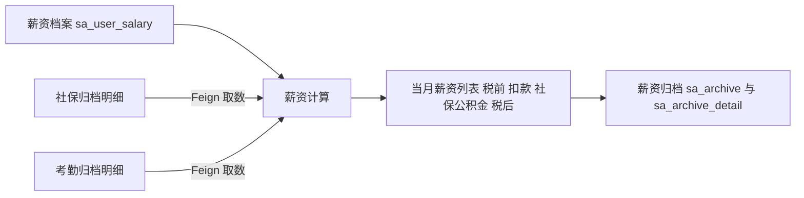

# 薪资模块开篇：业务全景、五张表与微服务工程搭建

社保和考勤两个模块从零写完，轮到薪资。操作流程上它跟社保几乎一个模子：进页面先「开始做某月工资」，确定后进入列表，列表上再挂调薪、定薪、详情、归档这些动作。所以这一模块换了学习方式：基础 CRUD 代码由资料直接提供，课堂上只精讲其中一两个核心功能，也就是金额计算。开工前要先把两件事办妥：看懂业务全景与表结构，把微服务工程立起来跑通。

## 先给结论

- 薪资模块的功能主线：当月薪资列表、调薪、定薪、薪资详情、月度薪资数据列表（含计算）、薪资归档，前四项是常规增删改查，后两项才是难点。
- 工资计算的输入来自三个方向：本模块的薪资档案、社保模块的归档明细、考勤模块的归档明细，后两者靠 Feign 跨服务取数。
- 五张 `sa_` 开头的表撑起整个模块：薪资档案、企业核算月份、津贴方案，加上归档主从两张。
- 工程搭建是模板活：父工程下新建 module，引入 JPA、MySQL、公共模块、Eureka 客户端与 OpenFeign，启动类打开 `@EnableFeignClients`，网关补一条路由。
- 服务名 `example-salarys`，端口接续前面的服务排在 9007。

## 一、业务全景：列表是入口，计算才是核心

把页面上能点的东西列全，薪资模块要做的功能是这些：

- **当月薪资列表**：展示当前这一个月所有员工的薪资方案与工资数据，是整个模块的主页面。
- **调薪**：给已有薪资记录的员工调整工资，老员工涨薪降薪都走这里。
- **定薪**：新入职员工还没有薪资记录，设定试用期工资与转正后工资各是多少。
- **薪资详情**：查看单个员工当月的完整账目，社保扣多少、五险一金扣多少、餐补公交补助有哪些、考勤情况如何。
- **月度薪资数据列表**：按设定好的薪水，叠加社保扣款与考勤数据算出每个员工当月实际收入，列表上呈现税前金额、扣款金额、社保公积金金额、税后金额。
- **归档**：算完把结果固化进归档表，说白了就是把计算结果落表存证。

六个功能里，前四个是前面社保、考勤练过很多遍的单表操作，真正的含金量集中在月度数据列表的计算上：



这张图把模块的数据所有权划得很清楚：薪资模块只 Own 薪资档案，社保和考勤的数据必须按「用户 id + 年月」向对应服务查询，而且取的都是已归档的快照，前两个模块末尾补的内部接口正是为这里准备的。计算完成落到列表，列表确认后归档，链路就和考勤归档如出一辙。

## 二、表结构：五张 sa_ 开头的表

数据库里所有薪资相关的表都以 `sa_` 前缀命名，逐张看职责：

| 表 | 实体 | 职责 |
|---|---|---|
| `sa_user_salary` | `UserSalary` | 员工薪资档案，一人一行，存当前、定薪、转正三组工资 |
| `sa_company_settings` | `CompanySettings` | 企业正在核算的月份，一企一行 |
| `sa_settings` | `Settings` | 企业津贴福利方案，餐补、交通、通讯、住房与计税方式 |
| `sa_archive` | `SalaryArchive` | 薪资归档主表，一月一行，存人工成本、税前工资、五险一金汇总 |
| `sa_archive_detail` | `SalaryArchiveDetail` | 薪资归档明细，一人一行，全字段快照 |

先看最核心的薪资档案表，它一张表里放了三组工资字段：

```java
@Entity
@Table(name = "sa_user_salary")
@Data
@NoArgsConstructor
@AllArgsConstructor
public class UserSalary implements Serializable {
    private static final long serialVersionUID = 7569031833026436746L;
    /**
     * 用户id
     */
    @Id
    private String userId;
    /**
     * 当前基本工资
     */
    private BigDecimal currentBasicSalary;
    /**
     * 当前岗位工资
     */
    private BigDecimal currentPostWage;
    /**
     * 定薪基本工资
     */
    private BigDecimal fixedBasicSalary;
    /**
     * 定薪岗位工资
     */
    private BigDecimal fixedPostWage;
    /**
     * 转正基本工资
     */
    private BigDecimal correctionOfBasicWages;
    /**
     * 转正岗位工资
     */
    private BigDecimal turnToPostWages;
}
```

三组字段对应三种业务状态：`fixed` 是定薪时录入的试用期工资，`correctionOfBasicWages` 与 `turnToPostWages` 是约定的转正工资，`current` 是当前实际执行的标准，员工转正或调薪后由系统把转正值或新值刷进 `current`。月度计算用的就是 `current` 这一组。主键直接用 `userId`，因为一名员工任意时刻只有一份当前薪资档案，调薪是覆盖更新而不是新增一行，历史轨迹由调薪记录表另行保留。

企业设置表则简单到极致：

```java
@Entity
@Table(name = "sa_company_settings")
@Data
@NoArgsConstructor
@AllArgsConstructor
public class CompanySettings implements Serializable {
    private static final long serialVersionUID = -2620680846592406186L;
    /**
     * 企业id
     */
    @Id
    private String companyId;
    /**
     * 是否设置 0为未设置，1为已设置
     */
    private Integer isSettings;
    /**
     * 当前显示报表月份
     */
    private String dataMonth;
}
```

主键即企业 id，整表一企一行，`dataMonth` 记录「现在正在做几月的工资」。做 7 月工资时它是 `201907`，切换到 8 月时把它改成 `201908` 就行。这个字段是薪资页面初始态的开关，环境收尾那一课会实际演示。`sa_settings` 津贴方案表同样是企业维度一行，字段全是各类补贴的计算类型与金额，不再展开。

## 三、工程搭建：四个开关加一份配置

在父工程下新建 module `example_salarys`，pom 与既有业务服务完全同构（包名已改为中性前缀）：

```xml
<parent>
    <artifactId>example_parent</artifactId>
    <groupId>com.example</groupId>
    <version>1.0-SNAPSHOT</version>
</parent>
<artifactId>example_salarys</artifactId>

<dependencies>
    <dependency>
        <groupId>org.springframework.boot</groupId>
        <artifactId>spring-boot-starter-data-jpa</artifactId>
    </dependency>
    <dependency>
        <groupId>mysql</groupId>
        <artifactId>mysql-connector-java</artifactId>
    </dependency>
    <dependency>
        <groupId>com.example</groupId>
        <artifactId>example_common</artifactId>
        <version>1.0-SNAPSHOT</version>
    </dependency>
    <dependency>
        <groupId>com.example</groupId>
        <artifactId>example_common_model</artifactId>
        <version>1.0-SNAPSHOT</version>
    </dependency>
    <dependency>
        <groupId>org.springframework.cloud</groupId>
        <artifactId>spring-cloud-starter-netflix-eureka-client</artifactId>
    </dependency>
    <dependency>
        <groupId>org.springframework.cloud</groupId>
        <artifactId>spring-cloud-starter-openfeign</artifactId>
    </dependency>
</dependencies>
```

比社保、考勤的 pom 多出来的只有 `spring-cloud-starter-openfeign`，因为薪资要调别的服务。启动类随之多一个注解：

```java
@SpringBootApplication(scanBasePackages = "com.example")
@EntityScan(value = "com.example.domain")
@EnableFeignClients
public class SalarysApplication {
    /**
     * 启动方法
     */
    public static void main(String[] args) {
        SpringApplication.run(SalarysApplication.class, args);
    }

    @Bean
    public IdWorker idWorker() {
        return new IdWorker();
    }
}
```

`scanBasePackages` 扫公共模块里的配置与工具，`@EntityScan` 指明 JPA 实体都在 `com.example.domain` 之下，`@EnableFeignClients` 打开声明式客户端扫描，三个注解各管一摊，缺一个都有对应的报错。配置文件与兄弟服务逐项对照着改：

```yaml
spring:
  application:
    name: example-salarys # 服务名
  jpa:
    database: MySQL
    show-sql: true
    open-in-view: true
  datasource:
    driver-class-name: com.mysql.jdbc.Driver
    url: jdbc:mysql://localhost:3306/hrm?useUnicode=true&characterEncoding=utf8
    username: root
    password: 111111
    hikari:
      maximum-pool-size: 2
  redis:
    host: 127.0.0.1
    port: 6379
eureka:
  client:
    service-url:
      defaultZone: http://localhost:6868/eureka/
  instance:
    preferIpAddress: true
    instance-id: ${spring.cloud.client.ip-address}:${spring.application.name}:${server.port}
server:
  port: 9007
```

改动的只有四处：服务名、数据库、注册中心地址按本机环境来，端口接着前面的服务顺延到 9007。公共模块带的 Shiro 配置类照常拷入，鉴权链路与别的服务保持一致。最后一站是网关，在路由表里按既有服务的模式补一段（路由结构与网关工程现有配置一致）：

```yaml
zuul:
  routes:
    example-salarys: # 薪资
      path: /salarys/**
      serviceId: example-salarys
      stripPrefix: false
      customSensitiveHeaders: true
```

到这里环境搭建完成：服务能注册进注册中心，网关能把 `/salarys/**` 的请求转进来，就等下一课把四层业务代码填进空壳。

## 常见误区

- **漏掉 `@EntityScan`**：实体类在公共模型模块 `com.example.domain` 下，不在启动类同级包里，不显式声明扫描路径，JPA 找不到实体，启动直接失败。
- **漏掉 `@EnableFeignClients`**：编译不报错，运行到注入 Feign 客户端时才抛 `NoSuchBeanDefinitionException`，报错点离原因很远，不好排查。
- **网关 `serviceId` 与服务名不一致**：路由指向注册中心里不存在的服务名，前端经网关访问一律 404，直连服务端口却正常，这种现象基本可以断定是路由配置问题。
- **工资字段用 `double`**：浮点数算钱必有精度误差，累加几轮就对不上账，金额一律 `BigDecimal`，比较用 `compareTo` 而不是 `equals`。

## 面试可能被问到的问题

1. 面试官追问：「薪资数据为什么要跨服务取，而不是把社保考勤数据同步过来存一份？」
   答：实时取数保证口径永远与数据提供方一致，避免两边库的数据时间差导致算错钱。同步存储要处理增量更新、一致性与存储冗余，只有调用量大到无法承受时才值得引入，这个量级下 Feign 直查更简单可控。

2. 面试官追问：「`sa_company_settings` 用企业 id 当主键，一企一行，这种设计有什么好处？」
   答：企业维度的配置天然与实体一一对应，主键即业务键省去一层 id 映射，查询 `findById(companyId)` 一次命中。它表达的是「当前状态」而不是历史流水，覆盖更新即可，切换核算月份就是改这一个字段。

3. 面试官追问：「薪资档案里当前工资、定薪工资、转正工资三组字段是什么关系？」
   答：定薪与转正工资是约定值，记录录用与转正时谈定的标准；当前工资是实际执行口径，月度计算只认它。转正或调薪发生时系统把对应约定值刷新到当前组，三组字段并用让「约定的」与「在执行的」互不覆盖。

4. 面试官追问：「`@SpringBootApplication` 默认扫描不到公共模块里的 Bean，怎么解决？」
   答：默认只扫启动类所在包及子包。公共模块的包路径通常在启动类包之外，要么像本课一样用 `scanBasePackages` 显式扩大扫描范围，要么在公共模块提供自动配置类交给 Spring Boot 的 SPI 机制加载。

5. 面试官追问：「微服务里新增一个业务服务，上线前你会检查哪些点？」
   答：注册中心地址与心跳配置、服务名唯一且与消费方引用一致、网关路由的 path 与 serviceId 对得上、端口不冲突、数据源与连接池参数、安全过滤器链是否与其他服务对齐，最后从注册中心控制台确认实例已上线再联通前端。

## 配套资料

- 薪资服务工程配置（`pom.xml`、`application.yml`、启动类、Shiro 配置，包名已改为 `com.example`）：`materials/code/02/day16 薪资管理与工作流概述/day16/03-资料/03薪资代码/`
- 薪资模块五个实体：`materials/code/02/day16 薪资管理与工作流概述/day16/03-资料/03薪资代码/实体类domain/salarys/`（含 `UserSalary.java`、`CompanySettings.java`、`Settings.java`、`SalaryArchive.java`、`SalaryArchiveDetail.java`）
- 网关既有路由配置（本课新增路由的结构来源）：`materials/code/02/day14 微服务网关与社保模块开发/day14/03-资料/网关相关资料/ihrm_gate/src/main/resources/application.yml`
- 网关路由段为按网关工程既有模式补全的示例，课程资料未单独收录该段配置
