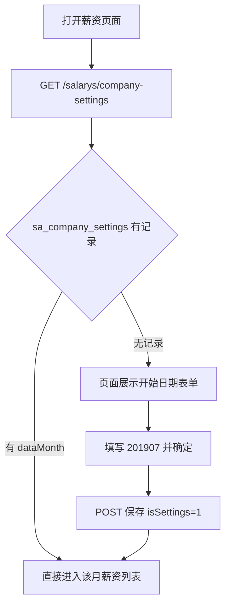

# 薪资模块环境收尾：四层基础代码就位与核算月份设置

上半场把薪资服务的空壳立了起来：module、坐标、启动类、配置、网关路由全部就位。下半场要做的是把资料包里准备好的四层代码拷进工程，让服务真正跑起来。这一步的策略与考勤模块一样：常规增删改查直接用现成实现，课堂精力留给下一课的金额计算，所以归档 Service 只留了一个空骨架。

验证环节有个值得玩味的现象：薪资页面打开后是直接进列表，还是先让你填「做几月份的工资」，完全由数据库里一行配置决定。把这个行删了，页面立刻退回初始化状态。

## 先给结论

- 四层代码一次到位：五个实体、六个 dao、四个 Service、四个 Controller，除归档 Service 留空待讲外，其余全是单表操作或一条连表查询。
- 分页列表用原生 SQL 连 `bs_user` 与 `sa_user_salary`，主查询必须配 `countQuery`，否则分页总数拿不到。
- 定薪与调薪共用一个 `save` 方法：薪资档案表主键就是 `userId`，没记录就是新增，有记录就是覆盖更新。
- 页面初始态由 `sa_company_settings` 驱动：有 `dataMonth` 直接进列表，没有就先填核算年月再保存。
- Feign 客户端在本课一并就位：考勤、社保两个声明式客户端，加一个统一解析响应的封装类。

## 一、四层代码一次到位

拷入的包结构如下，与前几个服务完全同构：

```text
com.example.salarys
├── controller   // CompanySettingsController、SalaryController、SettingsController、ArchiveController
├── service      // CompanySettingsService、SalaryService、SettingsService、ArchiveService(空骨架)
├── dao          // UserSalaryDao、CompanySettingsDao、SettingsDao、ArchiveDao、ArchiveDetailDao、UserSalaryChangeDao
└── feign        // AttendanceFeignClient、SocialSecurityFeignClient、FeignClientService
```

实体放在公共模型模块 `com.example.domain.salarys` 下。多数 dao 是空接口继承 `JpaRepository` 与 `JpaSpecificationExecutor`，唯一有内容的是薪资分页列表的 dao：

```java
public interface UserSalaryDao extends JpaRepository<UserSalary, String>,
        JpaSpecificationExecutor<UserSalary> {

    @Query(nativeQuery = true,
            value = "select bu.id, bu.username, bu.mobile, bu.work_number workNumber," +
                    "bu.in_service_status inServiceStatus, bu.department_name departmentName," +
                    "bu.department_id departmentId, bu.time_of_entry timeOfEntry," +
                    "bu.form_of_employment formOfEmployment," +
                    "sauss.current_basic_salary currentBasicSalary, sauss.current_post_wage currentPostWage " +
                    "from bs_user bu LEFT JOIN sa_user_salary sauss ON bu.id = sauss.user_id " +
                    "WHERE bu.company_id = ?1",
            countQuery = "select count(*) from bs_user bu LEFT JOIN sa_user_salary sauss " +
                    "ON bu.id = sauss.user_id WHERE bu.company_id = ?1"
    )
    Page<Map> findPage(String companyId, PageRequest pageRequest);
}
```

这条 SQL 回答了一个页面上的真实问题：列表要展示企业全部员工，可新员工还没定薪，在 `sa_user_salary` 里根本没有行。内连接会把这批人整行丢掉，页面看起来像「员工丢了」；`LEFT JOIN` 以员工表为基准保留全员，没定薪的人工资列取 null，前端显示为空，正好引导管理员去定薪。员工档案在 `bs_user`，薪资在 `sa_user_salary`，分属两张表，这种跨实体列表用派生查询拼不出来，原生 SQL 是最直接的选择。

## 二、薪资控制器：定薪与调薪共用一个入口

`SalaryController` 挂在 `/salarys` 下，四个方法覆盖列表页的全部动作：

```java
@CrossOrigin
@RestController
@RequestMapping(value = "/salarys")
public class SalaryController extends BaseController {

    @Autowired
    private SalaryService salaryService;

    // 查询用户薪资(调薪窗口回显)
    @RequestMapping(value = "/modify/{userId}", method = RequestMethod.GET)
    public Result modifyGet(@PathVariable(value = "userId") String userId) throws Exception {
        UserSalary userSalary = salaryService.findUserSalary(userId);
        return new Result(ResultCode.SUCCESS, userSalary);
    }

    // 调薪
    @RequestMapping(value = "/modify/{userId}", method = RequestMethod.POST)
    public Result modify(@RequestBody UserSalary userSalary) throws Exception {
        salaryService.saveUserSalary(userSalary);
        return new Result(ResultCode.SUCCESS);
    }

    // 定薪
    @RequestMapping(value = "/init/{userId}", method = RequestMethod.POST)
    public Result init(@RequestBody UserSalary userSalary) {
        userSalary.setFixedBasicSalary(userSalary.getCurrentBasicSalary());
        userSalary.setFixedPostWage(userSalary.getCurrentPostWage());
        salaryService.saveUserSalary(userSalary);
        return new Result(ResultCode.SUCCESS);
    }

    // 查询列表
    @RequestMapping(value = "/list", method = RequestMethod.POST)
    public Result list(@RequestBody Map map) {
        Integer page = (Integer) map.get("page");
        Integer pageSize = (Integer) map.get("pageSize");
        PageResult pr = salaryService.findAll(page, pageSize, companyId);
        return new Result(ResultCode.SUCCESS, pr);
    }
}
```

定薪和调薪最终都落到 `saveUserSalary`，看起来偷懒，实际是表结构决定的合理设计：`sa_user_salary` 主键是 `userId`，JPA 的 `save` 遇到不存在的主键做插入，遇到已存在的主键做更新，两种业务自然收敛到同一个方法。区别只在入口处理：定薪时前端只传了当前工资，后端把它同步进 `fixed` 一组，作为试用期执行标准；调薪时整条档案已在库里，覆盖保存即可。`companyId` 来自父类 `BaseController`，它在过滤器解析完令牌后把登录信息里的企业 id 存进了请求上下文，控制器直接取用，前端没有传参的机会。

## 三、企业设置：页面初始态的开关

`CompanySettingsController` 只有三个方法，却决定了打开页面看到什么：

```java
/**
 * 获取企业是否设置工资
 */
@RequestMapping(value = "/company-settings", method = RequestMethod.GET)
public Result getCompanySettings() throws Exception {
    CompanySettings companySettings = companySettingsService.findById(companyId);
    return new Result(ResultCode.SUCCESS, companySettings);
}

/**
 * 保存企业工资设置
 */
@RequestMapping(value = "/company-settings", method = RequestMethod.POST)
public Result saveCompanySettings(@RequestBody CompanySettings companySettings) throws Exception {
    companySettings.setCompanyId(companyId);
    companySettingsService.save(companySettings);
    return new Result(ResultCode.SUCCESS);
}

// 构造新报表
@RequestMapping(value = "/reports/{yearMonth}/newReport", method = RequestMethod.PUT)
public Result newReport(@PathVariable(value = "yearMonth") String yearMonth) {
    CompanySettings companySettings = new CompanySettings();
    companySettings.setCompanyId(companyId);
    companySettings.setDataMonth(yearMonth);
    companySettingsService.save(companySettings);
    return new Result(ResultCode.SUCCESS);
}
```

Service 的 `save` 顺手把 `isSettings` 置 1。页面加载时先查一次企业设置，后面的分支全靠这条记录有没有值：



课堂演示把这条链路演了一遍：手工删掉 `sa_company_settings` 里的记录，刷新页面，系统不再直接进列表，而是要求填写要核算的年月；填入 `201907` 点确定，请求落到 `saveCompanySettings`，数据库里这一行重新出现，页面跳进 7 月的薪资列表。「构造新报表」走的则是另一条路径：已在 7 月做完想开 8 月，`newReport` 把 `dataMonth` 改成 `201908`，本质就是改这一个字段。

## 四、Feign 客户端：把考勤与社保的口子先接上

薪资计算要用的外部数据，收尾阶段就把客户端备好。两个声明式接口与一个封装类：

```java
@FeignClient("example-social-securitys")
public interface SocialSecurityFeignClient {

    @RequestMapping(value = "/social_securitys/historys/archiveDetail/{userId}/{yearMonth}",
            method = RequestMethod.GET)
    Result getSocialInfo(@PathVariable("userId") String userId,
                         @PathVariable("yearMonth") String yearMonth);
}
```

考勤客户端同理，服务名 `example-attendance`，路径 `/attendances/archive/{userId}/{yearMonth}`，正是考勤模块最后一课补的接口。真正被业务注入使用的是封装类：

```java
@Service
public class FeignClientService {

    @Autowired
    private AttendanceFeignClient attendanceFeignClient;
    @Autowired
    private SocialSecurityFeignClient socialFeignClient;

    public ArchiveMonthlyInfo getAtteInfo(String userId, String yearMonth) {
        Result result = attendanceFeignClient.atteStatisMonthly(userId, yearMonth);
        ArchiveMonthlyInfo info = null;
        if (result.isSuccess()) {
            info = JSON.parseObject(JSON.toJSONString(result.getData()), ArchiveMonthlyInfo.class);
        }
        return info;
    }
}
```

`Result.data` 的声明类型是 `Object`，Feign 反序列化后实际是个 Map，直接强转会出问题，所以先 `toJSONString` 转回 JSON 字符串，再用 `parseObject` 绑定到目标实体。社保侧的 `getSocialInfo` 同一套写法。启动类上的 `@EnableFeignClients` 在工程搭建时已经打开，这些客户端随服务启动自动注册成 Bean，至此环境彻底收尾，就等下一课把金额计算填进归档 Service 的空壳。

## 常见误区

- **原生 SQL 分页漏配 `countQuery`**：`@Query` 原生查询返回 `Page` 时，框架不知道总数怎么取，统计 `getTotalElements()` 会报错或恒为 0，主查询与计数查询的条件必须完全一致。
- **页码直接透传**：`PageRequest(page - 1, pageSize)` 提醒页码从 0 起，前端传 1 表示第一页，不减一就永远从第二页开始查。
- **以为 `companyId` 由前端传**：它来自令牌解析，Controller 脱离过滤链单独测试时取不到值。自测要么补认证头，要么临时从参数注入，别把它当普通表单字段。
- **把 `Result.data` 直接强转实体**：拿到的是 Map，强转 `ArchiveMonthlyInfo` 运行期必挂，走一次 JSON 序列化与反序列化才是稳的。

## 面试可能被问到的问题

1. 面试官追问：「Spring Data JPA 里原生 SQL 怎么实现分页？」
   答：`@Query(nativeQuery = true)` 的返回值声明为 `Page`，入参传 `Pageable`，框架会在主查询外包一层分页语句，并通过 `countQuery` 属性指定的计数 SQL 求总数。主查询与计数查询的过滤条件要严格一致，否则总数与内容对不上。

2. 面试官追问：「薪资档案表用 `userId` 当主键，调薪为什么不新增一行保留历史？」
   答：这张表表达的是当前执行口径，查询与计算都只要一行最新值，主键即用户让读写都最简单。历史轨迹属于审计需求，由调薪记录表单独承载，读写模型各归各位，避免主表膨胀拖慢列表查询。

3. 面试官追问：「定薪和调薪合并成一个 save 方法，是偷懒还是设计？」
   答：是设计。JPA 的 `save` 以主键存在与否区分插入与更新，两种业务在存储层本来就没有差别，强行分开只会重复代码。业务差异放在入口处处理，比如定薪同步 `fixed` 字段，这才是合理的分层。

4. 面试官追问：「Feign 拿到的 `data` 为什么要二次序列化才能转实体？」
   答：统一响应体里 `data` 声明为 `Object`，反序列化时没有目标类型信息，落成 `LinkedHashMap`。先转 JSON 字符串再 `parseObject` 到具体实体，等于补一次带类型信息的绑定，是泛型丢失场景下的通用解法，更优雅的做法是让 Feign 接口直接声明泛型化的响应类型。

5. 面试官追问：「为什么页面初始状态要靠数据库配置而不是前端写死？」
   答：SaaS 多租户下每个企业的核算进度不同，写死状态等于所有企业共用一套进度。`sa_company_settings` 一企一行记录各自做到几月，前端只渲染后端给的状态，同一个页面在不同企业表现为不同的初始画面，切换月份也只是改数据不改代码。

## 配套资料

- 四层基础代码（controller、service、dao、feign 全集，包名已改为 `com.example`）：`materials/code/02/day16 薪资管理与工作流概述/day16/03-资料/03薪资代码/基本操作代码/`
- 启动类与 Shiro 配置：`materials/code/02/day16 薪资管理与工作流概述/day16/03-资料/03薪资代码/SalarysApplication.java`、同目录 `ShiroConfiguration.java`
- 薪资分页 dao（原生 SQL 与 `countQuery` 真实存在）：`materials/code/02/day16 薪资管理与工作流概述/day16/03-资料/03薪资代码/基本操作代码/dao/UserSalaryDao.java`
- Feign 客户端与封装类：`materials/code/02/day16 薪资管理与工作流概述/day16/03-资料/03薪资代码/基本操作代码/feign/`（含 `AttendanceFeignClient.java`、`SocialSecurityFeignClient.java`、`FeignClientService.java`）
- 归档 Service 在资料包中为依赖注入空骨架，金额计算按本系列下一课实现
