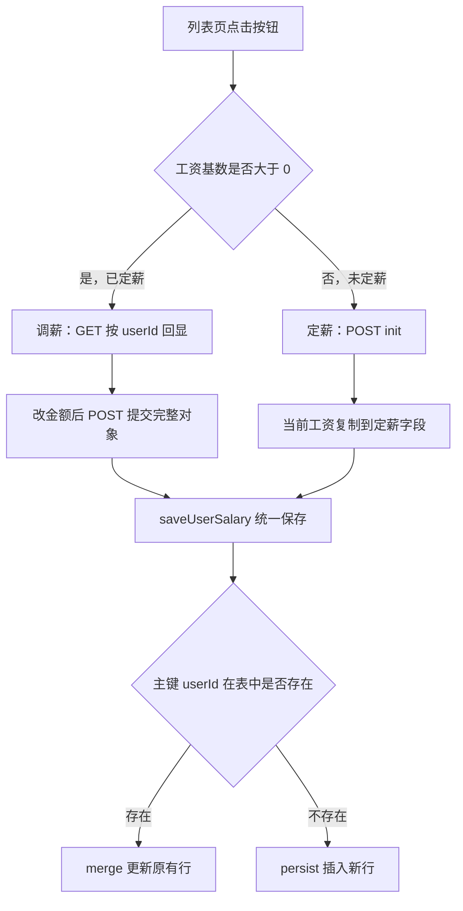

# 定薪与调薪：两个按钮背后共用的一条 save 逻辑

薪资列表页上，每个员工行尾的按钮不一样：没定薪的员工显示「定薪」，已定薪的显示「调薪」。这两个按钮各自打开不同表单、提交不同接口，但后端处理却收敛到一个方法里。为什么能合并、怎么合并、合并之后金额字段要注意什么，这课把这条链路讲透。

## 先给结论

- 按钮的区分不靠后端另加接口，前端拿列表返回的工资基数判断：基数为 0 或为空说明没定薪，显示「定薪」；大于 0 显示「调薪」。
- 定薪 `init` 的动作只有一步：把当前基本工资与岗位工资复制到定薪字段，然后统一保存。
- 调薪 `modify` 是先查后改：GET 按用户 id 查出薪资回显表单，POST 提交修改后的整对象。
- 两种操作最终都走 `saveUserSalary`，因为薪资表主键就是 userId，JPA 的 save 没记录就插入、有记录就更新。
- 金额字段一律用 `BigDecimal`，实体 getter 里对 null 兜底返回 0，防止没定薪的员工在计算与展示环节炸出空指针。

## 一、两个按钮怎么区分：工资基数说了算

上一课的列表查询是员工表左外连接薪资表，没定薪的员工薪资列是 null，序列化到前端就是空或 0。打开开发者工具看列表接口的响应体，`currentBasicSalary` 与 `currentPostWage` 有值的员工，前端渲染「调薪」按钮；合计为 0 的渲染「定薪」按钮。

这个设计把「是否已定薪」的判断完全交给了数据本身，后端不需要再提供一个「查询定薪状态」的接口。收益是接口面窄、状态不会出现两处不一致；代价是「没定薪」和「定了零元薪」在数据上无法区分，好在后一种业务上不存在，定薪金额必然大于 0。

## 二、UserSalary 实体：一张表六个体积字段

看实体就知道定薪和调薪为什么能共用一张表。`sa_user_salary` 的主键是 `userId`，金额字段分三组：

```java
@Entity
@Table(name = "sa_user_salary")
@Data
@NoArgsConstructor
@AllArgsConstructor
public class UserSalary implements Serializable {
    @Id
    private String userId;                      // 用户 id，主键
    private BigDecimal currentBasicSalary;      // 当前基本工资
    private BigDecimal currentPostWage;         // 当前岗位工资
    private BigDecimal fixedBasicSalary;        // 定薪基本工资
    private BigDecimal fixedPostWage;           // 定薪岗位工资
    private BigDecimal correctionOfBasicWages;  // 转正基本工资
    private BigDecimal turnToPostWages;         // 转正岗位工资

    public BigDecimal getCurrentBasicSalary() {
        return this.currentBasicSalary == null ? BigDecimal.ZERO : this.currentBasicSalary;
    }

    public BigDecimal getCurrentPostWage() {
        return this.currentPostWage == null ? BigDecimal.ZERO : this.currentPostWage;
    }
}
```

三组字段对应薪资的三个时间断面：定薪工资是入职时定下的标准，转正工资是试用期结束后生效的标准，当前工资是本月实际参与计算的数字。页面上的「工资基数」就是当前两组字段相加的结果。

两个手写的 getter 覆盖了 Lombok 生成的版本，把 null 换成 `BigDecimal.ZERO`。这一行兜底看着不起眼，后面做月报表计算时所有金额都会经过它，没有它一条没定薪的数据就能让整张报表算不出来。

## 三、定薪 init：当前工资落进定薪字段

定薪页面针对刚入职的员工：录入当前基本工资、当前岗位工资，再填一组转正之后的工资。点击确定，前端 POST 到 `init` 接口：

```java
//定薪
@RequestMapping(value = "/init/{userId}", method = RequestMethod.POST)
public Result init(@RequestBody UserSalary userSalary) {
    userSalary.setFixedBasicSalary(userSalary.getCurrentBasicSalary());
    userSalary.setFixedPostWage(userSalary.getCurrentPostWage());
    salaryService.saveUserSalary(userSalary);
    return new Result(ResultCode.SUCCESS);
}
```

注意前两行：前端只填了「当前」两组金额，后端在保存前把当前基本工资复制给定薪基本工资、当前岗位工资复制给定薪岗位工资。业务含义是「入职定下的标准就是当前标准的来源」，这样 `fixed` 字段不会留空，后续按定薪标准做统计时才有据可查。保存之后这条员工记录的工资基数不再是 0，下次刷新列表，按钮就从「定薪」换成了「调薪」。

## 四、调薪 modify：先查后改的回显保存

调薪针对已有薪资记录的员工，表单要先显示旧值才能改。Controller 里同一路径挂了两个方法，靠请求方法区分：

```java
//查询用户薪资（回显）
@RequestMapping(value = "/modify/{userId}", method = RequestMethod.GET)
public Result modifyGet(@PathVariable(value = "userId") String userId) throws Exception {
    UserSalary userSalary = salaryService.findUserSalary(userId);
    return new Result(ResultCode.SUCCESS, userSalary);
}

//调薪（保存）
@RequestMapping(value = "/modify/{userId}", method = RequestMethod.POST)
public Result modify(@RequestBody UserSalary userSalary) throws Exception {
    salaryService.saveUserSalary(userSalary);
    return new Result(ResultCode.SUCCESS);
}
```

Service 里的查询是一个标准的 Optional 判空：

```java
//查询用户薪资
public UserSalary findUserSalary(String userId) {
    Optional<UserSalary> optional = userSalaryDao.findById(userId);
    return optional.isPresent() ? optional.get() : null;
}
```

前端点「调薪」先发 GET 拿到当前 `UserSalary` 填进表单，金额改完提交 POST，携带的就是这个补过值的完整对象。课堂演示里把总金额 10 改成 20（基本工资与岗位工资相加的结果），保存后再刷新列表，金额跟着变了。

## 五、save 的双语义：一个方法吃下新增与更新

`saveUserSalary` 只有一行 `userSalaryDao.save(userSalary)`。它同时服务定薪和调薪，依据是 JPA save 的内部语义：按主键去数据库探一下，主键对应的行不存在就执行 persist 新增，存在就执行 merge 更新。定薪时 `sa_user_salary` 里还没有这个 userId，走新增；调薪时记录已在，走更新。

两个操作汇流的过程如下：



关键汇合点在 G：无论按钮叫什么，落到持久层都是「以 userId 为主键的整对象保存」。理解了这一点，新增字段时只需要改实体和表单，保存逻辑一行不动。

## 常见误区

- **用 double 或 float 存金额**：二进制浮点对十进制金额算不准，0.1 加 0.2 不等于 0.3。金额字段用 `BigDecimal`，构造时用字符串或整数，别用 `new BigDecimal(0.1)`。
- **定薪时漏复制 fixed 字段**：只保存 current 两组金额，定薪字段留 null，后续按定薪标准统计的报表对这批人算不出数。
- **调薪提交残缺对象**：前端只传改过的金额、不传主键 userId，save 会当成新记录插入或直接失败。POST 必须携带 GET 回显时的完整对象。
- **以为定薪和调薪要分表分接口**：数据都在 `sa_user_salary` 一张表，保存入口都是同一个 save，区分只发生在前端按钮与 init 的字段复制上。

## 面试可能被问到的问题

1. 面试官追问：「JPA 的 save 方法怎么判断该新增还是更新？」
   答：save 内部按主键判断，JPA 2.x 之后主要通过实体的 `@Id` 是否有值以及 `isNew` 策略（如 `@Version` 字段或 `Persistable` 实现）来决定走 persist 还是 merge。本例主键 userId 定薪时表里没有对应行，insert；调薪时已有行，update。
   
2. 面试官追问：「金额字段为什么用 BigDecimal 而不是 double？」
   答：double 是二进制浮点，无法精确表示多数十进制小数，累加与相乘会产生误差，金额计算不可接受。BigDecimal 任意精度且行为确定，配合实体里对 null 兜底返回 ZERO，能保证报表计算不因个别空值中断。
   
3. 面试官追问：「同一个 URL 上 GET 和 POST 两个方法，Spring 怎么路由？」
   答：`@RequestMapping` 的路径与 method 共同构成匹配条件，`/modify/{userId}` 的 GET 请求命中回显方法，POST 请求命中保存方法。这也是 RESTful 风格下「读」与「写」共用资源路径的常见做法。
   
4. 面试官追问：「定薪和调薪为什么能共用一个保存方法？」
   答：两者写的是同一张表、同一个主键维度的整对象，差别只在表单来源与 init 时多做一步字段复制。JPA save 的「无则插入、有则更新」语义天然覆盖这两种场景，没必要为按钮的名称拆两套持久层逻辑。
   
5. 面试官追问：「findUserSalary 为什么返回 null 而不是抛异常？」
   答：调薪回显场景下查不到记录属于正常分支（理论上不该发生但数据可能被删），返回 null 让 Controller 返回空数据对象即可；抛异常会把业务分支变成错误日志噪音。真正要区分时，调用方可以用 Optional 自己决定兜底策略。

## 配套资料

- 代码：`materials/code/02/day16 薪资管理与工作流概述/day16/03-资料/03薪资代码/基本操作代码/controller/SalaryController.java`（init、modify 原件）
- 代码：`materials/code/02/day16 薪资管理与工作流概述/day16/03-资料/03薪资代码/基本操作代码/service/SalaryService.java`（saveUserSalary、findUserSalary）
- 代码：`materials/code/02/day16 薪资管理与工作流概述/day16/03-资料/03薪资代码/实体类domain/salarys/UserSalary.java`（六个体积字段与判空 getter，文中包名已统一改为 `com.example`）
- 代码：`materials/code/02/day16 薪资管理与工作流概述/day16/03-资料/03薪资代码/实体类domain/salarys/UserSalaryChange.java`（调薪流水表实体，可对照阅读扩展调薪记录功能）
