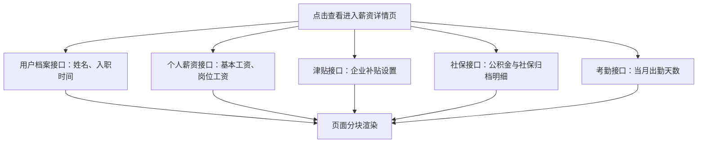
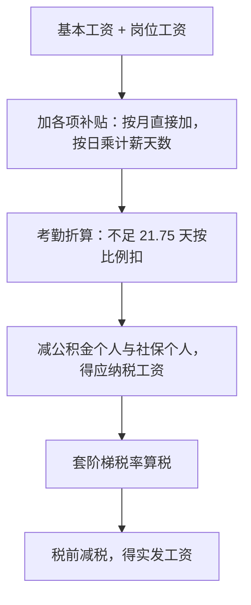

# 薪资详情页与月度工资报表：从单员工明细组装到全员算薪

薪资列表页点「查看」，弹出的详情页有几十个字段：档案、工资、津贴、公积金、出勤天数，它们来自五个不同的数据源。换到「报表」页签，同样的字段铺开成全员工资单，还多出应纳税额、扣税、实发工资这些算出来的列。单员工的明细怎么拼、全员报表的数据从哪来、金额怎么算，这一课把两条链路一次讲完。

## 先给结论

- 详情页是聚合页：用户、个人薪资、津贴、社保、考勤五个数据源并行请求，页面只负责拼装展示。
- 聚合的隐藏前提是接口风格统一：社保模块的老接口直接返回实体对象，改造成 `/historys/archiveDetail/{userId}/{yearMonth}` 返回统一 `Result`，页面上的 404 才消失。
- 月报表入口是 `GET /salarys/reports/{yearMonth}`，`opType` 参数决定数据来源：等于 1 走现算，否则查已归档表。
- 已归档数据分两步查：先按企业与年月定位 `sa_archive` 主表，再用主表 id 捞 `sa_archive_detail` 的全部明细。
- 现算口径：补贴按月直接加、按日乘出勤天数；计薪天数不足 21.75 按比例扣款；应纳税工资扣完社保与公积金个人部分后套阶梯税率，实发等于税前减税。

## 一、详情页：一次点击背后的五个数据源

详情页打开瞬间，浏览器开发者工具里能看到一串请求：查用户档案的、查个人薪资的、查津贴设置的、查社保归档的、查出勤天数的。页面上的内容分区和请求一一对应：



其中四路接口在前几课已经就绪，唯独 E 这一路返回 404。排查时顺着 URL 看参数：它要的是 userId 加年月，目标是已归档的社保用户数据。接口在社保模块里其实存在过，问题出在风格不统一。

## 二、补齐缺口：把社保老接口改造成统一风格

社保模块里原来的接口长这样，返回值是裸的实体对象，参数走 query 方式：

```java
//改造前：直接返回实体，不带统一响应壳
@RequestMapping(value = "/historys/data", method = RequestMethod.GET)
public ArchiveDetail historysData(String userId, String yearMonth) throws Exception {
    return archiveService.findUserArchiveDetail(userId, yearMonth);
}
```

系统里其余接口都遵循同一个约定：路径参数用 `{}` 占位并由 `@PathVariable` 声明，返回值统一包成 `Result`。按这个约定改造，路径换成带两个占位符的形式：

```java
//根据用户 id 与年月查询已归档的社保明细
@RequestMapping(value = "/historys/archiveDetail/{userId}/{yearMonth}", method = RequestMethod.GET)
public Result historysData(@PathVariable String userId, @PathVariable String yearMonth) throws Exception {
    ArchiveDetail detail = archiveService.findUserArchiveDetail(userId, yearMonth);
    return new Result(ResultCode.SUCCESS, detail);
}
```

重启社保模块后刷新详情页，社保与公积金区域的数据就出来了。这一小段的价值不在代码量，而在教训：聚合型页面里每个数据源都可能来自不同团队不同时期，接口风格不统一迟早以 404 或解析失败的形式冒出来，统一返回壳与统一参数风格是提前拆雷。

## 三、月报表的数据盘子：五块数据的来路

切到报表页签，表格列非常密：姓名、工号、部门、在职状态、公积金个人、社保个人、社保企业、岗位工资、应扣金额、考勤天数、应纳税、税、实发工资。把这些列按来源归类，正好五块：

**第一块，用户数据。** 姓名、工号、部门、在职状态，来自员工档案，实现方式与列表页一样，靠连表查询带出来。

**第二块，社保数据。** 公积金与社保的个人、企业缴纳额，来自社保模块的归档明细。

**第三块，薪资与津贴。** 基本工资、岗位工资来自薪资设置，各项补贴来自本企业的津贴方案配置，就在当前薪资模块里，直接调 Service。

**第四块，考勤数据。** 计薪天数、考勤扣款的依据，来自考勤模块的月度归档。

**第五块，计算结果。** 应纳税额、税、实发工资，没有现成表，靠前三块数据按口径算出来。

跨模块的部分不能直连对方的数据库，走的是 Feign 调用，这一点留到下一篇月报表数据组装时展开。这里先把「数据五块、来源三个模块」的盘子记住，后面的每个字段都能归位。

## 四、入口与分支：opType 决定现算还是查归档

报表接口挂在归档 Controller 下，请求形如 `/salarys/reports/201907?opType=1`。地址参数是年月，查询参数 `opType` 区分两种语义：等于 1 表示制作新报表，数据要现场构造；其他值表示查已归档的报表：

```java
//制作薪资报表
//请求 URL：/salarys/reports/201907?opType=1
//opType 为 1 时现算报表数据，其他值查询已归档报表
@RequestMapping(value = "/reports/{yearMonth}", method = RequestMethod.GET)
public Result historyDetail(@PathVariable String yearMonth, int opType) {
    List<SalaryArchiveDetail> list = new ArrayList<>();
    if (opType == 1) {
        //1.现算当月报表数据（下一篇展开）
    } else {
        //2.1 先查归档主表
        SalaryArchive sa = archiveService.findSalaryArchive(yearMonth, companyId);
        //2.2 主表有数据，再按主表 id 查全部明细
        if (sa != null) {
            list = archiveService.findSalaryArchiveDetail(sa.getId());
        }
    }
    return new Result(ResultCode.SUCCESS, list);
}
```

归档分支的 Service 与 Dao 都是教科书式的 Spring Data 写法：

```java
//根据企业与年月查询归档主表
public SalaryArchive findSalaryArchive(String yearMonth, String companyId) {
    return archiveDao.findByCompanyIdAndYearMonth(companyId, yearMonth);
}

//根据归档 id 查询全部明细
public List<SalaryArchiveDetail> findSalaryArchiveDetail(String id) {
    return archiveDetailDao.findByArchiveId(id);
}
```

两个 Dao 方法没有任何 `@Query`，全靠方法名派生：`findByCompanyIdAndYearMonth` 对应主表的 companyId 加 yearsMonth 两个条件，`findByArchiveId` 对应明细表的 archiveId 外键。先查主表再查明细不只是习惯，主表没有归档记录时直接返回空列表，省掉一次必然落空的明细查询，也让「这个月归档过没有」的判断有了明确落点。归档数据是主表加明细的两级结构：`sa_archive` 存企业某月的汇总（税前工资合计、五险一金合计、人工成本），`sa_archive_detail` 存每个员工一行的明细。

## 五、现算口径：补贴、考勤扣款与个税

`opType` 等于 1 时走现算，所有计算封装在明细对象 `SalaryArchiveDetail` 的方法里，把企业津贴设置传进去即可触发。计算按四步走：

**第一步，算补贴。** 津贴方案存在 `Settings` 表里，交通、通讯、午餐、住房各有一对「计算类型 + 金额」字段。类型 1 表示按日发放，类型 3 表示按月发放。按月的直接累加固定金额，按日的要乘本月计薪天数，全部累加结果落到 `salaryChangeAmount`，对应页面上的补贴列：

```java
//交通补贴：类型 1 按日乘天数，其他按月直接加
if (settings.getTransportationSubsidyScheme() == 1) {
    money = money.add(settings.getTransportationSubsidyAmount().multiply(this.officialSalaryDays));
} else {
    money = money.add(settings.getTransportationSubsidyAmount());
}
//通讯、午餐、住房同理逐项累加，最后写入补贴合计
this.salaryChangeAmount = money;
```

**第二步，算考勤扣款。** 企业真实规则可以很复杂，迟到、早退、旷工各有一套罚则，课程做了简化：只看计薪天数是否达到 21.75，这是劳动法口径的月计薪天数。不足时按比例折算，日工资等于工资基数除以 21.75，扣款等于日工资乘缺勤天数；满勤不扣：

```java
BigDecimal attendanceMoney = this.currentSalaryTotalBase;
if (officialSalaryDays.compareTo(new BigDecimal("21.75")) < 0) {
    //日工资 = 工资基数 / 21.75，保留两位小数四舍五入，再乘实际出勤天数
    attendanceMoney = this.currentSalaryTotalBase.divide(new BigDecimal("21.75"), 2, BigDecimal.ROUND_HALF_UP)
            .multiply(this.officialSalaryDays);
} else {
    this.attendanceDeductionMonthly = "0";
}
```

**第三步，算应纳税工资。** 岗位工资加基本工资构成基数，加上第一步的补贴，减去公积金个人部分与社保个人部分，剩下的才是计税口径：

```java
//税前合计 = 考勤折算后的工资 + 补贴
this.currentSalaryTotalBase = attendanceMoney.add(money);
//应纳税工资 = 税前合计 - 公积金个人 - 社保个人
this.salaryByTax = this.currentSalaryTotalBase
        .subtract(this.providentFundIndividual)
        .subtract(this.socialSecurityIndividual);
```

**第四步，算税与实发。** 计税方法按分段税率加速算扣除数实现，形如「应纳税工资乘税率再减速算扣除数」。课程里用的是 3500 起征的旧口径分段表，这段逻辑按课程思路整理如下（实际项目应读配置或替换成现行个税规则）：

```java
private BigDecimal getTax(BigDecimal salary) {
    //分段条件从小到大排列，命中即返回：税 = 应纳税工资 * 税率 - 速算扣除数
    if (salary.doubleValue() <= 3500) {
        return BigDecimal.ZERO;
    }
    BigDecimal stageNum;   //税率
    BigDecimal easyNum;    //速算扣除数
    if (salary.doubleValue() <= 5000) {
        stageNum = new BigDecimal("0.03"); easyNum = new BigDecimal("0");
    } else if (salary.doubleValue() <= 8000) {
        stageNum = new BigDecimal("0.1");  easyNum = new BigDecimal("105");
    } else if (salary.doubleValue() <= 12500) {
        stageNum = new BigDecimal("0.2");  easyNum = new BigDecimal("555");
    } else {
        stageNum = new BigDecimal("0.25"); easyNum = new BigDecimal("1085");
    }
    return salary.multiply(stageNum).subtract(easyNum);
}
```

税前工资减去税就是实发。整条流水线画出来是这样：



课堂演示的数据里，满勤员工各项俱全算出实发；构造的缺勤数据被扣到接近于零，报表列里直接显示不发放。至此当月报表在页面上完整呈现，剩下的归档动作就是把这份结果整体写进 `sa_archive` 与 `sa_archive_detail`，供以后按 opType 非 1 的分支回查。

## 常见误区

- **把 opType 语义记反**：等于 1 是现算新报表，其他值才是查归档。分支写反后，当月查不到数据、历史月反而触发一套 Feign 调用，表现为页面空白加无意义的远程请求。
- **计薪天数随手用 30 或当月自然日**：扣款口径的法定基数是 21.75，用它除出来的日工资才对得上工资单；用 30 天会把缺勤扣款系统性算少。
- **补贴不区分按日按月**：按月的方案误乘天数，员工出勤 20 天补贴就打七折；两种类型的分支缺一不可。
- **明细先于主表查询**：不判断主表是否存在直接按归档 id 查明细，ID 为 null 时要么空指针要么查回脏数据，先主表后明细是这里的安全顺序。

## 面试可能被问到的问题

1. 面试官追问：「详情页这种聚合展示，后端要做什么准备？」
   答：把各数据源的接口风格统一：响应统一包 Result、路径参数统一用占位符加 `@PathVariable`。聚合页本身只管并行请求与拼装，任何一个数据源风格不一致都会在页面上以解析失败或 404 的形式暴露。
   
2. 面试官追问：「报表为什么要分 opType 现算与查归档两条路？」
   答：当月数据还在变动，每次打开都重算才能反映最新考勤与社保；历史月份的数据已经定格，查归档表直接返回，省掉重复计算，也保证事后审计看到的数字与归档时一致。
   
3. 面试官追问：「归档主表和明细表为什么要拆开？」
   答：主表按企业加年月一行，承担「某月是否归档」的判定和月度汇总；明细表按员工一行，承担个人工资单。拆开后先主表后明细，避免无效的明细扫描，两表也各自有独立的生命周期。
   
4. 面试官追问：「方法名派生查询的边界在哪里？」
   答：字段条件简单明确时派生查询零样板，如 `findByCompanyIdAndYearMonth`；一旦涉及 join、聚合或复杂排序就该回到 `@Query`。派生方法名过长本身也是信号，说明该显式写 SQL 了。
   
5. 面试官追问：「21.75 这个数字哪来的，为什么不用当月实际工作日？」
   答：它来自劳动和社会保障部的月计薪天数口径，即 365 天减 104 个休息日再除以 12。用固定值保证各月日工资口径一致，用当月自然日或实际工作日会让同薪员工不同月的日工资浮动，扣款对不上合同约定。
   
6. 面试官追问：「个税计算为什么用速算扣除数？」
   答：分段计税要对每一段分别乘税率再求和，展开后等价于「全额乘最高段税率减速算扣除数」。速算扣除数就是前面各段差额的累计，一次乘法加一次减法替代逐段循环，结果相同且实现简单。

## 配套资料

- 代码：`materials/code/02/day16 薪资管理与工作流概述/day16/03-资料/03薪资代码/基本操作代码/controller/ArchiveController.java`（报表入口骨架，课堂在此基础上补充 reports 分支）
- 代码：`materials/code/02/day16 薪资管理与工作流概述/day16/03-资料/03薪资代码/基本操作代码/dao/ArchiveDao.java` 与 `dao/ArchiveDetailDao.java`（主表与明细 Dao）
- 代码：`materials/code/02/day16 薪资管理与工作流概述/day16/03-资料/03薪资代码/实体类domain/salarys/SalaryArchive.java`、`SalaryArchiveDetail.java`、`Settings.java`（归档主表、明细、津贴方案实体，文中包名已统一改为 `com.example`）
- 文中个税分段方法为按课程口径整理的简化示例，实际项目应替换为现行税率规则
