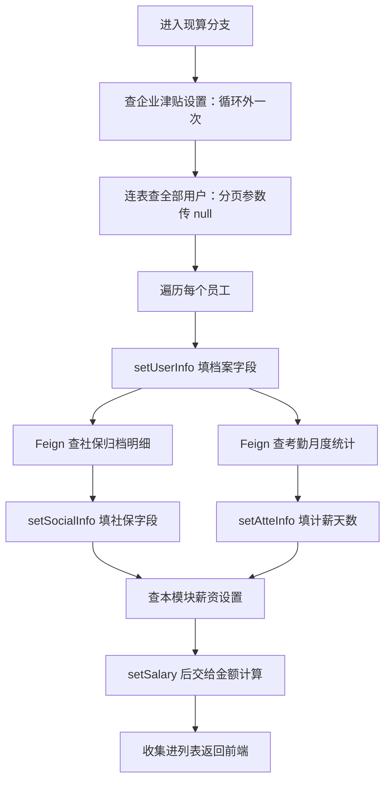

# 月报表数据组装：把考勤与社保数据揉进每张工资单

上一课把报表接口的分支立好了：`opType` 等于 1 时要走现算，那一格还是空的。现算的实质是一次大规模数据组装：全企业每个员工的档案、社保、考勤、薪资设置要分别取来，塞进同一个明细对象里，然后才轮到金额计算。这篇把组装的七步流程、两个 Feign 客户端的封装方式、以及每个字段的来路讲清楚。

## 先给结论

- 现算工资有业务前提：社保与考勤当月已归档，只有归档了才认为社保缴纳完成、考勤定格，算出来的数才正规。
- 跨模块数据不直连数据库，走 Feign：考勤归档走考勤服务，社保归档走社保服务，两边都要传 userId 与年月。
- 两个 `@FeignClient` 接口加一个封装类，统一把 `Result` 里的 data 转成目标实体，调用方不再碰 JSON。
- 组装主流程七步：查企业津贴设置（循环外一次）、连表查全部用户（分页参数传 null）、循环构造明细、填档案、填社保、填考勤、填薪资，最后交给计算方法。
- 津贴设置是企业级的，放循环外只查一次；员工级数据放循环内逐个取，这个内外之分是组装代码的第一性能守则。

## 一、前提与数据位置：归档了才准算

算工资前有一个业务口径要先立住：当月社保已经归档，才认为这月社保缴纳完成；当月考勤已经归档，才认为出勤数据定格。两个都归档了，制作出的薪资报表才称得上正规，数字经得起事后核对。

这也直接决定了数据的位置。社保明细躺在社保模块的归档表里，考勤月度统计躺在考勤模块的归档表里，薪资设置在本模块。三个模块三个服务，微服务架构下不能为了省事去连别人的库，跨服务取数只能走 Feign 声明式调用。

## 二、两个 Feign 客户端与一个统一封装

课程资料里给好了两个客户端接口，声明方式与之前的模块完全一致：

```java
//调用考勤服务的归档统计接口
@FeignClient("attendance-service")
public interface AttendanceFeignClient {

    @RequestMapping(value = "/attendances/archive/{userId}/{yearMonth}", method = RequestMethod.GET)
    Result atteStatisMonthly(@PathVariable("userId") String userId, @PathVariable("yearMonth") String yearMonth);
}
```

```java
//调用社保服务的归档明细接口
@FeignClient("social-security-service")
public interface SocialSecurityFeignClient {

    @RequestMapping(value = "/social_securitys/historys/archiveDetail/{userId}/{yearMonth}", method = RequestMethod.GET)
    Result getSocialInfo(@PathVariable("userId") String userId, @PathVariable("yearMonth") String yearMonth);
}
```

两个接口长得几乎一样：路径上带 userId 与 yearMonth 两个占位符，返回统一的 `Result`。注解里的服务名是注册中心里的服务 id，Feign 拿它做负载均衡寻址。

直接用这两个接口的话，每个调用点都要自己判断 `isSuccess`、自己把 data 转实体，重复代码很快铺开。所以再包一层：

```java
@Service
public class FeignClientService {

    @Autowired
    private AttendanceFeignClient attendanceFeignClient;

    @Autowired
    private SocialSecurityFeignClient socialFeignClient;

    //查考勤服务的月度归档统计
    public ArchiveMonthlyInfo getAtteInfo(String userId, String yearMonth) {
        Result result = attendanceFeignClient.atteStatisMonthly(userId, yearMonth);
        ArchiveMonthlyInfo info = null;
        if (result.isSuccess()) {
            info = JSON.parseObject(JSON.toJSONString(result.getData()), ArchiveMonthlyInfo.class);
        }
        return info;
    }

    //查社保服务的归档明细
    public ArchiveDetail getSocialInfo(String userId, String yearMonth) {
        Result result = socialFeignClient.getSocialInfo(userId, yearMonth);
        ArchiveDetail info = null;
        if (result.isSuccess()) {
            info = JSON.parseObject(JSON.toJSONString(result.getData()), ArchiveDetail.class);
        }
        return info;
    }
}
```

`Result` 里的 data 在反序列化后是 JSON 对象而不是目标类型，先 `JSON.toJSONString` 序列化回字符串、再 `JSON.parseObject` 定向转成实体，是 fastjson 体系下最省事的对象转换手法。失败时返回 null，把异常判断收敛在这一层。

## 三、getReports：七步组装主流程

组装逻辑放在归档 Service 的 `getReports` 方法里，类里已经注入了五个协作对象：明细 Dao、薪资 Dao、id 生成器、薪资 Service、设置 Service，外加刚写好的 `FeignClientService`。方法全貌如下：

```java
//计算薪资：前提是社保和考勤已经归档
public List<SalaryArchiveDetail> getReports(String yearMonth, String companyId) {
    List<SalaryArchiveDetail> list = new ArrayList<>();
    //1.查询当前企业的津贴设置，企业级数据，循环外只查一次
    Settings settings = settingsService.findById(companyId);
    //2.查询全部用户：分页参数传 null 代表不分页
    Page<Map> page = userSalaryDao.findPage(companyId, null);
    for (Map map : page.getContent()) {
        //3.构造明细对象，先填员工档案字段
        SalaryArchiveDetail detail = new SalaryArchiveDetail();
        detail.setUserInfo(map);
        //4.远程查社保归档明细
        detail.setSocialInfo(feignClientService.getSocialInfo(detail.getUserId(), yearMonth));
        //5.远程查考勤月度归档统计
        detail.setAtteInfo(feignClientService.getAtteInfo(detail.getUserId(), yearMonth));
        //6.查询本模块的薪资设置并填入
        detail.setSalary(salaryService.findUserSalary(detail.getUserId()));
        list.add(detail);
        //7.金额计算由明细对象自己的方法完成
    }
    return list;
}
```

几个容易忽略的细节值得单独说：

**查全部用户复用了列表那条连表 SQL。** `findPage` 的第二个参数传 null，Spring Data 不再追加 limit 与 offset，一次拿回全企业员工。不传 null 而是随手 new 一个 `PageRequest(0, 10)`，报表永远只有第一页十个人。

**档案字段的填充收口在实体的 `setUserInfo` 方法里。** 它把 Map 的取值与判空都搬进去，循环体里只剩一行：

```java
//设置用户属性
public void setUserInfo(Map map) {
    this.username = map.get("username").toString();
    this.departmentName = map.get("departmentName").toString();
    this.mobile = map.get("mobile").toString();
    this.userId = map.get("id").toString();
    this.workNumber = map.get("workNumber").toString();
    this.inServiceStatus = map.get("inServiceStatus").toString();
}
```

**查薪资走 Service 而不是 Dao。** `salaryService.findUserSalary` 内部已经处理了 `Optional` 判空，调用方拿到的直接是对象或 null，省掉一层啰嗦的判断。

## 四、字段映射：报表每一列从哪来

把明细对象 `SalaryArchiveDetail` 里的字段按来源归堆，报表列的地图就清晰了：

| 字段组 | 来源 | 填充入口 |
|---|---|---|
| username、mobile、workNumber、departmentName、inServiceStatus | 连表查询的员工档案 Map | `setUserInfo` |
| providentFundIndividual、socialSecurityIndividual 等社保公积金个人与企业缴纳额 | 社保服务归档明细 | `setSocialInfo` |
| officialSalaryDays 计薪天数等考勤统计 | 考勤服务月度归档 | `setAtteInfo` |
| currentSalaryTotalBase、currentBaseSalary 等薪资基数 | 本模块 `sa_user_salary` | `setSalary` |
| salaryChangeAmount、tax、salaryAfterTax、payment | 无来源，计算产生 | 明细对象的计算方法 |

社保相关字段的赋值由 `setSocialInfo` 完成，内部就是把社保归档对象的缴纳额逐个搬到工资明细：

```java
//设置社保属性
public void setSocialInfo(ArchiveDetail socialInfo) {
    this.providentFundIndividual = socialInfo.getProvidFundIndividual();
    this.providentFundEnterprises = socialInfo.getProvidFundEnterprises();
    this.socialSecurityIndividual = socialInfo.getSocialSecurityIndividual();
    this.socialSecurityEnterprise = socialInfo.getSocialSecurityEnterprise();
}
```

填完这四路数据，明细对象才算「料齐」，下一课的补贴累加、考勤折算与个税计算才有输入。

## 五、循环内外之分与隐藏的性能账

组装流程画出来，循环内外一目了然：



津贴设置放在循环外，是因为一个企业只有一套方案，一百个员工查一百次是纯粹的浪费。反过来，员工级的社保、考勤、薪资必须在循环内逐个取，因为每人的数据不同。

这套代码有一个明确的性能隐患：循环体内每名员工要发两次 Feign 远程调用，一百人就是两百次 HTTP 往返。课堂这样写是为了把依赖关系演示清楚，生产环境应该给社保与考勤服务补批量接口，按企业一次拉回全员归档数据再在内存里分组，N 加一问题就从远程调用层面消掉了。识别这类「循环内的远程调用」是读报表类代码时最值得练的眼力。

## 常见误区

- **津贴查询写进循环**：每人重复查一遍 `Settings`，数据库压力随人数线性涨。企业级配置一律提到循环外查一次，随参数传入计算。
- **分页参数没传 null**：`findPage` 传了个具体分页对象，报表只有第一页的人，其余员工「凭空消失」。查全量就传 null，让框架跳过 limit。
- **把 Result 的 data 直接强转实体**：data 实际是 JSON 对象，强转抛 `ClassCastException`。先序列化成字符串再 `parseObject` 成目标类型。
- **跳过归档前提直接现算**：社保或考勤当月没归档，Feign 返回 null，报表大面积空白还不报错。入口处应校验两模块的归档状态，缺归档就提示先去归档。

## 面试可能被问到的问题

1. 面试官追问：「微服务之间取数为什么用 Feign 而不是直连对方数据库？」
   答：直连数据库会把两个服务的存储层耦合在一起，表结构一改就连环崩，也无法享受服务端的缓存、鉴权与限流。Feign 走 HTTP 接口，消费方只依赖接口契约，服务可以独立演进与扩缩容。
   
2. 面试官追问：「Result 里的 data 怎么转成业务实体？」
   答：data 反序列化后通常是 JSONObject 或 Map，直接强转会抛类型异常。通用做法是先 `JSON.toJSONString` 转回字符串，再用 `JSON.parseObject` 按目标类重建对象，也可以用 `JSONObject.toJavaObject` 一步完成。
   
3. 面试官追问：「这段组装代码的 N 加一问题在哪，怎么优化？」
   答：循环内每名员工发两次 Feign 调用，N 个员工就是 2N 次 HTTP 往返。优化方向是给被调服务补批量接口，按企业一次取回全员归档数据，内存里按 userId 分组后填充；再配合并行调用与超时降级控制总耗时。
   
4. 面试官追问：「为什么把字段填充逻辑写进实体的 setUserInfo、setSocialInfo 方法？」
   答：Map 取值、类型转换、判空都是与该实体绑定的私有知识，收口到实体方法后 Service 的循环体保持一行一个动作，多处需要同样填充时直接复用，避免散落的赋值代码各自漏判空。
   
5. 面试官追问：「为什么现算工资必须等社保和考勤归档？」
   答：归档是业务上的定格动作，代表当月社保缴纳与出勤数据已确认。不归档就算薪，后面补归档时扣款基数可能变化，工资单与归档数据对不上，财务对账会出问题。
   
6. 面试官追问：「Feign 调用失败怎么兜底？」
   答：封装层统一判 `isSuccess`，失败返回 null 让上层决定展示空值还是提示；更完整的做法是配置超时与重试，再结合降级返回默认值或缓存数据，避免单个服务抖动拖垮整张报表。

## 配套资料

- 代码：`materials/code/02/day16 薪资管理与工作流概述/day16/03-资料/03薪资代码/基本操作代码/feign/AttendanceFeignClient.java`、`feign/SocialSecurityFeignClient.java`、`feign/FeignClientService.java`（两个客户端与统一封装的原件，文中服务名已改为中性命名）
- 代码：`materials/code/02/day16 薪资管理与工作流概述/day16/03-资料/03薪资代码/基本操作代码/service/SalaryService.java`（findUserSalary 的 Optional 封装）
- 代码：`materials/code/02/day16 薪资管理与工作流概述/day16/03-资料/03薪资代码/基本操作代码/dao/UserSalaryDao.java`（findPage 传 null 即查全量的连表查询）
- 代码：`materials/code/02/day16 薪资管理与工作流概述/day16/03-资料/03薪资代码/实体类domain/salarys/Settings.java`、`SalaryArchiveDetail.java`（津贴方案与工资明细实体，文中包名已统一改为 `com.example`）
