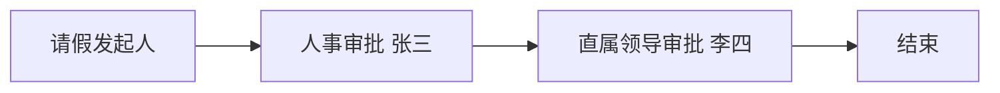

# 请假要层层审批，为什么交给工作流引擎

在人力资源系统或办公软件里，请假、调薪、调岗、离职这类操作，从来不是点一个按钮就完事：申请发出后要经过人事审批、直属领导审批，层层签完，流程才算走完。直觉做法是自己写代码把这条审批链串起来，把「下一步通知谁」用 if else 写死。人员一变动、流程一调整，这堆代码就开始腐烂。

这一课要回答的就是一个问题：这类层层审批的业务，为什么不该自己硬编码，而要交给工作流引擎。

## 先给结论

- 工作流是工作流程的计算模型：把一项工作如何前后组织在一起的逻辑和规则，交给计算机以恰当的模型表示并自动执行。
- 它解决的核心问题是多个参与者之间按规则流转：传递文档、信息或任务，让流程自动向下推进。
- 审批链硬编码有三个死穴：代码繁琐、人员变动即失效、流程调整必须改代码重新发版。
- 工作流引擎是「按角色、分工、条件不同，自动进行传递与层层推进」的解决方案，说白了就是一套做流程管理控制的框架；常见的有老牌的 JBPM 和目前主流的 Activiti。
- 引擎接手之后，「下一步谁审批」不再是代码里的一个名字，而是部署进引擎的流程模型。

## 一、先看清这类业务的共性

HR 系统与办公软件里，大量业务是流程型的：请假、调薪、调岗、离职，一个员工点一下页面按钮只完成了第一步，后面还挂着若干审批节点，每个节点可能是不同部门、不同角色的人。审批全部结束，业务才算完成；任何一环不通过，流程就得回头。

把这类业务抽象一下，就是一张有方向的图：起点是发起人，中间是若干审批节点，终点是结束。图的形状由公司制度决定，不同公司不一样，同一家公司的不同业务也不一样。形状经常变，这正是它不适合写死在代码里的根源。

## 二、工作流的定义：拆成三个关键词

讲义上的定义偏书面：工作流是工作流程的计算模型，即将工作流程中的工作如何前后组织在一起的逻辑和规则，在计算机中以恰当的模型表示并实施计算。这段话可以拆出三个关键词：

**模型。** 流程先被描述成一张图，有哪些节点、先后顺序如何，都写在模型里。

**规则。** 图上带着流转规则：走哪条边、满足什么条件、谁有权处理哪个节点。

**自动执行。** 程序按模型与规则自动推进，不需要人在代码里指定下一步发给谁。

以最常规的请假为例，一张最简单的审批图长这样：



图里没有任何代码，只有节点与先后顺序。工作流要做的，就是把这张图变成计算机可执行的东西，让程序自动地按规则一步一步向下推进，直到走完。

## 三、自己写代码串审批链，会坏在哪

按直觉写出来的审批逻辑大致是这个样子（反面示意代码）：

```java
// 反面示例：审批人写死在代码里，仅用于与工作流方案对比
public void submitLeave(String userId) {
    sendMessage("张三");  // 第一步：发给人事审批
    sendMessage("李四");  // 第二步：发给直属领导审批
}
```

能跑，但埋了三颗雷。

**第一，代码繁琐。** 每种流程都要手写一遍通知与推进逻辑，请假一套、调岗一套、调薪又一套，重复代码越堆越多。

**第二，人员变动即失效。** 张三离职了，人事审批这个动作就没人接，消息发到一个不存在的账号，请假流程直接卡死。审批人写死在代码里，人事一动，代码就得跟着改。

**第三，流程调整成本高。** 原来两个人审批，公司制度变了要三个人，只能推翻原有代码重新修改、测试、发版。流程是业务方经常调的东西，把它焊死在代码里，每次调整都是一次发布风险。

## 四、引擎接手：审批人从代码里挪进模型

解决思路不是把代码写得更灵活，而是换一种承载方式：交给工作流引擎。引擎是整个工作流的重要组成部分，为各系统提供根据角色、分工、条件不同自动进行传递、层层推进的解决方案；落到开发视角，它是一套框架，负责流程的管理与控制。市面上老牌的引擎有 JBPM，目前主流的是 Activiti。

用引擎之后，发起一个请假流程的代码是这样的（阶段二 Activiti 系列的真实成例，包名已改写为 `com.example`）：

```java
package com.example.activiti;

import org.activiti.engine.ProcessEngine;
import org.activiti.engine.ProcessEngines;
import org.activiti.engine.RuntimeService;
import org.activiti.engine.runtime.ProcessInstance;

public class ActivitiStartInstance {
    public static void main(String[] args) {
        // 1.得到 ProcessEngine 对象
        ProcessEngine processEngine = ProcessEngines.getDefaultProcessEngine();
        // 2.得到 RuntimeService 对象
        RuntimeService runtimeService = processEngine.getRuntimeService();
        // 3.创建流程实例，流程定义的 key 为 holiday
        ProcessInstance processInstance = runtimeService.startProcessInstanceByKey("holiday");
        // 4.输出实例信息
        System.out.println("流程实例ID" + processInstance.getId());
    }
}
```

注意 `startProcessInstanceByKey("holiday")` 这一行：发起流程的人只提供了一个流程定义的 key，代码里看不到张三也看不到李四。下一步该谁处理，由引擎按已部署的流程模型与节点配置算出来。审批人、审批顺序、分支条件全部住在模型里，模型可以重新设计、重新部署，业务代码不用动。这就是「繁琐」与「不灵活」两个问题的根本解法。

## 常见误区

- **把工作流当成画图工具。** 画出来的模型只是一份描述流程的 XML 文件，不部署进引擎不起任何作用；「画图」和「部署」是两步。
- **以为引擎认识你的审批人。** 引擎只按模型推进，审批人是模型里配置的候选人或候选组，把角色映射成具体的人是业务系统的职责。
- **觉得简单流程不值得上引擎。** 单级审批硬编码确实能跑，但只要流程会调整、审批人会更替，硬编码的维护成本很快就会超过引入引擎的学习成本。

## 面试可能被问到的问题

1. 面试官追问：「什么是工作流？它解决什么问题？」
   答：工作流是工作流程的计算模型，把一项工作如何前后组织在一起的逻辑和规则交给计算机表示并自动执行。它解决多个参与者之间按规则流转的问题，比如传递文档、信息或任务，让流程自动向下推进，最典型的场景就是各类审批。

2. 面试官追问：「为什么审批场景要用工作流引擎，自己写代码不行吗？」
   答：自己写能把审批链串起来，但审批人写死在代码里，人员变动、审批层级调整都要改代码重新发版；流程一多，通知与推进逻辑大量重复。引擎把流程抽成可部署的模型，调整流程只改模型不改代码，可维护性完全不在一个量级。

3. 面试官追问：「常见的工作流引擎有哪些？」
   答：老牌的有 JBPM，目前主流的是 Activiti。Activiti 是开源引擎，实现了 BPMN 2.0 规范，基于 Java，轻量、可嵌入，审批中心类系统普遍选它。

4. 面试官追问：「引入引擎后，审批人换了还需要改代码吗？」
   答：不需要。发起流程的代码只引用流程定义的 key，审批人配置在流程模型里；换审批人只需调整模型里的候选人配置或业务侧的角色映射，业务代码不用动。

5. 面试官追问：「工作流引擎的本质是什么？」
   答：本质是一套负责流程管理与控制的框架：把流程抽象成模型，持久化到自己的表结构里，再对外提供一组接口，让业务系统用打点调方法的方式发起流程、查询任务、推进流转，而不用关心底层的状态维护。

## 配套资料

- 代码：`materials/code/02/Activiti7-day02-工作流使用/Activiti7-day02-工作流使用/代码/代码/src/main/java/`（ActivitiStartInstance 等 4 个成例，文中包名已统一改为 `com.example`）
- SQL：`materials/code/02/day16 薪资管理与工作流概述/day16/03-资料/act.sql`（引擎自建的全部 `act_` 前缀表建表脚本）
- 本课为概念引入，无独立业务源码包；反面示例为按本课写法补全
