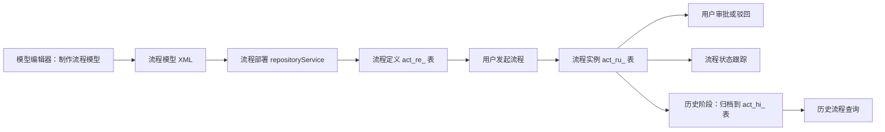

# Activiti 开发的三个阶段：从画图部署到发起审批与历史查询

审批中心确定用 Activiti 之后，流程开发也不是上来就写 Controller。官方把 Activiti 的开发路径称为生命周期，一共三个阶段：静态阶段、运行时阶段、历史阶段。把三个阶段和各自对应的代码姿势搞清楚，后面审批中心里的每一段代码都能对号入座。

## 先给结论

- 三阶段：静态阶段做流程设计与流程部署；运行时阶段发起流程、审批或驳回并跟踪状态；历史阶段做归档与历史查询。
- 静态阶段一行 Java 代码都不用写，产出是描述流程的模型，本质是一份 XML 文件，再加一条部署记录。
- 模型不部署就不能用；部署之后引擎才知道系统里定义了这样一个流程。
- 发起、审批、跟踪、查历史全部通过 Activiti 提供的接口完成，对象打点调方法，不直接读写它的表。
- 三阶段对应三组表：流程定义落 `act_re_` 前缀，运行时数据落 `act_ru_` 前缀，完结数据归档到 `act_hi_` 前缀。

## 一、静态阶段：设计模型，部署进引擎

静态阶段的特点是不需要写任何 Java 代码。它包含两项工作：

**流程设计。** 不同公司、不同业务的流程不一样：请假要过人事专员和部门领导，调岗调薪又是另一条线。把每种流程绘制成流程模型，导出后就是一份 XML 文件，里面详细描述了整个流程的流转过程和涉及的每一个节点。

**流程部署。** 模型只是 XML，还不能在系统里使用；要把模型上传到系统并导入 Activiti，引擎从此知道「定义了一个这样的流程，它的流转设计在这份 XML 里」。

部署对应的真实成例如下（包名已改写为 `com.example`）：

```java
package com.example.activiti;

import java.io.InputStream;
import java.util.zip.ZipInputStream;

import org.activiti.engine.ProcessEngine;
import org.activiti.engine.ProcessEngines;
import org.activiti.engine.RepositoryService;
import org.activiti.engine.repository.Deployment;

public class ActivitiDeployment {
    // 流程定义部署：流程制作出来后要上传到服务器，zip 文件更便于上传
    public static void main(String[] args) {
        // 1.创建 ProcessEngine 对象
        ProcessEngine processEngine = ProcessEngines.getDefaultProcessEngine();
        // 2.得到 RepositoryService 实例
        RepositoryService repositoryService = processEngine.getRepositoryService();
        // 3.转化出 ZipInputStream 流对象
        InputStream is = ActivitiDeployment.class.getClassLoader()
                .getResourceAsStream("diagram/holidayBPMN.zip");
        ZipInputStream zipInputStream = new ZipInputStream(is);
        // 4.进行部署
        Deployment deployment = repositoryService.createDeployment()
                .addZipInputStream(zipInputStream)
                .name("请假申请单流程")
                .deploy();
        // 5.输出部署信息
        System.out.println(deployment.getName());
        System.out.println(deployment.getId());
    }
}
```

部署背后写三张表：`act_re_deployment` 存部署信息，`act_re_procdef` 存流程定义信息，`act_ge_bytearray` 存流程的 bpmn 文件与 png 图片资源。成例用的是 zip 方式，bpmn 与图片一起上传；单文件方式对应 `addClasspathResource("diagram/holiday.bpmn")`，一次加一个资源。

## 二、运行时阶段：发起、审批、状态跟踪

模型部署好之后，流程进入运行时：用户发起流程，用户审批或驳回，期间还可以借助引擎做流程状态的跟踪。

发起流程（成例节选）：

```java
// 创建流程实例，前提是流程定义已部署
ProcessInstance processInstance = runtimeService.startProcessInstanceByKey("holiday");
System.out.println("流程定义ID" + processInstance.getProcessDefinitionId());
System.out.println("流程实例ID" + processInstance.getId());
```

发起会同时写运行时表与历史表：`act_ru_execution`、`act_ru_task`、`act_ru_identitylink` 记录正在跑的执行、任务与参与者，`act_hi_procinst`、`act_hi_taskinst`、`act_hi_actinst` 同步留档。

状态跟踪，查某个人当前要办的任务（成例节选）：

```java
// 根据流程定义 key 与负责人 assignee 查询当前用户的任务列表
Task task = taskService.createTaskQuery()
        .processDefinitionKey("holiday")
        .taskAssignee("wangwu")
        .singleResult();
System.out.println("任务ID:" + task.getId());
System.out.println("任务负责人:" + task.getAssignee());
System.out.println("任务名称:" + task.getName());
```

企业里常见的情况：请假发起半天没人理，用状态跟踪查一下流程流转到哪一步、卡在哪个同事手上，是 HR 没审批还是部门经理没审批，找到对应的人提醒审批。

审批就是完成任务：

```java
// 查询到当前用户任务后，按任务 id 办理
taskService.complete(task.getId());
```

`complete` 之后，当前任务从运行时表消掉，流程按模型流向下一个节点，历史表里补一条任务完成记录。驳回同样在任务维度上操作，让流程回到指定节点。

## 三、历史阶段：完结之后的归档与查询

流程全部完结（正常结束，或被驳回终止）之后，相关数据归档到历史表，可以查询历史流程实例：谁发起的、经过哪些节点、每个任务谁处理的、耗时多久。审批中心的「已办」与「流程记录」页面，读的就是这批 `act_hi_` 前缀的表。历史本质上就是查询，没有额外的写逻辑，写是引擎在运行时同步做的。

## 四、全景图：三阶段与两个支撑组件



图上有两块支撑要单独说：

**REST API。** 发起、审批、跟踪、查历史，都不是直接写 Java 代码去查引擎的数据库，而是调用引擎提供的一系列接口。说白了它提供了一堆 Service 方法，对象打点调方法就能发起流程、审批流程、查询历史。

**模型编辑器。** 它服务于静态阶段的流程设计，专门用来制作流程模型。图上的流程定义、流程实例、历史流程实例分别是「部署后的模板」「发起后的运行」「完结后的存档」，一层比一层更接近结果，不要混为一谈。

## 常见误区

- **只画图不部署。** 模型是 XML 文件，躺在磁盘上引擎毫无感知；必须走一次 createDeployment 才能发起流程。
- **绕过接口直查 `act_` 表。** 表结构是引擎的内部实现，自己写 SQL 关联查询，版本一升级就翻车；官方接口已经把常用查询封装好了。
- **混淆流程定义与流程实例。** 定义是模板，部署一次是一条记录；实例是每次发起产生的一个运行体，一个定义可以同时跑着无数个实例。
- **改了 XML 以为立即生效。** 已部署的定义不会自动更新，修改模型要重新部署，生成新版本的流程定义，旧实例仍按旧版本继续跑。

## 面试可能被问到的问题

1. 面试官追问：「Activiti 开发的完整流程是怎样的？」
   答：分三个阶段。静态阶段设计流程模型并部署进引擎；运行时阶段发起流程、审批驳回并跟踪状态；历史阶段查询归档数据。对应到代码就是 RepositoryService 部署、RuntimeService 发起、TaskService 查询与办理、HistoryService 查历史。

2. 面试官追问：「流程定义和流程实例什么区别？」
   答：流程定义是部署进引擎的模板，记录流程有哪些节点、怎么流转；流程实例是一次具体发起产生的运行体。一个定义可以同时存在多个实例，比如全公司每天发起的多个请假单，共用同一个定义。

3. 面试官追问：「部署流程定义会写哪些表？」
   答：act_re_deployment 记录部署信息，act_re_procdef 记录流程定义，act_ge_bytearray 存放 bpmn 与图片资源。资源以二进制形式存进引擎自己的表，后续按部署 id 取用。

4. 面试官追问：「怎么查某个用户当前要办的任务？」
   答：用 TaskService 的 createTaskQuery，按 processDefinitionKey 与 taskAssignee 过滤，单条用 singleResult，多条用 list。任务查出后拿到任务 id，调 complete 即可办理。

5. 面试官追问：「为什么开发时不直接查 Activiti 的表？」
   答：act_ 前缀的表是引擎的内部实现，结构复杂且随版本变化；官方 Service 已封装常用操作，直接查表绕过了引擎的状态维护逻辑，容易造成数据不一致，升级后也无法兼容。

6. 面试官追问：「历史数据是怎么来的，有什么用？」
   答：引擎在运行时同步写 `act_hi_` 前缀的历史表，流程完结后数据就是完整档案，用于已办查询、流程轨迹展示与统计分析。要在配置里打开 `db-history-used` 并把 `history-level` 设为 full 才有任务级明细。

## 配套资料

- 代码：`materials/code/02/Activiti7-day02-工作流使用/Activiti7-day02-工作流使用/代码/代码/src/main/java/`（ActivitiDeployment、ActivitiStartInstance、ActivitiTaskQuery、ActivitiCompleteTask 四个成例，文中包名已统一改为 `com.example`）
- 配置：`materials/code/02/Activiti7-day02-工作流使用/Activiti7-day02-工作流使用/代码/代码/src/main/resources/activiti.cfg.xml`（独立运行配置：数据源与 databaseSchemaUpdate）
- SQL：`materials/code/02/day16 薪资管理与工作流概述/day16/03-资料/act.sql`（引擎自建的全部 25 张 `act_` 前缀表建表脚本）
