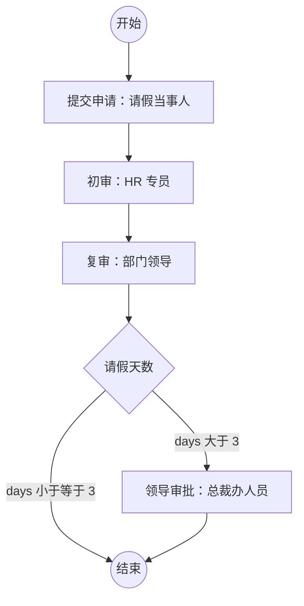

# 请假流程分析：四个角色、一个网关，第一张流程图的全部依据

流程制作的完整动作是三步：借助工具绘制流程图、把流程部署到 Activiti、之后才是流程的执行与历史查询。动手画图之前，最值钱的一步是业务分析：参与的人有谁、节点怎么串、哪里有分支。请假这个流程分析透了，调休、离职、加班大同小异，换一套节点而已。

## 先给结论

- 请假流程共四类参与人：请假当事人、HR 专员、部门领导、总裁办人员。
- HR 专员与总裁办人员都是「任意一人可审批或驳回」，建模时用候选组，不写死某个人。
- 部门领导特指请假当事人所在部门的领导，不是公司里任意的领导。
- 唯一分支条件是请假天数：3 天以内（含 3 天）部门领导有最终决定权，流程直接结束；超过 3 天交总裁办人员裁决。
- 分析结果直接映射成 BPMN：开始、提交申请、初审、复审、排他网关、领导审批、结束。

## 一、先分析业务，再画图

画流程图不难，难的是图上的每个框都有业务依据。讲义对请假流程的业务描述是：当事人发起请假申请；直属领导根据实际情况审核，有问题就不通过、流程终止，没问题就通过、流程继续向后执行；审批通过后进入人事部门复审阶段，3 天以内的请假复审结束即完成；3 天以上的请假需要内部领导审批，结束之后请假才算完成。

把这段描述捋成参与人清单，一共四类：

**请假当事人。** 发起人，提交请假申请。

**HR 专员。** 公司人力资源的专员，可能有很多位，任意一位都可以审批或驳回。

**部门领导。** 请假当事人所在部门的领导，负责复审。

**总裁办人员。** 总裁办、总经理办公室的人员，负责裁决超过 3 天的请假，同样任意一人可审批。

角色清楚了，流转顺序也就定了：当事人发起，进 HR 专员，再进部门领导，最后按天数决定是直接结束还是向上走。HR 专员可能是张三也可能是李四，但流程图上不关心具体是谁，只关心「这个节点由哪一类人办理」。

## 二、把分析翻译成流程图



图的结构与业务分析一一对应：两个圆是开始与结束事件，四个方框是用户任务，菱形是排他网关，按请假天数走两条出边。HR 专员节点和总裁办节点在图上与别的任务没有区别，「任意一人可办」体现在任务的候选人配置上，而不是图上。

## 三、流程图落到 BPMN 模型里是什么样

课程资料里有一份真实的请假流程模型 `请假.bpmn20.xml`，节点定义与上图完全对应（节选）：

```xml
<bpmn2:process id="process_leave" name="请假" isExecutable="true">
  <bpmn2:startEvent id="START" name="开始"></bpmn2:startEvent>
  <bpmn2:userTask id="APPLY" name="提交申请"
      activiti:candidateGroups="PROCESS_LEAVE_APPLY_USERS"></bpmn2:userTask>
  <bpmn2:userTask id="CHU" name="初审"
      activiti:candidateGroups="PROCESS_LEAVE_CHU_USERS"></bpmn2:userTask>
  <bpmn2:userTask id="FU" name="复审"
      activiti:candidateGroups="PROCESS_LEAVE_FU_USERS"></bpmn2:userTask>
  <bpmn2:userTask id="PI" name="领导审批"
      activiti:candidateGroups="PROCESS_LEAVE_PI_USERS"></bpmn2:userTask>
  <bpmn2:endEvent id="END" name="结束"></bpmn2:endEvent>
</bpmn2:process>
```

每个 userTask 都没有指定唯一办理人，而是通过 `activiti:candidateGroups` 配了一个候选组编码，比如 `PROCESS_LEAVE_CHU_USERS`。这正是「任意一个 HR 专员都可以审批或驳回」的建模方式：组内的人谁先认领谁办理，人员增减只改组内成员，流程模型不动。

分支条件写在顺序流上（节选，省略了连线布局属性）：

```xml
<bpmn2:sequenceFlow name="三天内" targetRef="END">
  <bpmn2:conditionExpression xsi:type="tFormalExpression">
    <![CDATA[${days<=3}]]>
  </bpmn2:conditionExpression>
</bpmn2:sequenceFlow>
<bpmn2:sequenceFlow name="三天以上" targetRef="PI">
  <bpmn2:conditionExpression xsi:type="tFormalExpression">
    <![CDATA[${days>3}]]>
  </bpmn2:conditionExpression>
</bpmn2:sequenceFlow>
```

排他网关的两条出边各带一个条件表达式，判断的是流程变量 `days`：小于等于 3 直接去结束事件，大于 3 去领导审批节点。注意边界，规则是「3 天以内含 3 天」，落成表达式就是 `days<=3`；写成 `days<3` 会把刚好请 3 天的单子错送到高层。

## 四、days 变量从哪来：发起时交给引擎

网关判断的 `days` 是流程变量，在发起流程的那一刻传入。审批中心成例里的发起方法：

```java
// 发起流程：processDefinitionId 指定流程定义，mapVariables 携带业务变量
public void startProcess(String processDefinitionId, Map<String, Object> mapVariables) {
    runtimeService.startProcessInstanceById(processDefinitionId, mapVariables);
}
```

`mapVariables` 里放请假天数等业务字段，流转到网关时引擎取值判断走哪条边。职责要分清：业务库的请假单表存给页面展示的申请数据，引擎的变量负责路由，两边用业务标识关联，不要把全部业务数据都塞进流程变量。

到这里 day16 的内容收束：薪资管理画上句号，工作流从概念、引擎、开发三阶段走到了请假流程的完整分析。下一课开始，把这张图部署进引擎，进入审批中心的代码实现。

## 常见误区

- **审批人配置成具体人名。** 人员一变动流程就卡死；用候选组加认领，「任意一人可办」才成立。
- **分支条件写死常量。** 排他网关的条件必须引用流程变量，发起时把天数传进去；条件里写死数字，所有单子都走同一条边。
- **边界丢失。** 规则是「3 天以内含 3 天」，表达式必须写 `days<=3`；写成 `days<3`，刚好 3 天的请假被错误地升级到总裁办。
- **把展示数据全塞进流程变量。** 变量是给网关路由与任务分配用的，大字段与展示数据留在业务表，变量只放路由必需的字段。

## 面试可能被问到的问题

1. 面试官追问：「请假流程有哪些参与角色？」
   答：四类。请假当事人负责发起；HR 专员初审，任意一位可审批或驳回；部门领导是当事人所在部门的领导，做复审；超过 3 天的请假由总裁办人员裁决，同样任意一人可办。

2. 面试官追问：「任意一个专员都可以审批，在 Activiti 里怎么建模？」
   答：任务上配置 candidateGroups 候选组，组编码对应一类角色，组内成员由业务系统维护；查询任务用 candidateOrAssigned，办理前先认领，谁认领谁处理。人员变动只改组内成员，模型不用改。

3. 面试官追问：「按天数分支怎么实现？」
   答：复审后接一个排他网关，两条出边分别配条件表达式 `${days<=3}` 与 `${days>3}`；发起流程时把天数作为流程变量传入，引擎在网关处取值判断走哪条边。

4. 面试官追问：「流程变量和业务表数据是什么关系？」
   答：变量只放引擎路由需要的字段，比如天数、部门编码；申请详情等展示数据存业务表，两边用业务主键关联。全部塞进变量会让引擎表膨胀，查询与归档都受影响。

5. 面试官追问：「请假流程会做之后，离职、加班流程怎么办？」
   答：方法完全复用：先分析各自的角色与节点，再绘制各自的 BPMN 模型部署进引擎。差异只在节点数量、候选组与分支条件，开发套路与请假一致。

## 配套资料

- 代码：`materials/code/02/day16 薪资管理与工作流概述/day16/03-资料/所有的流程bpmn文件/请假.bpmn20.xml`（课程真实流程模型，文中节选其节点与网关条件；同目录另有 离职.bpmn20.xml、加班.bpmn20.xml 可对照）
- 代码：`materials/code/02/Activiti7-day07-审批中心模块开发/Activiti7-day07-审批中心模块开发/代码/activiti07/src/main/java/`（startProcess 发起流程成例，文中包名已统一改为 `com.example`）
