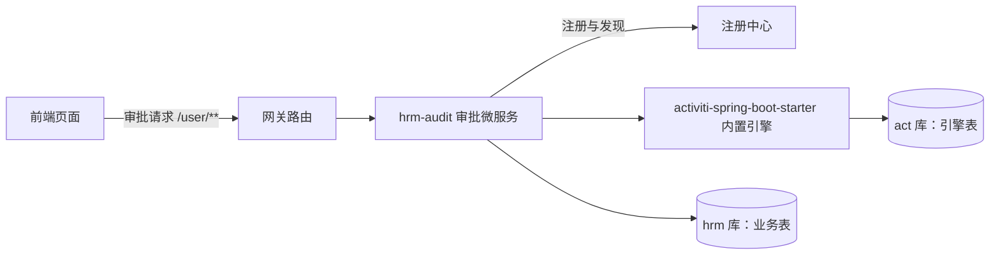

# 流程部署前的三件事：搭审批微服务、备引擎库、通网关路由

流程图有了，但当前工程里还没有 Activiti。把做好的 BPMN 部署进引擎之前，得先给审批中心搭一个能装下引擎的微服务骨架：模块与依赖、引擎要用的数据库、以及让前端请求能找到这个服务的网关路由。这三件事做完，上传并部署流程的代码才有落脚点。

## 先给结论

- 审批中心是独立微服务 `hrm-audit`，核心依赖是 `activiti-spring-boot-starter`，引擎随 Spring Boot 自动装配。
- 启动类要用 `exclude` 排除 `SecurityAutoConfiguration`：Activiti 7 自动引入 Spring Security，系统用的是 Shiro，两套安全体系叠加会冲突。
- 配置文件里有两个数据源：`act` 库给引擎，`hrm` 库给业务；`spring.activiti` 下把 `history-level` 设为 `full` 并打开 `db-history-used`。
- 网关加一条路由：`/user/**` 转给 `hrm-audit`，审批相关请求路径都以 `/user` 开头。
- 引擎的表已随课程资料 `act.sql` 准备好（28 张 `ACT_` 开头的表），导入 `act` 库即可；流程文件要么放 classes 由 starter 自动部署，要么走接口上传部署。

## 一、准备工作清单

通常情况下，流程都是提前规划好的：先把 BPMN 文件制作好、准备好，再通过文件上传的形式传到工程里，最后把流程文件部署进 Activiti 引擎，上传加部署才是完整链路。部署前的环境准备可以画成一张链路图：



图上能数出环境搭建的三个动作：右键父工程新建 `hrm-audit` 模块并配好依赖；准备好引擎要用的 `act` 数据库；在网关工程里加上审批模块的路由。下面逐件落实。

## 二、新建模块与核心依赖

在父工程 `hrm-parent` 下新建模块 `hrm-audit`，pom 里除了常规的 `spring-boot-starter-jdbc`、`mysql-connector-java`、公共模块 `hrm-common`、`hrm-common-model`，以及注册中心与 Feign 两个微服务依赖，真正和审批相关的有这几段（包名已改为 `com.example`）：

```xml
<!-- Activiti 引擎与 Spring Boot 集成：自动创建引擎并注册服务 -->
<dependency>
    <groupId>org.activiti</groupId>
    <artifactId>activiti-spring-boot-starter</artifactId>
    <version>7.0.0.Beta3</version>
</dependency>
<!-- junit 4.12：引擎功能用测试类验证 -->
<dependency>
    <groupId>junit</groupId>
    <artifactId>junit</artifactId>
    <version>4.12</version>
</dependency>
<!-- Activiti 按流程定义生成流程图 -->
<dependency>
    <groupId>org.activiti</groupId>
    <artifactId>activiti-image-generator</artifactId>
    <version>7.1.0.M2</version>
    <exclusions>
        <exclusion>
            <groupId>commons-io</groupId>
            <artifactId>commons-io</artifactId>
        </exclusion>
    </exclusions>
</dependency>
<!-- 接收前端上传的 bpmn 文件 -->
<dependency>
    <groupId>commons-fileupload</groupId>
    <artifactId>commons-fileupload</artifactId>
    <version>1.3.1</version>
</dependency>
```

**第一，`activiti-spring-boot-starter` 是整个模块的地基。** 引入它，Spring Boot 启动时会自动创建流程引擎、把 `RepositoryService` 等服务对象注册进容器，业务代码直接注入就能用。

**第二，`activiti-image-generator` 用来生成流程图。** 流程部署后页面要展示进度高亮的图，靠它按流程定义画出图片；它带了 `commons-io` 的传递依赖，与工程里已有版本冲突，所以显式排除。

**第三，`commons-fileupload` 服务于上传部署。** 流程文件由前端上传进来，文件解析能力由它提供。

## 三、启动类：排除 Spring Security 的自动配置

```java
//1.配置 Spring Boot 的包扫描，同时排除 Security 自动配置
@SpringBootApplication(scanBasePackages = "com.example",
        exclude = {SecurityAutoConfiguration.class})
//2.配置 jpa 注解的扫描
@EntityScan(value = "com.example.domain")
//3.注册到注册中心
@EnableEurekaClient
@EnableDiscoveryClient
@EnableFeignClients
public class AuditApplication {

    public static void main(String[] args) {
        SpringApplication.run(AuditApplication.class, args);
    }

    @Bean
    public IdWorker idWorker() {
        return new IdWorker();
    }
}
```

这是一个常规启动类，唯一的特别之处是 `exclude` 了 `SecurityAutoConfiguration`。原因在依赖链上：Activiti 7 的自动装配默认使用 Spring Security 做安全配置，引入 starter 后这套配置会被带进来；而系统鉴权用的是 Shiro，如果 Spring Security 相关内容也被扫描装配，两套安全过滤器叠加，轻则接口被莫名拦截，重则启动异常。所以要在扫描入口处把 Security 自动配置排除掉，只保留 Shiro 这一套。

## 四、配置文件：双数据源与引擎历史级别

```yaml
spring:
  application:
    name: hrm-audit #指定服务名
  #数据库连接池：act 给引擎，hrm 给业务
  datasource:
    act:
      jdbc-url: jdbc:mysql://localhost:3306/act?useUnicode=true&characterEncoding=utf8&serverTimezone=GMT
      username: root
      password: 111111
      driver-class-name: com.mysql.jdbc.Driver
    hrm:
      jdbc-url: jdbc:mysql://localhost:3306/hrm?useUnicode=true&characterEncoding=utf8&serverTimezone=GMT
      username: root
      password: 111111
      driver-class-name: com.mysql.jdbc.Driver
  redis:
    host: 127.0.0.1
    port: 6379
  jpa:
    database: MySQL
    show-sql: true
    open-in-view: true
  activiti:
    history-level: full   #记录全部历史
    db-history-used: true #启用历史库
eureka:
  client:
    service-url:
      defaultZone: http://localhost:6868/eureka/
  instance:
    preferIpAddress: true
    instance-id: ${spring.cloud.client.ip-address}:${spring.application.name}:${server.port}
server:
  port: 9007
```

这份配置的看点有三处。**一处是数据源写了两套**：引擎表在 `act` 库，业务表在 `hrm` 库，两套表放一个系统没问题，但分成两个库更清晰，连接信息用 `jdbc-url` 是因为后续数据源由 `DataSourceBuilder` 按 Hikari 属性绑定（下一篇展开）。**另一处是 `spring.activiti` 的两个开关**：`history-level: full` 让引擎把历史记录到最细粒度，含流程变量级的变更，审批留痕靠它；`db-history-used: true` 显式打开历史库的使用。**还有一处是注册中心指向 6868 端口**，服务起在 9007。

## 五、网关路由与引擎数据库

用户的所有审批请求路径都以 `/user` 开头，网关工程里加一条路由把这类请求转给审批服务（网关的 zuul 路由节选）：

```yaml
hrm-user-audit:
  path: /user/**        #配置 URL 与请求头规则
  serviceId: hrm-audit  #指定注册中心中的服务 id
  stripPrefix: false
  sensitiveHeaders:
    customSensitiveHeaders: true
```

`stripPrefix: false` 意味着转发时保留 `/user` 前缀，审批服务里的 Controller 路径自然也以 `/user` 开头，两边正好对上。

数据库这一侧，Activiti 7 运行要依赖一大批表，课程资料里的 `act.sql` 已经把整库导出，直接在 `act` 库执行即可；即便不导脚本，引擎首次启动也会自动建表，脚本的价值在于版本可控。流程文件的位置有两种安排：把 `.bpmn20.xml` 放进 `src/main/resources` 的 `bpmn` 目录（编译后位于 classes 下），starter 启动时会按 classpath 前缀自动部署；本课程走的是另一条路，前端把模型文件通过接口上传，服务端再部署进引擎，环境层面只需把上传能力备好。

环境搭完先用两个测试确认两套数据源都通了：

```java
@SpringBootTest
@RunWith(SpringJUnit4ClassRunner.class)
public class AuditTest {

    //测试业务数据库：JPA 正常工作
    @Autowired
    private ProcUserGroupDao procUserGroupDao;

    @Test
    public void test() {
        List<ProcUserGroup> list = procUserGroupDao.findAll();
        System.out.println(list.size());
    }

    //测试 activiti 数据库：引擎服务对象可用
    @Autowired
    private RepositoryService repositoryService;

    @Test
    public void testActiviti() {
        List<ProcessDefinition> list = repositoryService.createProcessDefinitionQuery().list();
        System.out.println(list.size());
    }
}
```

两个测试一个查业务表、一个查引擎的流程定义，都能跑通说明模块骨架、依赖、双库配置全部就位，可以进入部署代码的编写了。

## 常见误区

- **启动类不排除 `SecurityAutoConfiguration`**：Activiti 7 自动装配带来的 Spring Security 与项目里的 Shiro 叠加，出现接口被拦截、表单登录页顶替预期行为的怪现象。排除该项后只走 Shiro。
- **数据源属性写成 `url`**：数据源由 `DataSourceBuilder` 绑定配置，Hikari 的属性名是 `jdbc-url`，写成 `url` 会导致连接信息绑不上、启动报错。
- **漏掉 `db-history-used` 或把 `history-level` 设得过低**：历史表不产生数据，审批进度查询无据可依。审批场景直接用 `full`。
- **网关转发路径对不上**：路由的 `path` 是 `/user/**` 又配了 `stripPrefix: false`，转发后前缀保留，服务端接口必须带 `/user` 开头，少写一段就是 404。

## 面试可能被问到的问题

1. 面试官追问：「activiti-spring-boot-starter 引入后，Spring Boot 启动阶段做了什么？」
   答：自动装配会创建流程引擎配置并初始化 ProcessEngine，把 RepositoryService、RuntimeService、TaskService 等引擎服务注册为容器 Bean，同时按配置决定是否自动部署 classpath 下的流程定义文件，业务代码注入即可使用。

2. 面试官追问：「为什么要排除 SecurityAutoConfiguration？」
   答：Activiti 7 的自动配置依赖 Spring Security，starter 引入后安全自动配置也随之生效；项目本身用 Shiro 鉴权，两套安全体系同时装配会造成过滤器叠加和访问被拦。在 `@SpringBootApplication` 的 `exclude` 里排除掉，保留 Shiro 一套。

3. 面试官追问：「history-level 有哪几档，审批系统为什么选 full？」
   答：常见有 none、activity、audit、full 四档，从不记录到记录全部含变量级变更。审批系统需要完整留痕，追溯每一环节的处理人、时间和当时的数据快照，full 才能覆盖，代价是历史表写入更多，可接受。

4. 面试官追问：「流程定义文件可以怎么进引擎？」
   答：两种主流方式：放在 classpath 下由 starter 启动时自动部署，适合固定流程；通过接口上传 `MultipartFile`，服务端用 `RepositoryService.createDeployment().addBytes(...)` 部署，适合多租户、流程文件由管理端维护的场景，本课程用的是后者。

5. 面试官追问：「引擎库和业务库分成两个库有什么好处？」
   答：引擎 28 张表有自己完整的一套外键和命名规则，与业务表隔离后互不干扰，引擎升级、历史数据清理都不影响业务数据；配合多数据源配置，两边各自走自己的连接池，边界清晰。

## 配套资料

- 审批模块工程与配置：`materials/code/02/day16 薪资管理与工作流概述/day16/03-资料/04审批代码/ihrm_audit/pom.xml`、`materials/code/02/day16 薪资管理与工作流概述/day16/03-资料/04审批代码/ihrm_audit/src/main/resources/application.yml`（文中包名、库名已统一改为 `com.example`、`hrm`）。
- 启动类与测试类：`materials/code/02/day16 薪资管理与工作流概述/day16/03-资料/04审批代码/配置代码/AuditApplication.java`、`materials/code/02/day16 薪资管理与工作流概述/day16/03-资料/04审批代码/ihrm_audit/src/test/java/com/ihrm/audit/AuditTest.java`。
- 引擎建库脚本：`materials/code/02/day16 薪资管理与工作流概述/day16/03-资料/act.sql`。
