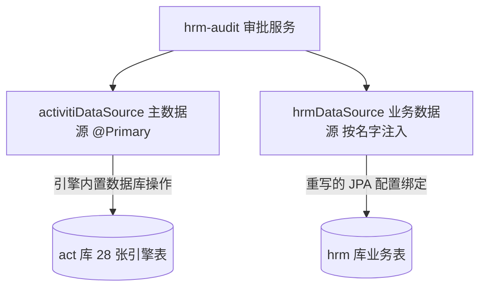

# 一个服务连两个库：让 Activiti 引擎与 Spring Data JPA 各用各的数据源

审批服务的骨架搭起来了，配置文件里却躺着两个连接池：`act` 指向引擎库，`hrm` 指向业务库。麻烦随之而来：代码里发起一次数据库操作，到底走哪个池？引擎自动建的 28 张表和业务的表混在一起又该怎么办？这一课把两个数据源各归各位，让引擎与 JPA 互不打架。

## 先给结论

- 引擎的表与业务表分属两个库：`act` 库放引擎的 28 张表，`hrm` 库放业务表，配置类里声明两个 `DataSource`。
- 引擎源码改不了，它按容器里的默认数据源工作，所以 `@Primary` 必须给 `activitiDataSource`，业务数据源用 `@Qualifier` 点名使用。
- 业务侧用 Spring Data JPA，要重写 `entityManagerFactory` 与 `transactionManager`，并都绑定 `hrmDataSource`。
- 包位置是硬纪律：dao 接口必须在 `@EnableJpaRepositories` 指定的 `basePackages` 下，实体必须在 `packagesToScan` 指定的包下，否则这套 JPA 配置不生效。
- 引擎历史级别在 `spring.activiti` 下配 `history-level: full` 与 `db-history-used: true`，审批留痕依赖它。

## 一、为什么是两个独立数据源，而不是动态路由

先把职责画清楚：



左边一个服务，右边两个库。与流程相关的读写（发起实例、推进任务、查历史）全走引擎内置的数据库操作，用工作流数据源连 `act` 库；业务数据（流程与用户组的映射等）走 Spring Data JPA，用业务数据源连 `hrm` 库。

多数据源有两种常见组织方式。一种是 `AbstractRoutingDataSource` 动态路由：一个对外数据源，内部按线程上下文里的 key 在多个真实库之间切换。这种方式适合纯业务代码的读写分离、分库路由。审批模块没用它，原因很直接：Activiti 引擎是黑盒，内部的 DAO 直接持有数据源引用，改不了它的源码去挂路由；与其让引擎在两个库之间漂移，不如静态分家，让它固定吃主数据源。另一种就是本课的做法：两个静态数据源，主从分明，JPA 显式点名业务源。

分派规则一句话：**默认的、唯一的、首选的那个数据源必须给 Activiti，业务开发用第二个备选数据源，用的时候明确指定。**

## 二、两个连接池：主给引擎，从给业务

```java
/**
 * 多数据源配置类
 * 1.activiti 数据库连接池：默认、首选（@Primary）
 * 2.业务数据库连接池：明确指定 hrmDataSource
 */
@Configuration
public class AuditDatasourceConfig extends AbstractProcessEngineAutoConfiguration {

    @Bean
    @Primary
    @ConfigurationProperties(prefix = "spring.datasource.act")
    @Qualifier("activitiDataSource")
    public DataSource activitiDataSource() {
        return DataSourceBuilder.create().build();
    }

    @Bean
    @ConfigurationProperties(prefix = "spring.datasource.hrm")
    @Qualifier("hrmDataSource")
    public DataSource hrmDataSource() {
        return DataSourceBuilder.create().build();
    }
}
```

这个配置类继承自 `AbstractProcessEngineAutoConfiguration`，等于接入引擎的自动配置体系，让引擎装配时能认到主数据源。三个注解配合完成绑定：

**第一，`@ConfigurationProperties` 负责灌值。** 前缀分别是 `spring.datasource.act` 与 `spring.datasource.hrm`，配置文件里那两组 `jdbc-url`、用户名、密码就这样各自绑进对应的 Bean。

**第二，`@Primary` 是主从标记。** 容器里出现两个同类型 Bean 后，凡是按类型注入的地方默认拿主数据源。引擎内部的代码就是按类型拿的，所以主数据源给 `act`，引擎的 28 张表自然落在 `act` 库。

**第三，`DataSourceBuilder` 负责实例化。** 读到的属性直接构建出 Hikari 连接池对象，两个方法体一模一样，差别全在配置前缀上。

## 三、给 JPA 换上业务数据源

引擎的归属定了，业务侧的 Spring Data JPA 也要重新表态。默认的 JPA 自动配置只会找一个数据源，现在有两个，必须手工重写它涉及的核心组件：

```java
@Configuration
@EnableJpaRepositories(
        //代理的 dao 接口所在的包
        basePackages = "com.example.audit.dao",
        entityManagerFactoryRef = "hrmEntityManager",
        transactionManagerRef = "hrmTransactionManager"
)
public class JpaRepositoriesConfig {

    @Autowired
    private Environment env;

    @Autowired
    @Qualifier("hrmDataSource")
    private DataSource hrmDataSource;

    //创建 entityManagerFactory 工厂
    @Bean
    @Primary
    public LocalContainerEntityManagerFactoryBean hrmEntityManager() {
        LocalContainerEntityManagerFactoryBean em = new LocalContainerEntityManagerFactoryBean();
        em.setDataSource(hrmDataSource);
        //配置扫描的实体类包
        em.setPackagesToScan(new String[] { "com.example.audit.entity" });
        HibernateJpaVendorAdapter vendorAdapter = new HibernateJpaVendorAdapter();
        em.setJpaVendorAdapter(vendorAdapter);
        HashMap<String, Object> properties = new HashMap<>();
        properties.put("hibernate.hbm2ddl.auto", env.getProperty("hibernate.hbm2ddl.auto"));
        properties.put("hibernate.dialect", env.getProperty("hibernate.dialect"));
        em.setJpaPropertyMap(properties);
        return em;
    }

    //创建事务管理器
    @Primary
    @Bean
    public PlatformTransactionManager hrmTransactionManager() {
        JpaTransactionManager transactionManager = new JpaTransactionManager();
        transactionManager.setEntityManagerFactory(hrmEntityManager().getObject());
        return transactionManager;
    }
}
```

逐层看这条装配链。`@EnableJpaRepositories` 的三个参数把 dao 层钉死：`basePackages` 说明哪些接口按 JPA 代理生成，`entityManagerFactoryRef` 与 `transactionManagerRef` 说明用哪个工厂、哪个事务管理器。工厂内部 `em.setDataSource(hrmDataSource)`，把业务数据源喂给了 EntityManager；事务管理器再挂到同一个工厂上。至此，业务 dao 的每一次查询都落在 `hrm` 库，而引擎的操作走主数据源落在 `act` 库，两条线在代码层面彻底分开。

## 四、包位置是这套配置的开关

重写的 JPA 配置把扫描范围从「自动」变成了「指定」，随之而来的是包纪律：

**第一，dao 接口只能放在 `com.example.audit.dao` 包下。** `basePackages` 只认这个包，放在别处的接口不会被生成代理，注入时直接报找不到 Bean。

**第二，实体类只能放在 `com.example.audit.entity` 包下。** `packagesToScan` 只扫这个包，实体放出去注解就白打了。

**第三，这是本工程特殊的取舍。** 其他模块习惯把实体统一放进公共模块，审批模块为了配合这套扫描配置，把审批相关的实体（如流程与用户组映射的 `ProcUserGroup`）直接放在本模块的 `entity` 包下，让整条链路看起来更直观。

## 五、别忘了引擎历史级别的配置

数据源分开之后，引擎侧还有一个影响深远的小配置。回到 `application.yml` 的 `spring.activiti` 段：

```yaml
spring:
  activiti:
    history-level: full   #历史级别：记录全部，含变量级变更
    db-history-used: true #启用历史库
```

`history-level` 决定引擎往历史表里写多少东西，`full` 是最细的一档，连流程变量的变更都记录；`db-history-used` 打开历史库功能。审批系统要还原「谁在什么时候基于什么数据做了什么决定」，这两项缺一不可。这些历史数据写进的是主数据源指向的 `act` 库，与业务库互不干扰。

## 常见误区

- **两个 DataSource 都不加 `@Primary`**：容器里同类型 Bean 有两个又没有首选者，启动时抛 `NoUniqueBeanDefinitionException`。主数据源必须标 `@Primary`。
- **把 `@Primary` 反给了业务数据源**：引擎按类型注入时拿到业务库，28 张 `ACT_` 表全建到 `hrm` 库里，业务表和引擎表混作一团。记住规则：主数据源永远给引擎。
- **dao 或实体放错包**：JPA 接口不在 `basePackages` 下，实体不在 `packagesToScan` 下，代理和映射都不会生成，表现为注入失败或查询不到表。
- **忘配 `entityManagerFactoryRef` 或 `transactionManagerRef`**：JPA 回退到默认装配，可能用主数据源建工厂，业务查询打到 `act` 库，报表不存在的错。

## 面试可能被问到的问题

1. 面试官追问：「Spring Boot 多数据源有哪几种实现思路？」
   答：主流两种。静态多源：每个库声明一个 DataSource Bean，主源加 `@Primary`，其他源用 `@Qualifier` 点名，JPA、MyBatis 的配置分别指定用哪个源，适合职责固定的场景。动态路由：用 `AbstractRoutingDataSource` 包一层，按线程上下文的 key 切换目标库，适合读写分离和分库。两者可以并存。

2. 面试官追问：「为什么这个项目里 `@Primary` 必须给 Activiti 的数据源？」
   答：引擎是第三方组件，内部代码直接按类型获取数据源，没有扩展点让你传入指定 Bean。只有把引擎库的数据源标成首选，才能保证引擎的表和操作都落在 `act` 库；业务侧代码由自己掌控，显式 `@Qualifier` 注入业务源即可。

3. 面试官追问：「重写 JPA 配置时，EntityManagerFactory 和 TransactionManager 各起什么作用？」
   答：EntityManagerFactory 是 JPA 的入口工厂，持有数据源、实体扫描包与 Hibernate 属性，产出每个事务用的 EntityManager；TransactionManager 基于 EntityManagerFactory 管理事务边界。两者都必须绑到同一个业务数据源上，否则事务与查询可能落在不同的库。

4. 面试官追问：「引擎库和业务库分库后，跨库的事务怎么办？」
   答：两个数据源各自有独立事务管理器，跨库写操作不再有单库的强一致。工程上通常按职责切分：流程状态由引擎事务保证，业务表由业务事务保证，两边的一致性靠业务补偿或以引擎记录为准的核对逻辑来兜底，而不是硬凑分布式事务。

5. 面试官追问：「history-level 的几个级别分别记什么？」
   答：none 不记录；activity 只记录流程实例与节点的流转；audit 在 activity 基础上补齐任务与表单属性，是默认档；full 再加流程变量级变更。审批留痕要还原决策现场的数据，所以选 full，配合 `db-history-used: true` 开启历史库。

## 配套资料

- 多数据源配置类：`materials/code/02/day16 薪资管理与工作流概述/day16/03-资料/04审批代码/ihrm_audit/src/main/java/com/ihrm/audit/AuditDatasourceConfig.java`、`materials/code/02/day16 薪资管理与工作流概述/day16/03-资料/04审批代码/ihrm_audit/src/main/java/com/ihrm/audit/JpaRepositoriesConfig.java`（文中包名、库名已统一改为 `com.example`、`hrm`）。
- 数据源与历史级别配置：`materials/code/02/day16 薪资管理与工作流概述/day16/03-资料/04审批代码/ihrm_audit/src/main/resources/application.yml`。
- 双库连通验证：`materials/code/02/day16 薪资管理与工作流概述/day16/03-资料/04审批代码/ihrm_audit/src/test/java/com/ihrm/audit/AuditTest.java`（业务 dao 查询与引擎 `RepositoryService` 查询各一例）。
