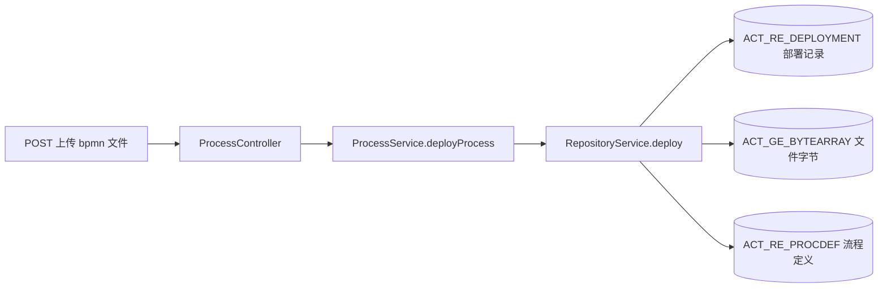

# 部署测试：用 Postman 上传 BPMN，去引擎表里核对结果

接口代码写完不等于功能完成，部署这条链路要真的走一遍才有底。启动审批服务（端口 9007），用 Postman 模拟前端把 `请假.bpmn` 传上来，再去引擎库里看部署留下了什么。这一课把请求怎么发、成功后引擎库里哪几张表有动静、同一个流程重复部署会怎样，逐一验证清楚。

## 先给结论

- 请求方式用 POST，路径 `127.0.0.1:9007/user/process/deploy`，Body 选 `form-data`，参数名必须是 `file`，类型从 Text 切成 File 再选 BPMN 文件。
- 部署成功后引擎库三张表有动静：`ACT_RE_DEPLOYMENT` 多一条部署记录，`ACT_GE_BYTEARRAY` 存下文件字节，`ACT_RE_PROCDEF` 多一条流程定义。
- 同一个流程重复部署不会报错也不会覆盖旧版本，`ACT_RE_PROCDEF` 的 `VERSION_` 列自动自增，多个版本并存。
- 部署时通过 `tenantId` 设置的企业 id 写进了各表的 `TENANT_ID_` 列，多租户标记在数据层可查。
- 测试前建议清空引擎库里旧的部署数据，让结果干净可对照。

## 一、把接口调成 POST

文件上传在语义上就该用 POST，控制器里的部署方法显式声明请求方式：

```java
@RequestMapping(value = "/deploy", method = RequestMethod.POST)
public Result deployProcess(@RequestParam("file") MultipartFile file) throws IOException {
    processService.deployProcess(file, companyId);
    return new Result(ResultCode.SUCCESS);
}
```

`method = RequestMethod.POST` 限定了只接受 POST 请求，浏览器或工具用 GET 来访问会直接得到 405。服务启动时留意控制台，审批服务注册的端口是 `9007`，测试地址以此为准。

## 二、Postman 构造上传请求

Postman 里按四步构造请求：

| 步骤 | 设置 | 说明 |
|---|---|---|
| 1 | 方法选 POST | 地址 `127.0.0.1:9007/user/process/deploy` |
| 2 | Body 选 form-data | 文件上传走 multipart 表单 |
| 3 | 参数名填 `file` | 必须与后端 `@RequestParam("file")` 一致 |
| 4 | 该参数类型选 File | 默认是 Text，不切类型选不了文件 |

参数类型从 Text 切成 File 后，输入框变成文件选择器，选中准备好的 `请假.bpmn`。用命令行工具等效地发一条，请求长这样：

```bash
curl -X POST http://127.0.0.1:9007/user/process/deploy \
  -F "file=@./请假.bpmn"
```

点击发送，服务端返回操作成功的统一响应，同时控制台会打印出 `deploy()` 返回的部署对象，里面有引擎生成的部署 id。到这里接口层验证完毕，但真正的证据要去数据库里找。

## 三、成功之后，引擎库里看什么

一次部署是引擎对上传文件的解析加落库，写入路径如下图：



打开引擎库逐表核对：

```sql
--部署记录：每次调用 deploy 新增一条
SELECT * FROM ACT_RE_DEPLOYMENT;

--资源表：上传的 BPMN 文件字节内容存在这里
SELECT * FROM ACT_GE_BYTEARRAY;

--流程定义表：解析 BPMN 后生成的可执行流程定义
SELECT * FROM ACT_RE_PROCDEF;
```

部署前 `ACT_RE_DEPLOYMENT` 还是空的，上传成功后刷新就能看到一条新记录，`ACT_GE_BYTEARRAY` 里多了对应文件的字节，`ACT_RE_PROCDEF` 里也多出一条流程定义。三张表的主外键相互关联：部署记录挂着资源与定义，后续按流程定义发起实例，用的正是 `ACT_RE_PROCDEF` 里的数据。

## 四、重复部署：版本自增而不是覆盖

部署接口设计成了「既部署新流程，也自动更新已有流程」，把同一个 `请假.bpmn` 再发一次请求会怎样？答案是引擎库里再添一条部署记录，`ACT_RE_PROCDEF` 里同一个流程 key 出现第二行，但 `VERSION_` 从 1 变成了 2。引擎按流程 key 管理版本：key 相同视为同一流程的新版本，版本号自动加一，新旧版本并存，已按旧版本发起的实例继续按旧定义走，新发起的实例默认用最新版本。

想只看最新版本，查询对象上可以加条件：

```java
//只查询每个流程 key 的最新版本
List<ProcessDefinition> list = repositoryService.createProcessDefinitionQuery()
        .latestVersion()
        .list();
```

这个机制解释了为什么重复部署不报错：引擎把它当成一次正常的版本升级，历史版本仍然可查、可回溯，删不删由业务决定。

## 五、TENANT_ID_ 列：租户标记落库可查

部署代码里 `tenantId(companyId)` 设置的企业 id，此刻已经写进了 `ACT_RE_DEPLOYMENT` 与 `ACT_RE_PROCDEF` 等表的 `TENANT_ID_` 列。查询时加上租户条件，就能验证隔离效果：

```sql
--查看各部署记录归属的租户
SELECT ID_, NAME_, TENANT_ID_ FROM ACT_RE_DEPLOYMENT;
```

企业 id 在测试阶段还是写死的占位值，换成不同 id 部署两次，这一列就会出现两个不同的值，多租户的标记从设置到落库整条链路就都打通了。

## 常见误区

- **参数名对不上或类型没切**：Postman 里参数名写成 `filename`，或者忘了把类型从 Text 切成 File，后端拿到的就是空文件或直接报参数缺失，返回参数绑定错误。
- **用 GET 访问 POST 接口**：控制器限定了 `RequestMethod.POST`，GET 请求得到 405，先检查请求方法再查代码。
- **部署成功但 `ACT_RE_PROCDEF` 没数据**：多半是上传的文件不是合法流程定义，比如 BPMN 里 `process` 节点缺 `id` 或内容残缺，引擎只落了部署记录，解析不出定义。用资料包里现成的 BPMN 文件先排除文件因素。
- **以为重复部署会报错或覆盖**：引擎按版本管理同 key 的流程定义，重复部署是版本自增并存，不是失败也不是替换；反过来想清理旧版本要显式删除，引擎不会自动帮你删。
- **端口打错**：审批服务的端口是 9007，打到了网关或其他服务的端口上，报 404 或鉴权失败，先核对 `application.yml` 里的 `server.port`。

## 面试可能被问到的问题

1. 面试官追问：「一次流程部署，引擎库里哪些表发生了变化？」
   答：至少三张。`ACT_RE_DEPLOYMENT` 新增部署记录，`ACT_GE_BYTEARRAY` 保存上传文件的字节内容，`ACT_RE_PROCDEF` 新增解析出的流程定义。三者通过部署 id 关联，资源表是文件本体，定义表是引擎解析后真正用来发起实例的数据。

2. 面试官追问：「同一个 BPMN 文件部署两次，引擎怎么处理？」
   答：引擎以流程 key 为准做版本管理，第二次部署会在 `ACT_RE_PROCDEF` 里新增一行，`VERSION_` 自动加一，两个版本并存。旧版本上的流程实例继续按旧定义运行，新发起的实例默认取最新版本，历史版本不会被自动删除。

3. 面试官追问：「怎么查询某个流程的最新版本定义？」
   答：用 `RepositoryService` 的 `createProcessDefinitionQuery()`，链上 `latestVersion()` 只取每个流程 key 的最高版本，也可以再加 `processDefinitionKey` 精确到某个流程。引擎返回的 `ProcessDefinition` 里有版本号、部署 id、资源名等信息，足够定位到具体定义。

4. 面试官追问：「multipart 文件上传，后端要注意哪几点？」
   答：参数用 `MultipartFile` 接收，参数名与前端保持一致；文件内容用 `getBytes()` 拿字节，注意处理 `IOException`；入口处校验文件名与内容非空；大文件还要留意 `spring.servlet.multipart` 里的大小限制配置，超限会在到达业务代码前就被拒掉。

## 配套资料

- 部署接口与请求方式：`materials/code/02/day16 薪资管理与工作流概述/day16/03-资料/04审批代码/ihrm_audit/src/main/java/com/ihrm/audit/controller/ProcessController.java`（文中包名已统一改为 `com.example`）
- 部署服务实现：`materials/code/02/day16 薪资管理与工作流概述/day16/03-资料/04审批代码/ihrm_audit/src/main/java/com/ihrm/audit/service/ProcessService.java`
- 测试上传的流程文件：`materials/code/02/day16 薪资管理与工作流概述/day16/03-资料/所有的流程bpmn文件/请假.bpmn20.xml`
- 服务端口与引擎配置：`materials/code/02/day16 薪资管理与工作流概述/day16/03-资料/04审批代码/ihrm_audit/src/main/resources/application.yml`
