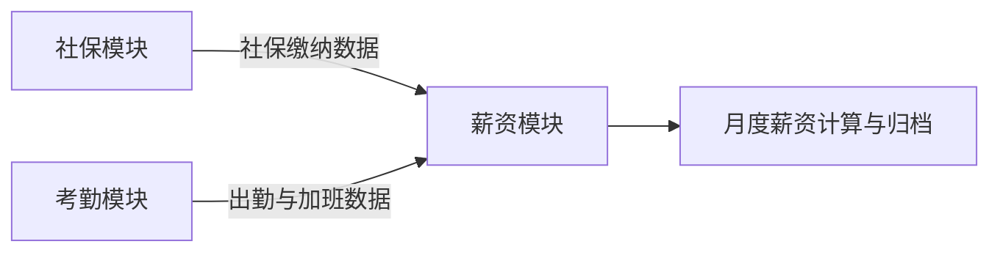

# 考勤社保薪资与工作流收尾：把一天的内容串成一张知识网

一天的内容横跨两大块：业务侧补齐了考勤与薪资的功能拼图，中间件侧把 Activiti 工作流从画图一路推进到部署。单看每个视频是一段操作，合起来才见结构：社保和考勤到底在给谁供数？工作流今天到底走到了哪一步、还剩什么？收尾这篇把两条线各自收束，给整个审批模块的环境搭建阶段画上句号。

## 先给结论

- 业务侧三大模块合流：社保模块供社保数据，考勤模块供考勤数据，两路数据最终都汇入薪资计算，它们与薪资一起构成人力资源系统不可缺少的核心闭环。
- 工作流侧按阶段推进：制作流程、执行流程、查询历史，今天的进度是把「制作」阶段走完，流程用 activiti-app 网页工具绘制，部署用 Controller 加 Service 写进了工程。
- 多数据源是当天环境搭建的关键点：引擎库与业务库分家，`@Primary` 给引擎数据源，JPA 重写配置绑定业务数据源。
- `companyId` 在部署代码里还是写死的占位值，正式写法继承 `BaseController`，从当前登录用户里取企业 id。
- 流程部署完成只代表引擎里有了流程定义，执行阶段（发起实例、审批任务）与历史查询是后续课程的主线。

## 一、业务侧：三大模块的数据合流

把考勤、社保、薪资三个模块的数据关系画出来，方向立刻清晰：



社保与考勤不是两个孤岛，它们都在给薪资当数据源：社保决定个人缴纳部分的扣减，考勤决定出勤天数与加班费的计算基数。加上薪资自身的企业设置、定薪调薪、月报表，三个模块合起来才是人力资源管理系统里「算钱」这条主干的完整闭环。当天业务侧的课程就是对这两块功能做补充，让它们达到能向薪资供数的完成度。

## 二、工作流侧：走到哪一步了

引擎开发按阶段推进，全景路径如下：


对照这张图，当天的产出集中在左半段：用 Activiti 提供的网页制作工具 activiti-app 画出请假流程，导出 BPMN 文件，再写代码把文件部署进工程。部署这一环的代码骨架就三行：

```java
//1.取上传的文件名
String fileName = file.getOriginalFilename();
//2.组装部署构建器：文件名 + 文件字节 + 租户 id
DeploymentBuilder deploymentBuilder = repositoryService.createDeployment()
        .addBytes(fileName, file.getBytes())
        .tenantId(companyId);
//3.真正部署，返回部署对象
Deployment deploy = deploymentBuilder.deploy();
```

支撑这三行跑起来的是整套环境：双数据源配置类让引擎与业务各连各的库，JPA 重写配置让业务 dao 落在业务库，测试类 `AuditTest` 用两个方法分别验证了两条链路。执行阶段的发起实例、任务审批，以及历史查询，对应图上右半段，是后面课程要展开的内容。

## 三、当天代码清单

按层次把写过的代码归拢一遍，方便复习时对号入座：

| 层次 | 类 | 作用 |
|---|---|---|
| 数据源配置 | `AuditDatasourceConfig` | 声明引擎与业务两个连接池，`@Primary` 给引擎 |
| JPA 配置 | `JpaRepositoriesConfig` | 重写工厂与事务管理器，绑定业务数据源 |
| 测试 | `AuditTest` | 业务库查 12 条、引擎查 2 条流程定义，验证双源分派 |
| 控制器 | `ProcessController` | 接收上传的 BPMN 文件，路径 `/user/process/deploy` |
| 服务 | `ProcessService` | 组装 `DeploymentBuilder` 并执行部署 |

这套清单同时是审批模块的骨架：后面不管做发起、审批还是历史，都是在这个骨架上继续往里填代码。

## 四、留下的两个尾巴

**第一，`companyId` 不能一直写死。** 部署方法签名里的企业 id，测试时随手填了个占位值，正式代码里控制器的父类已经准备好了取值途径：

```java
public class ProcessController extends BaseController {
    //BaseController 在每次请求中已从登录用户解析出 companyId
    //子类直接使用，SaaS 下所有数据都以它做企业隔离
    processService.deployProcess(file, companyId);
}
```

继承 `BaseController` 后，登录用户所属的企业 id 由父类统一提供，控制器代码里不再出现手工赋值。

**第二，部署资源不止 BPMN 一件。** 讲义里的部署示例支持一次上传两类资源，BPMN 文件之外再把流程图片一起交给引擎：

```java
public void deployProcess(MultipartFile[] files) throws IOException {
    Deployment deploy = repositoryService.createDeployment()
            .addBytes("bpmn", files[0].getBytes())
            .addBytes("png", files[1].getBytes())
            .deploy();
    System.out.println("部署成功，部署ID：" + deploy.getId());
}
```

把流程图图片存进引擎，前端查看审批进度时可以直接取图展示，不必自己重新渲染。引擎对一次部署挂多少资源没有限制，`addBytes` 多调几次即可。

## 常见误区

- **把总结背成目录**：能复述关系才算掌握，社保与考勤是薪资的数据供给方，工作流三阶段今天只走完制作，这两句话要能自己讲出来。
- **以为部署完流程就能审批**：部署只是让引擎里有了流程定义模板，员工发起请假、领导审批还依赖执行阶段的代码，两者不要混为一谈。
- **多数据源只记结论不记原因**：`@Primary` 给引擎是因为引擎按类型注入数据源、改不了它的代码；业务侧由自己掌控才能用 `@Qualifier` 点名。记住原因，换一个整合场景也会推。
- **企业 id 写死带上线**：占位值只用于打通链路，SaaS 系统的租户隔离全靠 `companyId`，上线前必须接回登录用户体系。

## 面试可能被问到的问题

1. 面试官追问：「人力资源系统里社保、考勤、薪资三个模块是什么关系？」
   答：社保与考勤是薪资的上游数据源。社保模块提供各员工五险一金的缴纳方案与扣减数据，考勤模块提供出勤、加班、请假记录，薪资模块汇聚两路数据完成月度计算与归档，三者共同构成算薪这条核心业务链。

2. 面试官追问：「用工作流引擎开发一个审批流程，完整的步骤是什么？」
   答：分阶段推进。制作阶段用设计器绘制流程并导出 BPMN，再通过 `RepositoryService` 部署进引擎；执行阶段用 `RuntimeService` 发起流程实例、`TaskService` 查询与办理任务；流程完结后进入历史阶段，用历史接口查询归档数据。本项目已完成制作阶段的部署，执行与历史是后续内容。

3. 面试官追问：「整合场景下为什么要配置多数据源，怎么配？」
   答：引擎的 28 张表与业务表分属两个库，引擎内部按类型注入数据源且不可改源码，所以声明两个 `DataSource`，引擎的标 `@Primary` 做默认，业务库的 JPA 工厂、事务管理器重写后显式绑定业务数据源。测试时两边各查各的数据即可验证分派正确。

4. 面试官追问：「流程部署进了引擎，数据存在哪里？」
   答：部署记录存 `ACT_RE_DEPLOYMENT`，BPMN 文件字节存 `ACT_GE_BYTEARRAY`，解析出的流程定义存 `ACT_RE_PROCDEF`。同一流程重复部署按 key 做版本自增，多版本并存，新发起的实例默认走最新版本。

5. 面试官追问：「多租户的 SaaS 场景下，流程隔离靠什么实现？」
   答：部署时调 `tenantId` 写入企业 id，各引擎表的 `TENANT_ID_` 列都带着这个标记；查询流程定义、发起实例时按租户条件过滤，业务层保证每个请求的企业 id 来自登录用户而不是前端传参，从源头防止越权看到别家流程。

## 配套资料

- 审批模块全套代码：`materials/code/02/day16 薪资管理与工作流概述/day16/03-资料/04审批代码/ihrm_audit/src/main/java/com/ihrm/audit/`（数据源配置、流程控制器、部署服务、实体与 dao）
- 双数据源验证测试类：`materials/code/02/day16 薪资管理与工作流概述/day16/03-资料/04审批代码/ihrm_audit/src/test/java/com/ihrm/audit/AuditTest.java`
- 流程文件与建表脚本：`materials/code/02/day16 薪资管理与工作流概述/day16/03-资料/所有的流程bpmn文件/`（请假、加班、离职三个流程）、`materials/code/02/day16 薪资管理与工作流概述/day16/03-资料/act.sql`
- 薪资模块代码：`materials/code/02/day16 薪资管理与工作流概述/day16/03-资料/03薪资代码/`
