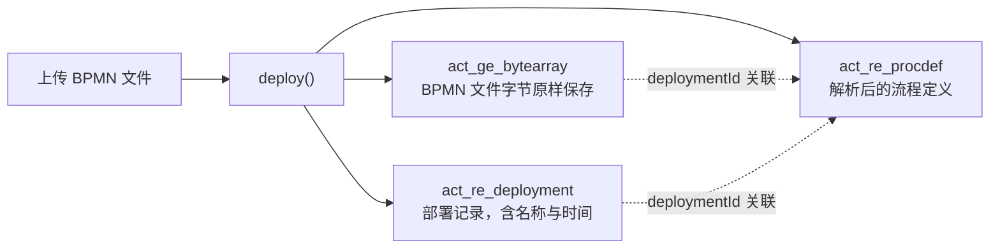

# 流程定义是什么：一次部署在 Activiti 引擎里留下的三份家当

BPMN 文件上传、部署代码执行、控制台打出部署成功的日志，然后呢？想在前端把「系统里现在有哪些流程」列出来，或者把某个暂停使用的流程恢复，都得先回答一个问题：部署这件事到底在引擎里留下了什么。流程定义（ProcessDefinition）就是答案的核心，它既是部署的产物，也是后续发起实例、挂起激活一切操作的起点。

## 先给结论

- 一次成功部署会在引擎里落三张表：`act_re_deployment` 记部署本身，`act_ge_bytearray` 存 BPMN 文件原文，`act_re_procdef` 存解析出来的流程定义。
- 流程定义可以理解成一个对象：把你画的节点、连线、审批人配置解析成引擎可执行的结构，一行数据库记录对应一个可发起的流程模板。
- 同一个 key 的流程重复部署，版本号自动加一，多版本并存互不影响。
- 部署时设置的租户 id 会一路带到流程定义上，SaaS 系统按它做企业隔离。
- 有了流程定义，才谈得上查询列表、挂起、激活、发起实例这些后续操作。

## 一、部署动作拆开看：数据落到哪三张表

上一阶段的部署代码很短，核心一行是把上传的 BPMN 字节交给引擎（包名已改为 `com.example`）：

```java
DeploymentBuilder deploymentBuilder = repositoryService.createDeployment()
        .addBytes(fileName, file.getBytes())
        .tenantId(companyId);
Deployment deploy = deploymentBuilder.deploy();
```

`deploy()` 执行的瞬间，引擎在背后做了三件事，对应三张表：



部署记录是「谁在什么时候传了什么」，文件字节表保存原文，将来前端想展示流程图或者下载 BPMN，就是从这里按 `deploymentId` 取流。真正参与运行的是第三张 `act_re_procdef`：引擎把 XML 解析校验之后，每个 `<process>` 都变成一条流程定义记录。

## 二、逐列读懂 act_re_procdef

打开这张表，一列列对着看，流程定义的对象模型就出来了：

| 列名 | 含义 |
|---|---|
| `ID_` | 定义主键，全局唯一 |
| `NAME_` | 流程名称，取自 BPMN 的 `name` 属性 |
| `KEY_` | 流程标识，取自 `<process id>`，发起实例时用它定位流程 |
| `VERSION_` | 版本号，同一 key 每部署一次自动加一 |
| `DEPLOYMENT_ID_` | 指回部署记录，能顺藤摸瓜找到部署对象和文件字节 |
| `RESOURCE_NAME_` | BPMN 资源在部署里的文件名 |
| `DGRM_RESOURCE_NAME_` | 流程图图片资源名（有图才有值） |
| `TENANT_ID_` | 租户 id，部署时通过 `tenantId(companyId)` 写入 |
| `SUSPENSION_STATE_` | 状态：1 为激活，2 为挂起 |

拿一条真实部署产生的记录举例：`KEY_` 为 `process_leave`，`VERSION_` 为 1，`TENANT_ID_` 是企业 id，`SUSPENSION_STATE_` 是 1。这一行就是代码里的 `ProcessDefinition` 对象，后续用 API 查询列表，查出来的每个元素都对应这么一行。

**KEY_ 和 ID_ 的区别值得单独强调。** `KEY_` 是业务给流程起的名字，跨版本不变；`ID_` 是引擎生成的唯一标识，精确到某一个版本。业务代码说「发起请假」用 key，引擎内部精确定位某条定义用 id。

## 三、与版本的关系：多版本并存，互不打架

流程上线后几乎一定会改：加个审批节点、改一下条件分支。直接改原来那条定义是不可能的，引擎的做法是**同一 key 重新部署，版本号自增**。

```text
process_leave  v1  （已发起的实例继续按 v1 走）
process_leave  v2  （新发起的实例默认走 v2）
```

两个版本两条记录，各自挂在自己的 `DEPLOYMENT_ID_` 下，旧文件、旧定义都还在。已经跑到一半的实例绑着老版本继续走完，新申请走新版本，升级过程对在途业务零冲击。这也解释了为什么查询定义时要能按版本过滤：列表页通常只展示每个 key 的最新版本，历史版本按需查看。

`process_leave` 流程文件里每个节点都带候选人组配置，解析后这些配置就长在定义对象上：

```xml
<bpmn2:process id="process_leave" name="请假" isExecutable="true">
  <bpmn2:userTask id="CHU" name="初审" activiti:candidateGroups="PROCESS_LEAVE_CHU_USERS"/>
  <bpmn2:userTask id="FU" name="复审" activiti:candidateGroups="PROCESS_LEAVE_FU_USERS"/>
</bpmn2:process>
```

发起实例、查询候选人、办理任务，引擎全靠定义里这份结构说话。定义是模板，实例是模板的一次运行，这句话就是流程定义在整条链路里的定位。

## 常见误区

- **以为部署成功只有一张表有数据**：只看 `act_re_deployment` 发现查不到流程信息就慌了，流程定义在 `act_re_procdef`，文件在 `act_ge_bytearray`，三张表靠 `deploymentId` 串起来。
- **把 `KEY_` 当唯一标识用**：同一 key 有多个版本，拿 key 去精确定位某条定义会命中多条记录；精确定位用 `ID_`，按 key 查询要配合版本条件或 `latestVersion`。
- **改流程直接改数据库里的 BPMN 字节**：解析产物 `act_re_procdef` 不会跟着变，运行时行为与文件内容脱节。正确做法是改文件后重新部署，让引擎生成新版本。
- **忽略租户 id 的传递**：部署时不设 `tenantId`，定义的租户列为空，SaaS 下按企业过滤查询就漏了这条流程。

## 面试可能被问到的问题

1. 面试官追问：「流程部署后引擎里发生了什么？」
   答：写三张表。`act_re_deployment` 存部署记录，`act_ge_bytearray` 按资源保存 BPMN 文件字节，`act_re_procdef` 存解析后的流程定义，每条定义带 `DEPLOYMENT_ID_` 指回部署。解析失败部署会整体报错，不会留下半成品。

2. 面试官追问：「同一个流程改了 BPMN 再部署，旧版本怎么办？」
   答：同一 key 部署一次版本加一，新旧版本并存。在途实例按各自创建时的版本继续运行，新发起的实例默认使用最新版本，旧版本不会被自动删除，需要时可以按 id 挂起或删除部署。

3. 面试官追问：「ProcessDefinition 的 key 和 id 有什么区别？」
   答：key 是 `<process id>`，业务标识，跨版本稳定；id 是引擎生成的定义主键，唯一指向某个具体版本。发起实例、按业务查流程用 key，挂起、取资源等精确操作用 id。

4. 面试官追问：「流程定义和流程实例分别对应哪类表？」
   答：定义属于 repository 层的 `ACT_RE_` 表，静态模板；实例属于 runtime 层的 `ACT_RU_` 表，运行时数据，流程结束后从运行时表清除、转入 `ACT_HI_` 历史表。

5. 面试官追问：「多租户下流程定义怎么隔离？」
   答：部署时调 `tenantId` 写入企业 id，该值落到 `act_re_procdef` 等表的 `TENANT_ID_` 列，查询时通过 `processDefinitionTenantId` 条件过滤，保证每家企业只能看到和发起自己的流程。

## 配套资料

- 部署代码（产生流程定义的源头）：`materials/code/02/day16 薪资管理与工作流概述/day16/03-资料/04审批代码/ihrm_audit/src/main/java/com/ihrm/audit/service/ProcessService.java`
- 请假流程 BPMN 文件（定义的原始形态）：`materials/code/02/day17 审批中心/day17/03-资料/所有的流程bpmn文件/请假.bpmn20.xml`
- 引擎表样例数据与建库脚本：`materials/code/02/day17 审批中心/day17/ihrm.sql`
- 引擎库配置（`act` 数据源，流程定义表所在库）：`materials/code/02/day16 薪资管理与工作流概述/day16/03-资料/04审批代码/ihrm_audit/src/main/resources/application.yml`
