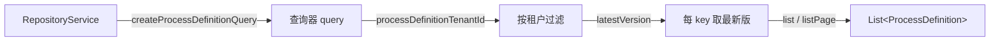

# 查出系统里所有的流程定义：ProcessDefinitionQuery 的租户过滤与分页

流程已经部署进引擎，定义也躺在 `act_re_procdef` 表里了。管理页面上那列「流程定义列表」怎么来？总不能手写 SQL 去碰引擎的表， Activiti 为每种核心对象都配了查询器，流程定义的这一个叫 `ProcessDefinitionQuery`，从 `RepositoryService` 手里拿。这一篇把查询列表完整走一遍：构建查询器、按租户过滤、只取最新版本、分页，最后看懂查出来的对象。

## 先给结论

- 所有流程定义查询的入口都是 `repositoryService.createProcessDefinitionQuery()`，返回一个查询器对象，条件一个个往上加，最后 `list()` 或 `listPage()` 执行。
- SaaS 系统必须加 `processDefinitionTenantId(企业id)` 条件，否则查出来的是全系统所有企业的流程。
- `latestVersion()` 的语义是每个 key 只保留版本号最大的那条，不是全局只留一条。
- 大列表用 `listPage(firstResult, maxResults)` 分页，配合 `count()` 做总数，配 `orderByProcessDefinitionVersion().desc()` 排序。
- 查出的 `ProcessDefinition` 上带着 `suspensionState`，1 是激活，2 是挂起，前端列表的「状态」列直接用它渲染。

## 一、从引擎测试到正式查询

上一阶段验证环境时写过这样一个测试方法，它不带任何条件，把引擎里所有定义一锅端出来：

```java
@Autowired
private RepositoryService repositoryService;

@Test
public void testActiviti() {
    //测试查看activiti中的所有流程
    List<ProcessDefinition> list = repositoryService.createProcessDefinitionQuery().list();
    System.out.println(list.size());
}
```

它能跑通说明链路没问题，但业务上不能这么用：引擎库里可能同时有 A 公司和 B 公司的流程，一锅端会越权。正式的列表查询要在它基础上补两件事，按租户过滤和取最新版本。在测试类里把完整流程写出来（类骨架与上一段一致，包名已改为 `com.example`）：

```java
@Test
public void findALL() {
    //1. 构建流程定义查询器
    ProcessDefinitionQuery query = repositoryService.createProcessDefinitionQuery();
    //2. 添加查询条件：按租户（企业）id 过滤
    query.processDefinitionTenantId("1");
    //3. 每个流程只取最新版本，执行查询
    List<ProcessDefinition> list = query.latestVersion().list();
    System.out.println(list.size());
}
```

三步是固定套路：建查询器、加条件、执行。整个链条画出来是这样：



## 二、条件怎么加，结果怎么看

查询器的方法名就是条件名，SQL 语义一眼可辨：

```java
ProcessDefinitionQuery query = repositoryService.createProcessDefinitionQuery();
query.processDefinitionTenantId("1");        //租户等于
query.processDefinitionKey("process_leave"); //key 等于
query.orderByProcessDefinitionVersion().desc(); //按版本倒序
```

断点跑 `findALL()`，把查出来的 `ProcessDefinition` 打开看，对象上每个属性都对应 `act_re_procdef` 的一列：`id` 是这条定义的唯一标识，`key` 是流程标识，`version` 是版本号，`deploymentId` 指回部署记录，`resourceName` 是 BPMN 文件名，`tenantId` 是企业 id，`suspensionState` 标激活还是挂起。列表页要展示的名称、版本、状态，全在这一个对象里，不需要再发第二条查询。

**`latestVersion()` 要按 key 理解。** 引擎里 `process_leave` 有 v1、v2、v3 三条定义时，加了它只返回 v3 那一条；另一个 key `process_overtime` 有 v1，就返回它的 v1。它做的是「每个 key 内部取最新」，正好对应管理页面每个流程只展示当前版本的诉求。

## 三、分页：数据多了以后的事

演示环境里定义只有几条，`list()` 一次全拿无所谓；生产环境一家企业几十个流程、每个流程若干历史版本，全量拉取就成了性能问题。查询器自带分页能力：

```java
//总数，用来渲染分页条
long total = query.count();
//第一页，每页 10 条：firstResult 从 0 起算
List<ProcessDefinition> page =
        query.orderByProcessDefinitionVersion().desc()
             .listPage(0, 10);
```

`listPage` 的两个参数是偏移量和条数，换页就是改偏移量：第 n 页对应 `(n - 1) * pageSize`。条件在 `listPage` 之前加好，分页只是截取执行结果的一段。`count()` 与查询共用同一组条件，统计总数时不用再构造一个查询器。

## 四、包一层服务，暴露给前端

单元测试证明了查询链路能跑通，真正给审批管理页面供数的是控制器加服务的组合。按本课写法把测试里的逻辑挪进服务层，包名已改为 `com.example`：

```java
@RestController
@RequestMapping(value = "/user/process")
public class ProcessController extends BaseController {
    //BaseController 已在每次请求中解析出当前登录用户的企业 id

    @Autowired
    private ProcessService processService;

    //查询当前企业的所有流程定义（每个流程取最新版本）
    @RequestMapping(value = "/definition", method = RequestMethod.GET)
    public List<ProcessDefinition> definitionList() {
        return processService.findProcessDefinition(companyId);
    }
}
```

服务层就是把 `findALL()` 的三步原样搬过来，只是租户 id 不再写死，换成从登录上下文解析出的 `companyId`。查询器的好处在这一步体现得很明显：不碰引擎表结构、不写 SQL，引擎升级时表结构变化被 `ProcessDefinitionQuery` 这层 API 挡住，业务代码一行不用改。列表接口返回的对象直接带名称、版本、状态字段，前端渲染一列「激活或挂起」也不需要二次请求。

## 常见误区

- **租户条件忘加**：测试库只有一家企业的数据时看不出问题，上了多租户立刻串数据。租户 id 应该来自登录用户（控制器父类解析出的 `companyId`），不能由前端传参决定。
- **把 `latestVersion()` 理解成全局取一条**：它按 key 分组各取最新，返回的仍是多个流程的列表；要精确定位某一条定义，用 `processDefinitionId(id).singleResult()`。
- **数据量大还用 `list()`**：返回全部记录，内存和响应时间都吃亏，列表页一律 `listPage` 加 `count`。
- **拿 `id` 当 `key` 发起实例**：`id` 精确到版本，用它发起会让新申请落在旧版本上；发起实例按 `key` 走，引擎默认取最新激活版本。

## 面试可能被问到的问题

1. 面试官追问：「RepositoryService 是干什么的？」
   答：Activiti 工作流引擎七大服务之一，管资源仓库层：部署流程、删除部署、查询流程定义与部署、按部署 id 取资源流。流程定义的静态管理全部经由它，运行时的实例与任务归 `RuntimeService` 和 `TaskService` 管。

2. 面试官追问：「ProcessDefinitionQuery 的使用模式是什么？」
   答：构建器模式。`createProcessDefinitionQuery()` 得到查询器后链式叠加条件与排序，条件方法与 SQL 谓词一一对应，最后用 `list()`、`listPage()` 取结果或 `count()` 取总数，一次构造可多次执行。

3. 面试官追问：「多租户下流程定义怎么查询才安全？」
   答：查询前必加 `processDefinitionTenantId` 条件，租户值在服务端从登录上下文解析，不信任前端传参；部署时 `tenantId(companyId)` 写进去的值与查询值同源，形成写入读取闭环，避免企业之间互相看到对方的流程。

4. 面试官追问：「一个流程有 v1 到 v5 五个版本，怎么只列出最新版？」
   答：查询器上加 `latestVersion()`，它按 key 过滤出每个流程版本号最大的记录。要查历史版本时去掉该条件，配合 `processDefinitionKey` 与版本排序逐条展示。

5. 面试官追问：「列表页的已挂起状态从哪里来？」
   答：`ProcessDefinition.getSuspensionState()`，值为 1 表示激活、2 表示挂起，对应 `act_re_procdef` 的 `SUSPENSION_STATE_` 列。也可以用 `repositoryService.isProcessDefinitionSuspended(id)` 直接判断。

## 配套资料

- 引擎查询测试类（`testActiviti` 为课程源码，`findALL` 按本课写法在其基础上补全）：`materials/code/02/day16 薪资管理与工作流概述/day16/03-资料/04审批代码/ihrm_audit/src/test/java/com/ihrm/audit/AuditTest.java`
- 部署代码（租户 id 写入的源头）：`materials/code/02/day16 薪资管理与工作流概述/day16/03-资料/04审批代码/ihrm_audit/src/main/java/com/ihrm/audit/service/ProcessService.java`
- 流程控制器（`/user/process` 路径与 `BaseController` 取企业 id 的写法来源）：`materials/code/02/day16 薪资管理与工作流概述/day16/03-资料/04审批代码/ihrm_audit/src/main/java/com/ihrm/audit/controller/ProcessController.java`
- 引擎数据源配置：`materials/code/02/day16 薪资管理与工作流概述/day16/03-资料/04审批代码/ihrm_audit/src/main/resources/application.yml`
