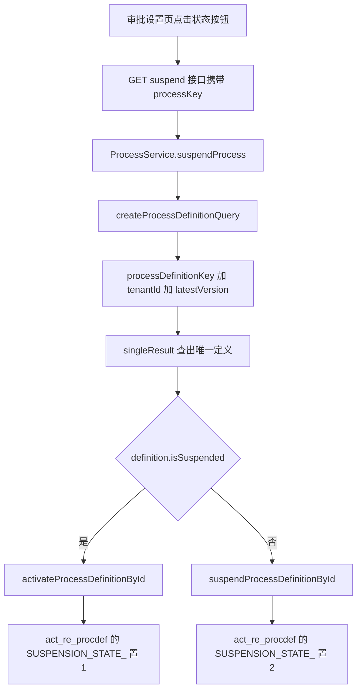

# 审批设置的后台两个接口：流程定义列表与挂起激活的切换

审批设置页面要做的就两件事：把企业里已有的流程定义全部列出来，再给每一条配一个状态按钮，点了能在「可用」和「不可用」之间切换。引擎层面的查询、挂起、激活 API 已经在测试代码里验证过，真正落到 Controller 和 Service 时，问题会具体成三个：路径怎么定、租户过滤加在哪、切换的方向怎么判断。

## 先给结论

- 页面只需要两个 GET 接口：`/user/process/definition` 查流程定义列表，`/user/process/suspend/{processKey}` 切换激活与挂起。
- Controller 只做参数接收和 `Result` 包装，所有引擎操作下沉到 `ProcessService`，保持分层干净。
- 列表查询固定三段：`processDefinitionTenantId(企业id)` 按租户过滤，`latestVersion()` 只取每个流程的最新版本，`list()` 执行。
- 切换接口的语义是「反转」：先按 key 查出定义，`isSuspended()` 为真就激活，为假就挂起。
- 定位流程用 key 而不是 id：key 是业务稳定标识，id 里混着版本号，页面传 key 更自然。

## 一、把页面需求翻译成接口

审批设置页展示的内容是一个流程定义清单：请假、加班、离职各占一行，行尾一个状态按钮。按钮的规则在产品层面就一句话，已激活的定义点一下变成挂起，已挂起的点一下变回激活。这条规则直接决定了接口的形状：前端不需要分别传「挂起」或「激活」两个动作，只要告诉后端「我要反转哪个流程」。

| 接口 | 方法 | 参数 | 作用 |
|---|---|---|---|
| `/user/process/definition` | GET | 无，企业 id 从登录态取 | 查询本企业全部流程定义（最新版本） |
| `/user/process/suspend/{processKey}` | GET | 流程 key | 激活与挂起互切 |

**第一，查询接口没有任何请求参数。** 企业维度不需要前端传，`companyId` 由拦截器解析 token 后放进 `BaseController`，方法体里直接用，这样也杜绝了查询别家企业数据的可能。

**第二，切换接口用路径变量带 key。** `processKey` 是 BPMN 文件里 `<process id="...">` 的值，比如 `process_leave`、`process_overtime`，同一个 key 的多个版本共享它。页面从列表接口拿到 key，点按钮原样传回，链路上不需要暴露引擎的 id。

## 二、列表接口：Controller 与 Service 各管一段

Controller 里的方法保持最短，收参数、调 Service、包结果：

```java
package com.example.audit.controller;

import com.example.common.controller.BaseController;
import com.example.common.entity.Result;
import com.example.common.entity.ResultCode;
import org.activiti.engine.repository.ProcessDefinition;
import org.springframework.beans.factory.annotation.Autowired;
import org.springframework.web.bind.annotation.*;

import java.util.List;

@CrossOrigin
@RestController
@RequestMapping(value = "/user/process")
public class ProcessController extends BaseController {

    @Autowired
    private ProcessService processService;

    /**
     * 查询当前企业的所有流程定义（每个流程只取最新版本）
     */
    @RequestMapping(value = "/definition", method = RequestMethod.GET)
    public Result definitionList() {
        List<ProcessDefinition> list = processService.getProcessDefinitionList(companyId);
        return new Result(ResultCode.SUCCESS, list);
    }
}
```

查询逻辑全部写在 Service 里，返回 `List<ProcessDefinition>`：

```java
package com.example.audit.service;

import org.activiti.engine.RepositoryService;
import org.activiti.engine.repository.ProcessDefinition;
import org.springframework.beans.factory.annotation.Autowired;
import org.springframework.stereotype.Service;

import java.util.List;

@Service
public class ProcessService {

    @Autowired
    private RepositoryService repositoryService;

    /**
     * 根据企业 id 查询所有流程定义对象
     */
    public List<ProcessDefinition> getProcessDefinitionList(String companyId) {
        return repositoryService.createProcessDefinitionQuery()
                .processDefinitionTenantId(companyId)  //只查本企业的流程
                .latestVersion()                       //每个 key 只留最新版本
                .list();
    }
}
```

三段查询条件缺一不可。`createProcessDefinitionQuery()` 拿到查询器，`processDefinitionTenantId` 决定数据边界，SaaS 场景下漏掉它就是把全平台企业的流程都泄露给当前用户；`latestVersion()` 处理版本堆积，一个流程改版三次就会有四条记录，页面只关心最新的那条。

## 三、切换接口：先读状态，再反向操作

切换接口的业务核心是一个 if 分支，但它前面的查询比列表接口严格：条件要收敛到唯一一条，用 `singleResult()` 收口。

```java
/**
 * 挂起或激活流程定义：当前挂起则激活，当前激活则挂起
 */
public void suspendProcess(String processKey, String companyId) {
    //1. 按流程 key 加租户 id 查询唯一一条最新版本的定义
    ProcessDefinition definition = repositoryService.createProcessDefinitionQuery()
            .processDefinitionKey(processKey)
            .processDefinitionTenantId(companyId)
            .latestVersion()
            .singleResult();
    //2. 读出当前状态，反向操作
    if (definition.isSuspended()) {
        //挂起状态：设置为激活
        repositoryService.activateProcessDefinitionById(definition.getId());
    } else {
        //激活状态：设置为挂起
        repositoryService.suspendProcessDefinitionById(definition.getId());
    }
}
```

Controller 侧对应地多一个 `@PathVariable`：

```java
/**
 * 切换流程定义状态：激活变挂起，挂起变激活
 */
@RequestMapping(value = "/suspend/{processKey}", method = RequestMethod.GET)
public Result suspendProcess(@PathVariable("processKey") String processKey) {
    processService.suspendProcess(processKey, companyId);
    return new Result(ResultCode.SUCCESS);
}
```

这个方法没有返回数据，`Result` 里只带成功码。挂起或激活是引擎侧的状态迁移，前端点完按钮重查一次列表就能看到新状态，不必在响应里回传。整个动作的分支走向如下：



关键路径在 `singleResult()` 之前：key 加租户只把范围缩到「同企业的同一种流程」，一个流程有多个版本时结果仍是多行，必须再叠 `latestVersion()` 让结果唯一，否则 `singleResult()` 会直接抛异常。

## 四、为什么挂起按钮值得做成一个功能

挂起不是把流程删掉，而是给模板上一个「暂停受理」的闸。引擎在发起新实例时会校验定义的挂起状态，定义处于挂起期再发起申请会直接抛异常。落到业务上就是：企业这段时间不想让员工提请假，管理员在审批设置里把请假流程挂起，所有发起入口立刻失效，等恢复后再点一次激活，全程不动任何数据，在途申请也不受影响。

这比「删除部署再重新上传」安全得多：删除会连带部署资源甚至历史数据，恢复时还得重新上传文件；挂起只是 `act_re_procdef` 表一个状态字段的翻转，成本几乎为零。

## 常见误区

- **切换接口不做状态判断直接挂起**：按钮语义是反转，已挂起的定义再收到挂起指令属于非法操作。必须先查出定义读 `isSuspended()`，再决定调用激活还是挂起方法。
- **按 key 查询单条时漏掉 `latestVersion()`**：同 key 多版本时结果不唯一，`singleResult()` 抛出异常。凡是「查一条」的查询，唯一条件要自己凑齐。
- **列表查询不加租户条件**：开发库里有测试企业的流程数据，漏掉 `processDefinitionTenantId` 会把别家企业的定义一并返回，既是数据事故也是越权漏洞。
- **把引擎操作写进 Controller**：`RepositoryService` 只该出现在 Service 层。Controller 直接操作引擎会让事务边界、参数校验无处安放，后续加日志或权限都要改 Controller。

## 面试可能被问到的问题

1. 面试官追问：「查询流程定义列表为什么要用 latestVersion？」
   答：Activiti 对同一个 key 的流程，每次部署都会生成一个新版本记录，`act_re_procdef` 里会有多行。业务页面只需要当前生效的模板，`latestVersion()` 让查询器按 key 分组取版本号最大的一条，避免前端拿到一堆历史版本。

2. 面试官追问：「切换接口为什么不提供两个，一个挂起一个激活？」
   答：页面上只有一个状态按钮，语义是反转。做成一个接口，前端不用先查当前状态再选接口，后端在 Service 里读 `isSuspended()` 后反向操作即可，接口数量减半，前后端约定也更简单。

3. 面试官追问：「singleResult 在什么情况下会出问题？」
   答：它要求查询结果恰好一条，条件不充分导致多行时会抛异常。所以用之前要把条件收敛到唯一：key 加租户加 latestVersion 是这套代码里的组合，少了任何一段都可能踩坑。

4. 面试官追问：「companyId 为什么不放请求参数里传？」
   答：它来自登录态，由拦截器解析 token 后写入 BaseController。放参数里等于允许调用者指定任意企业，造成横向越权；从 token 推导能把数据边界锁死在当前登录企业。

5. 面试官追问：「挂起流程定义之后，正在走的申请单会停吗？」
   答：不会。挂起定义只挡住新实例的发起，引擎在 createInstance 时校验状态。在途实例要一并冻结需要调用带 suspendProcessInstances 参数的重载，日常「不让再提请假」这类需求用默认行为就够了。

## 配套资料

- Controller 与 Service 基础代码（deploy 方法与类骨架来自真实文件，文中列表与切换方法为按本课视频补全）：`materials/code/02/day16 薪资管理与工作流概述/day16/03-资料/04审批代码/ihrm_audit/src/main/java/com/ihrm/audit/controller/ProcessController.java`
- `ProcessService` 原始文件（含 deployProcess 的租户写法）：`materials/code/02/day16 薪资管理与工作流概述/day16/03-资料/04审批代码/ihrm_audit/src/main/java/com/ihrm/audit/service/ProcessService.java`
- 挂起激活 API 的验证过程与查询器用法：`materials/code/02/day16 薪资管理与工作流概述/day16/03-资料/04审批代码/ihrm_audit/src/test/java/com/ihrm/audit/AuditTest.java`
- 流程定义表结构与 `SUSPENSION_STATE_` 字段：`materials/code/02/day16 薪资管理与工作流概述/day16/03-资料/act.sql`
