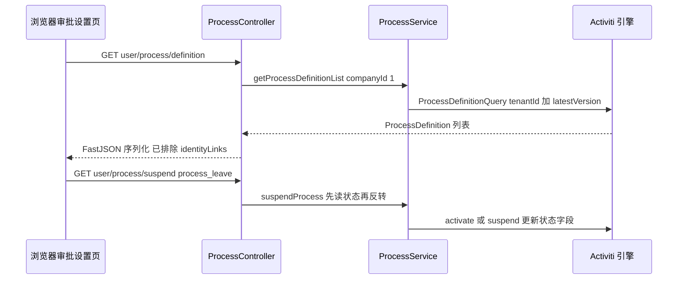

# 页面接通流程定义接口：一次 500 错误引出的 JSON 序列化补丁

接口代码写完，单元测试也过了，一到浏览器里点按钮就弹「系统出错」。这类问题在后端日志里往往只有一句说不清的转换异常，根子不在业务逻辑，而在 Activiti 返回的实体对象根本没法直接序列化成 JSON。把启动、权限、上传、报错、修复的完整链路走一遍，这条链路上的每颗钉子都值得记下来。

## 先给结论

- 类级前缀 `/user/process` 与方法级 `/process/definition` 拼接后路径重复，方法级只留 `/definition`、`/suspend/{processKey}`。
- 页面看不到流程清单有两类原因：权限菜单没挂「审批」入口，或者当前企业的租户 id 下没有部署过任何流程。
- 直接返回 Activiti 的 `ProcessDefinition` 会炸在惰性属性 `identityLinks` 上，JSON 转化时触发懒加载导致 500。
- 修法是换掉默认 JSON 转化器：用 `FastJsonHttpMessageConverter` 配合 `SimplePropertyPreFilter` 把 `identityLinks` 从序列化中排除。
- 按钮是否生效不靠肉眼，看 `act_re_procdef` 的 `SUSPENSION_STATE_` 在 1 与 2 之间翻转即可确认。

## 一、先把路径与菜单捋顺

写切换接口时方法级路径顺手写成了 `/process/definition`，而类上已经有 `@RequestMapping("/user/process")`。Spring MVC 会把两段拼接成 `/user/process/process/definition`，多出来的 `process` 让前端按约定请求 `/user/process/definition` 时直接 404。处理办法只有一个：把方法级路径里多余的段删掉，让最终路径与前端请求严格一致。

第二件事与代码无关。系统左侧的「员工页面」和「审批」菜单不是默认就有的，要在权限设置里给对应角色添加这两个菜单权限，否则登录后连入口都看不到。入口出现后进「审批」页面控制台抛异常可以暂时不管，真正要看的是右上角的设置按钮，点进去就是审批设置页。

## 二、让当前企业先有数据

审批设置页一开始是灰的：请假、加班、离职三个按钮全部不可点。原因在数据侧，此前测试代码部署流程时写的租户 id 与当前登录企业（租户 id 为 1）对不上，当前企业名下一套流程都没有。点击按钮提示「流程还没有上传」，正好走 `deploy` 接口把资料里备好的请假 BPMN 文件上传一次，部署时以登录企业作为租户写入引擎。

上传成功后回到设置页，「设置」弹层里出现了绿色的「请假」项，数据库里 `act_re_procdef` 多出一行，`KEY_` 是 `process_leave`，`TENANT_ID_` 变成了 1。这说明部署链路（页面到引擎）已经完全通了，列表和切换接口也有了可用数据。

## 三、列表接口为什么 500

F12 里能看到 `definition` 请求已经发出，响应却是系统错误。后端日志指向 JSON 转换。查一下引擎里 `ProcessDefinition` 的实现类就明白了，它的字段长这样：

```java
// ProcessDefinitionEntityImpl 的关键字段（反编译节选）
protected String diagramResourceName;
protected boolean isGraphicalNotationDefined;
protected Map<String, Object> variables;
protected boolean hasStartFormKey;
protected int suspensionState;
protected boolean isIdentityLinksInitialized;
protected List<IdentityLinkEntity> definitionIdentityLinkEntities;
protected IOSpecification iosSpecification;
protected String engineVersion;
```

问题出在 `definitionIdentityLinkEntities` 这类关联集合上。引擎实体带着惰性加载逻辑，`isIdentityLinksInitialized` 标记这批关联是否已经加载。Service 层的查询在引擎命令上下文里执行完就返回了，等 Spring MVC 在 Controller 外面做 JSON 序列化时，这批属性从未初始化，转化器一碰它就抛空指针类的异常，整个请求以 500 收场。也就是说，报错的那行堆栈在序列化器里，业务代码一点毛病没有。

## 四、换转化器并过滤属性

这类引擎实体的关联属性，页面和前端业务根本用不到，处理思路就是「不转它」。Spring Boot 里加一个自定义的 `HttpMessageConverters`，用 FastJSON 替换默认转化器，再通过属性过滤器把 `identityLinks` 排除（该配置为按本课写法补全，day17 资料包未随附此文件，包名已改为 `com.example`）：

```java
package com.example.audit;

import com.alibaba.fastjson.serializer.SerializerFeature;
import com.alibaba.fastjson.serializer.SimplePropertyPreFilter;
import com.alibaba.fastjson.support.config.FastJsonConfig;
import com.alibaba.fastjson.support.spring.FastJsonHttpMessageConverter;
import org.springframework.boot.autoconfigure.http.HttpMessageConverters;
import org.springframework.context.annotation.Bean;
import org.springframework.context.annotation.Configuration;

@Configuration
public class FastJsonConverterConfig {

    /**
     * 用 FastJSON 替换默认 JSON 转化器，解决 Activiti 实体序列化异常
     */
    @Bean
    public HttpMessageConverters fastJsonHttpMessageConverters() {
        FastJsonHttpMessageConverter fjc = new FastJsonHttpMessageConverter();
        FastJsonConfig config = new FastJsonConfig();
        config.setSerializerFeatures(SerializerFeature.PrettyFormat);
        //排除引发懒加载异常的 identityLinks 属性
        SimplePropertyPreFilter filter = new SimplePropertyPreFilter();
        filter.getExcludes().add("identityLinks");
        config.setSerializerFilters(filter);
        fjc.setFastJsonConfig(config);
        return new HttpMessageConverters(fjc);
    }
}
```

重启之后再刷新页面，`definition` 请求返回正常 JSON，列表渲染成功。整条链路可以画成下面这张图：



关键点是最后一段：Controller 返回对象之前，FastJSON 用过滤器把危险属性摘掉，序列化阶段不再触发任何引擎内部的懒加载。

## 五、按钮点下去，看数据库说话

列表能出来之后，挂起与激活的验证就简单了。点一次「请假」的状态开关，页面发送 `suspend` 请求，`act_re_procdef` 里那一行的状态字段从 1 变成 2；再点一次，又变回 1。按钮、接口、引擎、数据库四个环节在同一条状态字段上闭环。

顺带回答一个常见疑问：挂起到底有什么用。引擎在发起新实例时会校验定义状态，定义处于挂起期，再发起请假会被引擎直接抛异常拦下。所以企业里这段时间不想让员工提请假，管理员把这个流程挂起即可，恢复业务再激活，数据不动、历史不丢。这个开关控制的是「流程还能不能被执行」。

## 常见误区

- **以为 500 是数据库或业务代码的问题**：堆栈在 JSON 序列化环节，报错对象是 Activiti 的引擎实体。先分清报错层，再谈修复，否则会在 Service 里白白折腾半天。
- **用 Jackson 时试图给实体加 open-in-view 或事务来救懒加载**：引擎实体不是 JPA 实体，懒加载发生在 Activiti 的命令上下文里，出了上下文无法补。正确做法是换 FastJSON 并排除属性，或返回自定义 DTO。
- **方法级路径照抄讲义里的 `/process/suspend/{processKey}`**：类上已有 `/user/process` 前缀时，这样拼出来的路径多一段。写完接口用浏览器 F12 核对一次实际请求路径再联调。
- **页面按钮是灰的就以为是代码坏了**：先查两件事，权限菜单是否配置、当前企业租户下是否部署过流程。数据边界和权限边界的问题在页面上的表现是一样的。

## 面试可能被问到的问题

1. 面试官追问：「Activiti 的实体为什么不能直接返回给前端？」
   答：引擎实体内部带惰性加载的关联属性，比如流程定义的 identity links。Service 查询结束后引擎命令上下文已关闭，序列化阶段访问这些未初始化的集合会抛异常。要么用过滤器排除属性，要么转成自己的 DTO 再返回。

2. 面试官追问：「用 FastJSON 替换 Spring MVC 默认转化器要注意什么？」
   答：声明一个 `HttpMessageConverters` 的 Bean，内部配置 `FastJsonConfig`。属性过滤用 `SimplePropertyPreFilter` 的 excludes 精确排除指定字段；全局替换后所有接口的 JSON 输出风格都会变，日期格式等细节要一并确认。

3. 面试官追问：「类上的 RequestMapping 和方法上的会怎么合并？」
   答：Spring MVC 把类级路径作为前缀与方法级路径拼接成完整映射。两段里出现重复语义的段不会报错，但实际路径会与前端约定不符，联调前必须核对最终 URL。

4. 面试官追问：「挂起一个流程定义，对运行中的实例有什么影响？」
   答：默认没有影响。定义挂起只阻止新实例发起，在途实例继续流转；要连在途实例一起暂停需调用带 suspendProcessInstances 参数的重载，把实例及其任务一并置为挂起。

5. 面试官追问：「SaaS 系统里流程部署为什么要设置租户 id？」
   答：引擎表是所有企业共用的，不设租户等于把 A 公司的审批流程暴露给 B 公司。部署时以企业 id 写入 `TENANT_ID_`，查询、挂起、发起全部带上同样的租户条件，数据边界才能闭合。

## 配套资料

- 审批微服务启动类（多数据源、注册中心、Feign 注解齐全，JSON 转化器 Bean 可加在这里或独立配置类）：`materials/code/02/day16 薪资管理与工作流概述/day16/03-资料/04审批代码/ihrm_audit/src/main/java/com/ihrm/audit/AuditApplication.java`
- `ProcessController` 与 `ProcessService`（deploy 为真实代码，列表与切换方法按本课视频补全）：`materials/code/02/day16 薪资管理与工作流概述/day16/03-资料/04审批代码/ihrm_audit/src/main/java/com/ihrm/audit/controller/ProcessController.java`
- 引擎库建表脚本（`act_re_procdef` 的 `TENANT_ID_`、`SUSPENSION_STATE_` 列）：`materials/code/02/day16 薪资管理与工作流概述/day16/03-资料/act.sql`
- 上传用的 BPMN 文件（请假、加班、离职三份）：`materials/code/02/day17 审批中心/day17/03-资料/所有的流程bpmn文件/请假.bpmn20.xml`
