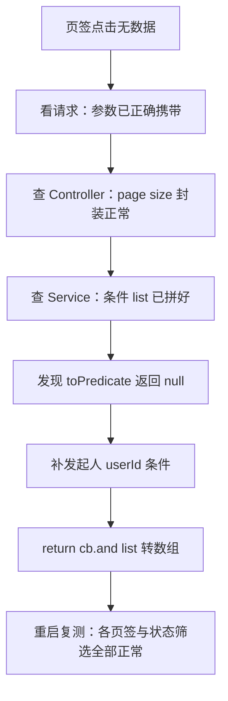

# 审批详情接口与联调：一个 findById、一串 JSON、一次条件失效的排查

列表接口写完，先别急着重启验证。微服务冷启动一次要等挺久，把详情接口一并写完再统一重启，一轮启动测两个接口。详情接口本体只有三行代码，真正值得展开的是两件事：`proc_data` 列里那串「长得像 JSON 的字符串」怎么变成页面上的表单；以及联调时「待审批页签怎么点都没数据」的排查过程，那个问题的根因是条件对象拼好了却忘了返回。

## 先给结论

- 详情接口是 `GET /instance/{id}`，Controller 三步：取路径参数、调 Service、包 `Result`；Service 就一句 `procInstanceDao.findById(id).get()`。
- 详情数据全部来自业务表 `proc_instance`，不需要去引擎库查。
- `proc_data` 在库里是 JSON 字符串不是 JSON 对象，前端拿到后要 `JSON.parse` 一次才能渲染成表单。
- 联调发现的列表失效问题根因是 `toPredicate` 返回了 `null`，条件全部白拼，修正为返回 `cb.and(list.toArray(new Predicate[list.size()]))`。
- 「我发起的」页签要补发起人条件：`userId` 字段等值匹配，与当前审批人的 `like` 匹配互不干扰。

## 一、详情接口：GET 加路径参数的三步走

接口约定很直白：详情页点「查看」时带着申请单 id 发 GET 请求，后端按 id 查 `proc_instance` 返回。Controller 代码：

```java
// 根据ID查询申请详情
@RequestMapping(value = "/instance/{id}", method = RequestMethod.GET)
public Result instanceDetail(@PathVariable String id) {
    //调用service根据id查询
    ProcInstance instance = auditService.findInstanceDetail(id);
    return new Result(ResultCode.SUCCESS, instance);
}
```

Service 更短：

```java
/**
 * 根据ID查询申请数据详情
 */
public ProcInstance findInstanceDetail(String id) {
    return procInstanceDao.findById(id).get();
}
```

三步结构同列表接口一致：调 Service、拿到实体、包 `Result`。`findById` 是 `JpaRepository` 自带的方法，返回 `Optional<ProcInstance>`，这里直接 `.get()` 取值。生产代码里更稳妥的写法是先 `isPresent()` 判断，查不到时返回业务错误码「申请单不存在」，而不是抛 `NoSuchElementException`。详情查询走业务表就够了：申请人、部门、当前审批人、状态、`proc_data` 都冗余在这张表里，引擎库只在推进任务、查节点轨迹时才需要。

## 二、proc_data：库里是字符串，页面要对象

详情页要展示请假类型、开始时间、结束时间、请假时长、申请原因，这些不在 `proc_instance` 的固定列里，全在 `proc_data` 的 JSON 串中。库里的原始内容是 `longtext`：

```sql
-- 数据库中存储的是一整个字符串
{"duration":"1","reason":"个人原因","holidayType":"1",
 "processName":"请假","processKey":"process_leave",
 "startTime":"2019-09-16 00:00:00","endTime":"2019-09-17 00:00:00"}
```

接口把这个字段原样吐给前端时，它是一个字符串，直接绑定表单拿到的是一坨文本。前端拿到响应后要手动解析一次（前端写法为按本课工程补全的示例）：

```javascript
// 详情响应回来后，把 proc_data 字符串还原成对象再渲染
loadDetail(id).then(res => {
  const detail = res.data;
  detail.procData = detail.procData ? JSON.parse(detail.procData) : {};
  this.form = detail;
});
```

不同流程的表单字段不同，请假有天数和假期类型，加班是小时数，离职是离职原因，前端按 `processKey` 决定渲染哪套表单组件，`procData` 解析出来的对象正好作为表单数据源。这也是当初把业务数据设计成 JSON 一列的回报：后端详情接口不用为每种流程写一个 DTO，一行解析交给页面。

## 三、联调测试：一次「列表点不动」的排查

详情接口写完，统一重启微服务，回到页面刷新，列表出现了一条请假记录，点详情弹窗数据完整。继续点「待审批」「我发起的」页签，出问题了：怎么点都查不出数据。排查沿着请求链路走：



定位到 Service 时发现，条件虽然封装了一大堆，方法末尾却 `return null`，等价于告诉 JPA「没有任何条件」，而前端传的筛选参数自然一个都没生效。顺带把缺失的「我发起的」条件补上，方法收尾统一修正：

```java
//发起人（「我发起的」页签）
if (!StringUtils.isEmpty(instance.getUserId())) {
    list.add(cb.equal(root.get("userId").as(String.class), instance.getUserId()));
}
//多个条件之间用 and 连接后返回
return cb.and(list.toArray(new Predicate[list.size()]));
```

修完重启，按四个维度逐一验证：

```bash
# 请假类型筛选，只返回 process_leave 的单据
curl -X PUT "http://localhost:8085/user/process/instance/1/10" \
     -H "Content-Type: application/json" \
     -d '{"processKey":"process_leave"}'

# 审批状态多值筛选：审批通过 + 审批中
curl -X PUT "http://localhost:8085/user/process/instance/1/10" \
     -H "Content-Type: application/json" \
     -d '{"processState":"1,2"}'
```

筛选全部命中之后，再做一组反向验证，直接改库证明条件真的在起作用：把某条记录的 `proc_curr_node_user_id` 改成 `123456`，再查「待审批」，这条单据消失了；把另一条的 `user_id` 改成 `123456`，再查「我发起的」，同样查不到。条件生效的判据不是「能查出数据」，而是「改了数据查询结果跟着变」。

## 常见误区

- **`toPredicate` 拼完条件忘了返回**：条件全在 `list` 里，方法却 `return null`，JPA 视角等于无条件，查询静默变成全量，页面表现是筛选失效。写完 `if` 就把 `cb.and(...)` 收尾补上。
- **`findById(...).get()` 不判空**：id 传错或单据被删时直接抛 `NoSuchElementException` 变 500。用 `Optional` 的 `isPresent` 或 `orElseThrow` 给出业务错误。
- **把 `proc_data` 当 JSON 对象透传**：库里是字符串，前端不 `JSON.parse` 就渲染，表单显示原始文本。解析失败还要考虑空串与脏数据的兜底。
- **只验证正向结果**：筛选接口测一次「能查出来」不够，要配合改库反向验证，确认不满足条件的数据确实被过滤掉了。

## 面试可能被问到的问题

1. 面试官追问：「`findById` 返回的 `Optional` 该怎么处理才规范？」
   答：不要裸调 `get()`。业务上查不到属于正常分支时用 `orElseThrow(() -> new BusinessException(...))` 抛业务异常，由全局异常处理器转成统一错误码；也可以 `isPresent` 判断后返回空对象。这样接口不会因为一条脏 id 变成 500。

2. 面试官追问：「详情数据为什么不多表联查一次取全，而要靠冗余列和 JSON？」
   答：详情页的主数据都在 `proc_instance`：申请人、部门、当前审批人是发起时冗余进来的画像列，请假天数、事由这类差异化字段在 `proc_data` JSON 里。一次单表主键查询全部拿到，没有跨库、没有 join，引擎表只在展示节点轨迹时才补查。

3. 面试官追问：「`toPredicate` 返回 `null` 为什么不报错而是查出全表？」
   答：JPA 规范里 `Specification` 返回 `null` 表示「无附加条件」，框架把它当作恒真谓词处理，这是约定行为而不是异常。好处是支持「可选 Specification」的写法，代价是漏写 return 这类笔误只能靠业务表现暴露，列表查询要配分页和单测兜底。

4. 面试官追问：「联调时如何快速判断问题在前端、网关还是服务端？」
   答：先看浏览器网络面板，确认请求 URL、方法、参数符合约定；请求正常到达但结果错，就看服务端日志断点，Controller 收参、Service 构造条件逐层核对；响应结构对但页面不渲染，问题多半在字段名或数据形态，比如该 `JSON.parse` 的字符串没解析。分层隔离，每层验证输入输出。

5. 面试官追问：「审批详情页的进度时间线数据从哪来？」
   答：`proc_instance` 给当前状态和当前审批人，`proc_task_instance` 按 `process_id` 查出全部节点记录，每条含节点名、处理人、处理时间、处理意见，按时间排序就是时间线。两表配合，一个讲「现在走到哪」，一个讲「每一步谁做了什么」。

## 配套资料

- 列表与详情所在的 Service 实现（文中条件代码摘自本课讲解，包名已改为 `com.example`）：`materials/code/02/day17 审批中心/day17/03-资料/02搭建环境代码/dao/ProcInstanceDao.java`
- 实例表实体（`procData` 字段定义）：`materials/code/02/day17 审批中心/day17/03-资料/02搭建环境代码/entity/ProcInstance.java`
- audit 服务既有工程（Controller 所在模块）：`materials/code/02/day16 薪资管理与工作流概述/day16/03-资料/04审批代码/ihrm_audit/src/main/java/com/ihrm/audit/controller/ProcessController.java`
- 库表 DDL 与 `proc_data` 样例数据（含多种状态的种子记录）：`materials/code/02/day17 审批中心/day17/ihrm.sql`
- 前端解析代码为按本课写法补全的示例，本课无前端源码包
