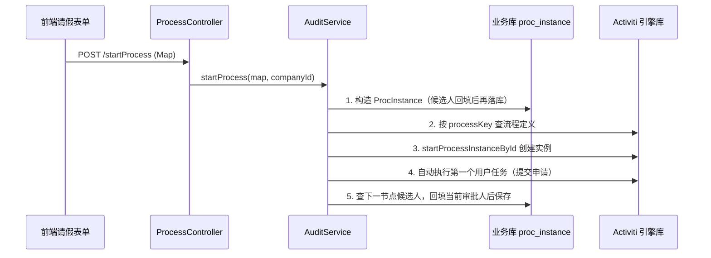

# 发起审批申请：一次点击背后，业务库与流程引擎要协同走的五步

列表和详情都是读操作，发起申请是审批中心第一个写操作，也是难度最高的一块：一次点击要同时写业务库的 `proc_instance`，要在引擎里创建流程实例，还要把下一节点的候选人找出来回填到业务表。搞不清步骤次序，写出来的代码要么引擎里有了实例、业务表却是空的，要么审批人一直是空的。这一节先做步骤分析，再落到代码，覆盖前两步半的实现。

## 先给结论

- 前端不同流程传的字段不一样，Controller 用 `Map` 接收，整体转 JSON 存进 `proc_data`，不为每种流程定义 DTO。
- 发起申请要操作两类数据库：业务库的 `proc_instance` 与 `proc_task_instance`，以及 Activiti 引擎库，后者通过引擎 Service API 操作。
- 五步主线：构造业务数据、按 `processKey` 查流程定义、开启流程、自动执行第一个用户任务（提交申请）、获取下一节点候选人回填当前审批人。
- 开启流程用 `runtimeService.startProcessInstanceById(definitionId, businessKey, vars)`，`businessKey` 传业务表主键，把引擎实例和业务单据绑死。
- 请假流程的网关条件是 `${days<=3}` 与 `${days>3}`，开启流程时要把天数放进流程变量 `vars`，不传分支永远走默认路径。

## 一、参数怎么收：Map 接收加 JSON 落库

在页面填好请假开始时间、结束时间、时长、事由，点提交，抓包看到的请求体是这样一份 JSON（取自课程资料）：

```json
{
  "processKey": "process_leave",
  "processName": "请假",
  "userId": "1066370498633486336",
  "startTime": "2019-09-02 00:00:00",
  "endTime": "2019-09-03 00:00:00",
  "duration": "1",
  "holidayType": "1",
  "applyUnit": "按天",
  "reason": "个人事务"
}
```

换加班流程，字段就变成加班开始结束时间、加班小时数、加班原因；离职流程又不同。这些差异化字段已经在拆表设计时定了归宿：全部序列化进 `proc_data`。于是 Controller 不必为每种流程建实体类，一个 `Map` 全收：

```java
// 发起流程申请：不同流程字段不同，用Map接收
@RequestMapping(value = "/startProcess", method = RequestMethod.POST)
public Result startProcess(@RequestBody Map map) {
    //调用service完成流程发起
    auditService.startProcess(map, companyId);
    return new Result(ResultCode.SUCCESS);
}
```

Controller 只做转发，业务在 Service。方法签名里把 `companyId` 一起传下去，多租户场景下流程定义按租户隔离，查定义要用它。

## 二、五步主线：两本账各记各的

Service 里要同时面对两个存储：业务库的 `proc_instance`、`proc_task_instance` 两张表，以及 Activiti 的引擎库。引擎表不需要手工增删改，引擎提供的 Service API 会自动维护，调「启动流程」「完成任务」，引擎自己写自己的表。整个发起过程在 Service 里排成五步：



**第一，构造业务数据。** 把 `Map` 里的散字段组装成 `ProcInstance` 对象，用户画像靠 Feign 远程查。

**第二，查询流程定义。** 发起的前提是知道「按哪张流程图走」，流程定义只存在于引擎库里，所以要拿 `processKey` 去引擎查定义。

**第三，开启流程。** 调引擎 API 按流程定义创建运行时实例，一句话的事。

**第四，执行第一个用户任务。** 容易被忽略的一步：开启流程不等于第一个节点已经办结。每个流程的第一个节点都叫「提交申请」，是申请人自己的用户任务，开启实例后要自动把它办理掉，流程才能推进到第一个审批节点。

**第五，获取下一节点候选人。** 走到这一步，列表里已经能看到这单申请，但当前审批人还是空的。要问引擎「下一个用户任务是谁的」，拿到候选人组解析出的名单，回填 `proc_curr_node_user_id`、`proc_curr_node_user_name`，业务数据保存之后，待审批列表才有人可查。

## 三、代码实现上篇：构造业务数据

Service 骨架先把五步注释立起来，代码按注释逐段填：

```java
// 流程申请
public void startProcess(Map map, String companyId) {
    //1.构造业务数据
    //2.查询流程定义
    //3.开启流程
    //4.自动执行第一个任务节点
    //5.获取下一个节点数据，填充业务数据中当前待审批人
}
```

第一步构造 `ProcInstance`，分三块取数：`Map` 里的基础字段、Feign 查回的用户画像、以及本地补齐的状态与时间：

```java
//1.构造业务数据
String userId = (String) map.get("userId");
String processKey = (String) map.get("processKey");
String processName = (String) map.get("processName");

//申请人画像数据：远程调用系统微服务查询
User user = feignClientService.getUserInfoByUserId(userId);

ProcInstance instance = new ProcInstance();
//同名属性批量拷贝：username、departmentId 等一次到位
BeanUtils.copyProperties(user, instance);
instance.setProcessId(idWorker.nextId() + "");   //业务表主键，IdWorker生成
instance.setProcessKey(processKey);              //流程标识
instance.setProcessName(processName);            //流程名称
instance.setProcessState("1");                   //刚发起：审批中
instance.setProcApplyTime(new Date());           //申请时间
instance.setProcData(JSON.toJSONString(map));    //全部入参转JSON存入
```

三个细节值得圈出来。用户对象与实例对象有大量同名属性，`BeanUtils.copyProperties(user, instance)` 一句顶十几个 setter，拷完再补引擎相关的字段。主键 `processId` 由 `IdWorker` 生成，此刻引擎还没创建实例，先有自己的单号，下一步开启流程时把它作为 `businessKey` 传进去，业务单据与引擎实例从出生就绑定。`procData` 直接 `JSON.toJSONString(map)`，前端传来什么就存什么，详情页按 `processKey` 再解析回表单。

## 四、定位流程定义并启动引擎

发起前要先回答「按哪个流程定义走」。同一个 `processKey` 可能部署过多个版本，多租户下还按企业隔离，查询条件要带全：

```java
//2.查询流程定义：key + 租户 + 最新版本
ProcessDefinition definition = repositoryService.createProcessDefinitionQuery()
        .processDefinitionKey(processKey)
        .tenantId(companyId)
        .latestVersion()
        .singleResult();
```

`RepositoryService` 是引擎负责流程定义的入口，`createProcessDefinitionQuery` 拿到查询器后按条件叠加，`latestVersion()` 保证用户永远按最新一版流程图走，`singleResult()` 要求结果唯一。定义到手，开启流程：

```java
//3.开启流程：先按流程类型准备流程变量
Map<String, Object> vars = new HashMap<>();
if ("process_leave".equals(processKey)) {
    //请假流程的网关条件是 days 与 3 比较，天数从入参 duration 里取
    vars.put("days", map.get("duration"));
}
//businessKey 传业务表主键，把引擎实例与业务单据绑定
ProcessInstance processInstance = runtimeService
        .startProcessInstanceById(definition.getId(), instance.getProcessId(), vars);
```

`startProcessInstanceById` 有多个重载，选三个参数的这个：流程定义 id 决定按哪张图创建实例；`businessKey` 传 `instance.getProcessId()`，引擎的运行时与历史表都会带上这个业务标记，日后对账、回查全靠它；`vars` 是流程变量，`startProcessInstanceById` 的 vars 参数。

流程变量不是可传可不传的装饰。请假流程在网关处写了两个分支条件 `${days<=3}` 走初审、`${days>3}` 加一道复审，`days` 这个变量只有在开启流程时给到，引擎才知道走哪条边。不传变量，条件表达式求不出结果，流程要么走默认分支，要么直接抛异常，具体表现取决于流程图的画法。加班、离职没有分支，`vars` 留空即可，所以这里按 `processKey` 判断后再放值。

到这里，引擎库里的实例已经创建并指向第一个审批节点，业务表的数据也组装完毕。剩下的第四、五步，执行第一个任务节点、解析下一节点的候选人组并回填当前审批人，留给下一节继续。

## 常见误区

- **为每种流程写一个 Controller 实体类**：请假、加班、离职字段各不同，按流程建 DTO 会让接口层无限膨胀。统一 `Map` 接收加 `proc_data` JSON 落库，差异收敛到前端表单与解析。
- **开启流程后不执行第一个用户任务**：实例创建后停在「提交申请」节点，流程不会自己推进，待审批列表永远查不到这单，看起来像「发起失败」。
- **`businessKey` 不传或传错**：引擎与业务库的关联纽带断了，之后按单据查引擎轨迹、按引擎对账业务状态都要靠额外映射，成本翻倍。
- **分支变量忘记放进 `vars`**：请假天数没传，网关条件 `${days<=3}` 无法求值，流程走向随机或报错。开启流程前对照 BPMN 的 `conditionExpression` 清点所需变量。
- **`procData` 只存部分字段**：转 JSON 时漏掉 `processKey`、`processName`，详情页拿不到流程类型就无法选表单模板，序列化要用完整的入参 `map`。

## 面试可能被问到的问题

1. 面试官追问：「发起申请为什么要先查流程定义，而不是直接 startProcessInstanceByKey？」
   答：按 key 启动是便捷重载，但多租户、多版本并存时，它默认取的版本不一定符合业务预期。先显式查出「当前租户、指定 key、最新版本」的流程定义，再按定义 id 启动，把版本选择权拿在自己手里，还能顺带校验定义是否存在。

2. 面试官追问：「businessKey 的作用是什么，不用它行不行？」
   答：businessKey 是业务系统放进引擎实例的业务标记，引擎的运行时与历史表都保存它。不用也能跑，但业务库与引擎库之间失去天然关联键，查一单申请的引擎轨迹要靠流程变量或额外映射表维护，对账和排错的成本明显上升。

3. 面试官追问：「流程变量和业务数据都存引擎或业务表一份，会不会重复？」
   答：会重复，但职责不同。流程变量只放影响流转的事实，比如决定分支走向的天数，体积小、生命周期跟着实例；`proc_data` 存完整业务快照，服务详情展示。引擎变量以流转判断为唯一目的，其余字段全部留在业务库，两边才不会互相拖累。

4. 面试官追问：「开启流程与业务表落库怎么保证事务一致？」
   答：引擎表和业务表在同一个数据库实例时，方法上加事务即可，落库失败实例也不存在。多数据源分离后，常规做法是同一事务内先构造业务数据再启动引擎，启动异常整体回滚；跨实例部署则引入消息表或对账任务，以 businessKey 定期核对两边状态。

5. 面试官追问：「为什么发起申请后还要自动执行第一个用户任务？」
   答：BPMN 里每个流程的第一个节点都是「提交申请」，这是设计给申请人核对回执的规范节点，但产品交互上一键提交就应该直达审批环节。自动完成这个任务等价于把「开启实例」和「提交申请」合并成一次用户操作，流程才能立即出现在审批人的待办里。

## 配套资料

- 实体与 IdWorker、Feign 依赖（文中代码基于此目录资料，包名已改为 `com.example`）：`materials/code/02/day17 审批中心/day17/03-资料/02搭建环境代码/entity/ProcInstance.java`
- Feign 门面（构造业务数据时远程查用户）：`materials/code/02/day17 审批中心/day17/03-资料/02搭建环境代码/client/FeignClientService.java`
- 请假流程 BPMN（`${days<=3}`、`${days>3}` 网关条件与 `candidateGroups` 出处）：`materials/code/02/day17 审批中心/day17/03-资料/所有的流程bpmn文件/请假.bpmn20.xml`
- 引擎 API 用法参考（RepositoryService 部署与租户隔离的既有实现）：`materials/code/02/day16 薪资管理与工作流概述/day16/03-资料/04审批代码/ihrm_audit/src/main/java/com/ihrm/audit/service/ProcessService.java`
- 业务库 DDL（`proc_data`、`process_state` 等列定义）：`materials/code/02/day17 审批中心/day17/ihrm.sql`
