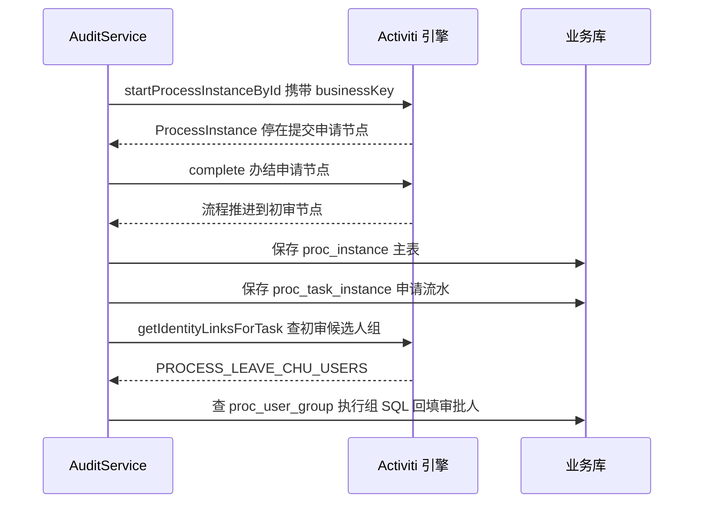

# 让流程真正转起来：启动引擎实例、办结申请节点并回填下一棒审批人

业务数据构造完毕、流程定义也查到了，`startProcessInstanceById` 一声令下，引擎开始流转。新困惑马上出现：方法的返回值叫 `ProcessInstance`，自己写的实体叫 `ProcInstance`，一字之差到底谁是谁？页面发起成功后列表里能看到单据，「当前审批人」一栏却空着，待审批的人查不到自己的活。这一节把剩下的第四步、第五步补完，中途先做一轮联调，看看代码走到一半系统是什么状态。

## 先给结论

- 引擎返回的 `ProcessInstance` 是 Activiti 的运行时对象，自建的 `ProcInstance` 是业务表实体，前者引擎自己维护，后者由业务代码 save，两者靠 `businessKey` 绑定。
- `taskService.createTaskQuery().processInstanceId(实例id).singleResult()` 永远返回当前待办任务；`complete` 之后再用同样的查询，拿到的就是下一个节点。
- 办结「提交申请」节点要在 `proc_task_instance` 落一条流水，处理人就是申请人自己，`handleType` 记 2。
- 下一节点的候选人不存死在代码里：`getIdentityLinksForTask` 拿候选人组 id，查 `proc_user_group` 得到带占位符的 SQL，替换参数后用 `EntityManager` 执行原生查询。
- 原生查询结果用 `Transformers.aliasToBean(User.class)` 映射成实体，SQL 的列别名必须与 `User` 的属性名一致。

## 一、ProcessInstance 与 ProcInstance：一字之差两本账

`runtimeService.startProcessInstanceById(definition.getId(), instance.getProcessId(), vars)` 的返回值是 Activiti 的 `ProcessInstance`，属性全是引擎视角：引擎实例 id、流程定义 id、`businessKey`。自己定义的 `ProcInstance` 是 `proc_instance` 表的 JPA 实体，存的是业务画像：申请人、部门、状态、`proc_data`。名字都叫「流程实例」，一个是引擎账本上的行，一个是业务账本上的行，编码时千万别把两类对象互相赋值。

两者的连接点在开启那一刻就定下了：第二个参数把业务主键 `instance.getProcessId()` 作为 `businessKey` 传给引擎。引擎的运行时表与历史表都会带着这个标记，之后所有「拿业务单号查引擎」的操作都走这条路。

## 二、第四步：让流程走出第一格

引擎实例创建后，流程停在 BPMN 里的第一个用户任务上。请假流程的起点是 `APPLY` 节点，节点名「提交申请」。产品设计上申请人点一次提交就该直达审批环节，所以这一格要由代码自动办结。办结需要 `TaskService`，它负责任务的查询与执行：

```java
//4. 自动执行第一个任务节点
//开启实例后流程停在「提交申请」，先查出这个待办
Task task = taskService.createTaskQuery()
        .processInstanceId(processInstance.getId())
        .singleResult();
//办结申请节点，引擎沿顺序流自动推进
taskService.complete(task.getId());
```

一个流程实例的生命周期里会有多个任务，`Task` 与实例是一对多关系。查询器按 `processInstanceId` 过滤，把范围收窄到这个实例当前的活动任务，再用 `singleResult()` 取唯一一条。`complete` 一执行，引擎沿顺序流走到下一格，「初审」节点成为新的待办。这里的任务 id 必须是引擎 `Task` 的 `getId()`，传业务表主键进去引擎找不到对应任务，直接抛异常。

## 三、业务表双写：主表落库，流水同步

引擎侧推进一格，业务侧也要记账。整个推进过程在两个存储里并行发生：



主表与流水各自落库，代码如下：

```java
procInstanceDao.save(instance);                  //业务主表落库

//申请节点的处理流水：处理人就是申请人自己
ProcTaskInstance pti = new ProcTaskInstance();
pti.setTaskId(idWorker.nextId() + "");           //流水主键，IdWorker 生成
pti.setProcessId(instance.getProcessId());       //关联业务主表
pti.setHandleTime(new Date());                   //处理时间
pti.setHandleType("2");                          //2 审批通过，申请节点视为通过
pti.setHandleUserId(user.getId());               //处理人：发起人
pti.setHandleUserName(user.getUsername());
pti.setTaskKey(task.getTaskDefinitionKey());     //节点 key：APPLY
pti.setTaskName(task.getName());                 //节点名：提交申请
pti.setHandleOpinion("发起申请");                 //处理意见
procTaskInstanceDao.save(pti);                   //节点流水落库
```

`ProcTaskInstance` 的字段几乎都能从已执行的任务里直接取：`taskKey` 用 `task.getTaskDefinitionKey()` 拿 BPMN 里的节点 id，`taskName` 拿节点名，处理人取发起人的 id 与用户名。详情页的审批轨迹就是按 `processId` 把这张表的记录按时间排出来。

## 四、中途联调：三处存储核一遍账

代码写到这个程度先别急着写第五步，启动服务从页面发起一单请假，验证已经完成的部分。页面上填好假期类型与起止时间点提交，浏览器控制台里能看到 `startProcess` 请求返回成功：

```json
{ "code": 18000, "message": "操作成功！", "success": true }
```

接下来按顺序核对三处存储。业务库 `proc_instance` 从一条变成两条，新记录 `process_state` 为 1，`proc_data` 里躺着完整的请假表单 JSON。`proc_task_instance` 多了一条「提交申请」，处理人是申请人自己。引擎库这边，`act_ru_task` 表里当前任务已经是「初审」节点，候选人组字段挂着 `PROCESS_LEAVE_CHU_USERS`；`act_hi_actinst` 历史表里能看到完整轨迹：开始节点耗时 0 毫秒，「提交申请」节点耗时约 209 毫秒。

页面上「我发起的」页签出现这单审批中的记录，但「待审批」里没有人能看到它，因为当前审批人字段还没填。历史表还暴露了一个线索：引擎自动记录了任务的处理人候选组，一个是提交人本人，一个就是初审用户组。数据都到了，只差把组翻译成人名。

## 五、第五步：把下一棒审批人找出来

`complete` 之后再用同一个查询器查一次，由于申请节点已经办结，查到的 `next` 就是初审任务。任务上挂着候选人组，用 `getIdentityLinksForTask` 把组取出来，再顺着组 id 去 `proc_user_group` 表拿这条组的查询语句。整套解析封装成一个私有方法：

```java
private List<User> findCurrUsers(Task nextTask, User user) {
    //一个任务可能挂多个候选人组，逐组解析
    List<IdentityLink> list = taskService.getIdentityLinksForTask(nextTask.getId());
    List<User> users = new ArrayList<>();
    for (IdentityLink identityLink : list) {
        String groupId = identityLink.getGroupId();
        //组 id 与 proc_user_group 主键一致，取出参数名与查询语句
        ProcUserGroup userGroup = procUserGroupDao.findById(groupId).get();
        String param = userGroup.getParam();
        String paramValue = null;
        if ("user_id".equals(param)) {
            paramValue = user.getId();
        } else if ("department_id".equals(param)) {
            paramValue = user.getDepartmentId();
        } else if ("company_id".equals(param)) {
            paramValue = user.getCompanyId();
        }
        //替换语句里的 ${param} 占位符，得到可执行 SQL
        String sql = userGroup.getIsql()
                .replaceAll("\\$\\{" + param + "\\}", paramValue);
        //执行原生查询，列别名映射到 User 属性
        Query query = entityManager.createNativeQuery(sql);
        query.unwrap(NativeQueryImpl.class)
             .setResultTransformer(Transformers.aliasToBean(User.class));
        users.addAll(query.getResultList());
    }
    return users;
}
```

`param` 列声明这条 SQL 需要什么入参：申请人组要 `user_id`，初审组要 `department_id`。初审组的语句是 `SELECT manager username, manager_id id FROM co_department WHERE id = ${department_id}`，替换后查的是申请人所在部门的主管。Spring Data JPA 不直接执行原生 SQL，所以注入 `EntityManager`；查询结果要变回 `User` 对象，靠 Hibernate 的 `Transformers.aliasToBean(User.class)` 按列别名注入属性，`username`、`id` 这两个别名正好对应 `User` 的字段。

拿到候选人后拼串回填：

```java
//查询下一节点并解析候选人
Task next = taskService.createTaskQuery()
        .processInstanceId(processInstance.getId())
        .singleResult();
List<User> currUsers = findCurrUsers(next, user);
String usernames = "";
String userIds = "";
for (User u : currUsers) {
    usernames += u.getUsername() + ",";
    userIds += u.getId() + ",";
}
instance.setProcCurrNodeUserName(usernames);     //当前审批人姓名串
instance.setProcCurrNodeUserId(userIds);         //当前审批人 id 串
procInstanceDao.save(instance);                  //主表再次保存，回填生效
```

现场就踩过一个真实的坑：回填时先把主键写进了姓名列，页面上「当前审批人」显示成一串数字。控制台日志确认 SQL 确实执行了，`select manager username, manager_id id from co_department where id = ...` 查回了部门主管，问题只出在回填字段选错。改成用户名后，待审批列表立刻有了归属人。

## 常见误区

- **`complete` 传错 id**：把业务表主键或流程实例 id 传给 `complete`，引擎只认当前活动任务的 `Task.getId()`，传别的直接抛任务不存在的异常。
- **对查询结果无脑 `singleResult`**：`singleResult` 要求结果唯一，一个实例同时存在多个活动任务（会签场景）时会抛异常。标准流程里同一时刻只有一个待办才这么写，不确定时先 `list()` 判空判断。
- **占位符正则没转义**：`$` 和 `{}` 在正则里都是特殊字符，`replaceAll("${department_id}", value)` 会抛 `IllegalArgumentException`，必须写成 `\\$\\{department_id\\}`。
- **SQL 列别名与实体属性对不上**：`aliasToBean` 严格按别名注入，列别名写成 `name` 而 `User` 属性叫 `username`，映射出来全是 null，还不报错，只能对着日志查。
- **回填字段混淆**：`proc_curr_node_user_id` 与 `proc_curr_node_user_name` 一一对应，一个存 id 一个存用户名，页面显示姓名、点进详情查 id，写反了前端展示与后端查询双双出错。

## 面试可能被问到的问题

1. 面试官追问：「启动流程返回的 ProcessInstance 和你自己的业务实体什么关系？」
   答：两者独立存在。引擎的 `ProcessInstance` 是运行时对象，生命周期由引擎管理，存引擎自己的表；业务实体存业务库，记录申请人、状态、表单数据。关联靠 `businessKey`：启动时把业务主键传入，之后双方都能凭这个标记互查。

2. 面试官追问：「complete 之后怎么拿到下一个任务节点？」
   答：用同一个查询器再查一次。`complete` 是同步推进，方法返回后引擎已经把流程走到下一个节点，此时 `taskService.createTaskQuery().processInstanceId(实例id).singleResult()` 返回的就是新的待办任务。这个特性让代码不用关心 BPMN 的连线细节。

3. 面试官追问：「候选人为什么不用 Activiti 自带的用户组表，而要自己建 proc_user_group？」
   答：引擎的 `IdentityLink` 只负责挂「组名」这个标记，组里具体是谁引擎不关心。企业审批人的定义往往是动态的，比如「申请人的部门主管」，需要按发起人的部门实时查库。把查询 SQL 配置在 `proc_user_group` 里，流程图不动就能换审批人规则，扩展性比写死 assignee 好得多。

4. 面试官追问：「原生 SQL 的结果怎么映射成 Java 对象？」
   答：JPA 里注入 `EntityManager` 执行 `createNativeQuery`，再通过 `unwrap` 拿到 Hibernate 的原生查询，设置 `Transformers.aliasToBean(User.class)` 结果转换器。它按查询结果的列别名反射注入实体属性，所以 SQL 里必须给列起与属性同名的别名。

5. 面试官追问：「发起申请一次要写业务表还要写引擎表，怎么保证一致性？」
   答：本项目的引擎表与业务表在同一个数据库实例，方法加 `@Transactional` 就能把两边纳入同一事务，任何一步失败整体回滚。若部署为跨库，常规做法是业务先落库标记处理中，引擎操作成功后更新状态，再配一张对账表定时核对 `businessKey` 两边的一致性。

6. 面试官追问：「IdentityLink 是什么？」
   答：Activiti 里描述任务与参与者关系的对象，一条记录代表一个参与者标记，类型包括候选人、候选组、办理人等。通过 `taskService.getIdentityLinksForTask(taskId)` 查询，流程图里写的 `candidateGroups` 就体现在它的 `groupId` 字段上。

## 配套资料

- 任务与实例实体（`ProcTaskInstance` 流水字段、`ProcInstance` 回填字段定义）：`materials/code/02/day17 审批中心/day17/03-资料/02搭建环境代码/entity/ProcTaskInstance.java` 与 `materials/code/02/day17 审批中心/day17/03-资料/02搭建环境代码/entity/ProcInstance.java`
- 两个 Dao（`procInstanceDao.save`、`procTaskInstanceDao.save` 的出处）：`materials/code/02/day17 审批中心/day17/03-资料/02搭建环境代码/dao/ProcInstanceDao.java` 与 `materials/code/02/day17 审批中心/day17/03-资料/02搭建环境代码/dao/ProcTaskInstanceDao.java`
- 候选人组表实体（`param` 与 `isql` 两列的定义）：`materials/code/02/day17 审批中心/day17/03-资料/02搭建环境代码/dao/ProcUserGroupDao.java` 与 `materials/code/02/day17 审批中心/day17/03-资料/02搭建环境代码/entity/ProcUserGroup.java`
- 请假流程 BPMN（`APPLY`、`CHU` 节点与 `candidateGroups` 出处）：`materials/code/02/day17 审批中心/day17/03-资料/所有的流程bpmn文件/请假.bpmn20.xml`
- 候选人组种子 SQL（初审组 `SELECT manager username, manager_id id FROM co_department ...` 原文）：`materials/code/02/day17 审批中心/day17/ihrm.sql`
- Feign 门面（回填前的申请人画像查询）：`materials/code/02/day17 审批中心/day17/03-资料/02搭建环境代码/client/FeignClientService.java`
