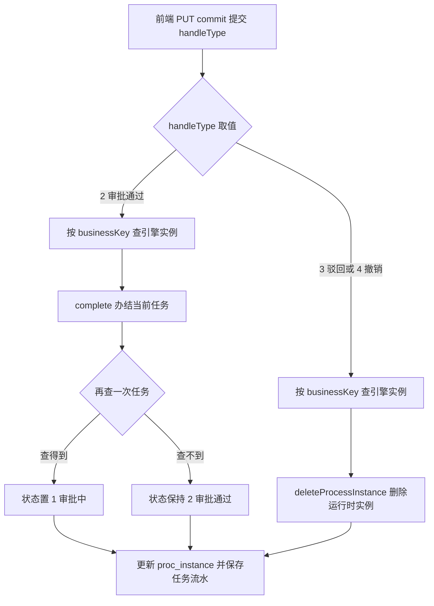

# 提交审核接口：通过、驳回、撤销三种操作共用一个入口

审批中心还剩最后一件事：审批人面对一单申请，页面上有通过、驳回、撤销三个按钮，发起人还能撤销自己的申请。后端不需要三个接口，三个操作传的都是同一份任务数据，区别只在处理类型字段的取值。真正要动脑的是分流后的走向：通过要推进引擎、判断流程是否走完；驳回与撤销要把引擎里的运行时实例删掉，但业务数据必须留着可查。删引擎实例用什么 id，是这一节最容易写错的地方。

## 先给结论

- 三个操作一个接口：`PUT /commit` 接收 `ProcTaskInstance`，前端只多传一个 `handleType`，2 审批通过、3 审批不通过、4 撤销。
- Service 四步：查业务主表、同步状态、按 `handleType` 分流、更新主表并保存任务流水。
- 通过分支：`complete` 办结当前任务，再查一次任务，查得到说明流程未结束状态回到 1，查不到说明流程真正走完。
- 驳回与撤销走 `runtimeService.deleteProcessInstance`，参数必须是引擎实例 id，要用 `businessKey` 先查出来，不能拿业务主键直接传。
- 删的只是引擎运行时数据，`act_hi_*` 历史表与业务表 `proc_instance`、`proc_task_instance` 都在，轨迹随时可查。

## 一、抓包确认：三个按钮其实是一个请求

页面上对一单审批中申请点「通过」，F12 里发出的请求体长这样：

```json
{
  "handleOpinion": "同意，情况属实",
  "handleType": "2",
  "handleUserId": "1863785989926227968",
  "processId": "11755933854653552192"
}
```

换驳回，`handleType` 变成 3；换撤销，变成 4，其余字段原封不动。处理意见 `handleOpinion` 在通过时是审批理由，在驳回时是驳回原因，在撤销时是撤销说明，同一个字段三种语义。`processId` 是业务主表 `proc_instance` 的主键，不是引擎实例 id。四个字段与 `ProcTaskInstance` 实体的属性一一对应，所以接口直接用实体接收。

## 二、Controller 与 Service 骨架

Controller 在流程接口的基础上补一个提交入口，请求方式用 PUT，语义是更新一单申请的状态：

```java
//提交审核：通过、驳回、撤销共用
@RequestMapping(value = "/commit", method = RequestMethod.PUT)
public Result commit(@RequestBody ProcTaskInstance taskInstance) {
    //调用service完成任务处理
    auditService.commit(taskInstance, companyId);
    return new Result(ResultCode.SUCCESS);
}
```

Service 里按四步推进，先把注释骨架立起来：

```java
public void commit(ProcTaskInstance taskInstance, String companyId) {
    //1.查询业务流程对象
    //2.设置业务流程状态
    //3.根据不同操作类型完成不同的业务处理
    //4.更新业务流程对象，保存业务任务对象
}
```

第一步查主表。前端传来的 `processId` 就是 `proc_instance` 主键，直接 `findById`：

```java
//1.查询业务流程对象
String processId = taskInstance.getProcessId();
ProcInstance instance = procInstanceDao.findById(processId).get();
//2.同步业务表状态：2 通过、3 驳回、4 撤销
instance.setProcessState(taskInstance.getHandleType());
```

状态字段先按前端传的处理类型写进去，通过分支里如果流程没走完还会改回来。`handleType` 是字符串，比较时用 `"2".equals(...)` 把常量放前面，避免入参为 null 时抛空指针。

## 三、通过分支：办结当前任务，再看还有没有下一棒

审批通过要让引擎推进一格。推进之前得先定位引擎里的实例，业务主键与引擎实例 id 不是同一个东西，靠发起时埋下的 `businessKey` 查：

```java
if ("2".equals(taskInstance.getHandleType())) {
    //3.1 审批通过：按 businessKey 定位引擎中的流程实例
    ProcessInstance pi = runtimeService.createProcessInstanceQuery()
            .processInstanceBusinessKey(processId)
            .singleResult();
    //查出当前待办任务并办结，引擎推进到下一节点
    Task task = taskService.createTaskQuery()
            .processInstanceId(pi.getId())
            .singleResult();
    taskService.complete(task.getId());
    //再查一次：查得到说明流程未结束，查不到说明已经走完
    Task next = taskService.createTaskQuery()
            .processInstanceId(pi.getId())
            .singleResult();
    if (next != null) {
        //还有下一棒，状态改回审批中
        instance.setProcessState("1");
    } else {
        //没有下一节点，流程真正结束，保持审批通过
        instance.setProcessState("2");
    }
}
```

查询器同一句话前后查两次，语义完全不同：`complete` 之前查到的是审批人正在办的任务，`complete` 之后查到的是流程推给下一棒的任务。这也解释了为什么通过分支要先置状态再可能改回：`handleType` 是 2 不代表流程结束，请假流程里部门主管通过了，后面可能还有人事和总裁办，只有查不到下一节点，这单才算真正审批通过。

## 四、驳回与撤销分支：删运行时实例，保业务数据

驳回（3）与撤销（4）对流程来说结局相同：这单不会再走了，运行时实例没有存在意义。引擎提供 `deleteProcessInstance` 做这件事：

```java
} else {
    //3.2 驳回或撤销：流程终结，删除引擎运行时实例
    ProcessInstance pi = runtimeService.createProcessInstanceQuery()
            .processInstanceBusinessKey(processId)
            .singleResult();
    //第一个参数必须是引擎实例 id，第二个参数记录删除原因
    runtimeService.deleteProcessInstance(pi.getId(), taskInstance.getHandleOpinion());
}
```

两个参数各有讲究。实例 id 必须先用 `businessKey` 查出来再传，直接把业务主键塞进去，引擎在运行时表里找不到这条 id，抛 `ActivitiObjectNotFoundException`。删除原因传处理意见，引擎会把它记进历史表，日后排查「这单为什么没了」全靠这句话。

删除不必担心数据丢失。`deleteProcessInstance` 清掉的是运行时表 `act_ru_*` 里的数据，历史表 `act_hi_*` 完整保留这条实例从头到尾的轨迹，业务表 `proc_instance` 与 `proc_task_instance` 更是动都没动，状态与流水都在，页面上的历史记录照常可查。

整个分流逻辑一张图看完：



三条路最后都汇到收尾这一步，业务表的更新与流水的保存逻辑完全一致。

## 五、收尾：主表更新，流水补全

`commit` 的最后一步保存两样东西。主表状态已经改好，直接 save；传入的 `taskInstance` 是前端拼的半成品，缺主键、处理人姓名和处理时间，补齐后再落库。处理人信息按 `handleUserId` 通过 Feign 回查系统微服务：

```java
//4.更新业务流程对象，保存业务任务对象
User user = feignClientService.getUserInfoByUserId(taskInstance.getHandleUserId());
taskInstance.setTaskId(idWorker.nextId() + "");      //流水主键
taskInstance.setHandleUserName(user.getUsername());  //处理人姓名
taskInstance.setHandleTime(new Date());              //处理时间
procInstanceDao.save(instance);                      //主表状态更新
procTaskInstanceDao.save(taskInstance);              //节点流水落库
```

到这里审批中心的主链路全部闭环：发起申请创建实例并双写，提交审核推进或终结流程并同步状态，轨迹查询靠 `proc_task_instance` 的流水。

## 常见误区

- **拿业务主键去删引擎实例**：`deleteProcessInstance` 的第一个参数是引擎实例 id，与 `proc_instance` 主键不是一个值。必须先按 `processInstanceBusinessKey(processId)` 查出引擎实例，再传它的 id。
- **把 handleType 等于 2 等同于流程结束**：中间节点通过后流程还要往下走，状态应回到 1 审批中。只有查询不到下一节点时，状态 2 才是终态。
- **状态值用 `==` 比较**：`handleType` 是字符串，`taskInstance.getHandleType() == "2"` 比较的是引用，跨方法传参后基本为 false。用 `"2".equals(...)` 并把常量放前面防空指针。
- **撤销后重复操作不设防**：实例删除后运行时查询返回 null，同一单再次提交会空指针。生产实现应在 commit 入口先校验 `processState` 是否审批中，非审批中的单直接拒绝。
- **驳回与撤销混为一谈**：两者都删运行时实例，但语义不同。驳回终态是 3，撤销终态是 4，页面筛选与统计依赖这个区分，落库前不要互相覆盖。

## 面试可能被问到的问题

1. 面试官追问：「通过、驳回、撤销为什么设计成一个接口而不是三个？」
   答：三个操作的入参完全一致，都是处理意见、处理类型、处理人、流程 id，差别只在 `handleType` 的取值；后端处理流程前半段（查主表、改状态、存流水）也一致，只在分流点走向不同。合并成一个接口减少重复代码，前端也只需一个提交方法。

2. 面试官追问：「deleteProcessInstance 之后数据还在吗，和物理删除有什么区别？」
   答：它只清理运行时表 `act_ru_*`，历史表 `act_hi_*` 保留完整轨迹，包括每个节点的办理时间与删除原因。业务表更是不受影响。所以删除运行时实例是逻辑终结，不是数据销毁，报表与审计从历史表查。

3. 面试官追问：「怎么判断一个流程实例是否已经走完？」
   答：最直接的办法是 `complete` 后再按实例 id 查任务，查不到即流程结束；也可以查运行时实例表，`runtimeService.createProcessInstanceQuery().processInstanceId(id).singleResult()` 返回 null 说明实例已不在运行时。历史表里实例的结束时间为空与否同样能判断。

4. 面试官追问：「businessKey 查引擎实例的查询条件是什么？」
   答：`runtimeService.createProcessInstanceQuery().processInstanceBusinessKey(businessKey)`。发起流程时把业务主键作为第二个参数传给了 `startProcessInstanceById`，引擎把它存进运行时表与历史表的 `BUSINESS_KEY_` 列，这是业务库与引擎库之间的天然外键。

5. 面试官追问：「审批人与发起人能不能是同一个人，代码要处理吗？」
   答：业务上应该禁止自审自批，代码层面靠候选人组天然规避不了，因为发起人自己可能就在某个组里。严谨的实现要在 `commit` 入口校验当前登录人与 `proc_curr_node_user_id` 的匹配关系，不匹配直接拒绝，这属于接口幂等与权限双重校验的一部分。

6. 面试官追问：「任务流水的主键为什么不用引擎的任务 id？」
   答：流水记录的是「一次处理行为」，与引擎任务不是一对一。同一单被驳回后重新发起，业务主键不变但引擎实例换了；而且撤销时流水还要在实例删除后继续追加。用 IdWorker 独立生成主键，让流水表的生命周期完全独立于引擎。

## 配套资料

- Controller 扩展基础（`ProcessController` 既有接口风格，`commit` 在此工程上补充）：`materials/code/02/day16 薪资管理与工作流概述/day16/03-资料/04审批代码/ihrm_audit/src/main/java/com/ihrm/audit/controller/ProcessController.java`
- 任务流水实体（`handleType`、`handleOpinion` 等字段定义与注释）：`materials/code/02/day17 审批中心/day17/03-资料/02搭建环境代码/entity/ProcTaskInstance.java`
- 主表实体与 Dao（`processState` 状态列、`procInstanceDao.findById` 出处）：`materials/code/02/day17 审批中心/day17/03-资料/02搭建环境代码/entity/ProcInstance.java` 与 `materials/code/02/day17 审批中心/day17/03-资料/02搭建环境代码/dao/ProcInstanceDao.java`
- Feign 门面（处理人信息回查）：`materials/code/02/day17 审批中心/day17/03-资料/02搭建环境代码/client/FeignClientService.java`
- 业务库 DDL（`process_state` 的四值枚举定义）：`materials/code/02/day17 审批中心/day17/ihrm.sql`
