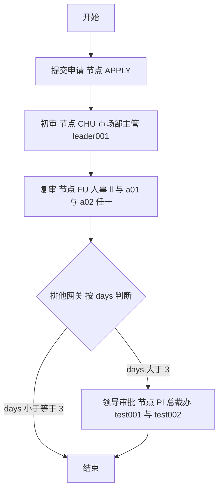

# 请假审批全流程实测：一单短假与一单长假把两条分支都走通

发起申请与提交审核的代码都已就位，但工作流系统的验收标准比普通接口高：流程图里有几条边，测试就要覆盖几条边。请假流程带一个排他网关，三天以内直接结束，三天以上还要总裁办加签，只测一条分支等于没测。这一节用准备好的演示数据，把短假、长假、中途撤销三种走向各跑一遍，顺带验证候选人组的解析是否符合「部门主管 → 人事任一 → 总裁办」的设计。

## 先给结论

- 测试前要复位数据：清空 `proc_instance` 与 `proc_task_instance`，保留 `proc_user_group`（组 SQL 是流程的配置，不是业务数据）。
- 短假单路径：申请人 → 部门主管 → 人事任一人 → 网关判 `days<=3` 直接结束，共两次审批操作。
- 长假单路径：申请人 → 部门主管 → 人事 → 网关判 `days>3` → 总裁办 → 结束，共三次审批操作。
- 「我发起的」与「待审批」两个页签是同一张 `proc_instance` 表按发起人、当前审批人两个维度过滤出来的，测试时两边要交叉核对。
- 撤销由发起人自己触发，撤销后主管的待办立即消失，状态落 4。

## 一、测试数据准备：干净的业务表，完整的组织树

正式开测前先复位环境。业务流程表与任务流水表清空，保证每一单都是从头走出来的；候选人组表保留，因为组 SQL 是流程配置的一部分，下一次解析候选人还要用。组织与人员按测试场景重新划分：市场部两人，一人发起申请；人事部三人，任一人可审；总裁办两人，负责长假加签；财务部一人，作为干扰项验证权限隔离。

候选人组 SQL 决定了「谁有资格审」，测试前值得核对一遍种子数据：

```sql
-- 初审组：查申请人所在部门的主管，department_id 由发起人的部门替换
SELECT manager username, manager_id id FROM co_department
WHERE id = ${department_id};
-- 复审组：固定查询人事部门下的全部用户，任一人可审
SELECT id, username FROM bs_user WHERE department_id = 1175311267684352000;
-- 批准组：固定查询总裁办用户，长假第三棒
SELECT id, username FROM bs_user WHERE department_id = 1175310929766055936;
```

复审组与批准组的部门 id 是写死的演示值，换一套环境必须同步改，否则人事审批会查到空列表，流程卡死在中间节点。这也是测试数据准备环节最容易漏的一项。

整个流程的走向与账号对应关系如下，测试时按图索骥：



图里两条分支的差别只有一个节点：三天以上的单子多一道总裁办审批。测试目标就是把这两条路分别走到底。

## 二、第一单：一天短假，走完部门主管与人事就结束

以市场部员工 `zbz`（账号 003）登录，在员工页面的快捷入口发起请假，时长填一天，事由随意。提交成功后先看发起人视角：审批列表「我发起的」出现一条审批中记录，当前审批人一栏显示的正是市场部主管，说明初审组的 SQL 按发起人部门解析正确；「待审批」页签为空，因为申请人不在任何审批组里。

退出换市场部主管（账号 002）登录，「待审批」里能看到 `zbz` 刚发起的这单。点通过，当前账号的待办清空。再换人事账号 `ll`（账号 004）登录，「待审批」出现同一单，人事组的三个账号理论上都能看到它，这正是候选组「组内共享待办、任一人办理」的行为。

人事再点通过。此时天数是 1，网关条件 `${days<=3}` 命中，流程直达结束节点。回到全部列表核对：这单状态变为审批通过，`proc_task_instance` 里应有三条流水，分别是申请人的「提交申请」、主管的初审、人事的复审。

## 三、第二单：五天长假，第三棒由总裁办接力

短假验证了主链路，长假单验证网关的另一条边。还是 `zbz` 登录发起，时长这次填五天。前面的走法与短假单完全一样：主管通过，人事通过。区别出现在人事通过之后：网关判 `${days>3}`，流程没有结束，而是推进到「领导审批」节点。

验证点在总裁办账号。以 `test001` 登录，「待审批」里出现这单五天请假，查看详情确认时长无误后点通过。此时再查全部列表，状态落为审批通过。两单对比能明确回答「网关是真的在按变量分流」：同样的发起人与审批人，唯一不同的输入是天数，流程长度就不同。`days` 变量在发起时由后端从表单的 `duration` 字段放进流程变量，链路上任何一环漏传，这一步的分流都不会成立。

## 四、第三单：发起后撤销，验证终态为 4

撤销是发起人的合法操作，也要测。`zbz` 再发起一单短假，之后回到「我发起的」列表，对这单点撤销并填写撤销原因。预期结果分三处核对：

1. 发起人列表里这单状态变为已撤销，不再出现在任何人的待办里。
2. 换主管账号登录，「待审批」里这单已经消失，因为引擎运行时实例已被删除。
3. 数据库核对：`proc_instance` 的 `process_state` 为 4，`proc_task_instance` 新增一条 `handleType` 为 4 的流水，引擎历史表里保留删除原因。

三处都对得上，说明提交审核接口的撤销分支与状态同步逻辑工作正常。

## 五、测试报告之外的两个观察

**第一，权限划分影响待办可见性。** 测试中途发现人事组某个账号看不到待办，原因是该账号的岗位角色没有划分完整。候选人组 SQL 只按部门查人，账号能不能进入审批列表还要过一遍系统自身的权限过滤，两层都通才能形成完整闭环。测试出现「该看到却看不到」时，先查组 SQL 结果，再查权限，不要先怀疑流程引擎。

**第二，前端表单没有做校验，天数可以随便填。** 起止时间与时长不一致、时长填零或负数，页面都不拦。工作流引擎不校验业务合法性，`days` 是什么就走什么分支。真实项目里这类校验要补在前端表单与后端接口两层，引擎只负责忠实流转。

## 常见误区

- **只测一条分支就收工**：网关流程至少要把每条边走一遍，短假与长假的单据数、流水数、终态都不同，漏测一条边，上线后那类单子会永远卡在中间节点。
- **清库时把组表也清了**：`proc_user_group` 是流程配置不是业务数据，清掉之后候选人解析直接抛空指针，发起申请在回填审批人一步失败。
- **待办不见了就认定是 bug**：先分清三类原因，引擎实例被删（驳回、撤销）、组 SQL 查不到人（部门 id 演示值没改）、账号权限过滤（岗位角色未划分），三者的排查路径完全不同。
- **忽略跨账号交叉验证**：发起人看到的「审批中」与审批人看到的「待审批」来自同一张表的同一行，任何一边对不上都说明回填或状态同步出了问题，只盯一个页面测不出这种错位。

## 面试可能被问到的问题

1. 面试官追问：「工作流系统的测试和普通 CRUD 接口的测试有什么不同？」
   答：普通接口验证输入输出，工作流测试还要验证「路径」。同一个接口在不同变量下会把流程推向不同分支，测试用例要覆盖流程图里的每条边与每个终态，包括驳回、撤销这类非正常完成路径，还要在多个账号间交叉核对同一单据的视图一致性。

2. 面试官追问：「网关分支变量 days 是什么时候进入引擎的？」
   答：发起申请时，后端从表单的 `duration` 字段取出时长，放进 `vars` 传给 `startProcessInstanceById`。变量在实例创建时落库，网关处的条件表达式 `${days<=3}` 在流程推进到网关时求值。若发起时漏传变量，网关求值失败，流程推进直接报错。

3. 面试官追问：「人事组三个人怎么保证一单只被审一次？」
   答：候选人机制下三个人共享同一个待办任务，谁先 `complete` 任务就归谁，引擎保证任务只被完成一次。后来者再查待办时该任务已经消失。业务上如需记录「实际办理人」，从流水表的 `handle_user_id` 取即可。

4. 面试官追问：「撤销操作为什么不影响历史查询？」
   答：撤销走 `deleteProcessInstance`，只清理运行时表，历史表保留完整轨迹与删除原因，业务表的状态与流水独立维护。所以页面上已撤销的单据仍可查详情，审批轨迹完整，这也是引擎「逻辑终结」设计的价值。

5. 面试官追问：「如果测试中发现待办列表为空，你会按什么顺序排查？」
   答：按数据流向查三层。第一层查引擎，`act_ru_task` 里任务是否存在、候选组是否正确；第二层查组 SQL，把替换参数后的语句手工执行看是否查得到人；第三层查业务回填，`proc_instance` 的当前审批人字段是否为空、账号权限是否过滤了记录。绝大多数问题出在第二层的部门 id 演示值上。

## 配套资料

- 候选人组种子数据（三个组 SQL 的原文与部门 id 演示值）：`materials/code/02/day17 审批中心/day17/ihrm.sql`
- 请假流程 BPMN（网关两条分支的 `conditionExpression` 原文）：`materials/code/02/day17 审批中心/day17/03-资料/所有的流程bpmn文件/请假.bpmn20.xml`
- 组表实体与 Dao（`param`、`isql` 列定义）：`materials/code/02/day17 审批中心/day17/03-资料/02搭建环境代码/entity/ProcUserGroup.java` 与 `materials/code/02/day17 审批中心/day17/03-资料/02搭建环境代码/dao/ProcUserGroupDao.java`
- 业务表 DDL（`process_state` 状态枚举，撤销终态 4 的依据）：`materials/code/02/day17 审批中心/day17/ihrm.sql`
