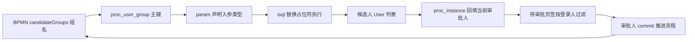

# 从代码回到流程图：请假审批全链路复盘，一条组 SQL 串起所有节点

发起、提交、短假、长假、撤销都测通了，代码散落在 Controller、Service、组表 SQL 三个地方，是时候把它们拼回一张完整的图。复盘的价值在于回答一个问题：页面上一单请假从提交到结束，数据究竟在哪些表之间怎么流动？把这条链路想透，换一个加班流程、离职流程，需要的只是换一张 BPMN 与几条组 SQL，Java 代码一行不用动。

## 先给结论

- 页面的全部、我发起的、待审批三个页签查的都是 `proc_instance` 一张表，靠 `process_state`、发起人、当前审批人三个字段切换视角。
- 发起申请的 Service 做三件事：构造业务数据、开启引擎流程并办结申请节点、查询下一节点解析候选人回填待处理人，第三步是整条链路的关键。
- 候选人组的解析链固定五环：BPMN 的 `candidateGroups` → `proc_user_group` 主键 → `param` 声明入参 → `isql` 替换占位符执行 → 结果回填业务表。
- 提交审核只对 `handleType` 为 2 的操作推进流程，驳回与撤销一律删除运行时实例视为流程终结。
- 请假流程四个审批节点对应四条组 SQL，初审查部门主管、复审查人事、批准查总裁办，迁移到其他流程时补全这些 SQL 即可。

## 一、一张表撑起三个页签

列表页的三个页签看起来像三份数据，实际是同一张 `proc_instance` 表的三种过滤。`process_state` 枚举四个值：1 审批中、2 审批通过、3 审批不通过、4 撤销。全部页签按状态与其他条件过滤；我发起的页签追加 `userId` 等于当前登录人；待审批页签的过滤条件是当前审批人字段包含登录人。发起申请时把 `proc_curr_node_user_id`、`proc_curr_node_user_name` 回填到位，待审批列表才有据可查；提交审核时更新 `process_state`，页签之间的流转才与真实进度一致。

这个设计的前提是每次节点推进都同步回填业务表。引擎自己的运行时表里也有待办信息，但业务页面不直接查引擎表：跨库、跨表结构、还要关联展示单据摘要，不如在业务表里冗余一份「现在轮到谁」。

## 二、发起链路：三步走，第三步最关键

`startProcess` 的完整代码按三步归纳：

```java
public void startProcess(Map map, String companyId) {
    //1.构造业务数据：Map 转实体，Feign 补齐申请人画像
    //2.开启 Activiti 流程：查流程定义、准备变量、启动实例
    //3.处理当前审批节点：办结提交申请节点，查询下一节点
    //  回填当前审批人
}
```

三步的次序有讲究。第一步让业务表先有自己的主键；第二步把这个主键作为 `businessKey` 埋进引擎实例；第三步依赖第二步的副作用：`complete` 申请节点后，引擎已自动流转到初审，此刻用实例 id 再查一次任务，查到的就是初审待办，任务上挂着的 `IdentityLink` 就是候选人组标记。回填代码与组 SQL 的执行在上一节的 `findCurrUsers` 里，这里不再重复。

## 三、候选人组全链路：从 BPMN 属性到一条 SQL

这是整个审批中心最核心的设计，值得逐环拆开。请假流程在 BPMN 里声明了四个用户任务，每个任务用 `candidateGroups` 挂一个组名：

```xml
<bpmn2:userTask id="APPLY" name="提交申请"
    activiti:candidateGroups="PROCESS_LEAVE_APPLY_USERS"></bpmn2:userTask>
<bpmn2:userTask id="CHU" name="初审"
    activiti:candidateGroups="PROCESS_LEAVE_CHU_USERS"></bpmn2:userTask>
<bpmn2:userTask id="FU" name="复审"
    activiti:candidateGroups="PROCESS_LEAVE_FU_USERS"></bpmn2:userTask>
<bpmn2:userTask id="PI" name="领导审批"
    activiti:candidateGroups="PROCESS_LEAVE_PI_USERS"></bpmn2:userTask>
```

组名只是字符串标记，组里是谁引擎不管。业务库的 `proc_user_group` 表用主键承接这些组名，`param` 列声明这条查询需要什么入参，`isql` 列存放真正的候选人查询语句。资料包里的种子数据把四个组的设计意图写得明明白白：

```sql
-- 申请组：入参 user_id，查询结果就是发起人本人
INSERT INTO proc_user_group (id, name, param, isql) VALUES
('PROCESS_LEAVE_APPLY_USERS', '请假申请人', 'user_id',
 'SELECT id, username FROM bs_user WHERE id = ${user_id}');

-- 初审组：入参 department_id，查申请人所在部门的主管
('PROCESS_LEAVE_CHU_USERS', '请假初审用户组', 'department_id',
 'SELECT manager username, manager_id id FROM co_department WHERE id = ${department_id}');

-- 复审组：按固定部门 id 查人事部全部用户
('PROCESS_LEAVE_FU_USERS', '请假复审用户组', 'department_id',
 'SELECT id, username FROM bs_user WHERE department_id = 1175311267684352000');

-- 批准组：按固定部门 id 查总裁办全部用户
('PROCESS_LEAVE_PI_USERS', '请假批准用户组', 'department_id',
 'SELECT id, username FROM bs_user WHERE department_id = 1175310929766055936');
```

四个组的取人策略各不相同：申请组按发起人主键精确命中；初审组最有意思，查的是部门表的 `manager` 字段，意味着「谁审我」由我的部门决定，部门调整主管，流程跟着变，BPMN 与代码都不用动；复审组与批准组是固定部门，SQL 里写死了部门主键。执行时 Java 代码从发起人对象取出 `param` 对应的值替换占位符，`EntityManager` 跑原生查询，列别名 `username`、`id` 借助 `aliasToBean` 映射回 `User`。

整条链路串成一张图：



图里最外层的环说明这是一个循环：每次节点推进都回到同一个解析链，下一棒的候选人按同样的规则重新计算。理解了这个环，审批中心的全部代码就只剩两条主线。

## 四、提交链路：类型分流，只有通过会推进

`commit` 的复盘可以压缩成一句判断加两段动作。入参里 `handleType` 为 2 才走推进逻辑：办结当前任务、再查一次任务、存在则回到审批中并回填下一棒审批人、不存在则流程终态为通过。`handleType` 为 3 或 4 时流程直接终结，删除运行时实例，历史与业务数据保留。中间节点的「推进后回填」与发起时的「办结后回填」走的是同一段组 SQL 解析代码，这也是为什么第三步要封装成私有方法复用。

## 五、收束：换流程换什么

day17 到这里收束。回顾整个审批中心的实现，流程相关代码只写了不到三百行，其中与具体业务耦合的更少。要把这套能力复用到加班、离职流程，改动清单只有两项：部署对应 BPMN（加班、离职的 bpmn 文件资料包里都有），以及按新流程的审批规则补全组 SQL。Java 代码里唯一按流程分支处理的地方是流程变量的准备（请假要传 `days`，其他流程没有网关变量），用 `processKey` 判断即可。

真正的工作量沉淀在配置里：一张画对节点的流程图，一组写对查询的候选人 SQL。引擎负责忠实地流转，业务库负责诚实地记账，代码只负责把两边接起来。

## 常见误区

- **把候选人写死在代码里**：按 `processKey` 写 if else 判断该节点给谁审，每加一种规则就要改代码发版。规则应全部下沉到 `proc_user_group` 的 SQL，代码只保留统一的解析框架。
- **组 SQL 不做参数化校验**：`param` 声明了入参类型，替换前应确认发起人对象上该字段非空，部门 id 为空的账号会把 `${department_id}` 替换成 null，SQL 查不到人，流程卡死且不报错。
- **固定部门 id 直接照抄到新环境**：复审组、批准组的部门主键是演示环境的值，迁移时必须按目标环境的组织数据重写，否则人事审批永远查不到人。
- **列别名与实体属性脱节**：组 SQL 的别名要和接收对象的属性名严格一致，初审判别名 `manager`、`manager_id` 就是为了映射 `username`、`id`，新写 SQL 时漏掉别名，`aliasToBean` 映射全为 null。

## 面试可能被问到的问题

1. 面试官追问：「整个审批中心的设计里，你认为最值得复用的是哪一部分？」
   答：候选人组的解析链。BPMN 只声明组名，组表配置入参与查询语句，代码做统一的「取组、换参、执行、回填」。它把「谁审批」这个最常变的业务规则从代码挪到了数据，新增流程或调整审批人策略都不需要发版，这是整套方案可复用的根基。

2. 面试官追问：「为什么不直接用 Activiti 的 IdentityService 管理用户与用户组？」
   答：引擎的用户组模型是静态的，先把人塞进引擎的组表才能用。企业审批人往往依赖动态关系，比如「申请人部门的主管」，需要执行时按发起人上下文查询。自定义组表存 SQL，把动态关系的计算留在业务侧，比把全量组织架构同步进引擎更轻也更准。

3. 面试官追问：「发起申请与提交审核里都有「查询下一节点并回填」的逻辑，如何避免重复？」
   答：把「查当前待办、取 IdentityLink、解析组 SQL、拼串回填」封装成私有方法，发起侧在办结申请节点后调用，提交侧在 complete 后判断有下一节点时调用。两处入参一致：引擎任务对象加申请人或处理人对象，返回候选人列表。

4. 面试官追问：「流程变量和组 SQL 的参数都影响流转，它们的边界怎么划？」
   答：流程变量决定「走哪条路」，比如天数决定是否加签，必须是引擎可感知的运行时数据；组 SQL 的参数决定「路上的人是谁」，只服务于候选人计算，不必进引擎。前者随实例生命周期存储，后者每次解析即时求值，边界清晰后两边都不会膨胀。

5. 面试官追问：「如果要把这套审批中心迁到另一个项目，你会怎么评估改造点？」
   答：按数据、配置、代码三层评估。数据层导入三张业务表结构；配置层重新部署 BPMN 并按目标组织重写组 SQL，特别是写死的部门主键；代码层只改包名与 Feign 目标服务。引擎版本、Spring Boot 版本对齐后，审批逻辑本身零修改。

6. 面试官追问：「审批中、通过、驳回、撤销四个状态，与引擎的任务状态怎么对应？」
   答：这是业务状态机，不是引擎状态。业务表每次在节点推进后由代码同步：发起与中间通过时为 1，末节点通过为 2，驳回为 3，撤销为 4。引擎侧对应关系是运行时实例存在即审批中，实例消失且历史终态为删除即驳回或撤销，通过则是实例自然走完。两层状态靠回填保持一致。

## 配套资料

- 请假流程 BPMN（四个用户任务的 `candidateGroups` 与网关条件原文）：`materials/code/02/day17 审批中心/day17/03-资料/所有的流程bpmn文件/请假.bpmn20.xml`
- 组表种子数据（四条组 SQL 的原文，含固定部门 id 演示值）：`materials/code/02/day17 审批中心/day17/ihrm.sql`
- 组表实体与 Dao（`param`、`isql` 列与查询接口）：`materials/code/02/day17 审批中心/day17/03-资料/02搭建环境代码/entity/ProcUserGroup.java` 与 `materials/code/02/day17 审批中心/day17/03-资料/02搭建环境代码/dao/ProcUserGroupDao.java`
- Feign 门面（申请人画像查询，组 SQL 入参的来源）：`materials/code/02/day17 审批中心/day17/03-资料/02搭建环境代码/client/FeignClientService.java`
- 流程 Controller 扩展基础（`startProcess`、`commit` 接口的既有工程）：`materials/code/02/day16 薪资管理与工作流概述/day16/03-资料/04审批代码/ihrm_audit/src/main/java/com/ihrm/audit/controller/ProcessController.java`
- 同类流程参考（加班、离职 BPMN，迁移新流程时对照）：`materials/code/02/day17 审批中心/day17/03-资料/所有的流程bpmn文件/加班.bpmn20.xml` 与 `materials/code/02/day17 审批中心/day17/03-资料/所有的流程bpmn文件/离职.bpmn20.xml`
