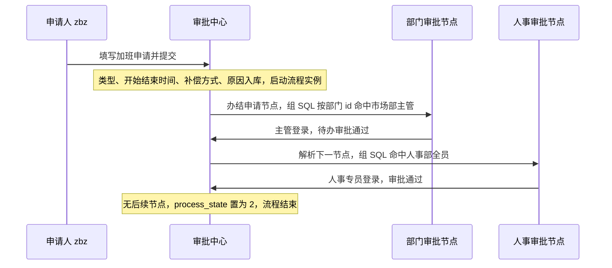

# 换一张流程图、配两条组 SQL：加班与离职流程测试复盘

请假流程端到端跑通之后，一个很自然的疑问浮出来：加班、离职这些流程，是不是要把 Controller、Service、前端页面再照抄一遍？如果每加一种审批就要复制一套代码，前面设计的「用户组」机制就白搭了。这一轮测试要验证的正是这件事：把加班流程的 BPMN 部署上去、把它的审批组 SQL 配齐，然后用真实账号从发起点到结束走一遍，看这套审批中心是不是真的「换流程不换代码」。

## 先给结论

- 加班流程只有三个节点：提交申请、部门审批、人事审批，BPMN 里对应三个 `userTask`，各自用 `candidateGroups` 挂一个组名。
- 部门审批组复用「查部门主管」那条 SQL，入参是发起人的 `department_id`；人事审批组直接写死人事部的部门 id，连 `param` 都可以删掉。
- 占位符替换发生在 `findCurrUsers` 里：按组声明的 `param` 从当前操作人身上取值，替换 `${department_id}` 后执行原生查询，列别名映射回 `User`。
- 离职流程把审批节点扩到四个（部门、人事、人事负责人、财务），多出来的只是两行 `userTask` 加两条组 SQL，Java 代码一行不动。
- 验收标准很具体：发起人提交后待办出现在部门主管名下，主管通过后待办流转到人事，人事通过后 `process_state` 变为 2。

## 一、加班流程的 BPMN：三个节点三个组

加班流程比请假还简单，没有网关、没有分支，一条直线走到底。资料包里的 `加班.bpmn20.xml` 定义如下（图形坐标部分已省略）：

```xml
<process id="process_overtime" name="加班" isExecutable="true">
    <documentation>加班流程</documentation>
    <startEvent id="START" name="开始"></startEvent>
    <userTask id="APPLY" name="提交申请"
        activiti:candidateGroups="PROCESS_OVERTIME_APPLY_USERS"></userTask>
    <userTask id="SHEN1" name="部门审批"
        activiti:candidateGroups="PROCESS_OVERTIME_SHEN1_USERS"></userTask>
    <userTask id="SHEN2" name="人事审批"
        activiti:candidateGroups="PROCESS_OVERTIME_SHEN2_USERS"></userTask>
    <sequenceFlow sourceRef="START" targetRef="APPLY"></sequenceFlow>
    <sequenceFlow sourceRef="APPLY" targetRef="SHEN1"></sequenceFlow>
    <sequenceFlow sourceRef="SHEN1" targetRef="SHEN2"></sequenceFlow>
    <sequenceFlow sourceRef="SHEN2" targetRef="END"></sequenceFlow>
</process>
```

三个用户任务的组名前缀都是 `PROCESS_OVERTIME`，节点 key 分别是 `APPLY`、`SHEN1`、`SHEN2`。流程部署后，`processKey` 就是 `process_overtime`，发起申请时前端把这个标识传给后端，后端按 key 找到流程定义启动实例。与请假流程对比，唯一的结构差异是不需要准备 `days` 之类的网关流程变量，启动参数更薄。

## 二、两条组 SQL：动态主管与固定部门

BPMN 只声明了「这三个节点要找人」，人从哪来由业务库的 `proc_user_group` 表决定。组名就是这张表的主键，加班流程要补的是两条种子数据（摘自课程数据库脚本）：

```sql
-- 部门审批组：入参 department_id，查申请人所在部门的主管
INSERT INTO proc_user_group (id, name, param, isql) VALUES
('PROCESS_OVERTIME_SHEN1_USERS', '加班部门审批用户组', 'department_id',
 'SELECT manager username, manager_id id FROM co_department WHERE id = ${department_id}');

-- 人事审批组：直接写死人事部的部门 id，查该部门全部用户
INSERT INTO proc_user_group (id, name, param, isql) VALUES
('PROCESS_OVERTIME_SHEN2_USERS', '加班人事审批用户组', 'department_id',
 'SELECT id, username FROM bs_user WHERE department_id = 1175311267684352000');
```

这两条 SQL 代表了取人的两种典型策略。**第一种是「跟着人走」的动态策略。** 部门审批查的是部门表的 `manager` 字段，谁的申请就查谁所在部门的主管，列别名 `username`、`id` 是故意起的，要和接收对象 `User` 的属性名对上。人事调整、人员轮岗都不用碰流程。

**第二种是「跟着职能走」的固定策略。** 人事审批的对象永远是人事部门这一批人，与申请人来自哪个部门无关，所以 SQL 里把人事部主键写死。`param` 字段声明的是「这条 SQL 需要什么入参」，既然没有占位符要替换，`param` 留着也没有副作用，删掉同样能跑。申请组 `PROCESS_OVERTIME_APPLY_USERS` 按 `user_id` 精确查出发起人本人，与请假的申请组完全一致，库里已有同构数据时甚至不用新增。

## 三、占位符替换：findCurrUsers 的取参与执行

组 SQL 里的 `${department_id}` 不是数据库语法，而是留给 Java 代码的标记。解析下一节点候选人时，统一的私有方法做四件事：取任务上的候选人组、按组名查组记录、按 `param` 从当前操作人身上取值、替换后执行。示意代码如下（包名已改为 `com.example`）：

```java
private List<User> findCurrUsers(Task nextTask, User user) {
    // 引擎任务上挂着候选人组标记，一个组对应 proc_user_group 的一条记录
    List<IdentityLink> links = taskService.getIdentityLinksForTask(nextTask.getId());
    List<User> users = new ArrayList<>();
    for (IdentityLink link : links) {
        ProcUserGroup group = procUserGroupDao.findById(link.getGroupId()).get();
        // 按组声明的参数类型，从当前操作人身上取对应的值
        String param = group.getParam();
        String paramValue = null;
        if ("user_id".equals(param)) {
            paramValue = user.getId();
        } else if ("department_id".equals(param)) {
            paramValue = user.getDepartmentId();
        } else if ("company_id".equals(param)) {
            paramValue = user.getCompanyId();
        }
        // 替换组 SQL 里的 ${department_id} 占位符后，跑原生查询
        String sql = group.getIsql().replace("${" + param + "}", paramValue);
        Query query = entityManager.createNativeQuery(sql);
        query.unwrap(NativeQueryImpl.class)
             .setResultTransformer(Transformers.aliasToBean(User.class));
        users.addAll(query.getResultList());
    }
    return users;
}
```

替换的逻辑一句话就能说清：当前操作人的 `departmentId` 是什么，`${department_id}` 就换成什么。申请人是市场部的员工，替换进去的就是市场部 id，SQL 查回市场部主管；换成另一个部门的员工，查回来的就是那个部门的主管。`group.getIsql()` 对应实体里的 `isql` 字段，存放的就是第二节那条 SQL 原文。查回来的 `User` 列表会被拼成 id 串和名字串，回填到实例表的当前待处理人字段，页面的待审批列表才有据可查。

## 四、端到端测试：从发起到结束

配置齐了之后就是真实走一遍。演示数据里发起人 `zbz` 属于市场部，市场部主管在部门表里登记在册；人事部则有一批专员账号，主管字段也是人事部的人。整条链路如下：



操作层面的细节有两处值得留意。发起表单的字段（申请类型、加班开始时间、加班结束时间、补偿方式、加班原因）以 JSON 形式存进实例表的业务数据字段，审批详情页原样取出来展示，所以换一种流程只是换一份表单结构，详情渲染逻辑不用改。审批人一侧的操作与请假流程完全相同：登录后进待办列表，看到待审批记录，点通过填意见，列表状态即时刷新。两棒审批都走完，审批列表里这单的状态就从「审批中」变成「审批通过」，全部、我发起的、待审批三个页签看到的是同一个事实的三种过滤。

## 五、离职流程：节点更多，套路不变

离职是这三个流程里节点最多的。资料包里的 `离职.bpmn20.xml` 在部门审批、人事审批之外又串了两个人事任务：

```xml
<bpmn2:userTask id="SHEN1" name="部门审批"
    activiti:candidateGroups="PROCESS_DIMISSION_SHEN1_USERS"></bpmn2:userTask>
<bpmn2:userTask id="SHEN2" name="人事审批"
    activiti:candidateGroups="PROCESS_DIMISSION_SHEN2_USERS"></bpmn2:userTask>
<bpmn2:userTask id="SHEN3" name="人事负责人审批"
    activiti:candidateGroups="PROCESS_DIMISSION_SHEN3_USERS"></bpmn2:userTask>
<bpmn2:userTask id="SHEN4" name="财物审批"
    activiti:candidateGroups="PROCESS_DIMISSION_SHEN4_USERS"></bpmn2:userTask>
```

四个 `userTask` 顺序串联，没有网关。组表里对应四条种子数据：前两个节点的 SQL 与加班流程同构，后两个节点在演示环境里同样按部门 id 取人。把「多两个审批环节」翻译成工作量，就是部署文件里多两行 XML、种子数据里多两条 SQL，`startProcess` 与 `commit` 的代码原样复用。这正是组表机制的价值：审批规则全部沉淀在数据里，引擎忠实地按图流转，代码只负责在节点之间搬运「轮到谁了」。

## 常见误区

- **写死的人事部 id 直接搬去新环境**：`1175311267684352000` 是演示库的部门主键，换一套组织数据后这条 SQL 查不出任何人，流程会安静地停在人事审批，没有任何报错。迁移时必须按目标环境的部门表重写。
- **占位符与 `param` 对不上**：组 SQL 里写 `${departmentId}` 而 `param` 声明的是 `department_id`，拼接出的替换串匹配不到，原样发给数据库直接报语法错。占位符必须与 `param` 逐字符一致。
- **忘记部署新流程的 BPMN 就发起申请**：后端按 `processKey` 查流程定义，查不到直接抛异常。先在流程定义页面上传 bpmn 文件完成部署，再发起测试。
- **组 SQL 漏写列别名**：查询结果靠 `aliasToBean` 按列名注入 `User`，别名不叫 `id`、`username` 时映射出来全是 null，待处理人字段回填成空串，待办列表「看起来正常」却永远没有人能受理。

## 面试可能被问到的问题

1. 面试官追问：「加班、离职与请假三种流程共用一套审批代码，靠的是什么设计？」
   答：靠「组名声明与取人规则分离」。BPMN 里每个节点只挂一个组名字符串，组表以组名为主键存放入参类型与候选人查询 SQL，Java 侧只有一段统一的解析代码。换流程只改 BPMN 与组表数据，代码里的发起、提交、回填逻辑全部复用。

2. 面试官追问：「`${department_id}` 这种占位符替换，有没有 SQL 注入风险？」
   答：替换值取自当前登录用户的服务端档案字段，不是用户输入，常规场景下风险可控。但设计上仍应防一手：`param` 只允许白名单枚举值，取值函数按枚举分发，绝不能把用户提交的字符串直接拼进 SQL；更稳妥的做法是改成参数化原生查询。

3. 面试官追问：「为什么部门审批用动态 SQL，人事审批却写死部门 id？」
   答：审批规则的业务语义不同。部门主管与申请人存在组织关系，随人员变动而变，必须执行时按发起人上下文计算；人事审批的对象是固定的职能部门，主键稳定，写死反而简单直白。两种策略并存说明组表机制能同时容纳动态与静态规则。

4. 面试官追问：「测试时一单流程卡住不动，你怎么定位问题？」
   答：按三层查。先查引擎运行时表确认当前停在哪个任务节点；再查实例表的当前待处理人字段是否回填成功；最后手工执行该节点组名对应的组 SQL，看查询结果是否为空。三层哪一层断了，问题就在哪一段：引擎没流转、回填没执行、或取人 SQL 查空。

5. 面试官追问：「如果要新增一个「调岗审批」流程，最小改动集是什么？」
   答：一份画好节点的 BPMN 文件、若干条按审批规则写好的组 SQL 种子数据，外加前端一张发起表单。后端代码零修改，除非新流程需要网关变量参与条件判断，那也只是在发起时按 `processKey` 补一段流程变量准备逻辑。

## 配套资料

- 加班流程 BPMN（三个用户任务与 `candidateGroups` 原文）：`materials/code/02/day17 审批中心/day17/03-资料/所有的流程bpmn文件/加班.bpmn20.xml`
- 离职流程 BPMN（四个审批节点定义）：`materials/code/02/day17 审批中心/day17/03-资料/所有的流程bpmn文件/离职.bpmn20.xml`
- 组表种子数据（加班两条组 SQL 与固定部门 id 的原文）：`materials/code/02/day17 审批中心/day17/ihrm.sql`
- 组表实体与 Dao（`param`、`isql` 字段定义）：`materials/code/02/day17 审批中心/day17/03-资料/02搭建环境代码/entity/ProcUserGroup.java`、`materials/code/02/day17 审批中心/day17/03-资料/02搭建环境代码/dao/ProcUserGroupDao.java`
- 实例表实体（待处理人回填的目标字段）：`materials/code/02/day17 审批中心/day17/03-资料/02搭建环境代码/entity/ProcInstance.java`
- 审批服务基础工程（多数据源与流程部署代码）：`materials/code/02/day16 薪资管理与工作流概述/day16/03-资料/04审批代码/ihrm_audit/`
