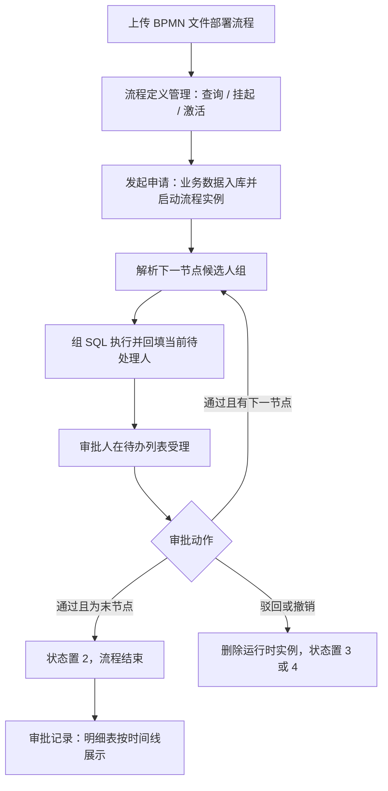

# 审批中心收官：管理员视角、审批记录与整个 HR 项目的全景回望

加班、离职、请假三条流程全部测通，审批中心还剩最后一块拼图：给管理员用的审批栏与审批详情页。这两个入口看似只是换了个查询姿势，背后却牵出实例表与明细表的分工设计。day17 是整个 SaaS-HRM 项目的最后一个教学日，把这块讲完，十七天的内容值得从两头各收一次口：一头收审批中心的全链路，一头收整个项目的技术版图。

## 先给结论

- 管理员的审批栏与员工的审批列表查的是同一张 `proc_instance` 表，区别只有一个：不带任何过滤条件，查全部。
- 审批详情页左侧是申请单数据，右侧是审批记录，记录来自 `proc_task_instance` 明细表，按处理时间排列就是一条完整的审批时间线。
- 审批记录接口是标准的「按流程实例 id 查任务列表」查询，不涉及分页，JPA 方法名派生查询一行就能实现。
- 实例表的当前待处理人字段、明细表的处理记录，全靠发起与提交两个动作主动维护，页面查询永远只碰业务表。
- 项目全景上，十七天覆盖了工程搭建、RBAC 权限、JWT 与 Shiro、POI 报表、图片存储、Jasper、刷脸登录、代码生成器、Zuul 网关、社保考勤薪资与工作流审批，是一条完整的传统行业微服务技术栈。

## 一、管理员审批栏：同一张表，另一种查询姿态

员工侧的审批列表有三个页签（全部、我发起的、待审批），管理员侧的审批栏只有一种形态：查全部，不带条件，用来纵览整个企业的审批进度。数据源没有任何变化，`getProcessInstances` 接口原样复用，条件对象传空即是管理员视角（包名已改为 `com.example`）：

```java
@RequestMapping(value = "/instances/{page}/{size}", method = RequestMethod.POST)
public Result getProcessInstances(@RequestBody ProcInstance procInstance,
                                  @PathVariable int page, @PathVariable int size) {
    //1.调用 service 完成查询，条件对象为空即查全部
    Page pageData = auditService.getProcessInstances(procInstance, page, size);
    //2.构造返回结果
    PageResult pageResult =
        new PageResult(pageData.getTotalElements(), pageData.getContent());
    return new Result(ResultCode.SUCCESS, pageResult);
}
```

这个设计的出发点是把「看数据的视角」收敛成同一个接口的不同入参，而不是为每种角色复制一个接口。员工传自己的 id 查「我发起的」，审批人传待处理人条件查「待我审批」，管理员什么都不传，权限差异交给前端菜单与网关鉴权处理，查询层保持一份代码。

## 二、审批详情与审批记录：实例表之外还要一张明细表

点开任意一单，详情页分成两半。左侧是这单审批的业务数据，申请人、部门、请假类型、起止时间等，与员工端看到的完全一致，只是换了展示形式。右侧是审批记录，这才是新东西：谁在什么时间发起了申请、谁在什么时间审批通过、一共几棒，按时间从上到下排成时间线。

数据来源对应两张业务表。`proc_instance` 存一单的骨架：流程标识、状态、申请人、当前待处理人、业务数据 JSON；`proc_task_instance` 存每一次处理动作的明细。课程实体把明细字段定义得很完整：

```java
@Entity
@Table(name = "proc_task_instance")
public class ProcTaskInstance implements Serializable {
    @Id
    private String taskId;        // 任务实例ID
    private String handleOpinion; // 处理意见
    private Date   handleTime;    // 处理时间
    private String handleType;    // 处理类型（2审批通过；3审批不通过；4撤销）
    private String handleUserId;  // 实际处理用户ID
    private String handleUserName;// 实际处理用户
    private String processId;     // 流程实例ID
    private String taskKey;       // 任务节点key
    private String taskName;      // 任务节点
}
```

审批记录接口是留给练习的，但做法完全确定：前端通过网关发起一个形如 `/instance/tasks/{流程实例 id}` 的 GET 请求，Controller 写一个按流程实例 id 查询任务明细的方法，不涉及分页，直接查表返回。Dao 侧用方法名派生查询即可（以下为练习的参考实现示例）：

```java
public interface ProcTaskInstanceDao
        extends JpaRepository<ProcTaskInstance, String> {
    // 按流程实例 id 查全部明细，按处理时间升序即审批时间线
    List<ProcTaskInstance> findByProcessIdOrderByHandleTimeAsc(String processId);
}
```

一次请假审批落进这张表，就是三行记录：发起一行（`handleType` 为发起）、部门审批通过一行、人事审批通过一行。每完成一棒审批，`commit` 逻辑在办结引擎任务的同时往明细表插一行并保存处理意见，时间线不需要事后计算，查询时排个序就能渲染。

## 三、day17 全链路：从部署文件到审批时间线

把 day17 的所有环节串起来，是一条从配置到数据的完整链路：



图上循环的部分是核心：每推进一棒都回到「解析候选人组」这个动作，组 SQL 重新求值，下一棒的待处理人重新回填。引擎负责流转与任务产生，业务表负责记账与展示，两个世界的连接点就是回填与明细两个写动作。

支撑这条链路的是三张业务表，分工如下：

| 表 | 职责 | 关键字段 |
|---|---|---|
| `proc_instance` | 一单审批的骨架，三个页签与详情页的数据源 | `process_state`、`proc_curr_node_user_id`、`proc_data` |
| `proc_task_instance` | 每一棒审批的处理明细，审批记录时间线 | `process_id`、`handle_type`、`handle_time`、`handle_opinion` |
| `proc_user_group` | 候选人组规则：入参类型加查询 SQL | `param`、`isql` |

组表值得多说一句。不同企业对「谁审批」的要求五花八门，可以把组固化成一张用户组关系表，也可以像这里一样直接存 SQL，执行时按当前上下文求值。存 SQL 的思路把最常变化的审批规则彻底数据化，是这个审批中心最值得带走的设计。

## 四、SaaS-HRM 项目全景：十七天走完一条微服务栈

站在项目出口回望，十七个教学日不是零散知识点的堆积，而是围绕「一套传统行业多租户 HR 系统」逐层展开：

| 主题块 | 教学日 | 关键技术 |
|---|---|---|
| 系统概述与工程搭建 | day01 至 day02 | 需求分析、数据库设计、父工程、分布式 id、统一返回与异常、跨域 |
| 用户权限体系 | day03 至 day06 | RBAC 模型、JWT、前端路由权限、Shiro 认证授权、Redis 会话 |
| 员工与报表 | day07 至 day10 | POI 导入导出、百万数据 SXSSF、图片上传云存储、JasperReports PDF |
| 刷脸登录 | day11 | 二维码轮询、人脸注册比对、云端 AI 接口 |
| 代码生成器 | day12 至 day13 | 元数据、FreeMarker 模板、代码自动生成 |
| 网关与业务模块 | day14 至 day15 | Zuul 动态路由与过滤器、统一鉴权、社保、考勤归档 |
| 薪资与工作流 | day16 至 day17 | 多数据源、Activiti 工作流、组表审批中心 |

这条脉络有两个反复出现的母题。一是「多租户」：从表设计带 company_id，到流程部署打 tenantId，隔离意识贯穿所有模块。二是「前后端分离下的契约」：统一返回结构、统一异常处理、网关统一鉴权，让十几个微服务在同一个约定下协作。往后做任何一套企业级系统，这两件事仍然是绕不开的第一课。

## 常见误区

- **给管理员审批栏偷偷加默认条件**：比如顺手带上当前登录人过滤，结果管理员只能看到自己的单子。这个入口的语义就是无条件查全部，任何默认过滤都违背它的定位。
- **审批记录不排序直接渲染**：明细表按主键查询返回的顺序不保证与业务顺序一致，必须按 `handle_time` 升序（必要时补发起记录的排序权重），时间线才会稳定。
- **只建明细表不维护回填字段**：发起与提交时漏更新 `proc_curr_node_user_id` 与 `proc_curr_node_user_name`，待审批页签基于这两个字段过滤，一漏就整列表查不出数据。
- **明细表漏记 `handle_type`**：通过、驳回、撤销混在一起，时间线上看不出哪一棒否决了流程，事后想统计驳回率也无从下手。

## 面试可能被问到的问题

1. 面试官追问：「整个 SaaS-HRM 项目里，你认为最值得复用到新项目的设计是什么？」
   答：审批中心的组表机制。流程节点只挂组名，组表存入参类型与候选人查询 SQL，代码做统一的取组、换参、执行、回填。它把「谁审批」这种最易变的规则从代码挪进数据，新增流程不改代码，这套思路直接可以搬到任何带审批链的业务系统。

2. 面试官追问：「审批页面为什么查业务表，而不直接查 Activiti 的运行时表？」
   答：三点原因。Activiti 表在独立库，跨库关联成本高；运行时表结构面向引擎而非业务，展示申请人、部门、单据摘要都要额外关联；流程结束后运行时数据被清理，历史追溯还得换表。业务表里冗余一份「现在轮到谁」与处理明细，页面查询简单直接，引擎表只服务流转。

3. 面试官追问：「多租户隔离在流程引擎里怎么落地？」
   答：部署环节把企业 id 作为 `tenantId` 写进部署对象，同一个流程定义可以按租户隔离出多份；发起与任务查询时按租户过滤。业务表侧每张表带 `company_id` 字段，两层配合保证租户数据互不可见。

4. 面试官追问：「审批记录已经有引擎的历史表了，业务侧再存一份明细算不算冗余？」
   答：是有意为之的冗余。引擎历史表面向审计与追溯，字段面向流程语义；业务明细表面向页面渲染与统计，存了处理类型、处理意见、处理人姓名这类展示友好字段。读写路径完全不同，这点冗余换来查询的简单与稳定，是划算的。

5. 面试官追问：「这个项目的权限控制一共分了几层？」
   答：四层。前端按菜单与按钮控制可见性；网关统一校验 JWT 并把用户信息透传给下游；各微服务用 Shiro 完成认证与授权；数据层再按租户与部门做隔离。无状态的 JWT 让服务间不需要会话共享，配合 Redis 的会话管理方案兜底登出与续期场景。

## 配套资料

- 流程实例实体（管理员审批栏与详情页的数据源字段）：`materials/code/02/day17 审批中心/day17/03-资料/02搭建环境代码/entity/ProcInstance.java`
- 任务明细实体（审批记录时间线的字段来源）：`materials/code/02/day17 审批中心/day17/03-资料/02搭建环境代码/entity/ProcTaskInstance.java`
- 流程部署与 Controller 基础代码：`materials/code/02/day16 薪资管理与工作流概述/day16/03-资料/04审批代码/ihrm_audit/src/main/java/com/ihrm/audit/service/ProcessService.java` 与 `materials/code/02/day16 薪资管理与工作流概述/day16/03-资料/04审批代码/ihrm_audit/src/main/java/com/ihrm/audit/controller/ProcessController.java`
- 组表机制相关（组实体、Dao 与种子数据）：`materials/code/02/day17 审批中心/day17/03-资料/02搭建环境代码/entity/ProcUserGroup.java`、`materials/code/02/day17 审批中心/day17/ihrm.sql`
- 三条流程的 BPMN（请假、加班、离职，部署与对照用）：`materials/code/02/day17 审批中心/day17/03-资料/所有的流程bpmn文件/`
- 审批记录查询接口与 Dao 示例为本课练习补全（课程原资料未含该段代码），写法与上文一致
