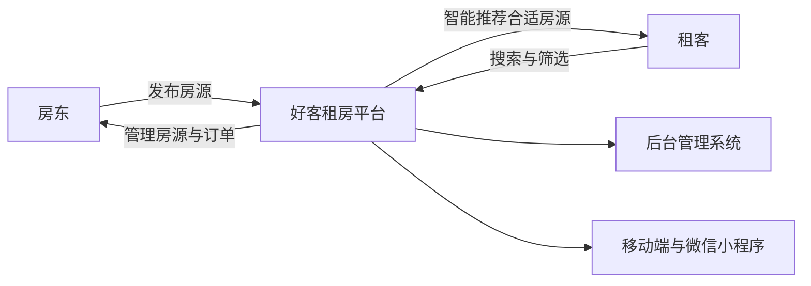

# 好客租房开课：一个生活服务平台的全景导览，以及为什么第一课是 ES6

进入一个新项目，最先要回答的问题不是「代码怎么写」，而是「这个系统为谁解决什么问题，我为什么要先学一堆看起来和后端无关的东西」。好客租房是本阶段的生活服务类项目：一个连接房东与租客的直连平台。它的技术栈横跨前后端，而后端工程师第一周要啃的却是 ES6 与 React，这个安排让不少人心里打鼓，值得先把账算清楚再上路。

## 先给结论

- 业务上，好客租房做的是「去中介化」：房东发布房源，租客直接找房，平台提供智能推荐，砍掉中间环节费用，提高匹配成功率。
- 架构上，项目按 SOA 思想组织服务，后端是微服务全家桶，前端是 React 体系，覆盖移动端、微信小程序、后台管理三端。
- 全程技术密度高：RPC、大数据检索、消息队列、图数据库式存储都会真实落地，不是玩具项目。
- 第一课学 ES6 是硬依赖：后台管理系统前端选型 React，而 React 代码大量使用 ES6 语法，不先补 ES6 就读不懂后续每一行组件代码。
- 已熟练掌握 ES6 的读者可以跳过第一部分，直接从 React 入门开始，课程结构为此留了口子。

## 一、业务全景：把中介环节从租房流程里拿掉

租过房的人都清楚传统流程的痛点：找中介、付中介费、房源信息真假难辨。好客租房的定位就是把这一层平台化，让信息的生产者（房东）与消费者（租客）直接见面：



图里平台承担三件事：承接房东的房源发布、为租客提供检索与智能推荐、用后台与移动端两类界面分别服务管理与消费场景。所谓智能推荐，本质是把房源数据、用户行为数据用检索与计算引擎组织起来，这也是后面若干天课程的重头戏。

## 二、技术版图：一门课把主流中间件串起来

项目整体采用 SOA 思想设计，也就是把系统能力拆成一个个可独立发布、可互相调用的服务，后续章节会专门展开这个概念。从整个教学日的安排反推，这门课的技术清单相当长：

| 层面 | 涉及技术 | 对应教学日 |
|---|---|---|
| 前端 | ES6、React、Ant Design 与 Ant Design Pro | day01 至 day02 |
| 服务实现 | Spring Boot、Spring MVC、MyBatis 与 MyBatis-Plus | day04 |
| 服务治理 | Dubbo（RPC 调用）、阿里云 OSS、GraphQL | day05 至 day06 |
| 实时与即时通讯 | WebSocket、MongoDB 微聊 | day07 至 day08 |
| 消息队列 | RocketMQ 入门与集群 | day09 至 day10 |
| 搜索与日志 | Elasticsearch 全家桶、房源数据抓取与搜索 | day13 至 day16 |
| 存储与部署 | MySQL 集群（主从、PXC、MyCat）、服务集群发布 | day17 至 day18 |

一句话概括：后端是 Spring Boot 体系加微服务治理，前端是 React 体系，中间用 RPC、消息队列、搜索引擎这些大数据量平台常见件撑住「房源检索」这类核心场景。这个项目做完，中型互联网公司主流技术栈基本都能对上号。

## 三、为什么第一课是 ES6 而不是业务

顺序问题是这门课最容易被问到的点。逻辑链其实很短：后台管理系统的前端选了 React，React 的组件写法建立在 ES6 语法之上，所以 ES6 是阅读全部后续代码的门票。讲义里预埋的一段示例很能说明问题（按可运行写法整理）：

```javascript
class User {
    constructor(name, age = 20) { // 构造方法，参数带默认值
        this.name = name;
        this.age = age;
    }
    sayHello() {
        return `hello, ${this.name}`; // 模板字符串
    }
    static isAdult(age) { // 静态方法
        return age >= 18 ? "成年人" : "未成年人";
    }
}
class ZhangSan extends User { // 继承
    constructor(name, age, address) {
        super(name, age); // 调用父类构造
        this.address = address;
    }
}
```

类、默认参数、模板字符串、静态方法、继承，这五样在后端语言里都是老朋友，但它们在 JavaScript 里的写法就是 ES6 定下的。React 组件声明、props 解构、模块导入导出，全都建立在这套语法上。

对后端工程师还有一层现实理由：不做前端，但免不了和前端协作。前端代码里满屏的 ES6 与框架语法，看不懂就没法联调接口、没法读对方的数据结构，对接工作根本开展不了。所以 ES6 在这门课里的定位不是「前端选修」，而是后端的必修课。

## 四、day01 的学习路线

第一天的内容分两块：ES6 新特性、React 入门。ES6 部分从语法逐个击破，React 部分从前端开发模式的演变讲到组件化思想，再动手写第一个组件。时间紧的读者有一条明确的自检线：`let` 与 `const`、箭头函数、解构赋值、模板字符串、`import` 与 `export`、`class` 与 `extends`，这六样如果能不假思索地写出来，第一部分可以整段跳过，直接进 React；但凡有一样含糊，就老老实实跟一遍，后面每一天的代码都在用它们。

## 常见误区

- **把 ES6 当成另一门语言**：ES6 是 JavaScript 语言标准的第六版，不是新语言，学的是同一门语言的现代化写法，心智负担远小于从零学外语。
- **认为后端可以跳过前端课**：这个项目后端要为三端供接口，联调、排查、看前端报错都绕不开读前端代码，跳过的成本会在项目中期加倍偿还。
- **把 SOA 与微服务对立理解**：SOA 是服务化的架构思想，微服务是它的一种落地形态，课程先用 SOA 思想组织服务，再按微服务的方式实施，两者是承接关系不是二选一。

## 面试可能被问到的问题

1. 面试官追问：「好客租房这类平台为什么适合用微服务而不是单体？」
   答：房源检索、即时通讯、消息推送、文件存储这些能力负载特征完全不同，检索要吃搜索引擎，通讯要长连接，拆成独立服务才能按各自的量级独立扩容与部署，单体应用做不到这种弹性。

2. 面试官追问：「SOA 和微服务是什么关系？」
   答：SOA 是面向服务的架构思想，强调按业务能力拆分服务、通过标准接口通信；微服务是 SOA 思想在轻量级协议、独立部署、去中心化治理方向上的一种具体实践。可以理解为思想与形态的继承关系。

3. 面试官追问：「为什么这个项目后台管理选 React，而不是其他前端框架？」
   答：React 组件模型简单，生态成熟，配合 Ant Design 这类企业级组件库非常适合快速搭后台管理系统；同时 React 与 ES6 绑定紧密，掌握 ES6 后上手成本可控，这对以后端为主的学员是务实的选择。

4. 面试官追问：「一个生活服务平台里， Elasticsearch 和 RocketMQ 分别解决什么问题？」
   答：Elasticsearch 解决房源多条件、全文检索与聚合统计的查询性能问题，这类查询关系库很难扛；RocketMQ 解决服务间异步解耦与削峰，比如房源变更后同步索引、通知下游，用消息把可异步的环节摘出去。

## 配套资料

- 本教学日资料包暂无配套源码（`materials/code/03/day01-ES6新特性以及ReactJS入门/`），文中代码示例为按本课课件写法补全
- 后续教学日的资料根目录（可提前浏览整体结构）：`materials/code/03/`
- 「技术版图」表格里的教学日命名均来自该目录，与课程真实章节一一对应
