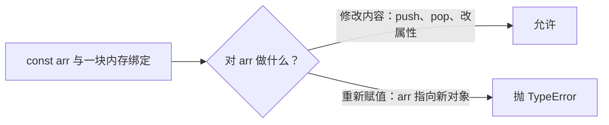

# 循环结束后还能访问 i：用 let 与 const 把变量作用域管起来

用 `var` 写一个普通的 for 循环，循环结束后到循环外打印 `i`，控制台不报错，还稳稳输出一个 5。变量明明是在循环里声明的，为什么外面拿得到？因为 `var` 的作用域不受代码块约束，声明还会被提升，一个循环计数器就这样悄悄挂到了全局上。函数一长、协作一多，这种泄漏的变量迟早和后面的同名变量互相覆盖，而且极难排查。

ES6 给出了两个替代品：`let` 管住作用域，`const` 管住常量。用建一个静态 Web 工程、写一个 `index.html`、开浏览器控制台的成本，就能把这两个关键字的行为全部复现出来。

## 先给结论

- `var` 声明的变量属于函数作用域甚至全局作用域，for 循环头里声明的 `i`，循环结束后依然可访问，这就是「变量莫名其妙成为全局变量」的根源。
- `let` 声明的变量只在所在代码块 `{}` 内有效，出了块访问直接抛 `ReferenceError: i is not defined`。
- `const` 声明的是常量，绑定关系不可重新赋值，语义类似 Java 的 `final`，重新赋值抛 `TypeError: Assignment to constant variable`。
- `let` 与 `const` 不做 `var` 那种「提升并初始化为 undefined」的处理，声明语句之前是暂时性死区，访问即报错。
- 新代码一律用 `let` 与 `const`，把 `var` 留给读懂老代码这一件事。

## 一、先复现 var 的坑

环境很简单：建一个静态 Web 工程，放一个 `index.html`，页面里加一个 `<script>` 标签（正式写页面时脚本建议放到 `<head>` 里，而不是 `body` 尾部），浏览器打开页面后按 F12 看控制台。课堂演示代码就是这一段：

```javascript
for(var i = 0; i < 5; i++) {
    console.log(i);
}
console.log("循环外：" + i);
```

控制台先输出 0 到 4，最后一行没有任何报错，输出「循环外：5」。按直觉 `i` 应该随着循环结束而消失，实际上它还活着。原因在于 `var` 声明的变量属于函数作用域，不在函数里时就是全局作用域，循环块的那对 `{}` 根本圈不住它。课件对 `var` 的评价很直白：定义的变量有时会莫名其妙地成为全局变量。

这个坑在真实项目里的形态是：两段逻辑都用 `i` 做计数，前一段把 `i` 改了，后一段接着用，数据就串了，而且排查时很难想到元凶是几十行外的一个循环。

## 二、let：把变量锁进代码块

把上面代码里的 `var` 全部换成 `let`：

```javascript
let i = 0;
for(let i = 0; i < 5; i++) {
    console.log(i);
}
console.log("循环外：" + i);
```

刷新页面，控制台输出 0 到 4 之后立刻抛出 `Uncaught ReferenceError: i is not defined`。`let` 的定义一句话就能说完：所声明的变量，只在 `let` 命令所在的代码块内有效。循环块的 `{}` 一关闭，`i` 的绑定随之销毁，外面自然找不到。这正是想要的效果：循环计数器的生命周期，就该和循环体一样长。

有一个编辑器细节值得记录：把 `var` 改成 `let` 后，IDEA 会标红提示报错。这不是代码写错了，而是工程的语言级别还停在 ES5，`let` 这个关键字在 ES5 里不存在，编辑器按旧语法做检查才报错。把语言级别切到 ES6，标红即消失；运行结果以浏览器控制台为准，浏览器执行时并不会有问题。

两种声明方式的行为差异，可以画成两条路径：


关键差异在左侧那条链：`var` 把声明提升到全局，块结构形同虚设；右侧 `let` 把声明、使用、销毁全部关在同一个块里，泄漏通道被彻底堵死。

## 三、const：常量，赋值之后不许再改

`const` 的语义是声明常量：一旦初始化，这个变量名与内存地址的绑定关系不能再变，这一点和 Java 的 `final` 很像。课堂演示：

```javascript
const str = "abc";
console.log(str);   // abc

str = "123";        // 抛 Uncaught TypeError: Assignment to constant variable
console.log(str);
```

第一行正常输出 `abc`，执行到重新赋值那一句时浏览器抛出 TypeError，后面的代码不再执行。报错发生在运行时的赋值语句上，而不是声明时：`const` 要求声明的同时必须初始化，只写 `const str;` 会直接语法报错；初始化完成之后，任何对 `str` 的重新赋值都是非法的。

**第一，const 锁的是绑定，不是值。** 这是最容易被追问的点：

```javascript
const arr = [1, 2];
arr.push(3);        // 合法，数组内容变了
arr = [4, 5];       // 非法，绑定不可重新赋值
```

`arr` 指向的那块内存不能换，但数组本身的内容可以继续增删。想做到对象级只读，需要配合 `Object.freeze()`。绑定与值的关系可以这样看：



图上分叉点就是判断标准：动「内容」走左路合法，动「绑定」走右路报错。

## 四、原理：变量提升与暂时性死区

**第一，var 是「提升并初始化」。** 引擎把 `var` 声明挪到所在作用域顶部并赋值为 `undefined`，所以声明之前访问得到的是 `undefined` 而不是报错。问题恰恰被这个 `undefined` 掩盖了：用了不该用的变量，程序不炸，只是算错。

**第二，let 与 const 是「提升但不初始化」。** 从进入作用域到执行声明语句之间的区域，叫暂时性死区（TDZ），期间访问该变量一律抛 `ReferenceError`。这个设计把「用了未声明的变量」从静默 bug 变成了显式报错，宁可在开发阶段炸出来，也不留到线上悄悄算错。

**第三，循环里的 let 每轮都是新绑定。** for 循环头用 `let` 声明时，每一轮迭代都会创建一个全新的 `i`，经典面试题「循环里放 setTimeout，为什么换成 let 就能依次打印 0 到 4」的原理就藏在这里。

## 常见误区

- **以为 let 也有 var 式提升，声明前可以先访问。** 实际声明前处于暂时性死区，`console.log(x); let x = 1;` 直接抛 `ReferenceError: Cannot access 'x' before initialization`。
- **以为 const 对象的属性也改不了。** `const` 只约束绑定，`const obj = {}; obj.name = "张三"` 完全合法；需要对象级只读用 `Object.freeze()`。
- **看到 IDEA 标红就以为代码错了。** 语言级别低于 ES6 时编辑器会对 `let`、`const` 报错，把项目语言级别切到 ES6 即可，实际执行以浏览器为准。
- **同一作用域用 let 重复声明同一个名字。** `let a = 1; let a = 2;` 抛 `SyntaxError`，而 `var` 重复声明静默通过；迁移老代码到 let 之后报错变多，多数是这个原因。

## 面试可能被问到的问题

1. 面试官追问：「let、const、var 三者的区别是什么？」
   答：作用域上，var 是函数作用域，let 与 const 是块级作用域；提升上，var 提升并初始化为 undefined，let 与 const 存在暂时性死区；重复声明上，var 允许，let 与 const 在同一作用域禁止；const 还额外约束绑定不可重新赋值。

2. 面试官追问：「什么是暂时性死区？」
   答：进入块级作用域后，从作用域开头到 let 或 const 声明语句执行之间的区域。期间访问该变量一律抛 ReferenceError，即使外层存在同名变量也一样。它的价值是把「声明前使用」从静默错误变成显式报错。

3. 面试官追问：「const 声明的对象还能修改属性吗？」
   答：能。const 约束的是变量名到内存地址的绑定不可变，对象内部属性、数组元素都可以继续增删改，只有对变量本身重新赋值才抛 TypeError。需要深度只读时用 Object.freeze。

4. 面试官追问：「循环里用 var 配 setTimeout 为什么打印五个 5，换成 let 就正常？」
   答：var 在全局或函数里只有一个 i，回调真正执行时循环早已结束，读到的都是 5。let 在每轮迭代创建一个新绑定，闭包捕获的是各自那一轮的 i，于是依次打印 0 到 4。

5. 面试官追问：「工程实践里默认用 const 还是 let？」
   答：推荐默认 const，只有确定会被重新赋值时才退回 let。循环计数器、累加器、后续会被替换的临时变量属于 let 的合理场景；其余声明一旦用 const，误赋值在运行时立刻暴露，等于多了一层免费的保护。

## 配套资料

- 本教学日资料包暂无配套源码（`materials/code/03/day01-ES6新特性以及ReactJS入门/` 下仅收录到空的解压清单），文中示例为按本课写法补全的可运行代码，复制到任意 HTML 的 `<script>` 标签中即可在浏览器控制台复现全部输出与报错
