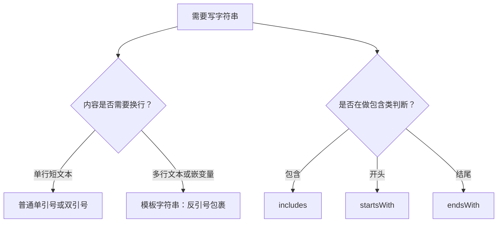

# 判断包含、开头、结尾一行搞定：ES6 给字符串加的三个方法与模板字符串

ES5 时代判断「一个字符串里有没有某个词」，得写 `str.indexOf("es6") !== -1`，返回值是下标还是负一，读代码的人要在脑子里转一圈。往字符串里塞一段带换行的文本更麻烦：普通引号里直接敲回车，控制台立刻抛语法错误，只能靠 `\n` 和 `+` 拼出一片天书。ES6 针对字符串类型做了一轮扩展，一个方向是新增几个判断方法，另一个方向是提供字符串模板这种新的书写格式。两件事都不大，但每天都能省下时间。

## 先给结论

- `includes(s)` 判断是否包含，`startsWith(s)` 判断是否以 s 开头，`endsWith(s)` 判断是否以 s 结尾，三者都返回布尔值，语义和 Java 的同名方法一致。
- 模板字符串用反引号 `` ` `` 包裹，反引号之间可以任意换行，多行文本不再需要 `\n` 与 `+` 拼接。
- 模板字符串支持 `${表达式}` 插值，变量和运算结果可以直接嵌进文本里。
- 同一批进入 ES6 的还有 `repeat(n)`，把一个字符串重复 n 遍，拼分隔线、造测试数据很顺手。
- 老写法 `indexOf(s) !== -1` 可以放心替换成 `includes(s)`。

## 一、三个判断方法：把 indexOf 的脑筋急转弯换掉

三个方法各管一种判断，返回值全是布尔值：

| 需求 | 方法 | 返回值 |
|---|---|---|
| 是否包含某串 | `str.includes(s)` | boolean |
| 是否以某串开头 | `str.startsWith(s)` | boolean |
| 是否以某串结尾 | `str.endsWith(s)` | boolean |

课件上给出的验证代码如下（示例串已换成中性文本），放进页面 `<script>` 标签，浏览器控制台就能看到全部结果：

```javascript
let str = "hello es6";
console.log(str, "中是否包含了 es6", str.includes("es6"));
console.log(str, "中是否包含了 java", str.includes("java"));
console.log(str, "中是否以 hello 开头", str.startsWith("hello"));
console.log(str, "中是否以 es6 开头", str.startsWith("es6"));
console.log(str, "中是否以 hello 结束", str.endsWith("hello"));
console.log(str, "中是否以 es6 结束", str.endsWith("es6"));
```

控制台输出六行，true 与 false 一目了然：

```text
hello es6 中是否包含了 es6 true
hello es6 中是否包含了 java false
hello es6 中是否以 hello 开头 true
hello es6 中是否以 es6 开头 false
hello es6 中是否以 hello 结束 false
hello es6 中是否以 es6 结束 true
```

写过 Java 的人对这套语义零学习成本：`startsWith` 与 `endsWith` 和 Java 的 `String` 同名方法完全对应，`includes` 对应的则是 `contains`。判断「包不包含」从此不再需要拿下标做算术。

## 二、痛点现场：字符串里敲个回车都报错

模板字符串解决的是一个看起来不起眼的问题：普通引号定义的字符串不允许直接换行。在控制台里敲下面这段，回车的瞬间就会抛错：

```javascript
let str2 = "abc
123";
// Uncaught SyntaxError: Invalid or unexpected token
```

单引号和双引号都一样，字符串字面量里不允许出现裸换行。ES5 只有两条路：要么用 `\n` 表示换行，要么把长文本切成几段用 `+` 拼接：

```javascript
let str2 = "abc\n123";          // 转义换行
let str3 = "第一段文字" +        // 分段拼接
    "第二段文字";
```

文本一长，转义符和加号混在一起，读起来非常费劲，改一个换行位置都得数引号。

## 三、模板字符串：反引号之间随便换行

ES6 提供的解法是字符串模板：用一个反引号 `` ` `` 作为标记，两个反引号之间的所有内容都属于这个字符串，换行可以随意敲：

```javascript
let tpl = `
hello
es6
template
`;
console.log(tpl);
```

控制台输出的就是原样的多行文本，空行、缩进都保留。要注意这个符号不是单引号，它在键盘左上角、数字 1 的左边、Esc 的下方，英文叫 backtick，中文常称反引号。

在控制台反复实验时还有一个小插曲：`let str` 这样的声明敲了两遍，会看到 `Identifier 'str' has already been declared`。这正是上一课讲过的规则在起作用，`let` 不允许同一作用域重复声明，刷新页面或者换个变量名就能继续。

什么场景用哪种写法，可以按需求对号入座：



两条判断线互不干扰：定义字符串时按「要不要换行」选书写格式，做判断时按「包含、开头、结尾」三选一。

## 四、插值与 repeat：模板字符串的进阶用法

模板字符串真正的杀手锏是插值：`${}` 里可以放任意表达式，值直接嵌进文本。这对后续 React 课程里拼页面文案是日常操作：

```javascript
let name = "好客租房";
let count = 25;
let info = `项目：${name}
房源数量：${count}`;
console.log(info);
// 项目：好客租房
// 房源数量：25
```

同一批带给字符串的还有 `repeat(n)`，把字符串重复 n 遍：

```javascript
console.log("-".repeat(30));   // 30 个连字符，一行分隔线
console.log("ab".repeat(3));   // ababab
```

拼日志分隔线、生成占位测试数据时，它比手写循环干净得多。

## 常见误区

- **把反引号打成单引号。** 单引号里敲回车照样抛语法错误，很容易让人误以为模板字符串没生效。先确认符号是数字 1 左边的反引号，再确认首尾成对。
- **以为多行模板里的缩进不算内容。** 反引号之间所有空格与换行都会原样进入字符串值，代码里为了对齐敲的缩进会跟着输出。需要干净文本时顶格书写，或输出前调 `trim()`。
- **把 includes 当成支持正则或忽略大小写。** 三个方法都按字面量、区分大小写匹配，传正则会先被转成字符串。忽略大小写比较要先把两边 `toLowerCase()`。
- **记错 startsWith 与 endsWith 第二个参数的语义。** `startsWith(s, n)` 表示从下标 n 开始判断；`endsWith(s, n)` 却是「只看前 n 个字符内是否以 s 结尾」，方向相反，用错会得到相反的结论。

## 面试可能被问到的问题

1. 面试官追问：「includes 和 indexOf 有什么区别？」
   答：indexOf 返回首次出现的下标，找不到返回 -1，判断包含时要手写比较，且对 NaN 这类特殊值无能为力；includes 直接返回布尔值，语义明确，内部按 SameValueZero 算法比较，能正确识别 NaN。单纯判断是否包含时，includes 是更好的选择。

2. 面试官追问：「模板字符串和普通字符串有什么本质区别？」
   答：书写上模板字符串用反引号包裹，允许直接换行；能力上支持 `${}` 插值，表达式在定义时求值并转成字符串嵌入。普通字符串里的换行必须转义，拼接变量只能靠加号，模板字符串相当于把拼接语法彻底消灭在语言层面。

3. 面试官追问：「startsWith 和 endsWith 的第二个参数分别是什么含义？」
   答：startsWith 的第二个参数指定从哪个下标开始查找；endsWith 的第二个参数是截断长度，表示只看前 n 个字符。两者方向相反，endsWith 尤其容易记错，实际编码时建议传参前先想清楚判断窗口在哪一段。

4. 面试官追问：「${} 里面能写什么？」
   答：任意合法表达式，变量、算术运算、函数调用、三元表达式都可以，求值结果按 ToString 规则转成字符串。嵌套模板字符串也合法，但在可读性变差时要克制。

5. 面试官追问：「repeat 传 0、小数、负数分别会怎样？」
   答：传 0 返回空字符串；小数会被按整数截断处理，比如 repeat(2.5) 等价于 repeat(2)；负数直接抛 RangeError，因为重复次数不可能为负。

## 配套资料

- 本教学日资料包暂无配套源码（`materials/code/03/day01-ES6新特性以及ReactJS入门/`），文中示例为按本课写法补全的可运行代码，判断方法与模板字符串两段均可直接粘贴到 HTML 的 `<script>` 标签里在浏览器控制台验证；课件示例中的演示串已替换为中性文本
