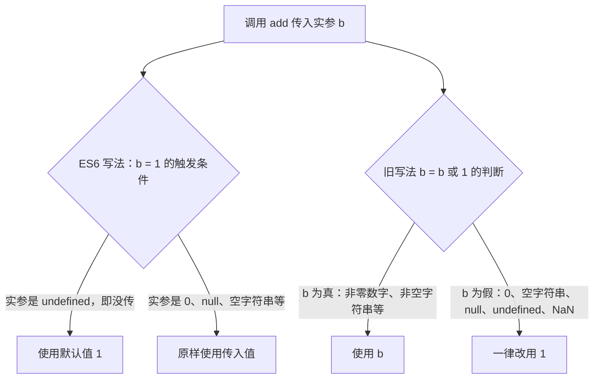
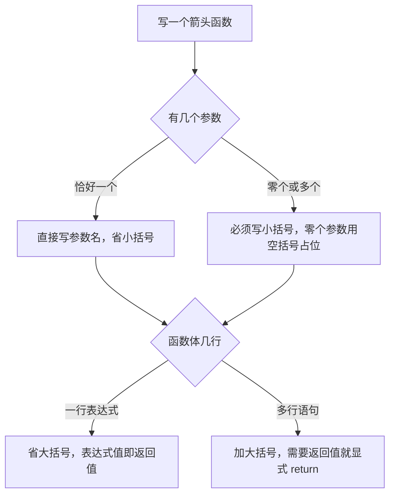
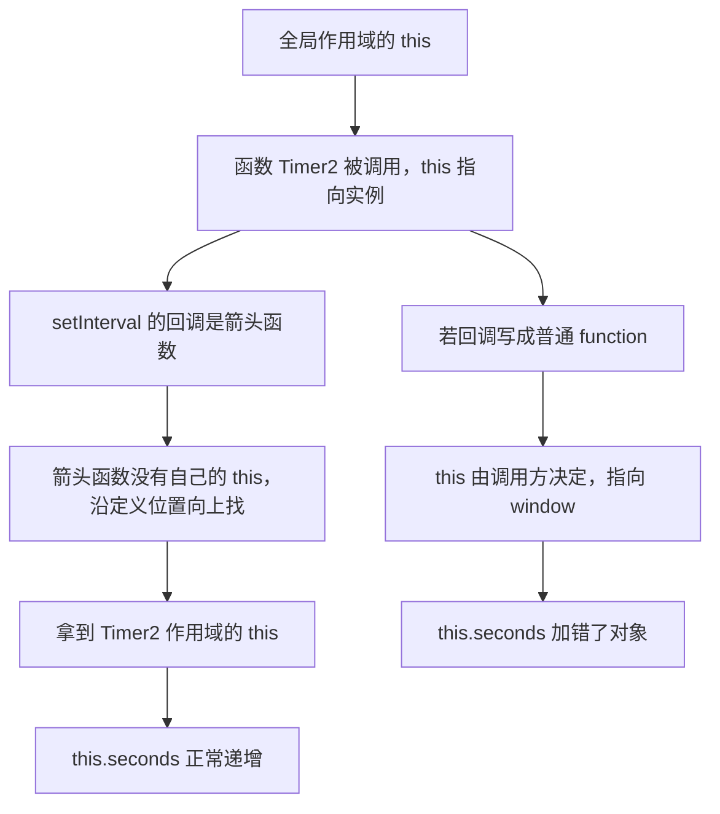
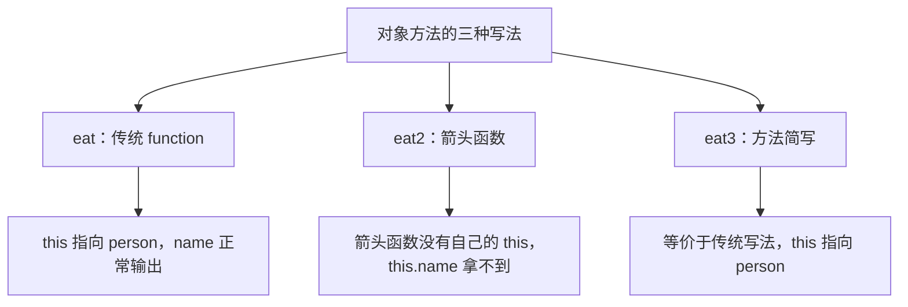

# ES6新特性之函数优化：参数默认值、箭头函数与解构组合三连

## 先给结论

- 系列定位：ES6 函数优化的三连小课，从参数默认值到箭头函数再到组合技，是后续 React 组件写法的语法地基。
- 参数默认值：ES6 直接写在形参上（`function add(a, b = 1)`），只在实参为 undefined 时生效；`b = b || 1` 这类 ES5 补丁会把 0、空字符串、false 全当缺参，两者本质不同。
- 默认值是每次调用重新求值的表达式，可以引用前面的形参；默认值不会保护它前面的参数，缺参照样得到 NaN。
- 箭头函数省的是写法换的是 this：单参数可省小括号、单表达式可省大括号与 return；它没有自己的 this 与 arguments，不能当构造函数，this 取定义处外层作用域。
- 对象方法不要写成箭头函数：箭头函数的 this 不指向对象，方法简写（省掉 function 关键字）才是与普通函数等价的写法。
- 箭头函数参数位可以直接写解构模式（`({name}) => ...`），与参数默认值叠加可给字段兜底；对 null 解构直接抛 TypeError，整个模式可再设默认值 `{}`。
- 全系列示例可粘贴到 HTML 的 script 标签在浏览器控制台验证，该教学日资料包暂无配套源码。
- 方法简写、箭头函数、解构参数的组合写法正是 React 组件处理 props 的标准形态，学完直接为组件课铺路。

## 第1部分：参数可传可不传：ES6 函数参数默认值，替掉 b = b || 1

写一个两数相加的函数，调用方却经常只传第一个参数，第二个参数希望「不传就用默认值」。ES5 里这个需求要靠 `if` 判断或 `||` 短路来打补丁，写法绕、坑还多。ES6 把默认值做成了正式语法，直接写在形参上。这是函数优化系列的第一课，后面 React 组件的函数写法全都建立在它上面。

### 一、需求现场：不传参的 add 返回 NaN
课程从一个最简单的函数开始：

```javascript
function add(a, b) {
    return a + b;
}
console.log(add(10, 1));   // 11
console.log(add(10));      // NaN
```

`add(10, 1)` 输出 11 没有任何悬念。新的需求是 b 可传可不传，不传时默认按 1 处理。直接少传一个参数试试，结果不是报错而是 `NaN`：没传的 b 是 `undefined`，`undefined` 参与加法运算得到 `NaN`。JavaScript 对缺参非常宽容，宽容到把错误悄悄咽了下去，这正是需要默认值机制的原因。

### 二、ES6 之前的两种补丁
**第一种，显式判断。** 判断 b 有没有值，没有就赋成 1：

```javascript
function add(a, b) {
    if(!b) {
        b = 1;
    }
    return a + b;
}
console.log(add(10));      // 11，不传时用默认的 1
console.log(add(10, 2));   // 12，传了就用传入值
```

**第二种，短路写法。** 利用 `||` 的求值规则：左边为真直接返回左边，为假返回右边：

```javascript
function add(a, b) {
    b = b || 1;
    return a + b;
}
```

两段代码运行结果一致，课件也明确说明 ES6 以前无法直接给参数设默认值，只能采用这类写法。但这两种补丁都不灵活：判断逻辑挤在函数体里，三行才表达一件事；而且 `!b` 与 `b || 1` 都是按「真假」判断，把 0、空字符串、null、undefined、NaN 一股脑当成「没传」。传 0 进来本想算 `10 + 0`，结果被当成缺参，算出 11。两种写法的行为可以对照着看：



看右侧分支就能发现问题：旧写法把「假值」与「没传」混为一谈，ES6 把二者严格区分开。

### 三、ES6 的正式写法：默认值写在形参上
ES6 允许在形参声明处直接给默认值：

```javascript
function add(a, b = 1) {
    return a + b;
}
console.log(add(10));      // 11，b 未传，使用默认值 1
console.log(add(10, 5));   // 15，b 传了 5
console.log(add(10, 0));   // 10，0 是合法实参，不会被默认值覆盖
```

一行声明，意图清晰，函数体里不再混杂默认值逻辑。语义上的关键差别再强调一遍：默认值只在实参严格等于 `undefined` 时启用。想故意跳过某个参数让后面的默认值生效，只能显式传 `undefined` 占位，传 `null` 是不行的。

默认值还可以是表达式，并且是惰性求值：每次调用时才计算，计算过程中能引用排在它前面的形参：

```javascript
function add(a, b = a + 1) {
    return a + b;
}
console.log(add(10));   // 21，b 默认取 a + 1
```

### 四、默认值与解构结合：直接拆对象参数
把解构模式写进形参，再配上默认值，是实际项目里最常见的组合。上一课的 `person` 对象直接传进来：

```javascript
const person = {
    name: "jack",
    age: 21
};
function show({name, age = 20}) {
    console.log(`${name} 今年 ${age} 岁`);
}
show(person);   // jack 今年 21 岁
show({});       // undefined 今年 20 岁
```

形参的 `{name, age = 20}` 就是对实参对象做解构，`name` 按属性名取值，`age` 取不到时走默认值 20。模板字符串顺手完成拼接。整个对象本身也可以设默认值，连实参都不传时整个解构模式退回 `{}`：

```javascript
function greet({name = "匿名"} = {}) {
    console.log(`你好，${name}`);
}
greet();                 // 你好，匿名
greet({name: "jack"});   // 你好，jack
```

外层 `= {}` 兜住「连对象都没传」的情况，内层 `name = "匿名"` 兜住「对象里没有 name」的情况，两层默认值各管一层。调用接口封装、React 组件的 props 处理，用的都是这套双层兜底结构。

## 第2部分：箭头函数：省略的是写法，换掉的是 this

定义一个打印参数的小函数，ES5 的固定开销是 `function` 关键字、函数体大括号加 `return`，两行逻辑摊成四行。ES6 引入箭头函数，把定义压缩成「参数 => 函数体」；字符变少只是一半，另一半更关键：`this` 不再看谁调用，而是看它定义在哪。React 时代的组件与回调几乎全是箭头函数，这套规则是绕不开的地基。

### 一、传统写法与箭头写法对照
课程用同一个「打印参数」的函数做对照。传统写法：

```javascript
function print(a) {
    console.log(a);
}
print(123);   // 123
```

同样的逻辑，箭头函数一行完成：

```javascript
let print2 = a => console.log(a);
print2(456);   // 456
```

拆开看这一行：`print2` 是函数名（一个 `let` 变量），`a` 是参数，`=>` 是箭头，后面的 `console.log(a)` 是函数体。没有 `function` 关键字，没有大括号，也没有 `return`，因为单表达式函数体会把这个表达式的值自动作为返回值交出去。

### 二、三种参数形态，括号各有规矩
**一个参数：括号可以省。** `a => console.log(a)` 直接写参数名，这是箭头函数最具辨识度的形态。

**多个参数：括号必须回来。** 参数放进小括号里，用逗号分隔：

```javascript
let sum = (a, b) => console.log(a + b);
sum(10, 5);   // 15
```

**没有参数：空括号占位。** 参数位置语法上必须有东西，没有参数就放一个空小括号：

```javascript
let sayHello = () => console.log("hello");
sayHello();   // hello
```

三种参数形态加上函数体行数，整理成一棵省略决策树：



拿课上四个例子对一遍这棵树：`a => ...` 单参省括号，`(a, b) => ...` 多参带括号，`() => ...` 空括号占位，`=> { return a + b; }` 多行带大括号，每个位置都对得上。

### 三、多行函数体：大括号和 return 必须回来
单行写法省掉的 `return`，在函数体变多行后必须显式补回来。想直接在箭头后面写 `return` 是不行的：

```javascript
let sum2 = (a, b) => return a + b;   // 语法错误
```

`return` 是一条语句，不是表达式，箭头后面只能跟一个表达式，或者用大括号包起来的语句块。多行函数体的正确写法：

```javascript
let sum2 = (a, b) => {
    return a + b;
}
console.log(sum2(10, 8));   // 18
```

换个角度理解：`=> a + b` 等价于 `=> { return a + b; }` 的缩写，前提是函数体恰好只有一条 `return` 表达式。只要函数体里还有第二条语句，比如先算中间变量再返回，大括号就省不掉。

### 四、this 指向外层：箭头函数真正的本质
省略规则只是表象，箭头函数和普通函数最深的分歧在 `this`。普通函数的 `this` 由调用方式决定，谁调用就指向谁；箭头函数定义时就没有自己的 `this`，它直接使用定义位置所在外层作用域的 `this`，之后无论怎么调用、被谁调用都不会变。

定时器场景最能体现差别（此例为按本课写法补全的示例）：

```javascript
function Timer() {
    this.seconds = 0;
    setInterval(function () {
        this.seconds++;          // 这里的 this 指向 window，计数器永远不动
    }, 1000);
}

function Timer2() {
    this.seconds = 0;
    setInterval(() => {
        this.seconds++;          // 箭头回调的 this 取 Timer2 作用域的 this
        console.log(this.seconds);
    }, 1000);
}
```

传统回调里的 `this` 在回调被触发时指向全局对象，`this.seconds++` 加在了一个不相干的对象上；箭头回调的 `this` 在定义那一刻就顺着词法作用域拿到了 `Timer2` 的 `this`，计数正常递增。



顺着图看，箭头函数的 `this` 不是「绑定」上去的，而是词法作用域向上查找的结果，所以它改不了、`call` 与 `apply` 也撬不动。对象字面量里的箭头方法拿不到对象自身，正是这条规则的反面案例，下一课的对象方法示例会当面演示这个坑。

## 第3部分：ES6 函数组合技：方法简写与箭头函数搭配解构

给对象定义一个方法，ES5 要写完整的「属性名: function(参数) {...}」；给函数传一个对象却只用其中一个字段，函数体里还得 `person.name` 地一层层点。ES6 把这两处啰嗦都解决了：方法简写省掉 `function` 关键字，解构参数让函数进门就被「拆」对象。这两招再和箭头函数拼在一起，就是后续 React 代码里的标准长相。

### 一、一个吃方法，三种写法
课程用「动物吃东西」这一个需求，把三种写法摆在同一个对象里。传统的 `function` 写法先登场：

```javascript
let person = {
    name: "jack",
    eat: function (food) {
        console.log(this.name + " 在吃: " + food);
    }
}
person.eat("西瓜");   // jack 在吃: 西瓜
```

`eat` 属性的值是一个函数，通过 `person.eat(...)` 调用时，`this` 指向 `person`，`this.name` 拼出 jack。

### 二、换成箭头函数：this 当场失踪
把属性值换成箭头函数：

```javascript
let person = {
    name: "jack",
    eat2: food => console.log(this.name + " 在吃: " + food)
}
person.eat2("南瓜");   //  在吃: 南瓜，jack 不见了
```

输出只剩「 在吃: 南瓜」，`this.name` 没拿到值。原因在上一课已经埋下：箭头函数没有自己的 `this`，沿定义位置向外找；而对象字面量不产生作用域，向外找到的是全局作用域，`this` 根本不是 `person`。对象只是属性的集合，不是代码块，能形成作用域的只有函数；`eat2` 虽然写在 `person` 的花括号里，定义环境仍然是全局，箭头向外一层查到的就是全局的 `this`。

课件里的修正方式是放弃 `this`，显式引用对象变量：

```javascript
eat2: food => console.log(person.name + " 在吃: " + food)
```

这样能拼出 jack，但属于绕路而不是解决：方法内部依赖外部变量名，对象赋给别的变量、字面量改名，引用就断了。真正的解法是下一节的方法简写。

### 三、方法简写：省掉 function 关键字
ES6 允许对象里直接写方法，连 `function` 和冒号都不用：

```javascript
let person = {
    name: "jack",
    eat3(food) {
        console.log(this.name + " 在吃: " + food)
    }
}
person.eat3("冬瓜");   // jack 在吃: 冬瓜
```

`eat3(food) {...}` 等价于 `eat3: function (food) {...}`，只是写法压缩，语义与普通函数方法完全一致：有自己的 `this`，调用时指向 `person`。三种写法的行为差异一张图看清：



图里分出的两条路就是选型依据：方法内部要用 `this`，走 `eat` 或 `eat3`；箭头函数只适合不依赖 `this` 的场景。

### 四、箭头函数搭配解构参数
换一个需求：函数接收 `person` 对象，只用到 `name` 打个招呼。传统写法要在函数体里一层层点出来：

```javascript
const person = {
    name: "jack",
    age: 21,
    language: ["java", "js", "css"]
}
function hello(person) {
    console.log("hello," + person.name)
}
hello(person);   // hello,jack
```

把解构模式写进箭头函数的参数位，对象在进门那一刻就被拆开：

```javascript
const hi = ({name}) => console.log("hello," + name);
hi(person);   // hello,jack
```

参数位的 `{name}` 是解构模式，调用时从实参对象里按属性名取出 `name`，函数体里直接用。它等价于在函数体第一行先做一次解构 `const {name} = person` 再打印，理解成「参数一进门就拆包」，任何解构参数都能照此还原。对比 `hello`，三个环节各省一刀：`function` 关键字没了、`person.name` 的前缀没了、函数声明换成变量赋值。需要多个字段就多解构几个，还能顺手设默认值（此例为按本课写法补全的示例）：

```javascript
const info = ({name, age = 18}) => console.log(`${name} ${age} 岁`);
info(person);            // jack 21 岁
info({ name: "tom" });   // tom 18 岁
```

## 常见误区

- **把 `b = b || 1` 当成 ES6 默认值的等价写法。** 传入 0、空字符串、false 时旧写法全部按缺参处理，ES6 默认值只在 `undefined` 时触发。替换旧代码时要逐个确认调用方是否会传假值。
- **以为传 null 会触发默认值。** 不会，`add(10, null)` 的 b 就是 null，运算结果是 10。想走默认值只能显式传 `undefined` 或者干脆不传。
- **默认值只保护它后面的那个参数。** `function add(a, b = 1)` 里 a 没有默认值，`add()` 调用照样得到 `NaN + 1`，即 `NaN`。默认值不会让前面的参数免于缺参。
- **以为默认值在函数定义时算好存起来。** 它是每次调用时重新求值的表达式，默认值里引用前面的形参是合法且常用的写法，这也意味着默认值表达式里不要放有副作用的代码。
- **无参数时省掉空括号。** `=> console.log("hello")` 直接语法错误，参数位置必须有空括号占位。
- **箭头后直接写 return。** `(a, b) => return a + b` 不是合法语法，要么写表达式 `=> a + b`，要么加大括号 `=> { return a + b; }`。
- **把箭头函数当对象方法还指望 this。** 对象字面量里写 `eat: food => this.name`，这里的 `this` 不是这个对象，`name` 拿不到。对象方法要用 `this`，写方法简写或传统 `function`。
- **以为箭头函数只是短一点的 function。** 它没有自己的 `this`、`arguments`，也不能用 `new` 当构造函数，这些差异在回调场景里全是行为差别。
- **给对象方法用箭头函数图省事。** `this` 不指向对象，`this.name` 拿不到值；方法内要用 `this` 就写方法简写或传统 `function`。
- **方法简写之间漏逗号。** 简写只是少了 `function` 关键字，对象属性之间的逗号一个都不能少，`eat3(food) {...}` 后面漏逗号直接语法错误。
- **以为解构参数收到的是字段本身。** `({name}) => ...` 的实参仍然是完整对象，解构只是取值方式；直接把 `name` 字符串传进去，解构得到的 `name` 是 `undefined`。
- **以为简写方法和箭头函数属性是一回事。** 差别不在字数在 `this`：简写方法有自己的 `this`，箭头函数属性没有，选型看方法体是否依赖 `this`。

## 面试可能被问到的问题

1. 面试官追问：「ES6 参数默认值和 b = b || 1 有什么区别？」
   答：触发条件不同。旧写法按真假判断，0、空字符串、false、null、undefined、NaN 都会被替换成默认值；ES6 默认值只在实参为 undefined 时生效，其余值原样传入。传 0 的场景下两者结果不同，这是最常考的差异点。

2. 面试官追问：「传 null 会触发参数默认值吗？」
   答：不会。null 是一个合法的实参值，形参会被赋成 null，只有 undefined 才触发默认值。这与解构的行为一致：对 null 解构直接抛 TypeError，对 undefined 解构才会启用模式上的默认值。

3. 面试官追问：「默认值可以引用其他参数吗？」
   答：可以，且只能引用排在它前面的形参，例如 function f(a, b = a + 1)。默认值按从左到右的顺序初始化，右侧看不到左侧。引用默认值本质上是惰性表达式，每次调用重新求值。

4. 面试官追问：「函数参数解构和普通默认值能叠加吗？」
   答：能，而且分两层。形参写成 {name, age = 20} 是对实参对象的解构，age 有对象内默认值；整个模式后面再写 = {} 是给实参本身兜底，连对象都没传时也不报错。两层默认值解决的是两类不同的缺省。

5. 面试官追问：「为什么 add(10) 不报错而是返回 NaN？」
   答：JavaScript 对缺参不做任何检查，缺失的形参值为 undefined，undefined 参与数值运算被转成 NaN，错误被静默吞掉。参数默认值的意义之一就是把这层隐患在声明处显式化。

6. 面试官追问：「箭头函数和普通函数的区别有哪些？」
   答：语法上，箭头函数用「参数 => 函数体」定义，单参数可省小括号，单表达式可省大括号和 `return`；语义上，箭头函数没有自己的 `this`，`this` 取定义处外层作用域，也没有 `arguments` 对象，不能作为构造函数使用，没有 `prototype` 属性。

7. 面试官追问：「箭头函数的 this 是什么时候确定的？」
   答：定义的时候。它按词法作用域沿定义位置向外层查找 `this`，之后 `call`、`apply`、`bind` 都改不了。普通函数的 `this` 则在调用时由调用方式决定。

8. 面试官追问：「什么时候不该用箭头函数？」
   答：需要动态 `this` 的场景都不适合，比如对象字面量里的方法、原型上的方法、DOM 事件监听器。这些地方的 `this` 应该指向调用者，用普通函数或方法简写。

9. 面试官追问：「箭头函数能当构造函数吗？」
   答：不能。它没有内部方法 `Construct`，用 `new` 调用会直接抛 `TypeError`，这也决定了箭头函数只适合做纯逻辑单元。

10. 面试官追问：「单表达式箭头函数返回对象字面量要注意什么？」
   答：`x => { name: x }` 的大括号会被解析成函数体而不是对象字面量，返回值不符合预期，必须给对象加圆括号：`x => ({ name: x })`。

11. 面试官追问：「对象方法简写的本质是什么？」
   答：语法糖。`eat3(food) {...}` 与 `eat3: function (food) {...}` 完全等价，省掉 `function` 关键字和冒号，生成的仍是普通函数属性，`this` 行为、能否 `new` 都不变。

12. 面试官追问：「为什么对象方法不要用箭头函数定义？」
   答：箭头函数没有自己的 `this`，取定义处外层作用域的 `this`，而对象字面量不构成作用域，向外找到的 `this` 不是这个对象。方法里依赖 `this` 的逻辑全部失效，只能靠外部变量名绕路，而外部变量名在对象被复制或改名后就断了。

13. 面试官追问：「箭头函数参数里的 {name} 是什么？」
   答：解构参数。调用时对实参对象按属性名解构取值，等价于在函数体第一行写 `const {name} = 实参`，配合参数默认值还能给字段兜底，例如 `({name, age = 18})`。

14. 面试官追问：「简写方法和箭头函数属性有什么区别？」
   答：简写方法就是普通函数，有自己的 `this` 和 `arguments`，可以当构造函数；箭头函数属性没有自己的 `this`、`arguments`，也不能 `new`。需要 `this` 用简写，纯逻辑回调用箭头。

15. 面试官追问：「解构参数传 null 会发生什么？」
   答：对 `null` 解构直接抛 `TypeError`，因为 `null` 不能被解构。要兜底可以给整个参数设默认值，例如 `function f({name} = {})`，连实参都没传时整个模式退回 `{}`。

## 配套资料

- 本教学日资料包暂无配套源码（`materials/code/03/day01-ES6新特性以及ReactJS入门/`），文中示例为按本课写法补全的可运行代码，与课件演示一致：`add` 函数、两种旧补丁、ES6 默认值与解构组合均可粘贴到 HTML 的 `<script>` 标签里在浏览器控制台验证
- 本教学日资料包暂无配套源码（`materials/code/03/day01-ES6新特性以及ReactJS入门/`），文中示例为按本课写法补全的可运行代码：`print`、`sum`、`sum2`、`sayHello` 与课件演示一致，可粘贴到 HTML 的 `<script>` 标签里在浏览器控制台验证；`Timer` 为定时器 this 场景的补充示例
- 本教学日资料包暂无配套源码（`materials/code/03/day01-ES6新特性以及ReactJS入门/`），文中示例为按本课写法补全的可运行代码：`person` 三种方法写法与「西瓜、南瓜、冬瓜」的调用输出、`hello` 与 `hi` 的对照均与课件演示一致；`info` 为解构默认值的补充示例，可粘贴到 HTML 的 `<script>` 标签里在浏览器控制台验证
