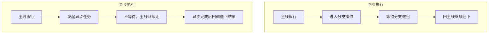
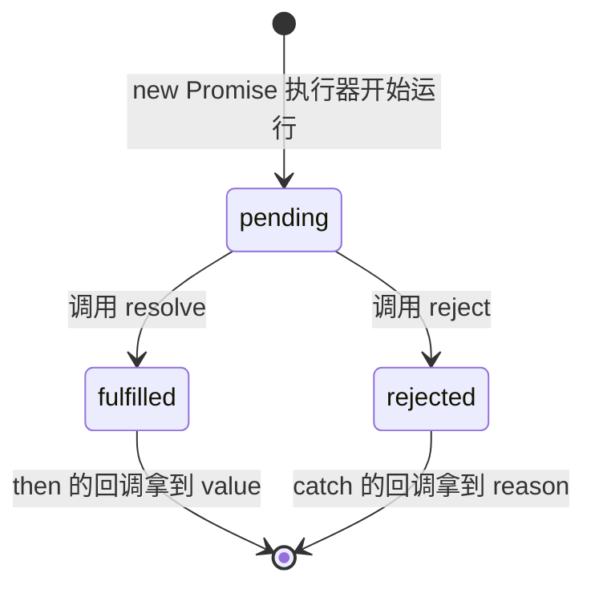

# Promise：把异步结果装进一个容器，then 与 catch 各接一端

页面上请求数据，代码却在结果回来之前就往下跑了，想拿到那个「未来才有」的值，只能在回调里一层层往里写函数，嵌套深了连自己都不知道在第几层。Promise 这个词的本义是「承诺」：它承诺里面装着一个未来才会发生、才会结束的事件，并把这件事变成一个可以被操作的对象。ES6 把这个对象纳入标准，异步代码的组织方式从此换了写法。

## 先给结论

- Promise 是一个容器，里面放的是异步操作；`new Promise` 时传入的执行器函数会立刻执行，异步结果通过 `resolve` 或 `reject` 抛出。
- `resolve(value)` 标记成功，`reject(error)` 标记失败，状态一旦定型就不再改变。
- `p.then(回调)` 接成功的结果，`p.catch(回调)` 接失败的原因，两者链在同一条 Promise 上写。
- 回调是异步执行的：`then` 与 `catch` 不会阻塞后面的代码，先打印主线日志，异步结果最后才出现。
- 在浏览器环境里，`setTimeout` 和 Ajax 请求都是典型的异步操作，课程案例用 `setTimeout` 模拟，道理完全一致。

## 一、同步与异步：主线等不等分支

同步和异步的差别，用执行流来看最直观。同步操作是程序从上到下沿一条主线执行，中途碰到一个分支就钻进去，把分支里的事做完，再回到主线继续往下走，全程一条道排到底。异步操作则是主线走到某个点，分出一个分支去干活，主线不等待，继续往下执行；等分支那边干完了，再通过回调把结果递回来。



上下两条线的差别就在「等不等」：同步要停下等分支，异步让分支先跑着、自己接着走。Ajax 请求几乎都是异步的，请求发出去之后页面不会卡死，响应回来之后由回调处理，这正是 Promise 要管的事。

## 二、创建 Promise：一个执行器，两个回调

`Promise` 是构造函数，直接 `new` 出来使用。构造参数是一个执行器函数，这个函数又接收两个参数，而且两个都是回调函数：

```javascript
const p = new Promise((resolve, reject) => {
    // 执行器里写异步操作，通常就是 Ajax 请求
});
```

IDE 的提示里还能看到只有一个参数的版本，那是因为有些场景只关心成功结果，`reject` 可以省着不写。完整写法把两个都拿到：`resolve` 用来宣告成功，`reject` 用来宣告失败。

课程案例用 `setTimeout` 模拟异步操作（真正的场景里通常是一段 Ajax 请求），再用 `Math.random()` 决定这次异步是成是败。`Math.random()` 生成 0 到 1 之间的小数，约定小于 0.5 算成功，否则算失败，纯属模拟：

```javascript
const p = new Promise((resolve, reject) => {
    // 写异步的操作，通常 ajax 的操作
    setTimeout(() => {
        // 异步操作（模拟）
        let num = Math.random();
        if (num < 0.5) {
            resolve("成功了 " + num);   // 成功：把结果递出去
        } else {
            reject("失败了 " + num);    // 失败：把原因递出去
        }
    });
});
```

执行器函数在 `new Promise` 的那一刻就开始运行，`setTimeout` 把真正的判断推迟了一段异步时间。到了判定的时刻，走哪条路就调哪个回调，并把消息和随机数一起传出去。

## 三、then 与 catch：成功失败各接一端

Promise 执行完，结果怎么接？通过 `p` 的两个方法：成功走 `then`，失败走 `catch`。两个方法都接收一个回调，用箭头函数写最顺：

```javascript
p.then(value => {
    console.log(value);         // 成功：拿到 resolve 传出的值
}).catch(reason => {
    console.log(reason);        // 失败：拿到 reject 传出的原因
});
```

`then` 里的 `value` 就是 `resolve(...)` 传出的那个值，`catch` 里的 `reason` 就是 `reject(...)` 传出的那个原因。`then` 之后直接点 `catch` 接在同一条链上，传统 `function` 写法也一样可用，只是箭头函数更简洁。多刷新几次页面，因为随机数的缘故，有时打印「成功了 0.37xxx」，有时打印「失败了 0.72xxx」，两条路都会走到。

用状态的语言重新描述一遍这套机制：每个 Promise 都有三种状态，初始是 `pending`（等待中），调用 `resolve` 后变成 `fulfilled`（已成功），调用 `reject` 后变成 `rejected`（已失败）。状态只能从 `pending` 出发改变一次，定了型就锁死，`then` 与 `catch` 正是对着这两种终态各接一端。



这张图在讲 Promise 的状态流转：出口只有两条，成功与失败各占一条，且一旦离开 `pending` 就回不去了。

## 四、用打印顺序验证「异步」

在 `then` 之前和之后各加一行普通打印，再观察控制台：

```javascript
console.log("ok");
p.then(value => {
    console.log(value);
}).catch(reason => {
    console.log(reason);
});
console.log("ok2");
```

刷新页面，控制台的输出顺序是：

```text
ok
ok2
成功了 0.4152…
```

`ok` 与 `ok2` 是主线上的同步代码，按顺序立刻执行；「成功了」那句是异步分支的结果，要等 `setTimeout` 里的逻辑跑完、调用了 `resolve` 之后才由 `then` 的回调打出来。输出顺序与前面那张同步异步对照图完全吻合：主线不停留，分支完成后再回调。Promise 本质上就是个容器，里面装的是异步操作，`resolve` 与 `reject` 负责给这段操作的结果定性，`then` 与 `catch` 负责在另一头把结果接住。

## 五、链式写法：回调不再层层嵌套

传统回调写法处理多个连续异步步骤，函数要一层套一层往里传。Promise 把「传递回调」变成「追加环节」，每个 `then` 返回的还是一个 Promise，可以继续点 `then`（此例为按本课写法补全的示例）：

```javascript
new Promise((resolve, reject) => {
    setTimeout(() => resolve("第一步的结果"), 300);
})
.then(value => {
    console.log(value);              // 第一步的结果
    return "第二步拿着上一步的值继续";
})
.then(value => {
    console.log(value);              // 第二步拿着上一步的值继续
})
.catch(reason => {
    console.log(reason);             // 链上任何一环失败都会落到这里
});
```

每个 `then` 里 `return` 的值会传给下一个 `then`，中途任何一环调了 `reject` 或抛了异常，都会被链尾的同一个 `catch` 接住。异步步骤再多也是一条竖线往下排，而不是向右无限缩进。

## 常见误区

- **以为 `new Promise` 会等异步完成。** 执行器函数是立刻同步执行的，等待的只是后续回调；真正耗时的部分要用 `setTimeout`、Ajax 这类异步手段包在执行器里。
- **在 `resolve` 之后还指望 `reject` 生效。** 状态只能改变一次，先调了 `resolve`，后面再调 `reject` 会被忽略，`then` 与 `catch` 只会走一条。
- **以为 `then` 会阻塞后面代码。** 回调属于异步环节，主线代码照常先跑，所以 `ok`、`ok2` 排在成功消息之前，不要按书写顺序去猜输出。
- **把 `then` 和 `catch` 当成两个独立调用乱接。** 它们是同一条链上的环节，`catch` 接的是链上失败的结果，混着写容易搞错归属，按先 `then` 后 `catch` 的顺序排最清晰。

## 面试可能被问到的问题

1. 面试官追问：「Promise 解决了什么问题？」
   答：它给异步操作提供了统一的容器和结果接口。传统回调方式处理连续异步步骤时函数层层嵌套、错误处理分散，Promise 用 `then` 把步骤串成链，用 `catch` 统一收失败，代码从嵌套结构变成平铺结构。

2. 面试官追问：「Promise 有哪几种状态，如何流转？」
   答：三种：`pending`（等待）、`fulfilled`（成功）、`rejected`（失败）。初始为 `pending`，调用 `resolve` 进入 `fulfilled`，调用 `reject` 进入 `rejected`，状态只能改变一次且不可逆，成功走 `then` 回调，失败走 `catch` 回调。

3. 面试官追问：「传给 Promise 构造函数的那个函数是同步执行还是异步执行？」
   答：同步执行。`new Promise` 的瞬间执行器就开始运行，异步的是 `then` 与 `catch` 注册的回调，它们要等状态定型后才会被调度执行。

4. 面试官追问：「then 和 catch 里的参数分别是什么？」
   答：`then` 的回调接收 `resolve(value)` 传出的成功结果，`catch` 的回调接收 `reject(error)` 传出的失败原因。两个回调的入参完全由执行器里调用 `resolve` 或 `reject` 时传的值决定。

5. 面试官追问：「为什么 then 之后还能继续 then？」
   答：`then` 方法的返回值本身又是一个 Promise，所以可以链式接续。上一个回调里 `return` 的值会传进下一个 `then`，链上任何一环失败则由 `catch` 兜底，这是链式调用的基础。

## 配套资料

- 本教学日资料包暂无配套源码（`materials/code/03/day01-ES6新特性以及ReactJS入门/` 解压后为空），示例为按本课写法补全的可运行代码：`new Promise` 加 `setTimeout` 模拟异步、`Math.random` 判定成败、`then` 与 `catch` 接收结果、`ok` 与 `ok2` 的打印顺序验证均与课件演示一致；三种状态说明与第五节链式传值为按主流写法补充的示例，均可粘贴到 HTML 的 `<script>` 标签里在浏览器控制台验证
