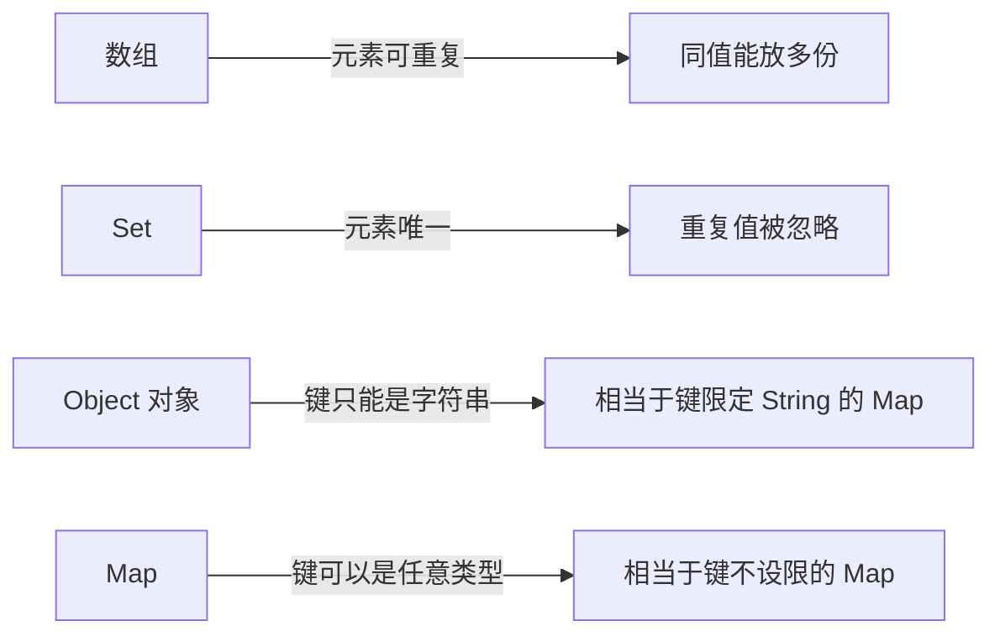

# Set 与 Map：ES6 给 JavaScript 补上的两件 Java 式集合

写惯 Java 的人到 JavaScript 里找 `HashSet` 和 `HashMap`，经常扑个空：数组的元素能重复，对象的键又只能是字符串，想要「不重复的元素集合」和「键不设限的键值对」都别扭。ES6 把这两件东西补齐了，就是 `Set` 与 `Map`，行为与 Java 的 Set 集合、Map 集合高度相似，上手成本很低，但几个细节和 Java、和直觉都不一样，用之前值得对一遍。

## 先给结论

- `Set` 本质与数组类似，区别是不允许重复元素，重复值加入时被忽略；也可以直接传一个数组给构造函数完成去重，`new Set([2, 3, 4, 5, 5])` 得到 `[2, 3, 4, 5]`。
- `set.delete(5)` 删的是元素 5 本身，不是下标 5；删到了返回 `true`，元素不存在返回 `false`。
- `Map` 本质与对象类似，区别是键可以是任意类型；对象等价于键限定为字符串的 `Map<String, Object>`，`Map` 相当于 `Map<Object, Object>`。
- `Map` 添加键值对用 `set(key, value)` 而不是 `add`，取值用 `get(key)`，删除用 `delete(key)`。
- `keys()` 与 `values()` 返回的是迭代器而不是数组，可以配合 `for...of` 或扩展运算符使用；`forEach` 的回调参数是 `value` 在前、`key` 在后。

## 一、Set：不会装重复元素的「数组」

`Set` 是 ES6 才提供的数据结构，本质上和数组类似，不同在于数组允许放相同的元素，Set 的特性是不能存放相同的元素，重复加入会被直接忽略，这一点与 Java 的 Set 集合非常相似。构造函数既可以空着 new，也可以接收一个数组（或迭代器）：

```javascript
// Set 构造函数可以接收一个数组或迭代器
let set = new Set();
set.add(1);                          // 添加元素
set.add(2);
set.add(5);
set.add(8);

let set2 = new Set([2, 3, 4, 5, 5]); // 得到 [2, 3, 4, 5]
```

第二行的数组里有重复的 5，构造出来的 Set 里只剩一个，利用这个特性做数组去重一行就够。往里加元素用 `add`，遍历用 `forEach`，回调拿到每个元素：

```javascript
set.forEach(value => {
    console.log(value);              // 依次打印 1、2、5、8
});
```

## 二、Set 的方法：delete 删的是元素，不是下标

Set 的方法清单不长：`add` 添加、`clear` 清空、`delete` 删除指定元素、`has` 判断是否存在、`forEach` 遍历，外加一个 `size` 属性记录元素个数。容易出事的是 `delete`：

```javascript
set.delete(5);      // true：集合从 1、2、5、8 变成 1、2、8
set.delete(10);     // false：10 不在集合里，什么也没删
set.has(2);         // true：2 存在
set.has(5);         // false：5 刚刚被删掉了
set.size;           // 3：删掉一个之后从 4 变 3
```

`delete(5)` 的意思是「把元素 5 删掉」，和数组里「删除下标为 5 的元素」完全是两回事，这点必须掰清楚。删除操作的返回值还能顺便当存在性判断用：删到了是 `true`，元素本来就不存在就是 `false`。`has` 则是正经的存在性判断。注意 `size` 是属性不是方法，写成 `set.size()` 会直接报错。

## 三、Map：键不再被限制成字符串

`Map` 的本质和对象（object）类似，都是键值对结构。以前定义一个键值对集合，就是写一个对象字面量，`key` 一个、`value` 一个。区别在键的类型约束上：对象的键强制只能是字符串，而 `Map` 的键可以是任意类型，对象、函数、甚至另一个 Map 都能当键。

拿 Java 的泛型来类比最清楚：JavaScript 的对象相当于 `Map<String, Object>`，键被钉死在 String 上；ES6 的 `Map` 相当于 `Map<Object, Object>`，键不再设限。



这张图把四种结构的约束摆在一起：上下两行的差别分别是「值可不可以重复」与「键可不可以换类型」，Set 与 Map 各自补上了右侧那个空位。

## 四、Map 的增删查：set 与 get

`Map` 的构造函数可以接收一个二维数组，每个成员是一个「键、值」对；也可以通过 Set 或另一个 Map 来构造。最常用的还是数组形式：

```javascript
const map = new Map([
    ['key1', 'value1'],
    ['key2', 'value2'],
]);
console.log(map.get('key1'));   // value1：按键取值
map.set('key3', 'value3');      // 添加一组键值对
console.log(map.size);          // 3
```

按键取值用 `get`，添加用 `set`。这里有个和 Set 撞脸的坑：Set 里添加元素用 `add`，Map 里添加键值对用 `set`，方法名一字之差，写顺手了容易串。其余方法与 Set 大同小异：`clear` 清空，`delete(key)` 按键删除，`has(key)` 判断键是否存在，`size` 属性记录键值对个数。

遍历也用 `forEach`，但回调的参数顺序要特别留心：

```javascript
map.forEach((value, key) => {
    console.log(key, value);    // 依次打印 key1 value1、key2 value2、key3 value3
});
```

回调的第一个参数是 `value`，第二个才是 `key`，与很多人「键在前」的使用习惯正好相反，控制台里打印 `key1 value1` 靠的是参数写对了顺序。

## 五、迭代器：keys、values 与扩展运算符

`Map` 还提供了两个看起来像「直接拿数据」的方法：`values()` 拿值的迭代器，`keys()` 拿键的迭代器。注意拿到的是迭代器，不是装好所有值的数组。迭代器怎么用？`for...of` 循环可以直接对它迭代：

```javascript
for (let key of map.keys()) {
    console.log(key);           // 依次打印 key1、key2、key3
}
```

另一个用法是接上前面学过的扩展运算符，三个点把迭代器当场展开：

```javascript
console.log(...map.values());   // value1 value2 value3
```

迭代器被展开成三个独立的参数，直接打印出来。`for...of` 适合逐个处理的场景，扩展运算符适合一次性摊开查看，按场景选即可。

## 常见误区

- **把 `delete(5)` 当删下标。** Set 的 `delete` 认元素不认位置，`delete(5)` 删的是元素 5；想按位置删，Set 没有这个能力，它也不是靠下标存取的结构。
- **往 Map 里用 `add` 添加。** Map 没有 `add` 方法，添加键值对用 `set(key, value)`；Set 添加用 `add`，两个结构各记各的。
- **`forEach` 回调把 `key` 写在第一个参数。** Map 的 `forEach` 回调是 `value` 在前、`key` 在后，参数顺序写反，打印出来的标签就全对不上值。
- **以为 `keys()`、`values()` 返回数组。** 它们返回迭代器，没有数组的那堆方法；要变成数组可以用扩展运算符 `[...map.values()]` 包一层。
- **把 `size` 当方法调用。** `set.size` 与 `map.size` 都是属性，加括号调用会报错。

## 面试可能被问到的问题

1. 面试官追问：「Set 和数组有什么区别，怎么用它去重？」
   答：Set 不允许重复元素，重复加入会被忽略。把数组直接传给构造函数 `new Set(arr)` 就完成去重，再用扩展运算符 `[...new Set(arr)]` 转回数组。

2. 面试官追问：「Map 和 Object 的区别是什么？」
   答：Object 的键只能是字符串（后续标准补了 Symbol），Map 的键可以是任意类型，包括对象和函数。Map 还提供 `size` 属性、按插入顺序遍历、`delete` 与 `has` 等更完整的集合操作，纯粹的键值对场景用 Map 更合适。

3. 面试官追问：「Map 添加元素用什么方法？」
   答：`set(key, value)`。注意与 Set 的 `add` 区分，Set 存单个元素，Map 存键值对；`set` 对已存在的键会覆盖旧值，键不存在则新增。

4. 面试官追问：「Set 的 delete 判断的是下标还是元素？」
   答：元素本身。`delete(5)` 是把元素 5 移除，返回布尔值表示是否删到了，元素不存在时返回 `false`，不会抛错。

5. 面试官追问：「Map 的 forEach 回调参数是什么顺序？」
   答：先是 `value`，后是 `key`，第三个参数才是整个 Map。这个顺序与直觉相反，写的时候要对准，否则键值对不上。

6. 面试官追问：「map.keys() 返回的是数组吗？」
   答：不是，是一个迭代器。可以放进 `for...of` 逐个消费，也可以用扩展运算符展开或转成数组，但它本身没有 `map`、`filter` 这些数组方法。

## 配套资料

- 本教学日资料包暂无配套源码（`materials/code/03/day01-ES6新特性以及ReactJS入门/` 解压后为空），示例为按本课写法补全的可运行代码：`new Set` 逐个 `add` 与 `forEach` 遍历、`new Set([2, 3, 4, 5, 5])` 构造去重、`delete`、`has`、`size`，以及 `new Map` 二维数组构造、`set` 与 `get`、`forEach` 回调参数顺序、`keys` 与 `values` 迭代器、扩展运算符展开均与课件演示一致，可粘贴到 HTML 的 `<script>` 标签里在浏览器控制台验证
