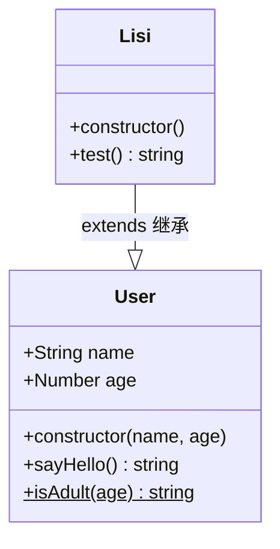

# class 类：用 Java 的姿势写 JavaScript 的面向对象

在 Java 里定义类、写构造方法、搞继承是肌肉记忆，切到 JavaScript 却发现老代码靠构造函数加原型拼出「类」的感觉，写法散、心智负担重。JavaScript 早期定位是基于对象而非面向对象，一直没提供 class 语法；ES6 引入了 `class` 关键字，用法与 Java 中的类非常接近，constructor、方法、静态方法、继承一应俱全，对 Java 工程师来说几乎是零成本迁移。

## 先给结论

- `class` 关键字定义类，构造函数固定叫 `constructor`，在 `new` 的时候自动执行，里面通过 `this.xxx` 挂属性并初始化。
- 构造参数可以带默认值，`constructor(name, age = 20)` 不传 `age` 就用 20。
- 实例方法写在类体里直接声明，靠实例调用；静态方法加 `static` 关键字，靠类名调用，与 Java 一致。
- 继承用 `extends`，子类只要写了 `constructor` 就必须先调 `super(...)` 把父类构造函数跑一遍，否则报错。
- 子类实例既能调自己新增的方法，也能直接用父类的实例方法和静态方法。

## 一、class 出现之前：构造函数拼对象

JavaScript 语言的传统方法是通过构造函数定义并生成新对象，想给「类」挂方法还得去操作原型。同样的东西用 ES5 写出来是这样（此例为与课件对照补全的示例）：

```javascript
// ES5：构造函数 + 原型方法
function User(name, age) {
    this.name = name;
    this.age = age;
}
User.prototype.sayHello = function () {
    return "hello, " + this.name;
};

let user = new User("张三", 20);
console.log(user.sayHello());   // hello, 张三
```

属性赋值在构造函数里，方法挂到 `prototype` 上，定义被拆成两截。ES6 的 class 把这些都收进一个大括号，ES6 引入 class 关键字来自定义类。

## 二、基本用法：constructor、实例方法与默认值

用 `class` 定义一个 `User` 类，构造函数里设置 `name` 与 `age`，其中 `age` 带默认值 20；再写一个实例方法 `sayHello` 和一个静态方法 `isAdult`：

```javascript
class User {
    // 构造函数
    constructor(name, age = 20) {
        this.name = name;   // 添加属性并初始化
        this.age = age;
    }
    // 实例方法
    sayHello() {
        return "hello, " + this.name;
    }
    // 静态函数
    static isAdult(age) {
        if (age >= 18) {
            return "成年人";
        }
        return "未成年人";
    }
}
```

几个要点：构造函数的名字固定是 `constructor`，不需要写 `function`，也不能自己另起名字；`age = 20` 是参数默认值，调用时不传就落到默认值上，这与 ES6 的函数参数默认值是同一套机制；类体里的方法之间不加逗号，这是类和对象字面量的一个显著区别。

使用方式与 Java 几乎一样，`new` 出实例，属性与方法都在上面：

```javascript
let user = new User("张三");
console.log(user);                  // User {name: "张三", age: 20}
console.log(user.sayHello());       // hello, 张三
console.log(User.isAdult(16));      // 未成年人
console.log(User.isAdult(20));      // 成年人
```

`new User("张三")` 只传了一个参数，打印出来的实例里 `age` 是默认值 20。`sayHello` 靠实例调用，`isAdult` 靠类名 `User` 直接调用，静态方法不需要先有对象，比如按年龄判断是否成年这种与具体实例无关的逻辑，放在静态方法里最合适。

## 三、继承：extends 与必须调用的 super

继承用 `extends` 关键字，写法与 Java 相同。定义一个 `Lisi` 类继承 `User`：

```javascript
class Lisi extends User {
    constructor() {
        super("李四", 30);           // 必须先调用父类构造函数
    }
    test() {
        return "test -> " + this.name;
    }
}

let lisi = new Lisi();
console.log(lisi);                  // Lisi {name: "李四", age: 30}
console.log(lisi.test());           // test -> 李四
console.log(lisi.sayHello());       // hello, 李四：父类的实例方法
console.log(Lisi.isAdult(18));      // 成年人：父类的静态方法
```

子类既然继承了 `User`，而 `User` 有构造函数，那么子类的 `constructor` 必须调用父类的构造函数，用 `super` 关键字完成，需要什么参数就传什么参数。这里 `super("李四", 30)` 把名字和年龄交给父类的 `constructor`，属性初始化由父类代劳。继承来的能力是全套的：`lisi.sayHello()` 用的是父类定义的实例方法，`Lisi.isAdult(18)` 调的是父类的静态方法，同时子类也可以定义自己的方法，`test` 就是在子类里新增的。

两个类的关系一图看清：



`isAdult` 成员名后的 `$` 是静态成员的标记，`Lisi` 箭头指向 `User` 表示继承。图上能直接读出上一段的结论：`sayHello` 与 `isAdult` 只定义在 `User` 里，`Lisi` 的实例却都能用。

## 常见误区

- **子类 `constructor` 里忘写 `super`。** `extends` 之后只要声明了 `constructor`，就必须先 `super(...)` 再用 `this`，否则抛 `ReferenceError: Must call super constructor...`；不写自己的 `constructor` 可以让父类构造被隐式调用。
- **在 `super(...)` 之前访问 `this`。** 必须等父类构造执行完，实例才算建好，提前访问 `this` 直接报错。
- **类体里的方法之间写逗号。** 类不是对象字面量，`sayHello() {...},` 这种逗号是语法错误，方法与方法之间换行即可。
- **用实例去调静态方法，或用类名去调实例方法。** `user.isAdult(20)` 会找不到方法，`User.sayHello()` 同样不行，静态归类、实例归对象，调用前先分清。
- **以为 class 会变量提升。** 类的声明方式接近 `let` 与 `const`，声明之前访问会进「暂时性死区」，先把类定义放在使用之前最稳妥。

## 面试可能被问到的问题

1. 面试官追问：「class 和 ES5 的构造函数有什么区别？」
   答：class 把属性初始化收进 `constructor`、方法直接写在类体里，不再需要手工操作 `prototype`。类体里的代码默认走严格模式，类不可像普通函数那样不 `new` 直接调用，声明也不存在变量提升。本质上 class 仍是基于原型的语法糖，底层对象模型没有变。

2. 面试官追问：「静态方法和实例方法的区别是什么？」
   答：静态方法用 `static` 声明，挂在类本身上，通过类名调用，适合与具体实例无关的工具型逻辑；实例方法挂在原型上，通过实例调用，方法内部可以通过 `this` 访问实例属性。

3. 面试官追问：「extends 之后为什么必须调 super？」
   答：子类的 `this` 对象要由父类构造函数先塑造出来，父类的 `constructor` 负责属性初始化，`super(...)` 就是去执行这一步。不调用 `super` 就访问 `this` 会直接抛引用错误。

4. 面试官追问：「constructor 的参数可以带默认值吗？」
   答：可以，`constructor(name, age = 20)` 里不传 `age` 就用 20。这是 ES6 参数默认值机制，与普通函数完全一致，默认值也可以引用前面的参数。

5. 面试官追问：「子类能使用父类的静态方法吗？」
   答：能。`extends` 建立的继承关系覆盖实例方法和静态方法，子类可以像父类一样直接以类名调用静态方法，例如 `Lisi.isAdult(18)`。

6. 面试官追问：「class 有变量提升吗？」
   答：没有。class 的行为接近 `let`，声明之前访问会抛引用错误，而不是像函数声明那样提升到作用域顶部，所以类的定义要写在实例化之前。

## 配套资料

- 本教学日资料包暂无配套源码（`materials/code/03/day01-ES6新特性以及ReactJS入门/` 解压后为空），示例为按本课写法补全的可运行代码：`User` 类（`constructor` 默认参数、`sayHello`、静态 `isAdult`）、`new User("张三")` 的输出、`Lisi extends User` 与 `super("李四", 30)`、子类调用父类实例方法与静态方法均与课件演示一致；第一节 ES5 构造函数对照为按主流写法补全的示例，可粘贴到 HTML 的 `<script>` 标签里在浏览器控制台验证
