# Generator 函数：给函数装上暂停键，一次 next 走一段

普通函数一旦被调用，就像离弦的箭：从头跑到尾，中间停不下来，返回值要么有要么没有，调用方只能干等。Generator 函数是 ES6 提供的一种异步编程解决方案，语法行为与传统函数完全不一样：它可以在函数体中间任意多个位置「暂停」，调用方拿着一个遥控器，按一下 `next()` 就往前走一段，每段都能拿到当前的值和「走完没有」的状态。后面的 `async` 与 `await`，正是沿着这条思路演化出来的最终形态。

## 先给结论

- Generator 函数有两个特征：`function` 关键字与函数名之间有一个星号；函数体内部用 `yield` 语句定义不同的内部状态。
- 调用 Generator 函数不会执行函数体，返回的是一个迭代器（generator 对象），函数体由 `next()` 逐段驱动执行。
- 每次调用 `next()` 返回一个对象 `{value, done}`：`value` 是当前 `yield` 或 `return` 后面的值，`done` 表示整个函数是否执行完毕。
- 遇到 `yield` 就停下并交出值，下次 `next()` 从停住的地方继续；走到 `return` 时 `done` 变为 `true`。
- `for...of` 可以一次性遍历迭代器里所有 `yield` 出来的值，但拿不到 `return` 的值。

## 一、两个特征：星号与 yield

Generator 函数的定义只比普通函数多两处：星号和 `yield`。星号夹在 `function` 与函数名之间，位置靠中间还是紧挨 `function` 都合法，习惯写法是靠住 `function`；`yield` 写在函数体内部，每一条 `yield` 就定义了一个内部状态，函数体里有几条 `yield`，这个函数就能被分几段执行：

```javascript
function* hello() {
    yield "hello";
    yield "world";
    yield "abc";
    return "qq";
}
```

同一个函数体里既有三条 `yield` 又有一个 `return`，这在普通函数里不可能成立，普通函数执行到第一个 `return` 就结束了。Generator 函数里它们不是冲突，而是四个依次排列的状态点：三个 `yield` 加一个终点 `return`。

## 二、调用即得迭代器，next 一步步推进

直接调用 `hello()` 会发生什么？函数体一行都不会执行，返回值是一个 generator 对象：

```javascript
let h = hello();
console.log(h);   // hello {<suspended>}：一个迭代器对象
```

想真正驱动函数体运行，要调用这个对象的 `next` 方法：

```javascript
let h = hello();
console.log(h.next());  // {value: "hello", done: false}
console.log(h.next());  // {value: "world", done: false}
console.log(h.next());  // {value: "abc", done: false}
console.log(h.next());  // {value: "qq", done: true}
console.log(h.next());  // {value: undefined, done: true}
```

第一次 `next()` 启动函数体，执行到第一条 `yield` 停下，把 `yield` 后面的值装进 `value` 返回，此时 `done` 是 `false`，表示函数没有执行完；再按一次 `next()`，从停住的地方往下走到下一条 `yield`，交出 `"world"`；第三次是 `"abc"`；第四次走完了整个函数体，拿到的是 `return` 的 `"qq"`，同时 `done` 变成 `true`，表示函数已经结束；之后再按 `next()`，函数体已无可执行的内容，`value` 是 `undefined`，`done` 保持 `true`。

```mermaid
flowchart LR
    S["调用 hello()"] --> I["得到迭代器，函数体未执行"]
    I --> N1["next()"] --> Y1["走到 yield hello 停下<br/>value hello，done false"]
    Y1 --> N2["next()"] --> Y2["走到 yield world 停下<br/>value world，done false"]
    Y2 --> N3["next()"] --> Y3["走到 yield abc 停下<br/>value abc，done false"]
    Y3 --> N4["next()"] --> Y4["走到 return qq<br/>value qq，done true"]
    Y4 --> N5["next()"] --> E["无可执行内容<br/>value undefined，done true"]
```



这张图把五次 `next()` 的推进路线排开：函数体不是一次跑完，而是每按一下走一段，每段在 `yield` 处交出值、按住暂停键。

## 三、为什么说它是异步编程的解决方案

关键就在「分批执行」这四个字。普通函数是同步的，调用即一次执行完毕，中途无法把控制权还给调用方；Generator 函数每执行到一个 `yield` 就暂停，把当前的值交给调用方，控制权回到调用方手里，想什么时候继续、要不要继续，都由下一次 `next()` 决定。

把 `yield` 后面写的值换成一个异步任务的结果，这套机制立刻就有了异步的味道：第一段发起请求后暂停，调用方处理完别的事，再 `next()` 拿结果走第二段，一次一段，各段之间还能传递数据（向 `next()` 传参可以把值送回上一个 `yield` 的位置）。这正是前面 Promise 解决的同一类问题，Generator 提供的是另一种组织手段，后来的 `async` 与 `await` 在它的基础上封装出更顺手的写法，所以理解 Generator 是理解异步语法演化的中间一环。

## 四、for...of：一次拿完所有值

一段一段 `next()` 太啰嗦，如果想把状态值一次性全拿出来，`for...of` 循环就能做到，因为迭代器本身就是可遍历的：

```javascript
for (let v of h) {
    console.log(v);     // 依次打印 hello、world、abc
}
```

循环把三条 `yield` 的值依次取了出来。注意输出里没有 `"qq"`：`for...of` 只遍历 `yield` 出来的值，`return` 的值不参与遍历，这是它与手动 `next()` 的一个差异点。逐段 `next()` 适合需要精确控制每一步的场景，`for...of` 适合只关心全部值的场景，按需选择。

## 常见误区

- **忘记写星号。** 少了星号就是普通函数，`yield` 会直接报语法错误；函数名前 `function*` 的星号是 Generator 的身份证。
- **以为 `hello()` 会执行函数体。** 调用 Generator 函数只创建迭代器，不执行任何一行函数体，必须靠 `next()` 驱动。
- **把 `next()` 的返回值当最终值直接用。** 每次返回的是 `{value, done}` 对象，要取 `h.next().value`，对象本身不是那个值。
- **指望 `for...of` 拿到 `return` 的值。** 循环只产出 `yield` 的值，`return qq` 里的 `"qq"` 只能通过手动 `next()` 在 `done: true` 的那次拿到。
- **把遍历完的迭代器接着用。** 迭代器是一次性的，走完之后 `done` 永远是 `true`，`value` 永远是 `undefined`，想要重来必须重新调用 `hello()` 创建新迭代器。

## 面试可能被问到的问题

1. 面试官追问：「Generator 函数和普通函数有什么区别？」
   答：定义上 `function` 与函数名之间有星号，函数体内可用 `yield` 定义多个内部状态；行为上调用它不执行函数体，而是返回一个迭代器，函数体由 `next()` 逐段驱动，每遇到 `yield` 暂停一次，普通函数则是一口气执行到底。

2. 面试官追问：「yield 和 return 有什么区别？」
   答：`yield` 只是暂停并交出当前状态的值，函数没有结束，下次 `next()` 从原地继续；`return` 是终局，返回值的同时 `done` 变为 `true`，函数体不再有可执行内容。一个函数可以有多个 `yield`，但 `return` 的效果只能发生一次。

3. 面试官追问：「next() 的返回值是什么结构？」
   答：一个含 `value` 与 `done` 两个属性的对象。`value` 是当前 `yield` 或 `return` 后面的值，`done` 是布尔值，表示整个 Generator 是否执行完毕；执行结束后再调用 `next()`，`value` 为 `undefined`。

4. 面试官追问：「为什么说 Generator 是异步编程的解决方案？」
   答：它把函数的执行权在函数与调用方之间来回移交，异步步骤可以写成 `yield` 间隔的分段同步风格，调用方在合适的时机推进下一段，还能向 `next()` 传参在段间传递数据。它是 Promise 之后、`async` 与 `await` 之前异步方案演化的中间形态。

5. 面试官追问：「for...of 遍历 Generator 能拿到 return 的值吗？」
   答：拿不到。`for...of` 只输出 `yield` 交出的值，`return` 的值只在手动 `next()` 推进到终点的那次出现在 `value` 里，且那一次 `done` 为 `true`，不会被循环消费。

6. 面试官追问：「星号写在哪里有讲究吗？」
   答：语法上 `function* fn`、`function *fn` 甚至 `function*fn` 都合法，位置只影响风格。社区习惯把星号靠住 `function`，一眼就能认出这是 Generator 函数。

## 配套资料

- 本教学日资料包暂无配套源码（`materials/code/03/day01-ES6新特性以及ReactJS入门/` 解压后为空），示例为按本课写法补全的可运行代码：`function* hello` 三条 `yield` 加一条 `return`、`hello()` 返回迭代器、连续 `next()` 的 `{value, done}` 输出序列、`for...of` 遍历均与课件演示一致；第三节异步意义的展开为按主流写法补充的说明，示例可粘贴到 HTML 的 `<script>` 标签里在浏览器控制台验证
