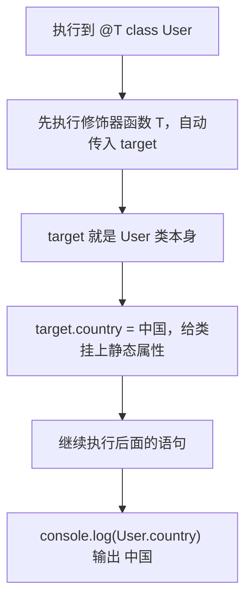

# 修饰器 Decorator：用 @ 符号给类挂一个外挂函数

在 Java 里给类加注解是家常便饭，`@Override`、`@Service` 往类上一贴就完事。切到 JavaScript 想给类做同样的事，靠的就是修饰器（Decorator）。麻烦在于：把 `@T` 原样敲进 HTML 里刷新浏览器，控制台连预期的输出都没有，看起来像语法写错了，其实是浏览器压根不认识这套语法。这一课把修饰器的用法讲透，并回答「为什么浏览器跑不出来」这个悬在头上的问题。

## 先给结论

- 修饰器是一个函数，用来修改类的行为，角色与 Java 中的注解非常相似；这项功能在 ES2017 中引入，Babel 转码器已经对它提供了支持。
- 用法分两步：类定义上方写 `@函数名`，下方定义同名普通函数；执行到这段类代码时，修饰器函数会先执行。
- 修饰器函数接收一个参数 `target`，指被修饰的目标对象，也就是类本身；在函数里给 `target` 添加的属性是静态属性，通过类名直接访问。
- 当前浏览器并不识别 `@` 语法，必须先经转码器把代码转成 ES5 再运行，转码器的用法在下一课展开。
- `@` 语法本质上是把类交给修饰器函数做一次调用，理解了这一点，React 生态里 `connect` 的修饰器写法就是水到渠成。

## 一、修饰器是什么：一个修改类行为的函数

修饰器的定位一句话就能说清：它是一个函数，用来修改类的行为。说它与 Java 注解相似，是因为两者的「长相」和「意图」一致，都是用 `@` 开头的一个标记贴在类上，表达对这个类的某种增强。差别在生效机制：Java 注解本身不干活，要靠反射或注解处理器去读取它才起作用；JavaScript 的修饰器更直接，它就是一个普通函数，执行到类定义的时候这个函数就被调用了，没有任何幕后魔法。

时间线上，修饰器是 ES2017 引入的功能，主流转码器 Babel 已经支持，所以实际开发里都是「写新语法，跑转码产物」的组合，后面两课会把这个闭环走完。

## 二、基本用法：@T 与 function T(target)

沿用 class 那一课的 `User` 类，给它贴一个修饰器。完整写法如下：

```javascript
// 通过 @ 符号引用修饰器，类似 Java 中的注解
@T
class User {
    constructor(name, age = 20) {
        this.name = name;
        this.age = age;
    }
}

function T(target) {   // 修饰器就是一个普通函数
    console.log(target);   // target 为被修饰的目标对象，这里是 User 类
    target.country = "中国";   // 为 User 类添加一个静态属性 country
}

console.log(User.country);   // 通过类名访问静态属性
```

三个要点：

**第一，`@T` 与 `function T` 必须对得上号。** `@` 后面跟的名字是随意的，`T` 只是本课随手起的名字，写成 `@log` 配 `function log` 同样合法，甚至可以是任何合法的标识符。`@` 引用了谁，下面就定义谁。

**第二，执行时机在类定义处。** 代码执行到 `@T class User` 这一段时，会先去执行 `T` 这个函数，然后再继续往下走后面的语句。修饰器不是等类被 `new` 的时候才生效，而是类被定义的那一刻就执行了。

**第三，函数能拿到一个参数。** 修饰器函数声明里写的 `target`，是调用时自动传进来的，不需要手动传。

修饰器的执行链路一图看清：



图里最关键的一条边是第二步：修饰器函数由类定义自动触发，`target` 作为实参传入。理解了这条边，修饰器就不再神秘。

## 三、target 与静态属性

`target` 指的是被修饰的对象，在这里就是 `User` 类本身，不是 `new` 出来的实例。正因为它指向类，`target.country = "中国"` 这一句等价于直接在类上挂属性，挂出来的东西是**静态属性**，要靠类名访问，这一点与 Java 的 `static` 成员一个味道：

```javascript
console.log(User.country);       // 中国：静态属性，类名直接访问
let user = new User("张三");
console.log(user.country);       // undefined：实例上没有这个属性（示例）
```

所以「修改类的行为」落在代码上非常具体：要么给类挂静态属性，要么改原型上的方法。修饰器函数体里能写什么，取决于想对类做什么，它拿到的始终是类这个对象本身。

## 四、为什么浏览器跑不出来：转码前与转码后

把上面第一段完整代码放进 HTML 的 `<script>` 标签里，浏览器刷新之后 `User.country` 并没有打印出「中国」。原因不在写法，而在支持度：修饰器是 ES2017 才加入的功能，当前浏览器对 `@` 语法并不识别，直接运行只会报语法错误。

出路是转码：把 ES2017 的代码转成 ES5 再执行。转码的意思就是把新语法等价改写成旧语法，比如箭头函数转成普通函数：

```javascript
// 转码前：ES6 箭头函数
let sum = (a, b) => a + b;

// 转码后：等价的 ES5 普通函数
var sum = function (a, b) {
    return a + b;
};
```

`@T` 同样逃不过这一步。转码之后，修饰器语法会变成一次普通的函数调用，类作为实参交给 `T` 处理，再把结果赋回类名（形如 `T(User)` 的调用形式）。也就是说，浏览器最终执行的从来不是 `@` 语法本身，而是转码后的 ES5 代码。转码器怎么装、怎么跑，下一课用 UmiJS 完整演示一遍，到时候可以亲眼看到这段转码产物。

## 五、React 生态里的修饰器：connect

修饰器在实际前端项目里最高频的出场位置，是 React Redux 的 `connect`。`connect` 本质是一个高阶函数：接收两个参数，返回一个「接收组件、返回新组件」的函数，把全局状态注入组件。不用修饰器时写法是两层调用：

```javascript
// 不用修饰器：把组件交给 connect 包一层（示例，按 React 生态主流写法补全）
class App extends React.Component { /* ... */ }

export default connect(mapStateToProps, mapDispatchToProps)(App);

// 用修饰器：同一个意思，写法更像 Java 注解
@connect(mapStateToProps, mapDispatchToProps)
export default class App extends React.Component { /* ... */ }
```

两段代码等价。对比之后修饰器的本质就露出来了：`@connect(...)` 不过是 `connect(...)(App)` 这一次函数调用的语法糖，类被当作实参送进去加工，再拿回增强后的结果。Java 工程师对这种「贴个标记就增强」的形式天然亲切，这也是修饰器在前端框架生态里流行的重要原因。

## 常见误区

- **把 `target` 当成实例。** `target` 是被修饰的类本身，修饰器里挂的属性是静态属性，要通过类名访问；实例 `user.country` 是 `undefined`，两者别混。
- **以为修饰器只是个标记，不会执行。** Java 注解要靠反射或处理器才起作用，JavaScript 的修饰器就是函数，执行到类定义就直接调用，挂属性、改行为都发生在这个时机。
- **在浏览器里直接跑，然后怀疑语法写错。** 修饰器是 ES2017 的语法，浏览器不识别，直接双击 HTML 运行只会报错；要先经转码器转成 ES5，课程里用 UmiJS 完成。
- **修饰器函数必须叫特定名字。** `@` 后面跟什么就定义什么，`T` 不是保留名；名字对不上号才是真正的错误来源。

## 面试可能被问到的问题

1. 面试官追问：「修饰器是什么？它和 Java 注解像在哪里？」
   答：修饰器是一个函数，用来修改类的行为，ES2017 引入，Babel 已支持。它与 Java 注解的相似点是用 `@` 开头贴在类上、表达对类的增强；区别在于 JS 修饰器本身就是函数，类定义时就被调用，不需要反射这类幕后机制。

2. 面试官追问：「修饰器函数的 target 参数是什么？」
   答：target 是被修饰的目标对象，当修饰器贴在类上时就是类本身。在函数体内可以通过 target 给类添加静态属性或修改原型方法，从而实现「修改类的行为」。

3. 面试官追问：「在修饰器里给 target 添加的属性，实例能访问到吗？」
   答：不能直接访问。添加在类对象上的属性是静态属性，通过类名访问，例如 `User.country`；实例的属性查找走原型链，找不到类对象上的这个属性，值为 `undefined`。

4. 面试官追问：「为什么浏览器直接运行修饰器代码会报错？怎么解决？」
   答：修饰器是 ES2017 引入的语法，浏览器尚未原生支持，直接运行会因语法不被识别而失败。解决思路是转码：用 Babel 等转码器把 `@T` 这样的语法转成等价的 ES5 函数调用，浏览器执行转码产物即可。

5. 面试官追问：「修饰器转码之后变成了什么？说明它的本质是什么？」
   答：`@T` 会被转成把类作为实参的普通函数调用，返回值赋回类名。这说明修饰器的本质是一次函数调用、一种语法糖，`@connect(...)` 等价于 `connect(...)(App)`，这正是 React 里高阶组件能和修饰器配合的原因。

6. 面试官追问：「修饰器现在能直接在项目里用吗？」
   答：要用，但离不开工程化支持。标准仍处于提案演进阶段，浏览器没有原生实现，实际项目通过 Babel 插件或 TypeScript 提供的装饰器支持来转码运行，UmiJS 这类集成 Babel 的框架天然可用。

## 配套资料

- 本教学日资料包暂无配套源码（`materials/code/03/day01-ES6新特性以及ReactJS入门/` 解压后为空），示例为按本课写法补全的可运行代码：`User` 类（`constructor` 默认参数）、`@T` 修饰器、`target.country` 静态属性、`console.log(User.country)` 均与课件演示一致；第二节执行时机、第三节实例访问对照、第四节转码前后对照为按主流写法补全的说明性示例；第五节 `connect` 场景为按 React 生态主流写法补全的示例，需在 UmiJS 等转码环境下运行
