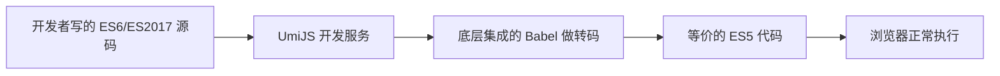

# 转码器与 UmiJS 入门：把 ES6 新语法变成浏览器能跑的 ES5

修饰器那一课留下了一个悬念：`@T` 写进浏览器，控制台安静得像什么都没发生。原因已经明确，浏览器不识别新语法。让新语法真正跑起来的角色就是转码器，而这一课不只讲转码器，还要用它后面课程要用的工程化框架 UmiJS 把整套流程跑通：装环境、建工程、贴代码、启动服务，最后亲眼在控制台里看到那个迟到的「中国」。

## 先给结论

- 转码器的目的：把 ES6/ES2017 代码转成 ES5 再执行，让不支持新特性的浏览器也能运行；代表产品是 Babel（使用最广）与 Google 的 Traceur。
- 课程不直接用这两款，而是用阿里系开源的企业级 React 应用框架 UmiJS，底层集成了 Babel，也把 React 全家桶配好了，后面课程直接用。
- 环境链路：装 Node.js（要求 8 以上）→ 用 npm 装 yarn（npm 的封装优化版）→ 用 tyarn 走淘宝镜像（国内更快）→ `tyarn global add umi` 全局安装 Umi。
- 工程三板斧：`tyarn init` 初始化出 `package.json`，`umi g page index` 在 `pages/` 下生成 `index.js` 与 `index.css`，`umi dev` 启动开发服务，默认 8000 端口。
- 把修饰器代码贴进 `index.js`，浏览器控制台打印出「中国」，修饰器正常工作；查看转码产物，`@T` 变成了把类交给 `T` 调用的普通 ES5 代码。

## 一、为什么需要转码器

浏览器只认自己实现过的语法。ES6 和 ES2017 带来的 `class`、箭头函数、修饰器等新写法，浏览器引擎的跟进有滞后，旧一点的浏览器更是完全不支持，直接把源码丢过去只会报语法错误。

转码器干的就是「翻译」这份工作：把新语法的代码等价改写成旧语法，转成 ES5 之后再交给浏览器执行。整个链路是这样的：



链路里最重要的一环是第三步：转码不是「换个浏览器」，而是把语法本身换掉。以修饰器为例，转码前后的差别大致是：

```javascript
// 转码前：ES2017 修饰器语法
@T
class User { /* constructor 与属性初始化 */ }

// 转码后：修饰器变成一次普通函数调用（简化示意）
var User = T(function User(name, age) { /* 同样的初始化逻辑 */ });
```

`@T` 没了，取而代之的是把整个类作为实参交给 `T` 处理再把结果赋回类名。浏览器执行的始终是下面这种普通 ES5 代码，转码器把「新语法不能用」这个死结从语言层面解开了。

## 二、UmiJS 是什么：集成 Babel 的企业级 React 框架

Babel 和 Traceur 都是优秀的转码器，但课程不直接拿它们搭工程，而是用阿里系开源的 UmiJS。它的自我定位是「可插拔的企业级 React 应用框架」，特点可以记三个：插件化体系、开箱即用、约定式路由。对开发者的实际意义是，工程化全套（转码、开发服务、打包、路由）它都替你配好了，底层转码由集成的 Babel 完成，React 相关依赖也一并集成，后面的课程用 React 开发时拿起来就能写。

官网专门标注了它的读音（Umi），社区里两种叫法都有，不必纠结。记住它的角色就够了：转码器是发动机，UmiJS 是装好发动机的整车。

## 三、环境搭建：Node.js、yarn 与 tyarn

无论用 Babel 还是 Traceur 还是 UmiJS，转码这一步都需要 Node.js 的支持，所以环境的第一环是安装 Node.js，安装包在课程资料里，一路下一步即可。装完在任意位置敲命令验证版本：

```bash
# 查看 Node.js 版本，要求 8 以上
node -v
```

接下来装 yarn。npm 是 Node.js 自带的包管理工具，yarn 是在 npm 基础上又做了封装的工具，可以理解为优化版的 npm，用起来更顺手。tyarn 则是走了淘宝镜像的 yarn，国内访问速度快，推荐直接用它：

```bash
# 全局安装 yarn
npm install -g yarn

# 安装 tyarn：使用淘宝镜像源的 yarn，国内更快
npm install -g tyarn

# 验证安装（当时版本为 1.12.1，以实际输出为准）
tyarn -v

# 全局安装 umi
tyarn global add umi

# 敲 umi 出现使用提示，说明环境装好了
umi
```

这一段有一个高频坑：敲 `tyarn -v` 或 `umi` 提示「找不到命令」。这不是安装失败，恰恰说明已经装成功了，只是 yarn 的全局安装路径没有加入系统环境变量 PATH。解决办法是把 yarn 全局安装目录（`global bin`）追加到 PATH 里，重新打开命令行窗口即可。

## 四、快速入门：三板斧跑起第一个工程

环境就绪后建一个空目录作为工程目录，在其中打开命令行（资源管理器地址栏输入 `cmd` 回车即可），依次执行三条命令：

```bash
# 初始化 Node 工程，生成 package.json
tyarn init

# 创建页面 index，自动生成 pages/index.js 与 pages/index.css
umi g page index

# 启动开发服务
umi dev
```

`tyarn init` 之后工程里多出一个 `package.json`，这是 Node.js 约定用来存放项目信息和配置信息的文件（`name` 为工程名，此处按中性命名改写）：

```json
{
  "name": "es6-demo",
  "version": "1.0.0",
  "main": "index.js",
  "license": "MIT"
}
```

`umi g page index` 执行后，注意生成的位置：在**工程根目录下的 `pages` 目录**里，出现 `index.js` 和 `index.css` 两个文件。`umi dev` 第一次启动会检查并补装一批依赖，工程里的 `node_modules` 目录由此而来，里面就是框架集成的那些依赖包。编译成功后控制台输出：

```bash
DONE  Compiled successfully in 767ms

App running at:
- Local:   http://localhost:8000/
- Network: http://172.16.55.194:8000/
```

服务跑在 8000 端口。不指定路径直接访问 `http://localhost:8000/`，默认加载的就是 `pages/index.js`。

## 五、验证修饰器：控制台终于打印出「中国」

把 `index.js` 里生成的默认内容删掉，贴入修饰器那一课的代码：

```javascript
// 通过 @ 符号引用修饰器，类似 Java 中的注解
@T
class User {
  constructor(name, age = 20) {
    this.name = name;
    this.age = age;
  }
}

function T(target) { // 定义一个普通的方法
  console.log(target); // target 为被修饰的目标对象，这里是 User 类
  target.country = "中国"; // 为 User 类添加一个静态属性 country
}

console.log(User.country); // 打印 country 属性值
```

刷新浏览器，控制台先打印出 `User` 类对象，再打印出「中国」。把 `console.log(target)` 注释掉，保存，页面自动刷新，这次只剩一个「中国」，修饰器在浏览器里完整地工作了。这里还有个顺手的体验：`umi dev` 运行期间修改代码，保存即自动刷新，不需要重启服务。

再深入一步，看看浏览器到底执行了什么。在页面右键「查看网页源代码」，里面引入了根目录下的 `umi.js`，点开是一个巨大的文件，在里面搜索「中国」就能定位到自己写的代码：`function T` 与 `class User` 的定义基本原样保留（这两段本来就是 ES5 兼容的），而 `@T` 那一行消失了，取而代之的是把类作为实参调用 `T` 并赋回结果的形式。这就是第一节图里那条链路的实物证据：浏览器执行的从来不是 `@` 语法，而是转码后的 ES5。后面的课程都会在 UmiJS 这个框架里开发，它的底层正是整合了 Babel 在做转码。

## 常见误区

- **提示「找不到命令」就以为是安装失败。** `tyarn -v`、`umi` 报找不到命令，说明包已装好，只是 yarn 全局安装目录没进环境变量 PATH，把它追加进 PATH 再开新窗口即可。
- **以为页面文件生成在工程根目录。** `umi g page index` 生成的是 `pages/index.js` 与 `pages/index.css`，UmiJS 约定页面放在 `pages` 目录下，直接访问 8000 端口默认加载的就是 `pages/index.js`。
- **把工程里的文件拿去双击直跑。** 离开 `umi dev` 就没有转码环节，`@` 语法照样报错；必须在 UmiJS 的开发服务里访问，转码由框架自动完成。
- **改完代码就重启服务。** `umi dev` 带热更新，保存文件页面自动刷新；先确认服务还在运行、控制台是否报编译错误，而不是习惯性重启。

## 面试可能被问到的问题

1. 面试官追问：「转码器解决什么问题？Babel 的大致原理是什么？」
   答：解决浏览器对新语法支持滞后的问题，把 ES6/ES2017 代码转成等价的 ES5 再执行。Babel 的大致流程是解析（源码转抽象语法树）、转换（按规则改写语法节点）、生成（输出目标代码），例如箭头函数转普通函数、修饰器转普通函数调用。

2. 面试官追问：「UmiJS 和 Babel 是什么关系？」
   答：UmiJS 是阿里系开源的可插拔企业级 React 应用框架，提供开箱即用的工程化能力（开发服务、构建、约定式路由、插件体系）；Babel 是它底层集成的转码器，负责把新语法转成 ES5。一个负责工程整体，一个负责语法转换。

3. 面试官追问：「yarn、npm、tyarn 三者是什么关系？」
   答：npm 是 Node.js 自带的包管理工具；yarn 在 npm 的基础上做了封装优化，命令与依赖管理体验更好；tyarn 是使用淘宝镜像源的 yarn，解决国内访问官方源慢的问题，三者装包的产物是一致的。

4. 面试官追问：「umi g page index 做了什么？umi dev 默认监听哪个端口？」
   答：`umi g page index` 按约定生成页面文件，在 `pages` 目录下创建 `index.js` 与 `index.css`；`umi dev` 启动开发服务并自动转码，默认监听 8000 端口，不带路径访问时默认加载 `pages/index.js`。

5. 面试官追问：「@T 在转码之后变成了什么？这说明了什么？」
   答：变成了把类作为实参调用 `T`、再把返回值赋回类名的普通 ES5 代码。说明修饰器的本质是函数调用加语法糖，浏览器执行的始终是转码产物而不是 `@` 语法本身。

6. 面试官追问：「为什么不直接用 Babel 而要用 UmiJS 这类框架？」
   答：直接用 Babel 只解决了转码一件事，工程还需要开发服务、热更新、路由、打包、依赖管理等一整套基础设施。UmiJS 把这些和 Babel 一起集成好并按约定配置，开发者省去从零搭工程的过程，团队也能获得统一的项目结构。

## 配套资料

- 本教学日资料包暂无配套源码（`materials/code/03/day01-ES6新特性以及ReactJS入门/` 解压后为空），示例为按本课写法补全的可运行命令与代码：`node -v`、`tyarn -v`、`tyarn global add umi`、`tyarn init`、`umi g page index`、`umi dev` 六条命令与编译输出均与课件一致；`package.json` 示例的 `name` 已按中性命名改写；第一节转码示意与 `pages/index.js` 修饰器代码按课件原样补全，可在 UmiJS 工程中直接验证
