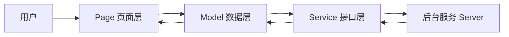
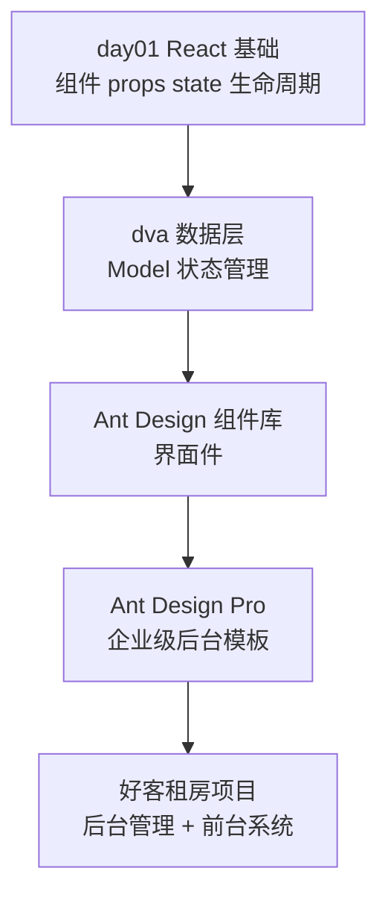

# day02 导览：Model 数据层、Ant Design 与 Ant Design Pro 各自解决什么问题

day01 结束时，组件、props、state、生命周期都通了，但有一个事实摆在眼前：所有数据还住在组件自己的 state 里。一个 List 页面无伤大雅，真到后台管理系统那种几十个页面共享数据、层层传值的场景，组件里塞数据立刻失控。day02 的三块内容就是冲着这个问题来的：给数据一个专门的家，给界面一套成品件，给工程一条起跑线。

## 先给结论

- day02 的主线是数据层：Model 负责数据的获取、更新与传输，承担前端与后台程序之间的所有数据交互。
- 前端代码同样分三层：Page 管页面渲染与用户交互，Model 管业务逻辑与状态的读写、变化、暂存，Service 专职与后台做 HTTP 读写，不对数据做任何加工。
- Ant Design 是开源的、基于 React 的 UI 组件库，解决「界面长什么样」，按钮、表格、表单、布局都是现成的。
- Ant Design Pro 是基于 React 与 Ant Design 完成的企业级后台管理系统模板，解决「工程怎么起步」，布局、菜单、路由开箱即用。
- 这一天仍然全部是前端内容，为后面租房项目的前台系统与后台管理做技术铺垫。

## 一、Model 层登场：数据不该住在组件里

课件把服务端与前端的分层摆在一张图里对照，Java 工程师看左边会非常亲切：

| 层 | 服务端 | 前端 |
|---|---|---|
| 第一层 | Controller：接收请求、转发、调用 Service | Page：页面渲染、接收用户输入，侧重展示与交互逻辑 |
| 第二层 | Service：编写业务逻辑 | Model：业务逻辑，为 Page 做数据状态的读写、变化与暂存 |
| 第三层 | Data Access：与数据库或第三方接口交互 | Service：与服务端对接，纯粹的 HTTP 数据读写 |

两条链路的形状完全同构，把「服务端」三个字换成「后台接口」，前端的 Service 层就是后端眼里的调用方：



去程是用户操作 Page，Page 找 Model 要数据，Model 让 Service 去后台读写；回程是后台把数据交给 Service，Service 原样给到 Model，Model 做完封装再交给 Page 渲染。最值得圈出来的是 Model 层那句话：**状态就是 Model 层的灵魂，state 一变，Page 的 render 重新执行，页面随之更新。** day01 讲组件状态时已经验证过这条规律，Model 层只是把 state 从组件里搬出来、集中托管，规律原封不动地继续生效。所以数据放哪，决定了工程能不能长大，这正是接下来 dva 要解决的问题。

## 二、Ant Design：界面从此不手搓

React 解决的是「界面怎么随数据变」，没解决「界面长什么样」。手写一个后台的中框线表格、分页器、表单校验，每一件都要耗掉半天，风格还未必统一。

Ant Design 给的答案是组件库：把中后台常用的界面元素做成一套带统一设计语言的成品组件，按需引入、开箱即用。用法预览（示例为按组件库官方写法补全，day02 后半程会正式展开）：

```js
import React from 'react';
import { Button } from 'antd'; // 从 antd 包按需导入按钮组件

class Demo extends React.Component {
  render() {
    return (
      <Button type="primary">主按钮</Button>
    );
  }
}

export default Demo;
```

导入组件、当标签写，和 React 自定义组件的手感完全一致，只是这次写的是别人造好的轮子。对租房项目来说，后台管理里大量重复的列表、表单、弹窗，几乎都能在组件库里找到对应件。

## 三、Ant Design Pro：企业级后台的起跑线

组件库解决单件，解决不了整套工程：一个企业级后台系统还需要整体布局、左侧菜单、路由、权限、请求封装这些骨架。Ant Design Pro 就是基于 React 与 Ant Design 完成的企业级后台管理系统模板，这些骨架全部提前搭好。

它的定位可以记成一句话：React 提供底层能力，Ant Design 提供界面件，Ant Design Pro 把两者组装成一个可以直接开工的后台工程。本项目要做的租房后台管理系统，就基于这套模板展开。

## 四、三块内容如何串成一条线



学习顺序就是依赖顺序：先有组件基础才谈得上状态集中管理，先有数据层与界面件才用得动后台模板。走完 day02，前端三件套就位，项目的后台系统与前台页面都有了落地的技术底座。

## 常见误区

- **把 Ant Design 当前端框架。** 它是组件库，只管界面层；数据流、状态管理要靠 dva 这类方案，两者是互补关系，不是替代关系。
- **把 Ant Design Pro 当成 Ant Design 的新版本。** Pro 是脚手架模板，内部复用 Ant Design 的组件，解决的是工程结构与骨架问题，版本号两者各自独立。
- **认为前端不需要分层。** 页面一多、数据一共享，没有 Model 层就会到处 setState、层层传 props；分层是把复杂度关进笼子，前端后端道理相通。
- **以为要吃透 dva 底层才能动手。** dva 官网自述易学易用、仅有六个 API，目标是把它熟练用起来，结合业务开发够用即可，不必先研究实现细节。

## 面试可能被问到的问题

1. 面试官追问：「前端 Page、Model、Service 三层各自负责什么？」
   答：Page 负责页面渲染与用户交互，侧重展示型和交互性逻辑；Model 负责业务逻辑，为 Page 做数据状态的读写、变化与暂存，state 变化会驱动 Page 重新 render；Service 专职与服务端做接口对接，采用 HTTP 协议做纯粹的数据读写，对数据不做任何加工。

2. 面试官追问：「为什么前端也需要类似后端的分层？」
   答：组件只适合承载展示与交互，把业务数据散落在各组件 state 里，共享数据只能层层传 props，复杂页面会迅速失控。分出 Model 层集中管理状态后，数据来源单一、组件之间解耦，与后端分层的动机完全一致：隔离变化、各司其职。

3. 面试官追问：「Ant Design 和 Ant Design Pro 是什么关系？」
   答：Ant Design 是基于 React 的 UI 组件库，提供按钮、表格、表单等成品组件；Ant Design Pro 是在其之上构建的企业级中后台管理系统模板，内置布局、菜单、路由、权限等工程骨架。前者是零件，后者是用零件拼好、可以直接开工的整车。

4. 面试官追问：「dva 在这套技术栈里扮演什么角色？」
   答：dva 是 Model 层的落地方案，基于 Redux、redux-saga 与 react-router 的轻量封装，用 namespace、state、reducers 等约定把数据层组织起来，再通过 connect 把数据与方法映射进组件的 props，让 Page 只管展示、数据统一托管。

## 配套资料

- 本教学日资料包暂无配套源码（`materials/code/03/day02-Ant Design以及Ant Design Pro入门/` 解压后为空），Ant Design 用法预览为按组件库官方写法补全的示例，Model 层与 dva 的完整代码从下一课起逐步展开
